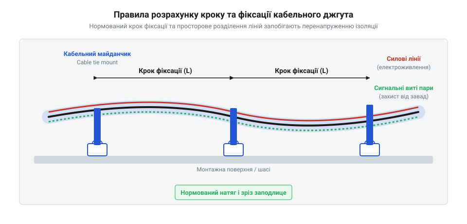
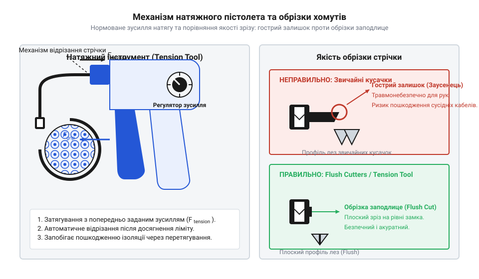

# Практичне формування та фіксація кабельного джгута з використанням натяжного пістолета

<preknowlist>
- [Органайзер кабелів (стрічка)](root:cat-hw-parts/cable-organizer) — способи групування провідників, захист від перетирання та принципи механічного впорядкування джгутів.
- [Монтажний провід 18 і 20 AWG](root:cat-hw-parts/hookup-wire) — параметри перерізу провідників, механічна міцність багатожильного проводу та гранично допустимі радіуси вигину ізоляції.
- [Родина силових роз'ємів XT (AMASS: XT30/60/90/120)](root:cat-hw-parts/xt-connectors) — специфіка прокладання високострумових силових ліній та вимоги до розвантаження натягу в місцях з'єднання.
- [Тросові та еластомірні віброізолятори: Wire Rope, силіконові демпфери та поглинання ударів](root:cat-hw-parts/wire-rope-isolators) — природа динамічних вібраційних навантажень, частоти резонансу джгутів та принципи поглинання механічних коливань.
</preknowlist>

## Механічні відмови та хаос нефіксованих джгутів

Вільне прокладання провідників у внутрішньому об'ємі приладу створює приховану загрозу, яка проявляється під час першої ж експлуатаційної вібрації. Коли кабельний пучок не має жорстко визначеної точки опори, динамічні коливання корпусних панелей передаються на окремі жили, перетворюючи їх на змінні маятники. В умовах постійного струшування нефіксований джгут починає систематично тертися об гострі металеві кромки шасі або отвори після лазерної різки. Оскільки стандартна полівінілхлоридна або силіконова ізоляція має обмежену стійкість до циклічного стирання, контактна поверхня поступово тоншає. Кінцевим результатом цього процесу стає оголення мідного провідника та коротке замикання силової лінії на заземлений корпус, що супроводжується виходом з ладу електроніки або термічним пошкодженням вузлів.

Окрім прямого механічного стирання об корпус, хаотичний джгут зазнає інтенсивного внутрішнього зносу. Під дією змінних прискорень провідники всередині пучка зміщуються один відносно одного, створюючи фретинг-зношування ізоляційного шару. У місцях підключення до плати або силових модулів, де встановлено [силові роз'єми XT](root:cat-hw-parts/xt-connectors), незакріплений джгут працює як важіль. Динамічний момент вигину припадає безпосередньо на місце обтискання клем або пайку контактів. Це призводить до швидкого механічного наклепу мідних жил, зростання внутрішнього опору та подальшого обриву провідника під навантаженням.

Електричний хаос нефіксованих ліній проявляється у вигляді паразитного електромагнітного зв'язку. Якщо високострумові проводи живлення силових приводів прокладаються в одному нестабільному пучку разом із чутливими лініями датчиків, виникає явище перехресних завад (англ. @@en|cross-talk@@, від англ. *cross* — перехресний та *talk* — розмова). Зміна струму в силовій лінії індукує імпульсні наводки на сусідніх сигнальних провідниках. Без просторової фіксації відстань між провідниками постійно змінюється, через що завади мають спорадичний характер і не піддаються програмній фільтрації. Для запобігання цьому потрібна чітка геометрія траси та захист пучка, де [органайзери кабелів](root:cat-hw-parts/cable-organizer) поєднуються з точковим бандлуванням нейлоновими хомутами (англ. @@en|cable tie@@, від англ. *cable* — кабель та *tie* — зв'язувати).

Кульмінацією кустарного монтажу є небезпека при обслуговуванні. Затягування хомутів вручну з подальшим обрізанням стрічки звичайними бокорізами залишає на головці хомута клиновидний виступ завдовжки 1–3 мм. Цей залишок стрічки має гострі як лезо кромки. Під час регламентних робіт або ремонту технік, просуваючи руку у вузький відсік, отримує глибокі порізи та травми. Для усунення цих ризиків застосовують спецкріплення (англ. @@en|cable tie mount@@, від англ. *mount* — опорне кріплення), нормоване затягування та зрізання лишку заподлице.

## Геометрія траси та розрахунок кріплення

Перехід від хаотичного прокладання до надійної кабельної мережі починається з проектування геометричної траєкторії джгута та розрахунку точок його опорного кріплення. Головне правило трасування — витримання мінімального радіуса вигину. Для гнучких пучків, зібраних із [монтажного проводу AWG 18](root:cat-hw-parts/hookup-wire), радіус вигину траси `R_min` повинен становити не менше п'яти зовнішніх діаметрів джгута `D_harness`:

```
R_min = 5 × D_harness
```

При прокладанні екранованих або високошвидкісних ліній коефіцієнт збільшують до `10`. Недотримання цієї норми призводить до деформації внутрішньої структури жил, зміни хвильового опору та локального перетискання ізоляції.

Другим геометричним фактором є просторове розділення силових і сигнальних контурів. Силові провідники високого струму та чутливі лінії, як-от [JST-GH сигнальний кабель](root:cat-hw-parts/jst-gh-cable) або [GPIO шлейф 40-pin](root:cat-hw-parts/gpio-ribbon-cable), прокладаються в паралельних трасах із мінімальним зазором не менше 20 мм. Якщо розв'язати траси на відстань неможливо, їх перетин виконують строго під кутом 90 градусів, що мінімізує взаємну індуктивність котушок завад.


*Геометрія трасування кабельного пучка: розміщення кріпильних майданчиків з нормованим кроком L_s та витриманим радіусом вигину.*

Для фіксації джгута до елементів корпусу використовуються спеціалізовані майданчики (англ. @@en|cable tie mount@@). Критерій вибору типу майданчика визначається масою джгута та рівнем вібраційних навантажень. Самоклеючі майданчики з акриловою стрічкою 3M VHB застосовують для легких пучків вагою до 150 г на метр за умов гладкої знежиреної поверхні. У високовібраційних середовищах, де діють [тросові віброізолятори](root:cat-hw-parts/wire-rope-isolators), використовуються виключно гвинтові майданчики. Вони фіксуються через гвинти M3 або M4 у [нарізні втулки](root:cat-hw-parts/threaded-inserts-and-heat-set) чи наскрізні отвори, забезпечуючи зсувну міцність понад 200 Н.

Крок встановлення майданчиків `L_s` розраховується на основі допустимого прогину джгута під дією власної ваги та динамічних прискорень. Для забезпечення жорсткості траси інтервал між точками фіксації обчислюють за формулою:

```
L_s = min(L_max, 10 × D_harness)
```

Де `L_max` становить 100 мм для пучків діаметром до 10 мм і 150 мм для пучків діаметром понад 10 мм. При цьому біля кожного роз'єму, наприклад при підключенні [сигнальних роз'ємів JST-SM](root:cat-hw-parts/jst-sm-connectors) або [наконечників Faston](root:cat-hw-parts/faston-crimp-terminals), обов'язково встановлюється точка розвантаження натягу на відстані 20–30 мм від задньої стінки корпусу роз'єму. Це виключає передачу механічного зусилля від ваги джгута на затиснуті контакти.

## Фізика натягу та налаштування пістолета

Правильне розміщення майданчиків трасування не гарантує довговічності, якщо затягування самих нейлонових хомутів виконується наосліп. Фізика бандлування базується на механічних властивостях поліаміду 66 (англ. @@en|polyamide 66@@), з якого виготовляють хомути. Цей матеріал має високу міцність на розрив, але схильний до пластичної деформації при перевищенні межі текучості. Коли затягування здійснюється ручними пасатижами або бокорізами, оператор не контролює прикладене зусилля `F_t`.

Ручне затягування неминуче призводить до однієї з двох крайностей. При недотягуванні зусилля стискання менше за 30 Н, через що джгут вільно ковзає всередині стрічки при вібраціях, зношуючи ізоляцію. При перетягуванні локальний тиск стрічки на зовнішні провідники перевищує допустиму межу міцності ізоляційного матеріалу. Це викликає незворотний зсув пластикату, зменшення міжпровідникової відстані та деформацію мідних жил, аж до їх часткового підрізання на гострих гранях кріпильного замка.

Для виключення людського фактора застосовують натяжний пістолет (англ. @@en|cable tie tension tool@@, від англ. *tension* — натяг та *tool* — інструмент). Принцип його роботи базується на використанні регульованого пружинного механізму скидання. Оператор охоплює стрічку хомута губками пістолета та стискає важіль. Інструмент витягує стрічку доти, доки опір джгута не досягне точно виставленого на шкалі значення `F_t`. У момент досягнення нормованого зусилля кулісний механізм автоматично вивільняє підпружинений ніж, який обрізає вільний кінець стрічки.


*Будова натяжного пістолета для кабельних хомутів та геометрія зрізу вільного кінця стрічки.*

Налаштування шкали зусилля натяжного пістолета виконується відповідно до ширини нейлонової стрічки `w_tie`:

```
F_t = k_w × w_tie
```

Де `k_w` — коефіцієнт жорсткості джгута. На практиці вибір позиції регулятора пістолета підпорядковується стандартним діапазонам:

* Для вузьких стрічок шириною 2.5 мм виставляють рівень `1–2` (зусилля `40–80 Н`). * Для стандартних стрічок шириною 3.6 мм виставляють рівень `2–3` (зусилля `80–130 Н`). * Для посилених стрічок шириною 4.8 мм виставляють рівень `3–5` (зусилля `130–220 Н`).

Завершальним етапом формування вузла є обрізка кінця стрічки заподлице. Якщо робота виконується без натяжного пістолета, категорично заборонено використовувати стандартні діагональні кусачки. Вони утворюють клиновидний фасковий зріз із виступаючим заусенцем. Обрізку слід виконувати спеціалізованими кусачками заподлице (англ. @@en|flush cutters@@, від англ. *flush* — заподлице та *cutter* — різак), плоска ріжуча кромка яких притискається впритул до замка хомута. Це забезпечує ідеально гладкий профіль зрізу `0 мм`, що гарантує безпеку обслуговування приладу та запобігає пошкодженню сусідніх провідників.

## Технологія бандлування та чиста обрізка

Геометрична впорядкованість провідників усередині кабельного джгута є визначальним фактором його механічної довговічності та електромагнітної сумісності. При хаотичному укладанні провідників під час затягування нейлонового хомута (англ. @@en|cable tie@@) виникають нерівномірні радіальні навантаження: окремі жили перетискаються, а ізоляція сусідніх провідників зазнає локальної деформації пластичного зсуву. Щоб запобігти цьому, формування джгута виконують за принципом симетричної циліндричної укладки. У центр пучка поміщають найбільш жорсткі провідники великого перерізу для [високострумових силових ліній](root:cat-hw-parts/xt-connectors), які формують несучий поздовжній сердечник. Навколо них концентричними шарами вкладають гнучкі сигнальні провідники [багатожильного монтажного проводу](root:cat-hw-parts/hookup-wire). Таке просторове групування мінімізує зовнішній діаметр пучка `D_b` та забезпечує рівномірний розподіл зусилля обтискання по всій окружності джгута.

Після формування правильної геометрії пучка та його попередньої фіксації за допомогою натяжного пістолета (англ. @@en|cable tie tension tool@@) виникає технологічна задача видалення вільного кінця нейлонової стрічки хомута. Автоматичний механізм відрізання натяжного інструмента зрізає стрічку за досягнення встановленого зусилля `F_t`, однак у багатьох моделей ніж розташований із невеликим відступом від фіксуючого замка. Це залишає прямий виступаючий залишок завдовжки від 0.5 до 2.0 мм із гострими краями. При експлуатації обжимального вузла в умовах вібрації або при ручному обслуговуванні обладнання такі виступи стають причиною травмування персоналу та абразивного пошкодження сусідніх ліній, як у [промислових кабельних шлейфах](root:cat-hw-parts/industrial-pendant-cable-harnessing-and-shielding).


*Геометрія зрізу стрічки нейлонового хомута: кусачки заподлице усувають гострий виступаючий хвостик.*

Для усунення травмонебезпечних заусенців та створення гладкого монтажного вузла застосовують відрізання заподлице із використанням [спеціалізованих кусачок заподлице](root:cat-hw-parts/cable-organizer) (англ. @@en|flush cutters@@). Конструктивна відмінність прецизійних кусачок від стандартних слюсарних бокорізів полягає в геометрії різальних кромок. Стандартні бокорізи мають симетричні двосторонні фаски, які під час зрізання витискають матеріал стрічки в обидва боки, формуючи V-подібний заусенчик із клиноподібною вершиною. Прецизійні кусачки заподлице мають абсолютно плоску зовнішню поверхню губок без фаски.

Техніка виконання чистого зрізу вимагає прикладання плоскої сторони губок кусачок безпосередньо до корпусу замка нейлонового хомута під кутом 90 градусів до напрямку стрічки. Під час зрізання не допускається потягування або викручування вільного кінця, оскільки це призводить до витягування нейлону із замкового механізму та утворення мікротріщин у місці фіксації зубчастого хвостовика. Плоский зріз, виконаний урівень із замком, утворює гладку поверхню без виступаючих країв. У трасах із високими вимогами до зносостійкості ділянки бандлування додатково захищають, застосовуючи плетені сітчасті рукави (англ. @@en|braided sleeving@@) або спіральний [органайзер кабелів](root:cat-hw-parts/cable-organizer).

## Вібровипробування та контроль якості траси

Сформований та зафіксований кабельний джгут під час експлуатації в автомобільній, авіаційній або промисловій техніці піддається тривалим знакозмінним вібраційним і ударним навантаженням. Знакозмінне прискорення створює в провідниках і кріпильних елементах динамічні напруження. Якщо крок фіксації траси `L_s` розраховано некоректно або зусилля затягування хомута є недостатнім, власна резонансна частота ділянки джгута `f_0` збігається з робочою частотою вібрації обладнання `f_v`. Виникає механічний резонанс, при якому амплітуда коливань пучка зростає в кілька разів, викликаючи відносний зсув хомутів уздовж траси, фретинг-зношування ізоляції та втому мідних жил біля контактних з'єднань.

Для оцінки стійкості монтажного вузла до динамічних чинників проводять вібровипробування на випробувальних стендах (вібростолах) за нормативними профілями синусоїдальної та широкосмугової випадкової вібрації. Для розв'язки кабельної траси від високочастотних вібрацій несучої конструкції в місцях кріплення кріпильних майданчиків (англ. @@en|cable tie mount@@) та кронштейнів застосовують кріплення з використанням [еластомірних віброізоляторів](root:cat-hw-parts/wire-rope-isolators), які поглинають енергію коливань та зміщують резонансну частоту вузла в область безпечних низьких частот. Фіксація майданчиків на композитних або металевих панелях здійснюється за допомогою [герметичних різьбових футорок](root:cat-hw-parts/threaded-inserts-and-heat-set) або болтових з'єднань відповідних класів міцності.


*Схема динамічних випробувань джгута: застосування віброізоляторів запобігає резонансному руйнуванню траси.*

Контроль якості кабельної траси після проведення вібровипробувань включає три послідовні етапи: візуальний інспекційний контроль, механічну перевірку та електричну діагностику. Під час візуального контролю перевіряють відсутність поздовжнього зсуву хомутів, цілісність замків, відсутність надрізів ізоляції та наявність чистої обрізки заподлице. Механічний контроль полягає в перевірці зусилля утримання джгута на кріпильних майданчиках та відсутності люфтів у місцях з'єднання [компактних сигнальних з'єднувачів](root:cat-hw-parts/jst-sm-connectors) і роз'ємів [міжплатових сигнальних кабелів](root:cat-hw-parts/jst-gh-cable).

Електрична діагностика є фінальним підтвердженням відсутності прихованих дефектів. Вона передбачає вимірювання опору ізоляції між ізольованими жилами та корпусом за допомогою мегаомметра, а також вимірювання падіння напруги `ΔU` на силових лініях при проходженні номінального струму `I_nom`. Величина падіння напруги визначається за формулою:

```
ΔU = I_nom × (R_wire + R_con)
```

де `I_nom` — номінальний струм лінії, `R_wire` — опір провідника, `R_con` — опір контактного з'єднання роз'єму. Якщо після вібровипробувань опір `R_con` зростає більше ніж на 5–10%, це свідчить про наявність мікротріщин у паяному або обтиснутому контакті чи початковий фретинг-знос. Лише за умови збереження електричних і механічних параметрів у межах допусків кабельна траса вважається придатною до експлуатації.