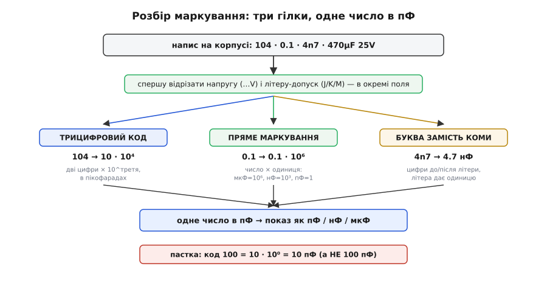

# ⚙️ Код у число за пів секунди

> ⚙️ Алгоритмічна вставка: маленький розкодовувач маркування конденсатора. Задача проста на словах — узяти те, що надруковано на корпусі (`104`, `223`, `0.1`, `470µF`), і одразу отримати ємність у зручній одиниці, — але саме тут новачок стабільно спотикається: плутає нанофаради з мікрофарадами в тисячу разів, читає робочу напругу як ємність, а код `100` приймає за «сто чогось», хоча це аж ніяк не сто. Напишемо коротку функцію, що робить це надійно, і по дорозі розберемо кожну пастку так, щоб більше на неї не наступати. Механіку самого маркування — усі коди, літери, рідші позначки — тримає [тема про маркування конденсаторів](root:hw-components/capacitor-code-and-package-reading); тут — лише як перетворити напис у число в коді й де саме код помиляється, коли його пише людина «на око».

## Задача

Задача звучить дитячо: дивишся на деталь, набираєш те, що бачиш, отримуєш ємність. Насправді за цим стоять три різні мови запису на одному корпусі, і плутати їх — означає промахнутися не на відсотки, а в тисячу разів.

По-перше, на дрібній кераміці ємність кодують **трьома цифрами** (`104`, `223`, `474`) — точнісінько як кольорові кільця на резисторі, тільки цифрами: дві значущі цифри плюс скільки нулів дописати, і все це в **пікофарадах**. По-друге, на більших деталях (плівка, електроліт) те саме число часто пишуть **прямо**: `0.1`, `470µF`, `2n2`. По-третє, поруч із ємністю на корпусі юрмляться **інші** числа — робоча напруга (`50V`, `25`, `63`), температурний клас (`105°C`), а іноді ще й дата виготовлення. Людське око легко хапає не те число: бачить велике `25` поряд із дрібним `104` і вирішує, що ємність — двадцять п'ять.

Мета розкодовувача — зняти цю плутанину раз і назавжди. На вхід — рядок, який реально надрукований на корпусі; на вихід — **одне однозначне число ємності** (візьмемо за спільну одиницю пікофаради, бо в них будь-який номінал виходить цілим і без десяткових хвостів) плюс, за наявності, допуск і робоча напруга **окремими полями**. Далі це число можна показати людині в найзручнішій одиниці — пФ, нФ чи мкФ, — але внутрішня валюта одна, і саме тому нічого не переплутається.

Це не робота із залізом: ні регістрів, ні шин, ні тактів — лише розбір короткого рядка й арифметика. Такий код природно лягає на мови, де рядки й числа під рукою, тож напишемо його **двома** мовами відразу — Python (як його набрав би інженер у REPL, щоб швидко перевірити купку деталей) і TypeScript (як це жило б у вебкалькуляторі маркування чи в застосунку-помічнику). Обидві версії роблять те саме й ідіоматично для свого середовища.

## Ідея

Уся хитрість — у трьох цифрах коду, тож почнімо з них, а решту (пряме маркування, літеру-допуск) підвісимо як окремі гілки того самого розбору.

Трицифровий код читається так: **перші дві цифри — це значення, третя — показник десятки (скільки нулів дописати), а результат — у пікофарадах**.

```
код 104:
  10        ← перші дві цифри = мантиса
  × 10⁴     ← третя цифра = показник (тут 4)
  = 100000 пФ
```

Тобто формула буквально одна:

```
ємність(пФ) = (перші дві цифри) × 10^(третя цифра)
```

Ось і весь код. `104` → 10 × 10⁴ = 100000 пФ. `223` → 22 × 10³ = 22000 пФ. `474` → 47 × 10⁴ = 470000 пФ. Ніякої магії; магія починається на дрібницях, і саме через них наївний «зчитай третю цифру як степінь» іноді підводить — до них дійдемо в пастках.

Коли число на вході містить **кому чи крапку** (`0.1`) або **суфікс одиниці** (`470µF`, `4n7`, `100n`), це вже не код, а **пряме маркування** — інша гілка. Тут ми не рахуємо степінь, а просто читаємо число як є й множимо на коефіцієнт одиниці, щоб звести до тих самих пікофарад: мікрофарад = 10⁶ пФ, нанофарад = 10³ пФ, пікофарад = 1. Тому `0.1` (мкФ за замовчуванням для великих деталей) = 0.1 × 10⁶ = 100000 пФ — те саме число, що дав код `104`. Це не збіг: `104` і `0.1 мкФ` — **одна й та сама деталь**, просто записана двома мовами. Хороший розкодовувач мусить із обох входів давати однакове число, інакше він марний.

Останній шматок — **літера-допуск** (`J`, `K`, `M`), що часто причеплена до коду: `104J`, `223K`. Вона не стосується ємності взагалі — це окреме поле «наскільки реальне значення може відхилятися від номіналу»: `J` = ±5 %, `K` = ±10 %, `M` = ±20 % (рідше `F` = ±1 %, `G` = ±2 %, `Z` = +80/−20 %). Розкодовувач має **відрізати** цю літеру, розпізнати її окремо й **не** дати їй потрапити в число ємності. Плутати літеру з цифрою ніяк — літери й цифри різні, — але забути її обробити легко, і тоді `104J` або впаде на перетворенні, або відкине допуск мовчки. Ми обробимо явно.


*Той самий напис із корпусу може бути кодом (`104`), прямим маркуванням (`0.1`) чи буквою-замість-коми (`4n7`) — але спершу з нього знімають напругу й допуск в окремі поля, а тоді за наявністю крапки чи букви-одиниці вибирають гілку. Усі три гілки зводять число до пікофарад, і лише в останню мить його показують у зручній одиниці. Внизу — пастка коду `100`: це 10 пФ, а не 100.*

> 🔧 **Навіщо це.** Здавалося б, навіщо власна функція, коли є онлайн-калькулятори маркування? Бо реальна цінність не в тому, щоб порахувати `104` (це й у голові за секунду), а в тому, щоб **зловити свою помилку**. Коли перебираєш коробку з тридцяти номіналів і закладаєш їх у специфікацію плати, одна сплутана нано-/мікрофарада тихо проповзе в готовий пристрій — і ти шукатимеш плаваючий баг там, де його немає. Функція, що з обох записів (`104` і `0.1`) дає **той самий** результат і окремо показує напругу з допуском, — це страховка від власного ока, а не заміна калькулятора.

## Робочий код

Спершу — ядро: перетворити три цифри коду в пікофаради, а тоді показати число людині в найприроднішій одиниці. «Найприродніша» — та, у якій число не має ні надто довгого хвоста нулів, ні дрібного дробу: пФ до тисячі, нФ від тисячі до мільйона, мкФ від мільйона. Обидві версії роблять однаковий вибір.

:::tabs
:::code proj-decode-code/py/decode.py
:::code proj-decode-code/ts/decode.ts
:::

Обидві версії на однаковому наборі входів друкують те саме:

```
       104  →      100 нФ   (100000 пФ)
       223  →       22 нФ   (22000 пФ)
       474  →      470 нФ   (470000 пФ)
       0.1  →      100 нФ   (100000 пФ)
 470uF 25V  →     470 мкФ   (470000000 пФ, 25 В)
       4n7  →      4.7 нФ   (4700 пФ)
      104J  →      100 нФ   (100000 пФ, ±5%)
       100  →       10 пФ   (10 пФ)
        47  →       47 пФ   (47 пФ)
```

Зверніть увагу на два рядки, що виглядають однаково, але прийшли різними шляхами: `104` (через гілку коду) і `0.1` (через гілку прямого маркування) дають **той самий** результат — 100 нФ. Це і є перевірка, що розкодовувач цілісний: одну деталь, записану двома способами, він читає однаково. І окремо гляньте на `100` → **10 пФ**, а не «сто»: це найпідступніша пастка коду, і про неї — нижче докладно.

### Чому окремі гілки, а не один регулярний вираз

Спокуса написати «один розумний regex, що ловить усе» велика, але хибна. Три мови запису мають **несумісні** правила: у коді `104` третій знак — це степінь десятки; у прямому `0.1` крапка — десяткова; у формі `4n7` буква стоїть **замість** крапки й водночас задає одиницю. Один вираз, що намагається вгадати, яка з трьох ситуацій перед ним, стає нечитабельним і крихким — додаси четверту форму, і він розсиплеться.

Тому логіка спершу **відрізає** те, що точно не ємність (напругу, потім літеру-допуск — з кінця, бо вони там і живуть), а тоді за наявністю крапки чи букви-одиниці вирішує: пряме маркування це чи код. Кожна гілка проста й перевіряється окремо. Це той самий принцип, що в будь-якому розборі формату: спершу зніми обгортку, тоді класифікуй ядро, і не змішуй кроки в одну магічну умову.

## Складність і пастки

Обчислень тут копійки — розбір короткого рядка й одне множення, — тож «складність» цього коду вимірюється не тактами, а **кількістю способів, якими людина (і код) читає напис неправильно**. Пастки нижче — не гіпотетичні: кожна регулярно з'їдає вечір у новачка, а деякі й у досвідченого.

- **`100` — це 10 пФ, а не 100.** Найковарніша пастка всього маркування. Код `100` читається за тим самим правилом «дві цифри × 10^третя»: `10 × 10⁰ = 10 пФ`. Око бачить «сто» й певне, що це 100 пФ, — і промахується вдесятеро. Так само `101` — це не «сто один», а `10 × 10¹ = 100 пФ`; `220` — не «двісті двадцять», а `22 × 10⁰ = 22 пФ`. Правило простого запам'ятовування: **у трицифровому коді останній знак — завжди степінь, навіть коли він нуль**. Якщо ж на корпусі справді хотіли написати сто пікофарад, там стоятиме саме `101` (10 і один нуль), а не `100`. Наш розкодовувач тут не помиляється, бо гілка коду завжди тлумачить третій знак як показник; помиляється саме людина, і код-функція для того й потрібна, щоб її підстрахувати.

- **Сплутати нФ з мкФ — промах у тисячу разів.** Між нанофарадою і мікрофарадою рівно 1000: `104` — це 100 **нано**фарад (0.1 мкФ), а не 100 мкФ. Прочитати «сто мікрофарад» замість «сто нанофарад» — означає взяти деталь у тисячу разів місткішу, і фільтр, що мав зрізати кілогерци, зріже герци, а розв'язка перетвориться на повільну банку. Саме тому розкодовувач тримає внутрішню валюту в **пікофарадах**: у них будь-який номінал — ціле число без десяткового хвоста, і немає спокуси «на око» переставити кому на три позиції. Одиницю для показу вибирають в останню мить, з єдиного точного числа.

- **Робоча напруга — не ємність.** На корпусі поряд із ємністю майже завжди стоїть друге число — робоча напруга (`50V`, `25`, `63V`), стеля, яку деталь витримує. Око хапає більше й помітніше число й вирішує, що це номінал: побачив `470µF 25V` і записав «25». Тому розкодовувач **першою дією відрізає** все, що схоже на напругу (число з `V`), кладе його в окреме поле й далі до нього не повертається. У живому маркуванні напругу зазвичай видає літера `V`; якщо ж на дрібній кераміці стоїть голе друге число без `V` (буває рідко), розрізнити його від ємності може лише контекст — тут функція чесно розбере лише те, що однозначне, а решту лишить людині.

- **Літера-допуск — окремо, і не сплутати з одиницею.** `104J` — це `104` плюс допуск ±5 %, а не якийсь інший код. Тонкість у розборі: літеру-допуск знімаємо **з кінця**, але спершу переконуємося, що це не буква-одиниця. `100N` закінчується на `N` — та це «100 нанофарад», а не «код 100 з допуском N» (допуску `N` взагалі не існує). Тому в коді перед тим, як відрізати останню літеру як допуск, стоїть перевірка: якщо перед нею вже йде `U`/`N`/`P` (тобто це форма одиниці), літеру не чіпаємо. Дрібниця, а без неї `100N` розібралося б неправильно.

- **`4n7` і `2u2`: буква замість коми.** Європейський стиль запису ставить літеру-одиницю **на місце десяткової крапки**: `4n7` = 4.7 нФ, `2u2` = 2.2 мкФ, `n47` = 0.47 нФ. Логіка тут не «код», а «крапка, позначена буквою», тож у розкодовувачі це окрема під-гілка прямого маркування: беремо цифри до літери як цілу частину, після — як дробову, а сама літера дає одиницю. Плутати з кодом не можна: у `4n7` середній знак — буква, а не цифра, і саме за цим гілки розходяться.

- **Кома проти крапки.** У частині написів (і в багатьох європейських даташитах) десятковий роздільник — **кома**: `0,1` замість `0.1`. Функція нормалізує кому в крапку першим кроком гілки прямого маркування — інакше `parseFloat`/`float()` спіткнеться. Дрібниця, але саме такі дрібниці валять розбір на реальних, а не тепличних, входах.

- **Розкодовувач не бачить діелектрика.** Код дає ємність — і мовчить про те, що ця ємність **попливе**. Дешева високоємна кераміка (класу Y5V, Z5U) під робочою постійною напругою легко втрачає половину заявленого номіналу, а з температурою — ще більше. `104` на папері й `104` під п'ятьма вольтами в теплому корпусі — різні ємності, і жодне маркування коду цього не покаже; клас діелектрика пишуть окремо, дрібним, а часто й зовсім не пишуть. Тож розкодоване число — це **номінал за паспортом**, а не те, що деталь віддасть у схемі; коли важить точність, дивляться ще й на клас, а не лише на три цифри.

Підсумок простий: сам розрахунок коду — множення на степінь десятки, писати нема про що. Уся вага цієї маленької функції — в тому, що вона **не дає власному оку сплутати** нано з мікро, напругу з ємністю, а `100` зі «сто», і що з двох різних записів однієї деталі (`104` і `0.1`) видає одне число. Повний словник усіх кодів, літер і рідших позначок, з якого ці правила виросли, лежить у [темі про маркування конденсаторів](root:hw-components/capacitor-code-and-package-reading).
