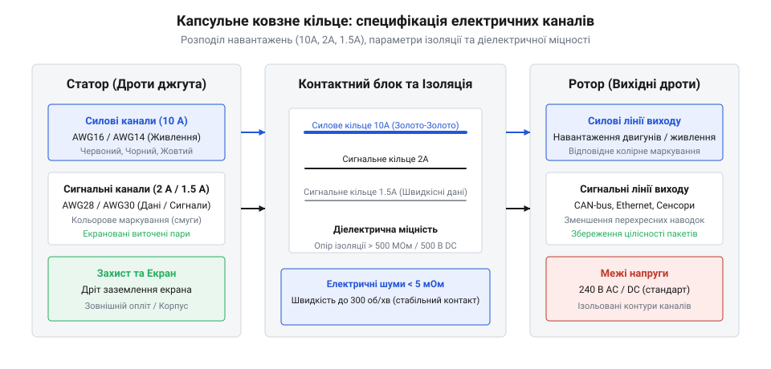
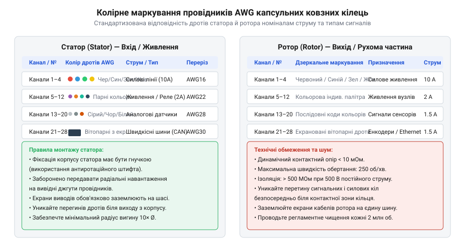

# Залізний інтерфейс капсульного ковзного кільця: кольорове маркування, розводка каналів і електричні межі

<preknowlist>
- [Монтажний провід 18 і 20 AWG](root:cat-hw-parts/hookup-wire) — характеристики геометричного калібру AWG, електричного опору та допустимого струму провідників
- [Розʼєми JST-SM і JST-SYP (сигнальні)](root:cat-hw-parts/jst-sm-connectors) — способи кримпування та підключення малопотужних сигнальних ліній до виводів капсульного кільця
- [Родина силових роз'ємів XT (AMASS: XT30/60/90/120)](root:cat-hw-parts/xt-connectors) — правила паяння та комутації силових каналів високого струму для з'єднання зі статорними джгутами
- [Кабельні шлейфи та заземлення пультів оператора](root:cat-hw-parts/industrial-pendant-cable-harnessing-and-shielding) — принципи екранування сигнальних проводів та правила запобігання земляним петлям у рухомих кабельних трасах
</preknowlist>

## Проблематика комутації у поворотних вузлах

Вхідна ситуація: розробка поворотного вузла робототехнічної системи, сервоприводного підвісу камери чи системи кругового огляду вимагає безперервної передачі силової енергії та сигналів керування з нерухомої основи на модуль, що безперервно обертається. У разі прямого прокладання стандартного кабельного джгута будь-яке обертання призводить до накопичувального кручення провідників навколо осі. Вже після кількох десятків обертів внутрішній механічний натяг руйнує зовнішню ізоляцію, перетискає мідні жили та викликає втомні злами проводів. Спроби обмежити кут повороту програмними концевиками звужують функціональність пристрою, а застосування відкритих гнучких петель створює ризик зачеплення та механічного клинування.

Виходом із цієї інженерної ситуації є ротаційний електричний з'єднувач — капсульне ковзне кільце (від англ. capsule — капсула, slip ring — ковзне кільце, @@en|capsule slip ring@@). Конструктивно такий пристрій складається з нерухомого корпусу (від англ. stator — статор, @@en|stator@@) та центрального вала, що вільно обертається (від англ. rotor — ротор, @@en|rotor@@). Усередині герметичної капсули розташовано серію концентричних струмопровідних кілець із золотим або срібним покриттям, по поверхні яких ковзають багатоточкові пружинні щітки. Це забезпечує постійний гальванічний контакт між вхідними та вихідними провідниками під час нескінченного обертання на 360 градусів у обидва боки.

Для компактних робототехнічних систем та приладобудування стандартними є серії капсульних кілець @@en|SRC@@ (від англ. slip ring capsule, @@en|SRC@@) та @@en|LPC@@ (від англ. capsule slip ring, @@en|LPC@@). Моделі серії @@en|SRC@@ оптимізовані під мінімальний зовнішній діаметр (від 12,5 мм до 22 мм) і невелику кількість каналів, тоді як серія @@en|LPC@@ розрахована на високу щільність комутації (до 36–56 каналів) та комбіноване навантаження. Однак компактні розміри капсули створюють високу щільність розташування струмознімальних кілець. Без чіткого розуміння електричних меж каналів та суворого дотримання розводки провідників виникає загроза пробою ізоляції, перегріву контакту та спотворення передачі даних.

При виборі джгутів для комутації непорушних зовнішніх кіл зі статорними та роторними виводами часто використовуються стандартні типи [монтажних провідників AWG](root:cat-hw-parts/hookup-wire), які вимагають правильної відповідності перерізу та кольорового маркування внутрішнім каналам ковзного з'єднувача. Окрім того, важливо враховувати загальну структуру [екранування сигнальних джгутів](root:cat-hw-parts/industrial-pendant-cable-harnessing-and-shielding) для запобігання впливу внутрішніх перехідних процесів у поворотній системі.

## Електричні межі та параметри каналів

Усвідомлення необхідності ротаційного контакту вимагає чіткого аналізу допустимих електричних режимів кожного струмового каналу всередині капсули @@en|capsule slip ring@@. Струмознімальні кільця серій @@en|SRC@@ та @@en|LPC@@ поділяються на дві основні категорії: силові канали для живлення приводів та сигнальні канали для передачі даних або аналогових вимірювань. Стандартні номінали струму для сигнальних кілець становлять 1,5 А або 2 А на канал, тоді як силові кільця розраховані на струмове навантаження 5 А або 10 А.

Гранична робоча напруга для більшості капсульних ковзних кілець становить 240 V змінного (AC) або постійного (DC) струму для силових ліній та до 48 V / 110 V для сигнальних кіл. Перевищення напруги небезпечне виникненням дугового розряду між сусідніми кільцями. Критично важливим параметром є опір ізоляції (від англ. insulation resistance — опір ізоляції, @@en|insulation resistance@@), який між сусідніми каналами та відносно металевого корпусу має становити не менше 500 MΩ при вимірювальній напрузі 500 V DC. Електрична міцність діелектрика (від англ. dielectric strength — діелектрична міцність, @@en|dielectric strength@@) визначає здатність ізолювальних перегородок витримувати короткочасні сплески напруги та випробовується випробувальною напругою 500 V AC при частоті 50 Hz протягом 1 хвилини (для силових ліній — до 1000 V AC).

Якщо вимога системи перевищує струмовий номінал одного каналу (наприклад, необхідно передати 5 А при наявності лише 2 А каналів), застосовують паралельне об'єднання кількох сигнальних кілець. Проте через технологічний допуск контактного опору струм між паралельними кільцями розподіляється нерівномірно. Для розрахунку сумарного допустимого струму паралельної групи застосовують коефіцієнт зниження навантаження (від англ. derating — зниження номіналу, @@en|derating@@):

```
I_total = n × I_channel × k_derating
= 3 × 2 A × 0.85                      [застосування коефіцієнта зниження навантаження]
= 5.1 A                               [максимальний безпечний струм паралельних каналів]
```

Тут `n` — кількість об'єднаних каналів, `I_channel` — номінальний струм одного каналу (2 А), а `k_derating` — коефіцієнт нерівномірності (типово 0,8–0,85).

Для підключення силових груп статора та ротора до зовнішніх планарних модулів використовуються надійні роз'єми високого струму, такі як лінії [роз'ємів серії XT](root:cat-hw-parts/xt-connectors) або обтискні з'єднання за допомогою [наконечників типу Faston](root:cat-hw-parts/faston-crimp-terminals).


*Підпис: Схема розподілу каналів живлення та сигналів у капсульному ковзному кільці із зазначенням допустимих струмів і параметрів ізоляції.*

## Кольорове маркування дротів статора ротора

Висока щільність виводів у капсульному ковзному кільці (@@en|capsule slip ring@@) створює ризик помилкової комутації при складанні джгутів. Виводи ротора (@@en|rotor@@) та статора (@@en|stator@@) виготовляються з гнучкого монтажного проводу у фторопластовій (PTFE/FEP) ізоляції калібру @@en|AWG@@ (від англ. American Wire Gauge — американський калібр дротів, @@en|AWG@@). Для сигнальних каналів на 1,5 А та 2 А застосовують дроти калібру 26 AWG або 28 AWG, а для силових ліній на 10 А — 16 AWG або 18 AWG.

Щоб безпомилково ідентифікувати номери каналів від 1 до N, у серіях @@en|SRC@@ та @@en|LPC@@ використовують міжнародну колірну специфікацію провідників, що базується на 12-кольоровому циклі. Послідовність забарвлення дротів є суворо однаковою як для статорної, так і для роторної групи, що дає змогу однозначно зіставити вхідний і вихідний кінці кожного каналу:

1. Чорний (канал 1) — загальний провід живлення або земля (GND)
2. Коричневий (канал 2) — лінія живлення VCC або силовий +
3. Червоний (канал 3) — лінія живлення VCC
4. Помаранчевий (канал 4) — сигнальний канал
5. Жовтий (канал 5) — сигнальний канал
6. Зелений (канал 6) — сигнальний канал
7. Синій (канал 7) — сигнальний канал
8. Фіолетовий (канал 8) — сигнальний канал
9. Сірий (канал 9) — сигнальний канал
10. Білий (канал 10) — сигнальний канал
11. Рожевий (канал 11) — сигнальний канал
12. Блакитний (канал 12) — сигнальний канал

У багатоканальних моделях серії @@en|LPC@@ (на 18, 24 чи 36 каналів) колірна послідовність повторюється з додаванням кольорової поздовжньої смуги (маркерного трейсера). Наприклад, канал 13 маркується як біло-чорний, канал 14 — біло-коричневий, канал 15 — біло-червоний і далі за стандартним списком.


*Підпис: Таблиця-діаграма відповідності кольорів ізоляції дротів AWG номеру каналу, допустимому струму та призначенню ліній.*

Для зручності монтажу на платах або в корпусах виводи дротів статора й ротора обтискаються та підключаються через рознімні блоки. Малопотужні сигнальні лінії зручно комутувати за допомогою [сигнальних з'єднувачів JST](root:cat-hw-parts/jst-sm-connectors) або паяти на планарні [штирьові з'єднувачі male](root:cat-hw-parts/pin-headers). При прототипуванні відлагоджувальних плат застосовують [з'єднувальні дроти Dupont](root:cat-hw-parts/dupont-wires). Для впорядкування вихідного джгута дрібних проводів AWG використовують ув'язку за допомогою [пластикових кабельних хомутів](root:cat-hw-parts/cable-ties) або затягують джгут у захисні спіральні [кабельні органайзери-стрічки](root:cat-hw-parts/cable-organizer).

## Електричний шум та швидкість обертання

Під час механічного обертання ротора (@@en|rotor@@) відносно статора (@@en|stator@@) у ковзному контакті виникає динамічний електричний шум (від англ. electrical noise — електричний шум, @@en|electrical noise@@). Фізичною причиною цього явища є мікроскопічні коливання контактного опору між золотомісткими пружинними щітками та V-подібними канавками струмознімальних кілець. Мікрошорсткість поверхонь, технологічний ексцентриситет вала та динамічна вібрація спричиняють мікроскопічні зміни площі механічного притиску контактної пари.

У якісному капсульному ковзному кільці @@en|capsule slip ring@@ серій @@en|SRC@@ та @@en|LPC@@ рівень електричного шуму не перевищує 10 mΩ при роботі на номінальних швидкостях обертання (до 250–300 об/хв). Однак при перевищенні допустимої частоти обертання (понад 300 об/хв) відцентрові сили почнуть відривати щітки від поверхні кілець. Це призводить до виникнення мікровідскоків контактів, сплесків динамічного опору до кількох Ом або сотень Ом та прискореного фретинг-зносу контактного покриття.

Вплив електричного шуму на різні типи кіл відрізняється:
- Силові лінії постійного струму: шум 10 mΩ викликає незначну пульсацію напруги мілівольтового рівня, що легко згладжується фільтрувальними конденсаторами. - Низькошвидкісні цифрові шини (UART, I2C, RS-485): сплески опору під час вібрації можуть призвести до спотворення логічних рівнів, втрати стоп-бітів або помилок квитування (ACK) на шині I2C. - Аналогові вимірювальні канали (тензодатчики, термопари): флуктуації контактного опору додають паразитної амплітудної модуляції до корисного сигналу, створюючи вимірювальне зміщення.

Для зменшення динамічних коливань опору в конструкції капсульних кілець використовують багатоточкові щітки (по 3–4 контакти на один канал). Під час монтажу поворотного вузла важливо ізолювати капсулу від жорстких механічних ударів, застосовуючи елементи [захисту від вібрацій](root:cat-hw-parts/wire-rope-isolators). Окрім того, для оцінки поведінки точкового механічного контакту при вібраціях можна порівнювати ротаційні з'єднувачі з принципами [використання пружинних контактів](root:cat-hw-parts/pogo-pins), де зусилля притиску є вирішальним фактором стабільності опору.

## Екранування та заземлення сигнальних пар

Компактні розміри капсули @@en|capsule slip ring@@ призводять до того, що паралельні провідники статора й ротора проходять на відстані кількох десятих часток міліметра один від одного. Під час передачі високочастотних цифрових сигналів або імпульсного живлення силових двигунів виникає паразитний ємнісний та індуктивний зв'язок між сусідніми каналами — перехресні наводки (від англ. crosstalk — перехресні завади, @@en|crosstalk@@).

Для захисту чутливих диференційних ліній (CAN-шина, RS-485, USB, Ethernet) від завад застосовують кручені пари (від англ. twisted pair — кручена пара, @@en|twisted pair@@). Провідники диференційної пари комутують через два суміжні канали ковзного кільця, а зовнішній захисний екран кабелю підключають до окремого виділеного заземлювального каналу капсули.

Критично важливим правилом апаратної інтеграції є одноточкове заземлення екрана (від англ. single-point grounding). Захисний екран сигнальної крученої пари повинен підключатися до спільної точки заземлення (GND/PE) лише з одного боку — як правило, на нерухомому статорі (@@en|stator@@). 

Якщо підключити екран до землі одночасно і на статорі, і на роторі (@@en|rotor@@), через екранний провідник та земляний канал кільця замкнеться контур. Через неминучу різницю потенціалів та динамічні флуктуації контактного опору земляного кільця в екрані виникнуть зрівняльні струми. Цей замкнений земляний контур (від англ. ground loop — земляна петля, @@en|ground loop@@) перетвориться на антену, яка наводитиме важкі низькочастотні та високочастотні завади безпосередньо на сигнальні жили.

Для швидкісних та чутливих інтерфейсів вихідні джгути капсульного кільця підключають до відповідних стандартних кабелів:
- Для мережевих ліній застосовують [підключення ліній Ethernet](root:cat-hw-parts/ethernet-cable). - Для послідовних шин даних вивільняють виводи під [інтерфейсних кабелів USB](root:cat-hw-parts/usb-cables). - Для підключення політних контролерів або автопілотів застосовують комутацію через джгути [з'єднувачів JST-GH Pixhawk](root:cat-hw-parts/jst-gh-cable). - При передачі множинних паралельних керуючих сигналів роторний джгут з'єднують із виводами [багатожильних шлейфів GPIO](root:cat-hw-parts/gpio-ribbon-cable).

Дотримання правил одноточкового заземлення екранів та правильного колірного розподілу каналів гарантує надійну, беззавадну роботу як силових приводів, так і високошвидкісних цифрових шин у будь-яких поворотних механізмах.