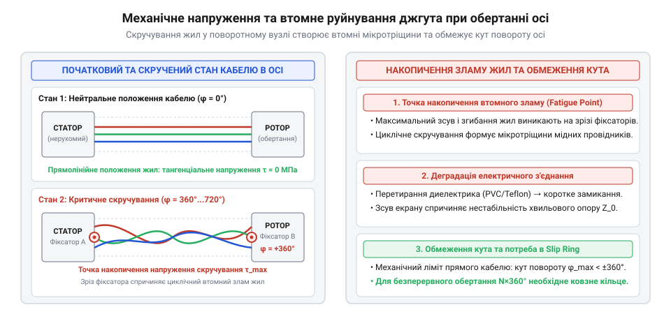
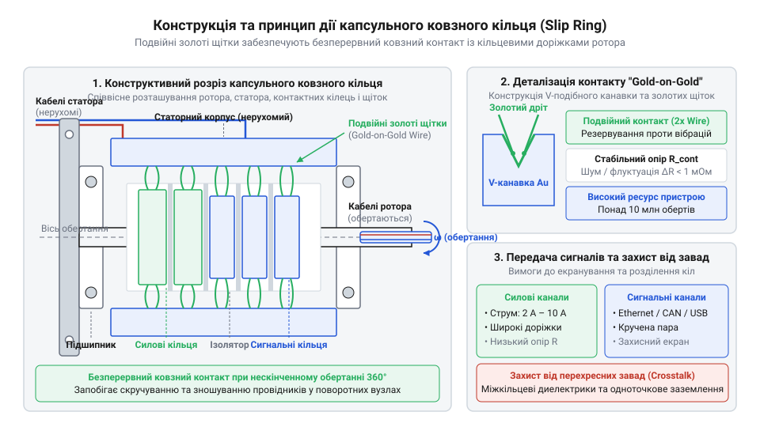
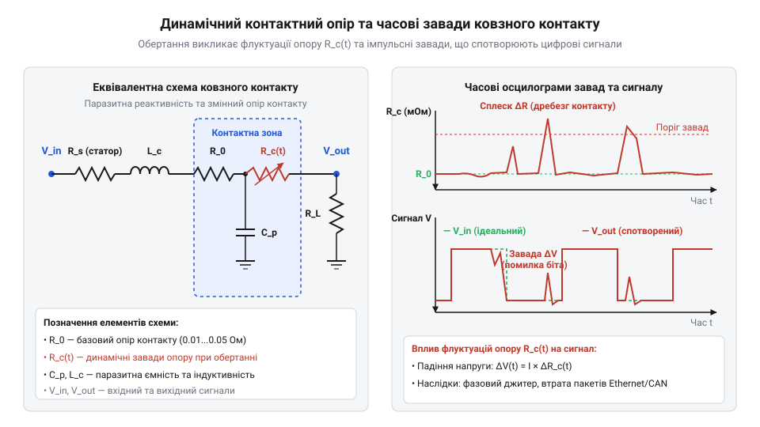
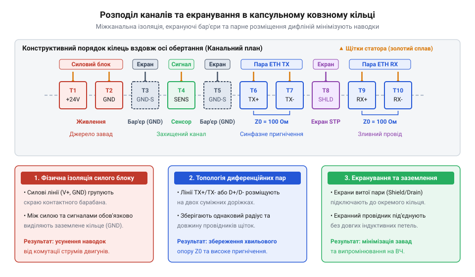
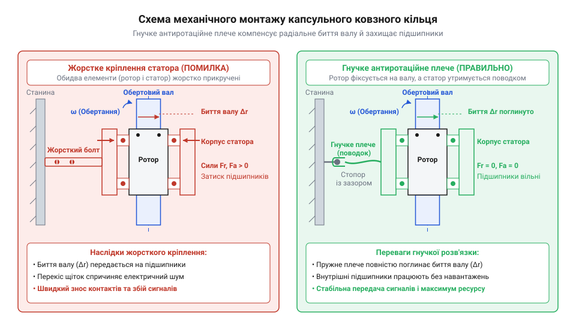

# Капсульне ковзне кільце (Slip Ring): передача живлення й швидкісних сигналів крізь обертові осі

<preknowlist>
- [Пружинні контакти Pogo Pins: механіка притиску, фретинг-корозія та вібростійкість](root:cat-hw-parts/pogo-pins) — механіка контактного притиску, фізика фретинг-корозії та вплив мікрозміщень на стабільність опору
- [Ethernet-кабель RJ45](root:cat-hw-parts/ethernet-cable) — структура диференційних сигнальних пар, імпедансне узгодження та принципи екранування високочастотних ліній
- [Кабелі USB (Type-C, micro, mini)](root:cat-hw-parts/usb-cables) — вимоги до диференційних ліній даних D+/D- та чутливість високошвидкісних протоколів до ємнісних наводок
- [Монтажний провід 18 і 20 AWG](root:cat-hw-parts/hookup-wire) — залежність допустимого струму від перерізу жили та тепловідведення дротів у обмеженому об'ємі
</preknowlist>

## Проблема скручування кабелів в обертових вузлах

В будь-якому поворотному механізмі — будь то двоосьовий @@en|gimbal@@ (від англ. *gimbal* — карданний підвіс) камери спостереження, оптичний скануючий @@en|lidar@@ (абревіатура від англ. *Light Detection and Ranging* — оптичний локатор) на даху мобільного робота чи поворотна башта промислового маніпулятора — виникає фундаментальне фізичне протиріччя. З одного боку, рухомий вузол потребує безперервного постачання електричної енергії для приводів та сенсорів, а також передачі зворотних даних високої частоти на нерухомий управляючий контролер. З іншого боку, фізичне з'єднання двох частин механізму звичайним кабелем миттєво обмежує свободу його кутового руху.

Коли поворотна вісь здійснює безперервне обертання в одному напрямку, провідники, що проходять крізь її центр або уздовж шарніра, зазнають інтенсивного кручення навколо власної поздовжньої осі. На перших кількох обертах деформація мідних жил знаходиться у зоні пружності матеріалу. Проте із накопиченням кута повороту ситуація стрімко погіршується. Фізичну природу руйнування кабелю при обертанні описує відносна деформація зсуву, яка виникає в зовнішніх шарах мідних провідників при крученні.

Якщо ділянка кабелю довжиною `L` зафіксована з одного кінця і повертається на кут `θ` з іншого, відносна деформація зсуву `γ` на радіусі `r` обчислюється за формулою:

```
γ = (r × θ) ÷ L
```

У цій формулі `γ` означає деформацію зсуву, `r` — радіус зовнішнього шару жил провідника від осі кручення, `θ` — повний накопичений кут скручування у радіанах, а `L` — довжина вільної ділянки кабелю, на якій роззосереджується деформація.

Границя пружної деформації для електротехнічної відпаленої міді становить приблизно `0.002` (`0.2%`). Якщо кут скручування `θ` перевищує це граничне значення, мідний провідник незворотно переходить у режим пластичної деформації. З кожним наступним повним обертом осі на `360°` (`2π` радіан) у кристалічній ґратці металу накопичується висока щільність дислокацій. Виникає явище @@en|work hardening@@ (від англ. *work hardening* — наклеп або накльопування), при якому мідь втрачає свою пластичність і стає крихкою. На поверхні мікрожилок з'являються первинні тріщини, які під дією циклічних крутильних напружень швидко розростаються вглиб перерізу, що призводить до втомного злому провідника.

При цьому слід чітко розрізняти звичайний вигин кабелю від його кручення. При вигині радіус кривизни визначає поверхневе розтягнення і стиснення жил, де захисний запас гнучкості є досить високим. При крученні ж кожен окремий дрітиковий елемент зазнає складного напруженого стану: поєднання зсуву та поздовжнього розтягу. Зовнішній ізоляційний шар кабелю (із полівінілхлориду, силікону чи фторопласту) під час скручування зазнає радіального стискання, затискаючи внутрішні провідники й прискорюючи їхнє взаємне перетирання.

Навіть якщо застосувати надгнучкі [силіконові монтажні дроти](root:cat-hw-parts/hookup-wire) із сотнями мікрожилок або багатожильний [плоский кабель GPIO](root:cat-hw-parts/gpio-ribbon-cable), механічний знос є лише питанням часу. Постійний крутильний момент призводить до того, що окремі жильні пасма всередині ізоляції перетираються, зменшуючи ефективну площу поперечного перерізу. Це викликає локальне термічне перегрівання провідника під навантаженням, а згодом — виникнення дугового пробою або повний розрив електричного кола. Навіть якщо захистити кабельний джгут у спиралеподібний [органайзер кабелів](root:cat-hw-parts/cable-organizer), це лише трохи перерозподілить радіус вигину, але жодним чином не зніме крутильні напруження при тривалому обертанні в один бік.


*Скручування кабельного джгута при обертанні вала: виникнення крутильних напружень, накопичення пластичної деформації та неминучий механічний злам провідників.*

Спроби обійти цю проблему за допомогою механічних обмежувачів кута повороту або алгоритмічного розкручування кабелю (коли поворотна головка робить реверсивний розворот на `360°` у зворотний бік) створюють серйозні експлуатаційні обмеження. У робототехніці та системах відеонагляду втрата часу на розкручування означає виникнення мертвих зон та пропущені кадри спостереження. Застосування гнучких петльових компенсаторів, подібних до того, як формуються [кабельних шлейфах пультів](root:cat-hw-parts/industrial-pendant-cable-harnessing-and-shielding), дозволяє досягти лише обмеженого кутового ходу (наприклад, ±`180°` або ±`360°`), але не вирішує задачу нескінченного безперервного обертання. Крім того, пружний опір кабельного джгута створює паразитно реактивний момент, який створює постійне навантаження на сервоприводи й викликає мікровібрації підвісу.

Для забезпечення безперешкодного обертання поворотного вузла потрібен спеціальний клас пристроїв — обертовий електричний з'єднувач. Ключові вимоги до такого інтерфейсу формулюються наступним чином:
1. Безперервна передача електричної енергії та сигналів під час нескінченного обертання на `360°` у будь-якому напрямку з заданою частотою обертання (від одиниць до тисяч обертів на хвилину). 2. Гарантована відсутність короткочасних розривів кола (миготливих втрат контакту) при динамічних вібраціях та прискореннях. 3. Низький та стабільний рівень динамічного контактного опору для запобігання збоям при передачі [високочастотних сигналів ethernet](root:cat-hw-parts/ethernet-cable) чи швидкісних [ліній даних usb](root:cat-hw-parts/usb-cables). 4. Високий рівень гальванічної та ємнісної ізоляції між сусідніми каналами для мінімізації міжканальних наводок та перехресних завад. 5. Мінімальний власний момент опору обертанню та тривалий напрацювальний ресурс (мільйони обертів без обслуговування).

## Будова та принцип дії капсульного струмознімача

Розв'язанням проблеми безперервного обертання став @@en|slip ring@@ (від англ. *slip* — ковзати та *ring* — кільце; струмознімач або ковзне кільце). У компактних приладах, таких як підвіси камер, лідари та малі робототехнічні системи, використовують прецизійне @@en|capsule slip ring@@ (від англ. *capsule* — капсула; капсульне ковзне кільце), у якому весь контактний вузол герметично закритий у єдиному циліндричному корпусі. На відміну від [силових роз'ємів xt](root:cat-hw-parts/xt-connectors), призначених для стаціонарних з'єднань, струмознімач розрахований на постійний динамічний контакт під час руху.

Конструктивно капсульний струмознімач складається з двох основних точних частин: @@en|stator@@ (від лат. *stator* — той, що стоїть нерухомо, від *stare*) та @@en|rotor@@ (від лат. *rotare* — обертатися). Статор являє собою зовнішню захисну капсулу (виконану з високоміцного інженерного пластику або анодованого алюмінієвого сплаву), яка жорстко кріпиться до нерухомої станини чи корпусу пристрою. Ротор — це внутрішній вал, що спирається на прецизійні кулькові підшипники відносно статора і з'єднується з обертовою частиною механізму.


*Конструктивний розріз капсульного ковзного кільця: прецизійне розміщення роторних кільцевих канавок та багатоточкових золотих щіток статора.*

На поверхні вала ротора розташовано набір ізольованих один від одного концентричних струмопровідних кілець (доріжок). Кожне кільце має спеціально профільовану V-подібну або радіусну канавку. З боку статора на кожну кільцеву доріжку спирається пружна контактна @@en|brush@@ (від англ. *brush* — щітка). У прецизійних капсульних струмознімачах щітка являє собою не суцільний брусок, а пучок або вилку з декількох найтонших дротиків зі спеціального золотого сплаву (@@en|gold alloy@@).

Електричний шлях проходження струму крізь пристрій побудовано за такою послідовністю: вихідний гнучкий провідник статора з'єднаний із нерухомою золотою щіткою; щітка під дією власної механічної пружності з точно розрахованим зусиллям притискається до V-подібної канавки обертового роторного кільця; від кільця струм прямує на роторний провідник, який виведено через порожнистий або монолітний центр вала. Таким чином, при обертанні ротора золотий дрітик безперервно ковзає по канавці золоченого кільця, забезпечуючи нерозривний електричний зв'язок між нерухомими та обертовими колами.

Фундаментом надійності та довговічності капсульного струмознімача є технологія @@en|gold-on-gold contact@@ (від англ. *gold-on-gold contact* — контакт типу «золото по золоту»). Золото володіє унікальним поєднанням фізико-хімічних властивостей: високою питомою електропровідністю, надзвичайно низькою хімічною активністю та повною відсутністю окиснення на повітрі. На відміну від міді чи срібла, які з часом вкриваються діелектричними плівками оксидів та сульфідів, золото зберігає атомарно чисту металеву поверхню. Це дозволяє використовувати дуже малу силу притиску щітки (порядку декількох грам-сил), що мінімізує механічний знос та фрикційне виділення тепла.

Для забезпечення зносостійкості кільцеві доріжки вкривають твердим гальванічним золотом (сплав золото-кобальт або золото-нікель з мікротвердістю `120`–`200` HV), тоді як дротяні щітки виготовляють із високопружного золотого сплаву. Це запобігає явищу задирання металу та забезпечує рівномірне зношування контактної пари без утворення струмопровідного пилу.

Докладніше про те, як промисловість пройшла шлях від важких колекторів із вугільними щітками до прецизійного капсульного виконання, описано у вставці про [еволюцію від вугільних щіток](root:cat-hw-parts/capsule-slip-ring/hist-capsule-slip-ring-gold-contacts.md) до золотих контактів.

Під час ковзання щітки по кільцю виникає явище флуктуації контактного опору, яке називається @@en|dynamic contact resistance@@ (від англ. *dynamic contact resistance* — динамічний контактний опір). Оскільки поверхня кільця на мікрорівні має мікрошорсткість, а вал має радіальне підбиття підшипників, пляма фактичного контакту постійно змінює свою площу та конфігурацію під час руху.

Електричний опір ковзного контакту складається зі статичної складової `R₀` та динамічної пульсуючої складової `ΔR_dyn`:

```
R_contact(t) = R₀ + ΔR_dyn(t)
```

У цій формулі `R_contact(t)` — миттєвий опір контакту в момент часу `t`, `R₀` — середній статичний опір (зазвичай від `1` до `10` мОм), а `ΔR_dyn(t)` — динамічна змінна складова, обумовлена мікропрофілем поверхні та ковзанням.


*Електрична еквівалентна схема ковзного контакту та флуктуації динамічного опору під час обертання.*

Коли через контакт протікає струм `I`, пульсація `ΔR_dyn` створює напругу динамічного контактного шуму @@en|contact noise@@ (від англ. *contact noise* — контактний шум):

```
V_noise = I × ΔR_dyn
```

Цей шум `V_noise` може накладатися на високочастотні сигнальні лінії, спричиняючи викривлення цифрових фронтів, сплески завад або пропущені пакети даних у цифрових протоколах.

Для пригнічення динамічного шуму в капсульних струмознімачах застосовують концепцію багатоточкового дублювання контакту. На кожне кільце спирається не один золотий дрітик, а `N` паралельних дротяних пальців (зазвичай `N = 2` або `3`), рознесених під кутом вздовж канавки. Імовірність одночасного мікровідриву всіх `N` пружних провідників є надзвичайно малою. Сумарний контактний опір `R_total` при паралельному з'єднанні `N` щіток обчислюється як:

```
R_total = R_contact ÷ N
```

Завдяки цьому `ΔR_dyn` знижується у кілька разів, а амплітуда шуму падає до мікровольтних значений (менше `10` мОм під час обертання). Детальний математичний розрахунок фізичних моделей та теплового режиму ковзного контакту розкрито у вставці про [розрахунок динамічного контактного опору](root:cat-hw-parts/capsule-slip-ring/math-slip-ring-dynamics-impedance.md).

На відміну від статичних рознімних з'єднань, таких як у [пружинних контактів pogo](root:cat-hw-parts/pogo-pins), де контактна сила діє перпендикулярно і не має відносного зміщення, у ковзному кільці присутній постійний сухо-твердозмащувальний фрикційний контакт. Також слід відрізняти капсульні струмознімачі від альтернативних конструкцій: [плоского ковзного кільця](root:cat-hw-parts/pancake-slip-ring), яке використовується при суворих обмеженнях по висоті, токсичного й небезпечного [рідиннометалевого ртутного струмознімача](root:cat-hw-parts/mercury-wetted-slip-ring) або швидкісного, але безконтактного [оптоволоконний обертовий перехідник](root:com-medium/fiber-optic-rotary-joint) (FORJ), що застосовується виключно для світловодних ліній.

## Динамічний опір та високочастотні завади

Нерухоме електричне з'єднання має постійний контактний опір, який визначається лише площею притиску та властивостями матеріалу контактів. У ковзному струмознімачі (@@en|capsule slip ring@@) контактний вузол перебуває в постійному русі: дріт щітки (@@en|brush@@) з золотого сплаву (@@en|gold alloy@@) безперервно ковзає по круговій V-подібній канавці обертового ротора (@@en|rotor@@). На мікроскопічному рівні поверхня металу покрита мікрошорсткостями, оксидними або адсорбованими плівками та частками зносу. Під час обертання точка фактичного механічного дотику постійно переміщується між окремими мікровиступами (@@en|asperities@@, від лат. *asperitas* — шорсткість). Це спричиняє безперервну зміну дійсного площі контактної плями та викликає флуктуацію опору — явище, відоме як динамічний контактний опір (@@en|dynamic contact resistance@@).

Динамічний опір складається з постійної складової `R_stat` та змінної складової `ΔR_c(t)`, що хаотично змінюється в часі залежно від кутової швидкості обертання, притискного зусилля щітки та вібрацій статора (@@en|stator@@). Коли через такий контакт протікає постійний струм `I`, зміна опору викликає падіння напруги, що пульсує. Ця змінна складова напруги утворює контактний шум (@@en|contact noise@@):

```
V_noise(t) = I × ΔR_c(t)
```

Чим вищий електричний струм у колі, тим більша амплітуда високочастотного шуму наводиться на ковзний контакт. Для силових кіл живильних ліній це означає появу пульсацій напруги живлення, а для низьковольтних сигнальних ліній цей шум стає критичним фактором спотворення даних.

Короткий історичний відрізок демонструє, як [історичний розвиток струмознімачів](root:cat-hw-parts/capsule-slip-ring/hist-capsule-slip-ring-gold-contacts.md) пройшов шлях від важких промислових колекторів із вугільними щітками (@@en|carbon brush@@) та ртутних ванн (@@en|mercury-wetted slip ring@@) до сучасних капсульних конструкцій. Ранні вугільно-мідні струмознімачі генерували контактний шум амплітудою в сотні міліом через постійне іскріння та утворення вугільного пилу, що робило передачу слабострумових сигналів абсолютно неможливою. Впровадження в прецизійний струмознімач контакту типу «золото по золоту» (@@en|gold-on-gold contact@@) із пучком пружинних дрітків зменшило `ΔR_c` до величин порядку `1–5 мОм`, забезпечивши стабільність, необхідну для передачі чутливих цифрових даних.

Окрім динамічного опору, обертовий інтерфейс капсульного кільця володіє паразитною ємністю (@@en|parasitic capacitance@@, від лат. *parasitus* — нахлібник) та паразитною індуктивністю (@@en|parasitic inductance@@). Близьке розташування паралельних мідних кілець усередині корпусу утворює між сусідніми каналами міжканальну ємність `C_p` величиною від `5` до `20 пФ`. Спіральні вивідні дроти та кільцеві доріжки додають послідовну індуктивність `L_p` порядку `10–50 нГн`.

Поєднання змінної величини `ΔR_c(t)`, паразитної ємності `C_p` та індуктивності `L_p` перетворює кожен канал струмознімача на еквівалентний фільтр низьких частот (@@en|low-pass filter@@) із нестабільним хвильовим імпедансом (@@en|impedance mismatch@@, від лат. *impedio* — перешкоджати). Для високочастотних цифрових протоколів, таких як @@en|Ethernet@@, @@en|USB@@ або шина @@en|CAN bus@@, це створює три основні фізичні перешкоди:

1. Спотворення фронтів імпульсів та джитер (@@en|jitter@@, від англ. *jitter* — тремтіти): хаотична зміна опору `ΔR_c(t)` змінює постійну часу `τ = R × C_p` перезаряду паразитної ємності каналу. Внаслідок цього крутизна фронтів цифрових прямокутних імпульсів розмивається, виникає часове зміщення фази сигналів та зсув точок переходу через нуль. 2. Помилки узгодження ліній та відбиття сигналу: швидкісні інтерфейси вимагають суворого дотримання дифпарою диференційного імпедансу (наприклад, `100 Ω` для @@en|Ethernet@@ або `90 Ω` для @@en|USB@@). Вставка капсульного струмознімача створює локальний імпедансний стрибок (@@en|impedance discontinuity@@). Частина енергії високочастотного сигналу відбивається назад до передавача, що викликає міжсимвольну інтерференцію (@@en|intersymbol interference@@, ISI) та зростання частоти бітових помилок (@@en|bit error rate@@, BER). 3. Високочастотне згасання (@@en|attenuation@@) та завади широтно-імпульсної модуляції (@@en|PWM@@): під час передачі потужних силових імпульсів керування двигунами через сусідні каналу швидкі фронти струму `di/dt` наводять імпульсні завади на сигнальні лінії через спільний індуктивний та ємнісний зв'язок.

Розрахуємо сумарне падіння напруги `V_drop` та потужність теплових втрат `P_d` на одному каналі ковзного кільця при протіканні постійного струму `I` з урахуванням статичного опору `R_stat` та максимального динамічного відхилення `ΔR_max`:

```
R_total = R_stat + ΔR_max                  [сумарний опір контакту]
V_drop = I × R_total                       [закон Ома для ділянки кола]
P_d = I² × R_total                         [закон Джоуля-Ленца]
```

Якщо канал має статичний опір `R_stat = 0.02 Ω`, динамічний опір `ΔR_max = 0.005 Ω`, а струм навантаження становить `I = 2 A`, то обчислення дають:

```
R_total = 0.02 + 0.005 = 0.025 Ω          [сумування опорів]
V_drop = 2 × 0.025 = 0.05 V                [падіння напруги на каналі]
P_d = (2)² × 0.025 = 0.1 W                 [теплова потужність каналу]
```

З обчислень видно, що при струмі `2 A` падіння напруги становить `50 mV`, а виділення тепла — `0.1 W`. Однак якщо через той самий контакт передається аналоговий сигнал сенсора з робочим діапазоном `0–100 mV`, флуктуація напруги завади `V_noise = I × ΔR_max = 2 × 0.005 = 10 mV` становить `10%` від робочого діапазону, що викривляє покази приладу.

Більш глибокий [математичний аналіз динамічного опору](root:cat-hw-parts/capsule-slip-ring/math-slip-ring-dynamics-impedance.md) описує теплові втрати та зміни імпедансу при обертанні на граничних частотах. З математичної моделі випливає важливий практичний висновок: стандартні капсульні ковзні кільця без спеціального збалансованого розведення мають верхню межу смуги пропускання (@@en|bandwidth@@) порядку `10–50 МГц`. Для передачі більш високочастотних протоколів (наприклад, @@en|Gigabit Ethernet@@ на частоті `125 MHz` або @@en|USB 2.0 High-Speed@@ на частоті `480 MHz`) потрібні спеціальні високочастотні модифікації струмознімачів із нормованим хвильовим опором каналів або застосування спеціальних схем топологічного розподілу та екранування.

## Розподіл каналів та екранування сигнальних ліній

Концентричні струмопровідні доріжки усередині капсульного струмознімача розташовані на мінімальній відстані одна від одної — крок між доріжками зазвичай становить від `0.5` до `1.0 мм`. Коли по силових каналах протікають імпульсні струми живлення силових приводів або струми безколекторних двигунів, навколо кільцевих доріжок виникає змінне магнітне та електричне поле. Через високу міжканальну ємність та взаємну індуктивність виникають перехресні завади (@@en|crosstalk@@, від англ. *cross* — перехресний та *talk* — розмова): силові сплески проникають у сусідні сигнальні доріжки. Якщо сигнальна лінія підключена безпосередньо до сусідньої доріжки із силовою, комутаційні завади силових ключів викличуть збої в кадрах шини @@en|CAN bus@@ або руйнування пакетів даних @@en|Ethernet@@.

Щоб запобігти взаємній наводці між каналами, під час проєктування електричної схеми підключення застосовують принцип просторового рознесення та топологічного бар'єра. Силові кола високої напруги чи струму (наприклад, лінії живлення `V+` та `GND_power`) групують з одного краю кільцевого стека ротора, а чутливі сигнальні лінії — з протилежного краю.

Між силовою та сигнальною групами каналів обов'язково вводять екрануючі або захисні доріжки (@@en|guard ring@@, від англ. *guard* — захист). На захисну доріжку подають потенціал сигнальної землі (@@en|GND_signal@@) або з'єднують її з загальним екраном кабелю. Екранююче кільце виконує роль екрана Фарадея: воно замикає на себе силові лінії паразитного електричного поля, шунтуючи ємнісні струми наводки на землю і не дозволяючи їм проникати в сигнальні кола.


*Розподіл каналів у капсульному ковзному кільці: силові лінії відокремлені від диференційних пар екрануючими доріжками, що мінімізує ємнісні та індуктивні наводки.*

Окрім просторового рознесення, суттєве значення має техніка прокладання диференційних пар (@@en|differential pair@@). У таких протоколах, як @@en|Ethernet@@ (лінії `Tx+/Tx-`, `Rx+/Rx-`) або @@en|USB@@ (лінії `D+/D-`), інформація передається як протифазна різниця потенціалів між двома провідниками. Щоб дифпара зберігала завадостійкість усередині струмознімача, два провідники пари обов'язково прокладають через дві сусідні кільцеві доріжки капсули. У цьому випадку зовнішня електромагнітна завада наводить на обидва провідники одинакову фазу напруги, яка взаємно знищується на диференційному приймачі як синфазна завада (@@en|common-mode noise@@).

При підключенні зовні ковзного кільця диференційну пару ведуть через [екранований Ethernet-кабель](root:cat-hw-parts/ethernet-cable) або виту пару з обов'язковим збереженням кроку скрутки аж до паяльних ламелей статора та ротора. Для низькошвидкісних сигналів керування використовують [сигнальний кабель JST-GH](root:cat-hw-parts/jst-gh-cable) або компактні [роз'єми JST-SM](root:cat-hw-parts/jst-sm-connectors).

Для силових ланцюгів живлення з великим струмом один канал струмознімача часто не здатний пропустити необхідну силу струму (стандартний канал розрахований на `1.5–2 A`). У такому разі застосовують паралельне об'єднання декількох каналів. Проте паралельні доріжки для одного силового полюса (`V+`) слід розподіляти не підряд, а чергувати або розносити симетрично, щоб уникнути локального перегріву окремих ділянок пластикового корпусу капсули. Підключення до зовнішніх джерел живлення виконують через [високострумові роз'єми XT30](root:cat-hw-parts/xt-connectors) та гнучкий [багатожильний монтажний провід](root:cat-hw-parts/hookup-wire).

Критичним аспектом екранування є правильне заземлення екранів кабелів та запобігання утворенню замкнених контурів заземлення (@@en|ground loop@@). Якщо екран кабелю з'єднати з металевою масою конструкції з обох боків обертового вузла (і на статорі, і на роторі), через екран почнуть протікати зрівнювальні струми заземлення, що створять потужні індуктивні наводки на сигнальні жили. Правильне правило для капсульного струмознімача:
- Екран сигнального кабелю проводять через один виділений канал струмознімача для збереження безперервності екранування (@@en|shield continuity@@). - Заземлення екрана на корпус пристрою або спільну шину заземлення виконують лише в одній точці — зазвичай на нерухомій стороні статора (система @@en|single-point grounding@@).

Окрім електричної схеми, надійність контактної групи та рівень завад безпосередньо залежать від механічного способу монтування струмознімача у поворотному вузлі.


*Механічне монтування капсульного струмознімача: жорстка фіксація ротора на валу та гнучке кріплення статора запобігають осьовим навантаженням на контактні групи.*

Найпоширенішою помилкою під час монтажу є жорстка фіксація як ротора, так і статора до нерухомого та обертового елементів механізму відповідно. Найменша неспіввісність (@@en|misalignment@@, від англ. *mis-* — помилка та *alignment* — вирівнювання) обертових осей створює величезні радіальні та осьові зусилля на внутрішні мініатюрні підшипники капсули. Це призводить до вигинання золотих дрітків щіток, зміщення їх з V-подібних канавок, різкого зростання динамічного опору та швидкого механічного руйнування контактів.

Правильне механічне правило свідчить:
1. Ротор струмознімача жорстко закріплюють на обертовому валу (за допомогою установчих ґвинтів або затискної втулки). 2. Статор закріплюють нерухомо за допомогою гнучкого антиротаційного плеча (@@en|anti-rotation arm@@) або стопорного паза з зазором. Гнучке плече утримує корпус статора від прокручування, але вільно компенсує бічні биття та радіальний люфт вала.

Під час монтажу корпуса в пластикові деталі робота чи підвісу доречно встановлювати [різьбові втулки у пластик](root:cat-hw-parts/threaded-inserts-and-heat-set), що дозволяє неодноразово демонтувати вузол без пошкодження різьби. Для ізоляції від зовнішніх механічних ударів застосовують [силіконові демпфери](root:cat-hw-parts/wire-rope-isolators). Усі зовнішні провідники, що виходять із капсули, необхідно фіксувати до конструкцій через [пластикові хомути](root:cat-hw-parts/cable-ties), щоб механічний натяг дротів під час руху не передавався на внутрішні паяні ламелі струмознімача.

Вичерпний технічний [довідник з розводки](root:cat-hw-parts/capsule-slip-ring/api-capsule-slip-ring-pinout-specs.md) містить стандартне кольорове маркування провідників серійних капсульних кілець та електричні межі напруги й струму для кожного каналу.

Для практичного закріплення отриманих знань розглянемо повноцінний [практичний проєкт монтажу](root:cat-hw-parts/capsule-slip-ring/proj-gimbal-ethernet-slip-ring-mount.md), де продемонстровано розрахунок, екранування та інтеграцію капсульного струмознімача у двоосьовий роторний підвіс камери з підтримкою відеопотоку High-Definition та живленням приводів.

## Механічний монтаж в обертові вузли

Коли інженер інтегрує капсульне ковзне кільце @@en|capsule slip ring@@ у поворотний механізм, виникає спокуса жорстко зафіксувати за допомогою різьбових з'єднань як ротор (від лат. rotare — обертатися) @@en|rotor@@ до обертового валу, так і корпус статора (від лат. stare — стояти) @@en|stator@@ до нерухомої рами пристрою. Така симетрична фіксація здається надійною, проте у реальному механічному вузлі вона неминуче призводить до передчасної аварійної відмови. Жодна механічна обробка та складання деталей не забезпечують абсолютної співвісності (від лат. co- — разом, axis — вісь) @@en|coaxiality@@ двох незалежних конструктивних осей. Навіть найменший радіальний ексцентриситет (від лат. ex — поза, centrum — центр) @@en|eccentricity@@ у кілька десятих часток міліметра або кутовий перекіс осей перетворює ротор струмознімача на важіль. Оскільки зовнішні корпусні елементи та обертовий вал мають високу жорсткість, уся механічна неузгодженість допусків сприймається тендітним валом ротора та внутрішніми подвійними мікропідшипниками капсули.

Постійне радіальне биття (від лат. radialis — променевий) @@en|radial runout@@ створює циклічні згинальні навантаження на вал струмознімача під час кожного оберту. Усередині @@en|capsule slip ring@@ розташовані тонюсінькі дріткові щітки (від англ. *brush* — щітка) @@en|brush@@ із золотого сплаву @@en|gold alloy@@, які під пружним притиском висять у V-подібних канавках кільця. Коли вал ротора здійснює циклічні радіальні мікрозміщення, золота щітка зміщується від вершини канавки до її бокових стінок. Це спричиняє нестабільність притискного зусилля, періодичне відривання контакту від провідної поверхні та інтенсивне механічне стирання м'якого золото-золотого контакту @@en|gold-on-gold contact@@. Одночасно кульки внутрішніх мікропідшипників зазнають нерозрахункового радіального й осьового тиску, що викликає пітінг (від англ. pit — точкова ямка) @@en|pitting@@ доріжок кочення, зминання сепаратора та заклинювання всього обертового вузла.

Щоб уникнути паразитного механічного напруження, застосовують фундаментальне правило монтажу обертових електричних інтерфейсів: **один кінець зафіксований жорстко, другий — плаваючий**. Ротор @@en|rotor@@ струмознімача фіксують жорстко на обертовій осі механізму — за допомогою установчих гвинтів, затискного хомута або фланця. Зате корпус статора @@en|stator@@ утримується від прокручування за допомогою антиротаційного фіксатора (від грец. anti- — проти, лат. rotatio — обертання) @@en|anti-rotation arm@@. Фіксатор являє собою гнучке плече, штифт у паз або розрізну вилку, яка блокує обертання статора навколо власної осі, але зберігає для нього радіальну та осьови ступені свободи (в межах 0.2–0.5 мм). Якщо обертовий вал має радіальне биття @@en|radial runout@@, корпус статора вільно здійснює мікроколивання слідом за валом, не передаючи згинальних зусиль на внутрішні підшипники та контактні групи.


*Неправильне подвійне жорстке фіксування ротора й статора створює згинальні навантаження на мікропідшипники, тоді як плаваюче антиротаційне кріплення статора повністю компенсує радіальне биття.*

Критичним елементом механічної інтеграції є правильна організація вивідних дротів. Сигнальні та силові кабелі, що виходять з боку ротора @@en|rotor@@ і статора @@en|stator@@, герметизовані у торцях капсули епоксидним компаундом. Якщо зовнішній дріт під час обертання або руху підвісу зазнає натягу, цей натяг передається безпосередньо на внутрішню пайку щіток чи кільцевих канавок. Щоб запобігти вириванню провідників, вивідні кабелі обов'язково формують у компенсаційне коліно (сервісну петлю) біля самого виходу з корпусу. Для надійного кріплення дротів до елементів конструкції використовують [пластикові хомути](root:cat-hw-parts/cable-ties) або спіральний [органайзер кабелів](root:cat-hw-parts/cable-organizer), стежачи, щоб радіус вигину силіконових дротів не був меншим за п'ятикратний зовнішній діаметр кабелю.

У робототехнічних системах та безпілотних апаратах ковзне кільце зазнає високочастотних вібрацій від двигунів чи роторів. Вібрація з амплітудою, що перевищує пружний прогин золотих дріткових щіток @@en|brush@@, викликає високочастотний відскок контакту — так званий чаттер (від англ. chatter — деренчання) @@en|contact chatter@@. Для ізоляції капсули від корпусних вібрацій монтажні фланці встановлюють через [еластомірні віброізолятори](root:cat-hw-parts/wire-rope-isolators) або силіконові демпферні втулки. Для створення надійних різьбових з'єднань у 3D-друкованих корпусах або карбонових елементах поворотного вузла застосовують [нарізні термозакладні втулки](root:cat-hw-parts/threaded-inserts-and-heat-set) у поєднанні з болтами з [нержавіючої сталі A2](root:cat-hw-parts/fastener-strength-classes-and-materials), що запобігає саморозгвинчуванню під дією постійної вібрації. Детальний покроковий приклад практичного [монтажу двоосьового підвісу](root:cat-hw-parts/capsule-slip-ring/proj-gimbal-ethernet-slip-ring-mount.md) розглянуто у відповідному практичному керівництві, а точні розміри фланців задані [механічними специфікаціями корпусу](root:cat-hw-parts/capsule-slip-ring/api-capsule-slip-ring-pinout-specs.md).

## Діагностика зносу та граничні режими експлуатації

Тривала та безвідмовна експлуатація @@en|capsule slip ring@@ визначається збереженням цілісності прецизійного гальванічного покриття — контакту «золото по золоту» @@en|gold-on-gold contact@@. За нормальних умов тиск дріткової щітки @@en|brush@@ розрахований на сухе або мікрозмащене ковзання, що забезпечує робочий ресурс у межах від 10 до 50 мільйонів обертів. Проте перевищення двох ключових граничних параметрів — максимальної швидкості обертання та допустимого струму — прискорює деградацію контактних груп у сотні разів. При перевищенні лінійної швидкості ковзання відцентрова сила та відскоки щітки створюють фрикційний перегрів. Захисний гальванічний шар золота товщиною 2–5 мкм швидкісно стирається, оголюючи підкладку з нікелю або латуні.

Оголення базового металу миттєво змінює физику контактного вузла. На повітрі латунь і мідь швидко окислюються, утворюючи тонкі діелектричні плівки оксидів. У місці контакту виникає фретинг-корозія (від англ. fret — терти) @@en|fretting corrosion@@, аналогічна деградації у непорушних [пружинних контактах Pogo Pins](root:cat-hw-parts/pogo-pins). Внаслідок цього стабільний динамічний контактний опір @@en|dynamic contact resistance@@, який у нормальному стані становить менше ніж 20 мОм, починає хаотично стрибати до кількох Ом або спричиняти мікрообриви. У лініях передачі даних це проявляється як сплески контактного шуму @@en|contact noise@@, високий рівень джитеру та масова втрата пакетів у високошвидкісних протоколах Ethernet або USB.

Перевищення допустимого струму каналу призводить до вибухового зростання Джоулевого нагріву контактної плями. Оскільки реальна площа контакту між дрітковою щіткою та V-подібною канавкою вимірюється квадратними мікрометрами, густина струму в мікровиступах досягає критичних значень. Теплова потужність `P_heat`, що виділяється у ковзному контакті одного каналу при проходженні струму `I`, розраховується за формулою:

```
P_heat = I² × R_contact
       = (3 A)² × 0.05 Ом [підстановка струму 3 А та опору 50 мОм]
       = 0.45 Вт           [теплова потужність одного контакту]
```

При проходженні струму 3 А через контакт із підвищеним опором 50 мОм кожен контакт виділяє 0.45 Вт тепла. У компактній капсулі з 12 або 24 каналами сумарна теплова потужність перевищує 5–10 Вт, що призводить до розм'якшення пластикового сепаратора ротора, температурного розширення деталей та розплавлення внутрішньої ізоляції дротів. Для підключення силових ланцюгів підвищеної потужності слід використовувати паралельне об'єднання декількох каналів або застосовувати зовнішні [силові роз'єми XT](root:cat-hw-parts/xt-connectors) та відповідний [монтажний провід](root:cat-hw-parts/hookup-wire) до входів капсули.

Діагностика стану контактних груп звичайним мультиметром неможлива, оскільки він усереднює значення опору й не здатен зафіксувати мікросекундні сплески завад під час обертання. Основним методом кількісного контролю є вимірювання динамічного контактного опору під навантаженням за допомогою осцилографа (від лат. oscillo — коливаюсь, грец. grapho — пишу) @@en|oscilloscope@@. Через перевіряльний канал обертового струмознімача пропускають стабільний постійний струм (наприклад, `I_test = 100 мА`) від джерела струму і підключають щуп осцилографа паралельно каналу у режимі відкритого входу. Під час обертання валу зі робочою швидкістю амплітуда розмаху пульсацій напруги `ΔV` прямо пропорційна динамічній зміні опору `ΔR`:

```
ΔR = ΔV ÷ I_test
   = 0.005 В ÷ 0.1 А [виміряний розмах завади 5 мВ при струмі 100 мА]
   = 0.05 Ом         [динамічний опір контакту 50 мОм]
```


*Часова діаграма напруги на ковзному контакті: справний золото-золотий контакт забезпечує флуктуації опору в межах кількох міліом, тоді як протирання золотого покриття викликає періодичні сплески опору та обриви.*

Другим фактором деградації капсульного струмознімача є накопичення струмопровідного пилу. У процесі зносу гальванічного покриття продукты стирання золота та міді осідають на пластикових ізоляційних перегородках між сусідніми кільцевими канавками. Для перевірки стану міжканальної ізоляції застосовують мегомметр (від грец. megas — великий, від прізвища нім. фізика Г. Ома та грец. metron — міра) @@en|megohmmeter@@, прикладаючи випробувальну напругу 100 В DC між сусідніми ізольованими каналами. У новому пристрої опір ізоляції перевищує 500 МОм. Падіння опору ізоляції нижче 10 МОм свідчить про забруднення ізоляційних бар'єрів пилом зносу, що викликає міжканальні перехресні наводки та витоки струму. Оскільки більшість капсульних струмознімачів є нерозбірними герметизованими вузлами, профілактичне обслуговування зводиться до регулярного контролю рівнів завад та температурного режиму. Детальні фізико-математичні моделі [динамічного опору та завад](root:cat-hw-parts/capsule-slip-ring/math-slip-ring-dynamics-impedance.md) дозволяють розрахувати залишковий ресурс, порівнюючи його з історичними етапами [еволюції ковзних контактів](root:cat-hw-parts/capsule-slip-ring/hist-capsule-slip-ring-gold-contacts.md). При перевищенні граничного рівня завад `ΔR > 50 мОм` або зниженні опору ізоляції модуль підлягає плановій заміні.