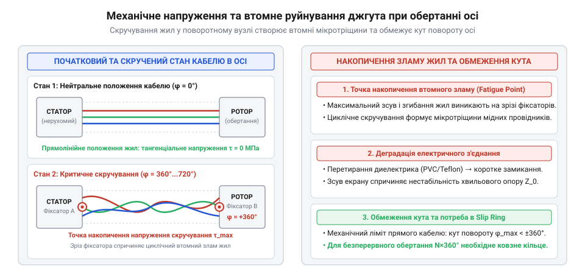
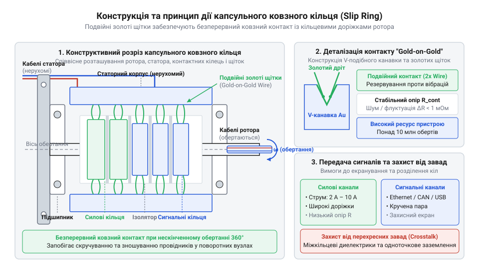
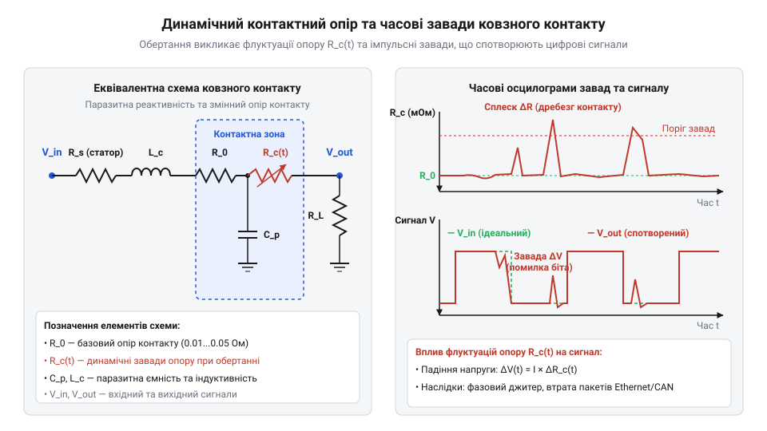
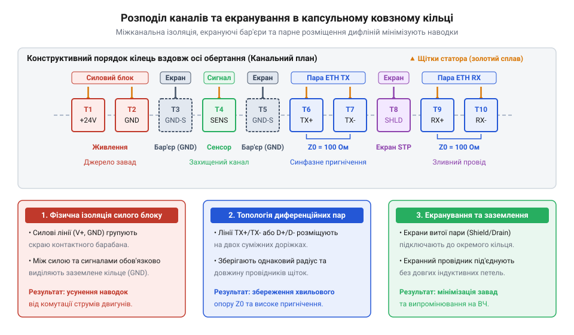

# Капсульне ковзне кільце (Slip Ring): передача живлення й швидкісних сигналів крізь обертові осі

<preknowlist>
- [Пружинні контакти Pogo Pins: механіка притиску, фретинг-корозія та вібростійкість](root:cat-hw-parts/pogo-pins) — механіка контактного притиску, фізика фретинг-корозії та вплив мікрозміщень на стабільність опору
- [Ethernet-кабель RJ45](root:cat-hw-parts/ethernet-cable) — структура диференційних сигнальних пар, імпедансне узгодження та принципи екранування високочастотних ліній
- [Кабелі USB (Type-C, micro, mini)](root:cat-hw-parts/usb-cables) — вимоги до диференційних ліній даних D+/D- та чутливість високошвидкісних протоколів до ємнісних наводок
- [Монтажний провід 18 і 20 AWG](root:cat-hw-parts/hookup-wire) — залежність допустимого струму від перерізу жили та тепловідведення дротів у обмеженому об'ємі
</preknowlist>

## Проблема скручування кабелів в обертових вузлах

Безперервне обертання осі поворотних механізмів змушує [гнучкий монтажний провід](root:cat-hw-parts/hookup-wire) або [промисловий кабельний шлейф](root:cat-hw-parts/industrial-pendant-cable-harnessing-and-shielding) витково скручуватися.

Багаторазове кручення накопичує у жилах джгута (англ. @@en|harness@@) деформації зсуву, викликаючи наклеп і втомний злам міді. Для передачі живлення й сигналів крізь обертову вісь застосовують капсульне ковзне кільце (англ. @@en|capsule slip ring@@, від латинського @@lat|capsula@@ — скринька).

*Механіка втомного руйнування мідних провідників при витковому скручуванні джгута в обертовому з'єднанні.*

## Будова та принцип дії капсульного струмознімача

Капсульний струмознімач (англ. @@en|slip ring@@) складається з нерухомого статора (англ. @@en|stator@@) та обертового ротора (англ. @@en|rotor@@). Вал ротора містить ізольовані кільця з V-подібними канавками (англ. @@en|V-groove rings@@), до яких притискаються пружні дротяні щітки статора (англ. @@en|brush@@).

Контактна пара золото по золоту (англ. @@en|gold-on-gold contact@@) із золоченням кілець по нікелю та сплавом золота й паладію в щітках забезпечує корозійну стійкість, низьке тертя й відсутність оксидних плівок. На відміну від дискретних [пружинних контактів Pogo Pins](root:cat-hw-parts/pogo-pins), ковзне кільце зберігає замкнене коло під час руху. Багатоточкові щітки (англ. @@en|multi-finger brushes@@) торкаються канавки у кількох точках, пригнічуючи контактний шум і компенсуючи мікровідриви від вібрацій.

*Конструктивна будова контактного вузла капсульного струмознімача з V-подібними роторними канавками.*

## Динамічний опір та високочастотні завади

Мікрошорсткість ковзних поверхонь при обертанні ротора викликає флуктуації площі контакту — динамічний контактний опір (англ. @@en|dynamic contact resistance@@).

Флуктуації опору `ΔR` під струмом `I` генерують контактний шум (англ. @@en|contact noise@@) із завадою `ΔV = I · ΔR`. У швидкісних колах, як-от [диференційні лінії USB](root:cat-hw-parts/usb-cables), це викликає тремтіння фронтів — джитер (англ. @@en|jitter@@). Стрибок імпедансу в контакті додатково спричиняє відбиття й згасання сигналу, що обмежує смугу пропускання струмознімача.

*Часова діаграма флуктуацій динамічного контактного опору та спалахів високочастотного шуму.*

## Розподіл каналів та екранування сигнальних ліній

Силові лінії струмознімача генерують імпульсні магнітні поля, викликаючи перехресні наводки (англ. @@en|crosstalk@@) у сигнальних колах.

Для захисту даних силові та сигнальні провідники розносять уздовж ротора через заземлені захисні кільця (англ. @@en|guard rings@@). Диференційні пари під [високочастотний Ethernet-кабель](root:cat-hw-parts/ethernet-cable) розводять на сусідні кільця з однаковою довжиною виводів. Для струмів понад 2 А канали об'єднують паралельно, застосовуючи [силові роз'єми XT](root:cat-hw-parts/xt-connectors) та [обтиснуті наконечники Faston](root:cat-hw-parts/faston-crimp-terminals). Екрани заземлюють за правилом одноточкового заземлення (англ. @@en|single-point grounding@@) лише з боку джерела сигналу, що запобігає виникненню замкнених контурів заземлення (англ. @@en|ground loop@@) через паразитну ємність статора.

*Схема міжканального екранування та суміщення паралельних провідників у капсульному кільці.*

## Механічний монтаж в обертові вузли

Одночасна жорстка фіксація ротора і статора (англ. @@en|rigid mounting@@) є неприпустимою: несоосність валів викликає згинальні напруження, що руйнують підшипники та контактні щітки.

Монтаж виконують за схемою плаваючого закріплення статора (англ. @@en|floating mounting@@). Ротор затискають на обертовій осі через фланець (англ. @@en|flange@@), а статор утримують гнучким антиротаційним фіксатором (англ. @@en|anti-rotation tab@@). Радіальне биття нейтралізують [еластомірні віброізолятори](root:cat-hw-parts/wire-rope-isolators), а різьбові з'єднання монтують через [різьбові футорки](root:cat-hw-parts/threaded-inserts-and-heat-set). Вивідні дроти прокладають із компенсаційними петлями (англ. @@en|service loops@@) та фіксують через [пластикові кабельні хомути](root:cat-hw-parts/cable-ties), що знімає навантаження з внутрішніх вузлів.

*Правила кінематичної розв'язки корпуса струмознімача за допомогою антиротаційного фіксатора.*

## Діагностика зносу та граничні режими експлуатації

Перевищення допустимої швидкості (200–500 об/хв) чи струму викликає відцентровий відрив щіток та електричну дугу, прискорюючи ерозію контактів.

Зношування гальванічного золочення оголює основу, викликаючи сухе тертя й фретинг-корозію (англ. @@en|fretting corrosion@@, від @@ang|frettan@@ — пожирати), а металевий пил знижує опір ізоляції. Стан контактів контролюють за пульсаціями динамічного опору (поріг — понад 10 мОм). Опір ізоляції вимірюють мегомметром (англ. @@en|megohmmeter@@, 500 В DC; норма — від 500 МОм). Падіння опору чи втрати пакетів у колах з [сигнальні роз'єми JST-SM](root:cat-hw-parts/jst-sm-connectors) вимагають планової заміни.

*Деградація контактної пари та поява високочастотних завад при стиранні гальванічного золочення.*