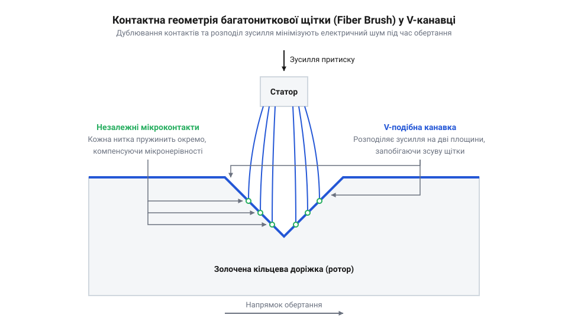
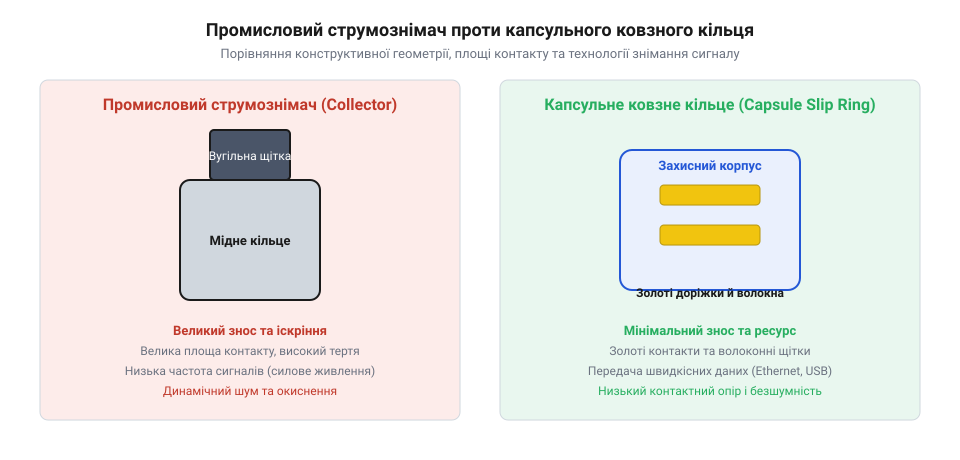

# Еволюція струмознімачів: від промислових вугільних щіток до золотого контакту в капсулі

<preknowlist>
- [Пружинні контакти Pogo Pins: механіка притиску, фретинг-корозія та вібростійкість](root:cat-hw-parts/pogo-pins) — механіку контактного притиску, явища фретинг-корозії та вплив покриття благородними металами на стабільність опору під дією вібрацій
- [Кабелі USB (Type-C, micro, mini)](root:cat-hw-parts/usb-cables) — вимоги до стабільності диференційного імпедансу та низького рівня динамічного шуму під час передачі високошвидкісних цифрових даних
- [Кабельні шлейфи та заземлення пультів оператора](root:cat-hw-parts/industrial-pendant-cable-harnessing-and-shielding) — принципи екранування сигнальних ліній та механіку втоми провідників під час динамічних деформацій у рухомих кабельних з'єднаннях
</preknowlist>

## Обмеження вугільних щіток у рухомих системах

Спроба передати електричну енергію або вимірювальний сигнал на частину механізму, що безперервно обертається, неминуче впирається у фізичні межі ковзного контакту. Вирішення цієї задачі у класичній електротехніці базувалося на масивних вузлах, де роторний @@lat|collector@@ (лат. *colligere* — збирати) або кільцевий @@en|slip ring@@ (англ. *slip* — ковзати, *ring* — кільце) взаємодіє зі стаціонарною щіткою. У потужних генераторах і електродвигунах змінного та постійного струму основним контактним матеріалом десятиліттями слугував графіт із домішками мідного порошку. Проте фізика контактних явищ у таких промислових вузлах висуває жорсткі вимоги, які виявилися повністю несумісними зі слабострумовими сенсорами та цифровими шинами.

Головна причина полягає у механіці та хімії формування контактної плівки. Для запобігання катастрофічному сухому тертю і задиранню мідного кільця графітовій щітці потрібне постійне утворення поверхневого шару — так званої політури. Цей шар складається з оксиду міді Cu₂O, адсорбованих водяних парів і мікроскопічних лусочок графіту. У силових кола з напругою в сотні вольт і струмами в десятки ампер ця напівпровідникова оксидна плівка легко пробивається електричним полем, а значна площа монолітного бруска щітки забезпечує стійку передачу потужності. Однак коли через аналогічний контакт намагаються передати аналоговий сигнал від термопари чи тензодатчика амплітудою в кілька мілівольт, падіння напруги на оксидному шарі стає нездоланним бар'єром.

До хімічного бар'єра додається механічна нестабільність. Для утримання монолітної щітки на кільці потрібне значне притискне зусилля пружини. Під час обертання ротора мікрошорсткості поверхні та неминучі радіальні биття викликають мікроскопічні відскоки щітки. На відміну від статичних з'єднань, де [пружинні контакти pogo](root:cat-hw-parts/pogo-pins) створюють постійний локальний тиск без динамічного зсуву, обертовий контакт перебуває під дією неперервного фрикційного збудження. Це спричиняє постійну зміну дійної площі мікроконтактів і викликає @@en|friction noise@@ (англ. *friction* — тертя, *noise* — шум), або фрикційний контактний шум.

Вимірювальний прилад реєструє цей шум як хаотичні коливання опору — @@en|dynamic contact resistance@@ (англ. *dynamic* — динамічний, *resistance* — опір). Опір ковзного контакту може стрибати від часток ома до сотень ом за мікросекунди. Спроба зменшити зусилля пружини призводить до виникнення мікродуг та іскріння, що прискорює ерозію металу. Спроба збільшити тиск викликає інтенсивний абразивний знос, виділення струмопровідного графітового пилу та різке зростання механічного моменту опору обертанню. Якщо при цьому зовнішнє [екранування сигнальних ліній](root:cat-hw-parts/industrial-pendant-cable-harnessing-and-shielding) захищає від наведених електромагнітних завад, то проти завад, що генеруються у самому контактному вузлі через стрипки опору, зовнішні екрани виявляються безсилими. У результаті традиційні вугільно-мідні щітки виявилися непридатними для передачі чутливих даних.

## Пошук рідких і срібних обертових контактів

У першій половині XX століття інженери здійснили серію спроб подолати фрикційний шум і падіння напруги на оксидних плівках, звернувшись до альтернативних контактних середовищ і матеріалів. Головна ідея полягала у переході від твердих абразивних щіток до систем, де контакт реалізувався б або через рідку фазу, або через найбільш провідні благородні метали.

Першим радикальним напрямком стало створення рідкометалевих контактів. Найбільшого поширення набули пристрої, відомі як @@en|mercury slip ring@@ (англ. *mercury* — ртуть, *slip ring* — ковзне кільце), де замкнений електричний ланцюг утворювався зануренням рухомого металевого диска у ванну з рідкою ртуттю. Рідка ртуть, володіючи високою електропровідністю та здатністю змочувати поверхню провідників, формувала ідеальний @@en|liquid metal contact@@ (англ. *liquid* — рідкий, *metal* — метал). Таке рішення полностью усувало механічний відскок і зменшувало @@en|dynamic contact resistance@@ практично до нуля, забезпечуючи передачу надчутливих аналогових сигналів без фрикційного шуму.

Однак практична експлуатація ртутних струмознімачів виявила нездоланні фізичні та екологічні обмеження. Ртуть є надзвичайно токсичною речовиною з високим тиском насиченої пари при кімнатній температурі. У рухомих або авіаційних системах під дією вібрацій, відцентрових сил та прискорення рідкий метал випліскувався через ущільнення, викликаючи короткі замикання та руйнування конструктивних елементів. Окрім того, ртуть викликає ртутну крихкість (амальгамацію) більшості конструкційних сплавів міді та алюмінію, а при температурі нижче -38.83 °C вона твердне, повністю блокуючи механізм.

Другим напрямком став розвиток твердих контактних пар на основі чистого срібла. Срібло має найвищу питому електропровідність серед усіх металів (6.30 × 10⁷ См/м), що робило його привабливим кандидатом для високочастотного обладнання. Проте в умовах відкритої атмосфери або негерметичних корпусів срібло миттєво вступає у реакцію з мікрокількостями сірководню H₂S, утворюючи щільну плівку сульфіду срібла Ag₂S. Оскільки сульфід срібла є діелектриком або напівпровідником із високим опором, на контактній поверхні виникало падіння напруги, відоме як @@en|silver tarnish@@ (англ. *silver* — срібло, *tarnish* — потускніння або оксидний наліт).

Для пробиття сульфідної плівки потрібна була висока напруга, що робило срібні кільця нестабільними для низьковольтних шин. Коли передаються сучасні високошвидкісні цифрові дані, де [кабелі USB](root:cat-hw-parts/usb-cables) вимагають строгої стабільності імпедансу та нульових викривлень сигналу, будь-яка напівпровідникова плівка призводить до нищівних втрат пакетів. Більше того, чисте срібло виявилося надзвичайно м'яким металом, схильним до пластичного зсуву та явища @@en|fretting corrosion@@ (англ. *fret* — роз'їдати, *corrode* — руйнувати). Під дією мікровібрацій срібні щітки зношувалися за сотні годин, залишаючи струмопровідні мікростружки. Стало зрозуміло, що ані рідка ртуть, ані чисте срібло нездатні забезпечити довговічну роботу в замкнених бортових приладах.

## Виклики радарів та бортової авіоніки

Друга світова війна та перші десятиліття Холодної війни створили гостру потребу в принципово нових класах обертових електричних з'єднань. Стрімкий розвиток радіолокаційних станцій із безперервним азимутальним обертом @@en|radar antenna@@ (англ. *radar* — радіолокація, *antenna* — антена), авіаційних гірокомпасів та прецизійних навігаційних систем @@en|gyroscope@@ (грец. *gyros* — коло, *skopeo* — дивитися) висунув перед інженерами вимоги, які неможливо було задовольнити класичними методами.

Радіолокаційні системи вимагали передачі через обертовий вузол високочастотних сигналів імпульсної модуляції та фазових даних від кутомірних синхро-машин @@en|synchro@@ (англ. *synchronous* — синхронний). Будь-який короткочасний сплеск контактного опору спричиняв викривлення відображення цілі на індикаторі кругового огляду або розрив петлі зворотного зв'язку в автопілоті. При цьому струмознімач мав розміщуватися всередині компактного герметичного корпусу авіаційного приладу та працювати в діапазоні температур від -55 °C до +85 °C без постійного обслуговування й заміни мастила.

Найбільшим викликом для бортової авіоніки став механічний момент опору. Координатні рамки авіаційних гіроскопів приводяться в рух малопотужними моторами, для яких тертя навіть у частки грам-сили на сантиметр є критичним. Збільшення притискного зусилля щіток для усунення контактного шуму призводило до застопорення гіроскопічного підвісу та передчасного зносу підшипників. Навпаки, зменшення притиску викликало вибухове зростання завад від вібрацій планера літака.

У таких умовах жорсткі вимоги висувалися й до цілісності передачі бортових сигналів: якщо чутливі цифрові лінії, якими сьогодні з'єднують бортові контролери через [сигнальний кабель JST-GH](root:cat-hw-parts/jst-gh-cable), вимагають високої завадозахищеності, то аналогові високовольтні та високочастотні кола радарів були ще чутливішими до імпульсних сплесків. Застосування зовнішніх ізоляторів та корпусних рішень, де [еластомірні віброізолятори](root:cat-hw-parts/wire-rope-isolators) гасили зовнішні механічні коливання, частково рятувало механіку приладу, але не усувало фундаментальної проблеми: ковзний контакт усередині герметичного блоку мусив мати нульове оксидоутворення й стабільну геометричну точку притиску.

Інженерний глухий кут середини XX століття сформулював чітку фізичну суперечність: для відсутності шуму потрібен стабільний металевий мікроконтакт без оксидних плівок, але для роботи в авіоніці цей контакт повинен мати мікроскопічне зусилля притиску, незмінний опір та нульове змащення. Вирішення цієї суперечності вимагало принципового переходу від монолітного бруска міді чи срібла до прецизійної мікрогеометрії багатониткових золотих щіток, які ковзають по золочених V-подібних канавках кільця. Це відкрило епоху сучасних капсульних струмознімачів.

## Прорив золотої багатониткової щіткової технології

Суперечність між вимогами бортової авіоніки щодо мінімального моменту тертя та необхідністю нульового контактного шуму знайшла розв'язок у другій половині XX століття завдяки створенню щіткової технології @@en|fiber brush technology@@ (англ. *fiber* — волокно, *brush* — щітка, *technology* — технологія). Ідея полягала в повній відмові від монолітного металевого бруска або поодинокої пластини на користь пучка з десятків тонесеньких дротів, виготовлених із прецизійного золотого сплаву @@en|gold alloy@@ (англ. *gold* — золото, *alloy* — сплав). Замість однієї масивної точки притиску, яка під дією вібрацій неминуче відлітає від поверхні, багатониткова щітка створює паралельне дублювання контактних точок. На відміну від дискретних рішень, де [пружинні контакти Pogo Pins](root:cat-hw-parts/pogo-pins) забезпечують притиск у статичних або зворотно-поступальних вузлах, багатониткова щітка розрахована на безперервне ковзання вздовж колової доріжки ротора.

Фізика стабільності цього мікроконтакту базується на законах статистичної імовірності та пружної деформації. Кожна окрема золотоносна нитка діаметром 0.05–0.1 мм виступає як автономна консольна пружина з мікроскопічним зусиллям притиску — лише 0.5–2 грами. Якщо під час обертання або механічного удару окремі нитки тимчасово втрачають контакт через мікрошорсткість, сусідні волокна у той самий момент залишаються щільно притиснутими до золоченого кільця. Це статистичне дублювання повністю усуває короткочасні розриви кола та знижує @@en|dynamic contact resistance@@ до часток міліома, пригнічуючи @@en|friction noise@@ без застосування рідких мастил.

Критичну роль у цій конструкції відіграє матеріалознавство контактної пари. Чисте золото є занадто м'яким металом, схильним до швидкого абразивного зносу. Тому для виготовлення ниток застосовують леговані сплави із додаванням нікелю або кобальту — так зване тверде золото @@en|hard gold alloy@@ (англ. *hard* — твердий, *gold* — золото, *alloy* — сплав). Додавання 0.1–0.5% нікелю збільшує мікротвердість покриття за Віккерсом з 60 HV до 150–200 HV, зберігаючи абсолютну хімічну інертність матеріалу. Контактна доріжка ротора також вкривається шар за шаром: поверх мідної основи наноситься підшар нікелю (для запобігання взаємній дифузії міді й золота), а зверху — гальванічне покриття твердим золотом завтовшки 2–5 мкм.

*Конструктивна схема багатониткової золотої щітки Fiber Brush у V-подібній канавці, яка демонструє багатоточковий мікроконтакт і напрямок обертання ротора.*

Поєднання багатониткової щітки, твердого золота та герметичного виконання дозволило створити новий клас пристроїв — капсульне ковзне кільце @@en|capsule slip ring@@ (англ. *capsule* — капсула, *slip ring* — ковзне кільце). У такому компактному блоці всі кільця й щіткові групи зібрані в єдиному захищеному корпусі з мініатюрними підшипниками кочення. Відсутність оксидних плівок та потреба у мастилі роблять капсульний струмознімач повністю обслуговуваним на весь термін експлуатації. Це дозволило надійно передавати чутливі аналогові й цифрові сигнали без завад у місцях, де раніше кабелі зазнавали механічної втоми чи скручування, як це буває, коли будують [кабельні шлейфи пультів](root:cat-hw-parts/industrial-pendant-cable-harnessing-and-shielding) у динамічних промислових системах.

## Контактна геометрія та розвінчання міфів

Широке впровадження капсульних ковзних кілець у робототехніці та безпілотній авіації породило низку поширених інженерних міфів. Найбільш стійка омана полягає в твердженні, ніби золото обрали для контактів через його найвищу електропровідність. З погляду класичної фізики це твердження є абсолютно хибним: питома електропровідність золота (4.1 × 10⁷ См/м) суттєво поступається як сріблу (6.3 × 10⁷ См/м), так і міді (5.9 × 10⁷ См/м). Справжня причина вибору золота полягає у його винятковій хімічній інертності @@en|chemical inertness@@ (англ. *chemical* — хімічний, *inertness* — інертність). На відміну від міді, яка вкривається напівпровідниковим оксидом Cu₂O, та срібла, що формує діелектричний сульфід Ag₂S, золото не утворює поверхневих ізоляційних плівок за нормальних умов. Це забезпечує чистий металевий мікроконтакт без необхідності високої напруги пробою чи значного тиску.

Другий популярний міф стверджує, що капсульне кільце — це просто зменшена копія промислового струмознімача. Насправді вони відрізняються принципово іншою контактною геометрією @@en|contact geometry@@ (англ. *contact* — контакт, *geometry* — геометрія). У промислових колекторах прямокутний брусок ковзає по плоскій або циліндричній гладкій поверхні кільця. У капсульних струмознімачах кільцева доріжка має V-подібну канавку @@en|V-groove@@ (англ. *V-shaped* — V-подібний, *groove* — канавка). Вкладання ниток золотої щітки у V-подібний профіль забезпечує клинковий ефект: кожна нитка контактує з канавкою щонайменше у двох точках під кутом. Це гарантує самоцентрування волокон, унеможливлює осьовий зсув під дією вібрацій та підвищує геометричну стабільність опору при мінімальному тиску.

*Принципова відмінність контактної геометрії: монолітна щітка на плоському кільці промислового струмознімача проти багатониткової золотої щітки у V-канавці капсульного ковзного кільця.*

Розуміння фізичних меж ковзних контактів дозволяє правильно обґрунтовувати вибір пристроїв для робототехніки, поворотних відеопідвісів та безпілотників (ДПЛА). Золочені капсульні струмознімачі є ідеальними для передачі сигналів високошвидкісних цифрових шин, де [Ethernet-кабель RJ45](root:cat-hw-parts/ethernet-cable) чи [кабелі USB](root:cat-hw-parts/usb-cables) критично залежать від відсутності сплесків імпедансу та нульового @@en|friction noise@@. Однак ці пристрої мають чіткі фізичні обмеження за струмом: спроба пропускати значні силові струми (понад 2–5 А на лінію) призводить до локального перегріву тонесеньких волокон, відпалу твердого золотого сплаву та мікрозварювання ниток із доріжкою.

Для передачі високих потужностей силові лінії розводять на кілька паралельних каналів струмознімача або застосовують спеціалізовані [силові роз'єми XT](root:cat-hw-parts/xt-connectors) на розмикальних вузлах із фіксованим положенням. При монтажі капсульного струмознімача в роторні вузли з композитів чи карбону корпус фіксують шляхом [монтування нарізних втулок](root:cat-hw-parts/threaded-inserts-and-heat-set), що запобігає передачі механічних напружень на внутрішні підшипники капсули. Для підключення силових або допоміжних кіл часто застосовують м'який [монтажний провід 18 AWG](root:cat-hw-parts/hookup-wire), який не створює паразитного згинального моменту на роторі. Завдяки розумінню контактної геометрії V-канавки та хімії золотих сплавів інженер може чітко розпланувати баланс між силовим живленням та високою якістю цифрових даних у будь-якій обертовій системі.