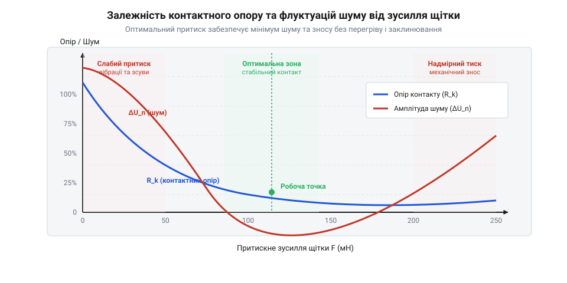
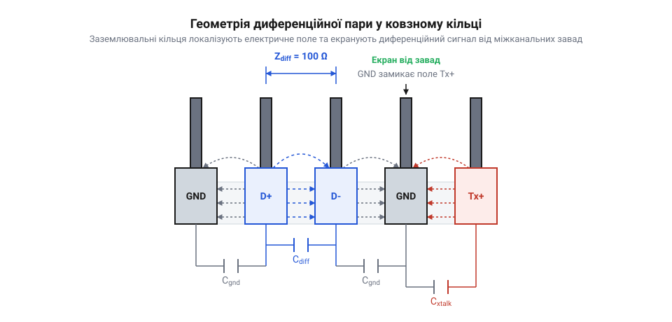

# Динамічний опір, ємнісна наводка та розрахунок теплового режиму ковзного контакту

<preknowlist>
- [Пружинні контакти Pogo Pins: механіка притиску, фретинг-корозія та вібростійкість](root:cat-hw-parts/pogo-pins) — механічні принципи пружного притиску контактів, фізику фретинг-корозії та вплив вібрацій на стабільність електричного зв'язку
- [Ethernet-кабель RJ45](root:cat-hw-parts/ethernet-cable) — специфікацію диференційного хвильового опору 100 Ом та вимоги до захисту високочастотних сигналів від перехресних завад
- [Кабелі USB (Type-C, micro, mini)](root:cat-hw-parts/usb-cables) — вимоги до узгодження диференційного хвильового опору 90 Ом та вплив паразитної ємності на цілісність сигнальних фронтів
- [Монтажний провід 18 і 20 AWG](root:cat-hw-parts/hookup-wire) — характеристики струмового навантаження, питомий опір провідників та гранично припустимі температури нагріву ізоляції
- [Кабельні шлейфи та заземлення пультів оператора](root:cat-hw-parts/industrial-pendant-cable-harnessing-and-shielding) — методики екранування сигнальних ліній та принципи зниження паразитної взаємної ємності в джгутах
</preknowlist>

## Чому зникає сигнал у ковзному контакті

Під час статичних випробувань ротаційне з'єднання — @@en|ковзний контакт@@ (від англ. @@en|slip ring@@, від прагерм. *slipan* — ковзати та англ. *ring* — кільце) — працює бездоганно. Проте при обертанні вала виникають збої: передача даних через [кабелі USB](root:cat-hw-parts/usb-cables) втрачає синхронізацію, на лініях з [Ethernet-кабелем RJ45](root:cat-hw-parts/ethernet-cable) зростає кількість помилок CRC, а силові кола іскрять і перегріваються.

Збої виникають через ототожнення ротаційного вузла зі стаціонарними з'єднувачами на зразок [пружинних контактів Pogo Pins](root:cat-hw-parts/pogo-pins) чи [силових роз'ємів XT](root:cat-hw-parts/xt-connectors). На відміну від нерухомого контакту, обертання докорінно змінює фізику на межі розподілу матеріалів.

Струм між кільцем і щіткою проходить через мікроскопічні виступи. Биття вала та мікровібрації безперервно змінюють площу цих мікроконтактів, спричиняючи @@en|динамічний контактний опір@@ (від англ. @@en|dynamic contact resistance@@, від грец. *dynamis* — сила та лат. *resistere* — протистояти) і @@en|контактний шум@@ (від англ. @@en|contact noise@@, від лат. *noxia* — шкода).

Близьке розташування кілець ротора створює між ними ємнісний зв'язок, де @@en|паразитна ємність@@ наводить @@en|перехресні завади@@ (від англ. @@en|crosstalk@@) у сусідніх каналах. Водночас джоулеве та фрикційне нагрівання змінює пружність щіток і прискорює окиснення поверхні. Щоб відновити якість зв'язку, необхідно побудувати математичну модель притиску, ємнісного наведення та теплового балансу.

## Динаміка та флуктуації контактного опору

Електричний опір сухого ковзного контакту утворюється звуженням ліній струму в мікроскопічних зонах торкання — @@en|пляма контакту@@ (від англ. @@en|a-spot@@, скорочення від @@en|actual contact spot@@). Радіус окремої плями `a` визначається притискним зусиллям щітки `F_c`, кількістю плям `n` та мікротвердістю `H` м'якшого з матеріалів:

        a = √ ( F_c / (n × π × H) )

Загальний опір звуження — @@en|опір Холма@@ (від нім. @@de|Holm-Kontaktwiderstand@@, на честь фізика Рагнара Холма) — для питомого опору матеріалу `ρ` обчислюється як:

        R_s = ρ / (2 × n × a)
            = (ρ / 2) × √ ( π × H / (n × F_c) )       [підстановка радіуса плями a]

З урахуванням оксидних плівок з питомим опором `σ_f` повний опір становить `R_c = R_s + σ_f / (n × π × a²)`. Підвищення зусилля `F_c` збільшує площу плям і зменшує опір обернено пропорційно `√F_c`.

Під час обертання вала з кутовою швидкістю `ω` та радіусом `r` биття поверхні викликає флуктуації зусилля `ΔF_c(t)` і опору `ΔR_c(t)`. Струм `I` генерує напругу @@en|контактний шум@@:

        V_n(t) = I × ΔR_c(t)

Щоб інерційна сила щітки маси `m` не спричинила відриву при битті `A_runout`, зусилля притиску має задовольняти умову:

        F_c > m × ω² × A_runout

Порушення нерівності викликає мікровідриви щітки, іскріння та сплески шуму.

*Збільшення притискного зусилля зменшує середній опір та флуктуації, проте при перевищенні критичної швидкості мікровідриви щітки створюють сплески контактного шуму.*

**Приклад обчислення динамічного опору та шуму ковзного контакту**
*Умова:* Золочене кільце радіусом `r = 15 мм` обертається зі швидкістю `N = 300 об/хв`. Зусилля щітки `F_c = 0.15 Н` має флуктуацію `ΔF_c / F_c = ±20%`. Питомий опір `ρ = 2.44 × 10⁻⁸ Ом·м`, мікротвердість `H = 800 МПа`, кількість плям `n = 4`. Обчислити опір Холма `R_s` та амплітуду шуму `ΔV_n` при струмі `I = 2 А`.

        F_c = 0.15 Н
        H = 800 × 10⁶ Па
        a = √ ( 0.15 / (4 × 3.1416 × 800 × 10⁶) )
          = 3.863 × 10⁻⁶ м                        [обчислення радіуса плями]
        R_s = (2.44 × 10⁻⁸) / (2 × 4 × 3.863 × 10⁻⁶)
            = 0.000790 Ом                         [обчислення опору Холма]
        R_s_min = 0.000790 / √1.2
                = 0.000721 Ом                      [опір при max притиску]
        R_s_max = 0.000790 / √0.8
                = 0.000883 Ом                      [опір при min притиску]
        ΔR_c = (0.000883 - 0.000721) / 2
             = 0.000081 Ом                         [амплітуда флуктуації опору]
        ΔV_n = 2 × 0.000081
             = 0.000162 В = 0.162 мВ               [амплітуда шуму напруги]

Розрахована амплітуда шуму 0.162 мВ є припустимою для кіл живлення, але для аналогових сигналів вимагає диференційної передачі або підсилення.

## Електромагнітна взаємодія та міжканальна ємність

Концентричні струмопровідні кільця ротаційного вузла, розділені діелектриком або повітряним зазором, утворюють копланарний конденсатор. Його електрична ємність — @@en|паразитна ємність@@ (від англ. @@en|parasitic capacitance@@, від грец. *parasitos* — утриманець та лат. *capacitas* — місткість).

Для двох сусідніх доріжок середнього радіуса `r`, шириною `w` та проміжком `g` із діелектриком `ε_r` паразитну міжканальну ємність `C_m` розраховують за площинною апроксимацією для електричної сталої `ε_0 = 8.854 × 10⁻¹² Ф/м`:

        C_m ≈ ε_0 × ε_r × (2 × π × r × w) / g

При проходженні високочастотного сигналу через активний канал ємнісний опір `X_c = 1 / (ω × C_m)` падає, викликаючи струм витоку в сусідній канал — @@en|перехресні завади@@. Коефіцієнт ємнісного наведення `K_c` на навантаженні `Z_0` та рівень послаблення ближніх перехресних завад (NEXT) у децибелах становлять:

        K_c = Z_0 / (2 × X_c)
            = (Z_0 × ω × C_m) / 2
        NEXT_dB = -20 × log₁₀ ( K_c )

Для збереження цілісності сигналів у лініях [кабелів USB](root:cat-hw-parts/usb-cables) та [Ethernet-кабелю RJ45](root:cat-hw-parts/ethernet-cable) необхідно підтримувати стабільний @@en|хвильовий опір@@ (від англ. @@en|characteristic impedance@@). Сигнали передаються через @@en|диференційну пару@@ (від англ. @@en|differential pair@@, від лат. *differentia* — різниця), диференційний хвильовий опір якої `Z_diff` залежить від погонної індуктивності `L'`, взаємної індуктивності `M'`, власної ємності `C_self` та міжканальної ємності `C_m`:

        Z_diff = 2 × √ ( (L' - M') / (C_self + 2 × C_m) )

Стрибок імпедансу `ΔZ` при переході від кабелю до кілець спричиняє відбиття сигналу з коефіцієнтом `Γ = (Z_ring - Z_cable) / (Z_ring + Z_cable)`. Для забезпечення нормативних 90 Ом (USB) і 100 Ом (Ethernet) між сигнальними кільцями розміщують заземлені екрануючі кільця, підключені через [кабельні шлейфи та заземлення](root:cat-hw-parts/industrial-pendant-cable-harnessing-and-shielding).

*Розподіл силових ліній електричного поля між сигнальними кільцями та екранами показує зниження паразитної ємності й стабілізацію хвильового імпедансу.*

**Приклад розрахунку паразитної ємності та перехресних завад диференційного каналу**
*Умова:* Сусідні кільця ротаційного з'єднання мають радіус `r = 12 мм`, ширину `w = 0.8 мм` і проміжок `g = 0.5 мм` з `ε_r = 3.2`. Частота сигналу Ethernet `f = 100 МГц`, опір навантаження `Z_0 = 50 Ом`. Обчислити паразитну ємність `C_m` та послаблення завад `NEXT_dB`.

        r = 0.012 м
        w = 0.0008 м
        g = 0.0005 м
        ε_0 = 8.854 × 10⁻¹² Ф/м
        ε_r = 3.2
        A_ring = 2 × 3.1416 × 0.012 × 0.0008
               = 6.032 × 10⁻⁵ м²                  [площа паралельного перерізу кілець]
        C_m = (8.854 × 10⁻¹² × 3.2 × 6.032 × 10⁻⁵) / 0.0005
            = 3.418 × 10⁻¹² Ф = 3.42 пФ           [паразитна міжканальна ємність]
        ω = 2 × 3.1416 × 100 × 10⁶
          = 6.283 × 10⁸ рад/с                      [кутова частота сигналу]
        X_c = 1 / (6.283 × 10⁸ × 3.418 × 10⁻¹²)
            = 465.5 Ом                             [ємнісний опір зв'язку]
        K_c = 50 / (2 × 465.5)
            = 0.0537                               [коефіцієнт ємнісного наведення]
        NEXT_dB = -20 × log₁₀ ( 0.0537 )
                = 25.4 дБ                          [послаблення перехресних завад]

Отримане послаблення 25.4 дБ є недостатнім для Fast Ethernet (вимога >40 дБ). Встановлення заземленого екранючого кільця зменшує діючу ємність `C_m` та підвищує захищеність каналу до норми.

## Узгодження диференційного хвильового опору каналів

Підключення ротаційного вузла до ліній передачі [Ethernet-кабелю RJ45](root:cat-hw-parts/ethernet-cable) (100 Ом) або [кабелів USB](root:cat-hw-parts/usb-cables) (90 Ом) супроводжується зміною геометрії провідників при переході до пласких концентричних кілець. Зміна ширини доріжок, відстані між ними та діелектричного середовища створює неоднорідність хвильового імпедансу.

Коли довжина кільця `l_ring = 2 × π × r` перевищує `0.1 × λ` (де `λ = v_phase / f` — довжина хвилі у діелектрику), контакт розглядають як лінію з розподіленими параметрами. Диференційний @@en|хвильовий опір@@ пари кілець `Z_diff` залежить від погонної індуктивності `L'`, взаємної індуктивності `M'`, власної ємності доріжки `C_self` та міжканальної ємності `C_m`:

        Z_diff = 2 × √ ( (L' - M') / (C_self + 2 × C_m) )

Для прямокутних кілець над заземленою поверхнею значення `Z_diff` оцінюють через ефективну діелектричну проникність середовища `ε_eff`, ширину доріжки `w` та зазор `g`:

        Z_diff ≈ (120 / √ε_eff) × ln ( (2 × g) / w )

Різниця між опором кілець `Z_ring` та кабелю `Z_cable` викликає відбиття хвилі. Амплітуду відбитого сигналу визначає @@en|коефіцієнт відбиття@@ (від англ. @@en|reflection coefficient@@, від лат. *reflectere* — відвертати) `Γ`:

        Γ = (Z_ring - Z_cable) / (Z_ring + Z_cable)

Якість узгодження оцінюють через @@en|зворотні втрати@@ (від англ. @@en|return loss@@) `RL_dB` (для високошвидкісних ліній нормою є `RL_dB > 14...15 дБ`) та @@en|коефіцієнт стоячої хвилі напруги@@ (від англ. @@en|voltage standing wave ratio@@) `VSWR`:

        RL_dB = -20 × log₁₀ ( |Γ| )
        VSWR = (1 + |Γ|) / (1 - |Γ|)

Імпеданс узгоджують вибором ширини `w` і зазору `g` (`Z_ring = Z_cable`) та додаванням заземлювальних кілець через [кабельні шлейфи та заземлення](root:cat-hw-parts/industrial-pendant-cable-harnessing-and-shielding). За високоомного переходу на платах ротора й статора додають компенсаційні ємності `C_comp`.

**Приклад обчислення узгодження та зворотних втрат ковзного контакту**
*Умова:* Сигнал USB 2.0 High-Speed (`Z_cable = 90 Ом`) надходить на кільце `Z_ring = 115 Ом` при затримці `τ = 100 пс`. Обчислити `Γ`, `RL_dB`, `VSWR` та компенсаційну ємність `C_comp` для вирівнювання імпедансу до 90 Ом.

        Z_cable = 90 Ом,  Z_ring = 115 Ом
        Γ = (115 - 90) / (115 + 90)
          = 25 / 205 = 0.1220                     [обчислення коефіцієнта відбиття]
        RL_dB = -20 × log₁₀ ( 0.1220 )
              = 18.27 дБ                          [обчислення зворотних втрат]
        VSWR = (1 + 0.1220) / (1 - 0.1220)
             = 1.278                              [обчислення КСХН]
        C_comp = (100 × 10⁻¹²) × ( (1 / 90) - (1 / 115) )
               = 2.414 × 10⁻¹² Ф = 2.41 пФ        [обчислення компенсаційної ємності]

Зворотні втрати 18.27 дБ є прийнятними (>14 дБ), але додавання ємності `C_comp = 2.41 пФ` усуває сплеск опору, знижуючи відбиття до нуля.

## Тепловий режим та граничне струмове навантаження

Тепловиділення в ковзному контакті визначають два фізичні процеси: протікання струму та механічне тертя щітки об кільце. Перша складова — @@en|джоулеве тепловиділення@@ (від англ. @@en|Joule heating@@) `P_elec` — залежить від струму `I` та контактного опору `R_c`:

        P_elec = I² × R_c

Друга складова — @@en|фрикційне тепловиділення@@ (від англ. @@en|frictional heating@@, від лат. *fricare* — терти) `P_mech` — виникає через тертя ковзання. Вона залежить від притиску щітки `F_c`, коефіцієнта тертя `μ` та лінійної швидкості `v = ω × r`:

        P_mech = F_c × μ × ω × r

де `ω` — кутова швидкість вала, `r` — радіус кільця. Повна теплова потужність вузла `P_total` є сумою обох компонентів:

        P_total = P_elec + P_mech
                = I² × R_c + F_c × μ × ω × r

Стан теплової рівноваги описує @@en|термічний опір@@ (від англ. @@en|thermal resistance@@, від грец. *therme* — тепло) `R_th` у К/Вт. Перегрів контакту `ΔT` відносно температури довкілля `T_amb` дорівнює:

        ΔT = T_contact - T_amb = P_total × R_th

Нагрівання підвищує опір провідника через @@en|температурний коефіцієнт опору@@ (від англ. @@en|temperature coefficient of resistance@@) `α`:

        R_c(T) = R_c0 × ( 1 + α × ΔT )

Локальна температура плями контакту `T_spot` перевищує середню температуру кільця `T_contact`. За відносинами Кольрауша, падіння напруги `V_c = I × R_c` пов'язане з `T_spot` виразом `V_c² = 4 × L_Lorenz × (T_spot² - T_contact²)`, де `L_Lorenz = 2.45 × 10⁻⁸ В²/К²` — число Лоренца. Щоб запобігти пошкодженню ізоляції провідників, таких як [монтажний провід 18 і 20 AWG](root:cat-hw-parts/hookup-wire), температура `T_contact` не повинна перевищувати `T_max`. З рівняння теплового балансу виводять граничний струм `I_max`:

        T_max - T_amb = ( I_max² × R_c + F_c × μ × ω × r ) × R_th

Звідси граничний струм ковзного контакту дорівнює:

        I_max = √ ( ( (T_max - T_amb) / R_th - F_c × μ × ω × r ) / R_c )

Зі зростанням кутової швидкості `ω` фрикційний нагрів збільшується, що вимагає дерейтингу струму. У силових колах з [силовими роз'ємами XT](root:cat-hw-parts/xt-connectors) нехтування фрикційною складовою на високих обертах спричиняє тепловий розгон та розплавлення сепараторів.

**Приклад розрахунку теплового балансу та граничного струму**
*Умова:* Кільце силового каналу (`r = 20 мм`) обертається зі швидкістю `N = 600 об/хв` (`ω = 62.83 рад/с`). Зусилля щітки `F_c = 0.2 Н`, коефіцієнт тертя `μ = 0.15`, опір `R_c = 0.005 Ом`, термічний опір `R_th = 25 °C/Вт`. При `T_amb = 25 °C` та граничній температурі [монтажного проводу 18 і 20 AWG](root:cat-hw-parts/hookup-wire) `T_max = 85 °C` обчислити `P_mech`, `P_elec_max` та `I_max`.

        r = 0.02 м
        ω = 2 × π × (N / 60)
          = 2 × 3.1416 × (600 / 60)
          = 62.83 рад/с                         [обчислення кутової швидкості]
        v = ω × r
          = 62.83 × 0.02
          = 1.257 м/с                           [обчислення лінійної швидкості]
        P_mech = F_c × μ × v
               = 0.2 × 0.15 × 1.257
               = 0.0377 Вт                      [обчислення фрикційної потужності]
        P_total_max = (T_max - T_amb) / R_th
                    = (85 - 25) / 25
                    = 2.40 Вт                   [максимально припустиме тепловиділення]
        P_elec_max = P_total_max - P_mech
                   = 2.40 - 0.0377
                   = 2.3623 Вт                  [припустима електрична потужність]
        I_max = √ ( P_elec_max / R_c )
              = √ ( 2.3623 / 0.005 )
              = 21.74 А                         [обчислення граничного струму]

При зростанні швидкості до `3000 об/хв` (`ω = 314.16 рад/с`) фрикційна потужність зростає до `0.1885 Вт`, знижуючи граничний струм до `21.03 А`. Це підтверджує необхідність дерейтингу струму при підвищенні обертів.

## Оптимізація компромісу між завадами та зносом

@@en|Багатопараметрична оптимізація@@ визначає притиск щітки `F_c`, кутову швидкість `ω` та струм `I` через компроміс між електрикою, теплом і ресурсом.

Притиск `F_c` діє протилежно:
1. Його зростання зменшує опір Холма `R_s ∝ 1 / √F_c`, шум `ΔV_n` та запобігає відриву щітки під час вібрацій, на відміну від [пружинних контактів Pogo Pins](root:cat-hw-parts/pogo-pins). 2. Водночас підвищується фрикційний нагрів `P_mech = F_c × μ × v` та @@en|інтенсивність зношування@@ `dV/dt` за законом Арчарда:

        dV/dt = k_wear × F_c × ( (ω × r) / H )

де `k_wear` — коефіцієнт зносу, `H` — мікротвердість покриття.

Робоче вікно задають межі:
- Нижня межа `F_c_min` запобігає відриву щітки масою `m` при битті `A_runout` (`k_s ≈ 1.5...2.0`):

        F_c_min = k_s × m × ω² × A_runout

- Верхня межа `F_c_max` обмежується ресурсом `L_hours` до стирання покриття товщиною `h_coat` площею `A_contact`:

        F_c_max = (h_coat × A_contact × H) / (k_wear × ω × r × 3600 × L_hours)

- Допустимий перегрів `T_max - T_amb` обмежує сумарне тепловиділення:

        ( I² × R_c(F_c) + F_c × μ × ω × r ) × R_th ≤ T_max - T_amb

Притиск обирають близьким до `F_c_min`, що забезпечує нормативний шум і максимальний ресурс контакту.