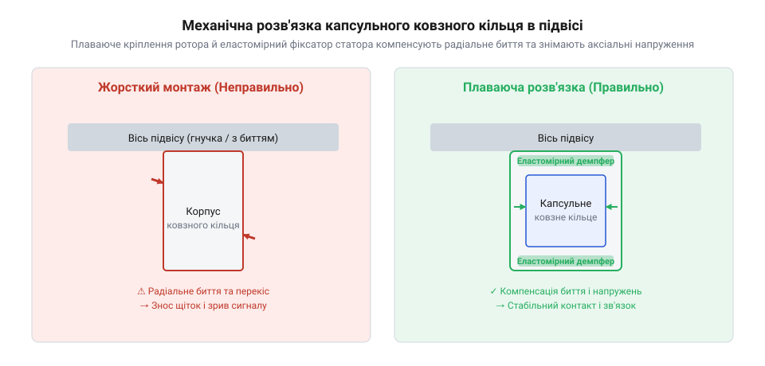
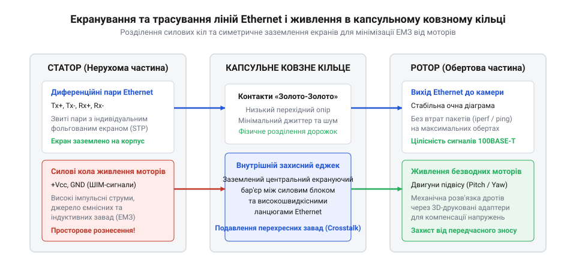

# Монтаж капсульного ковзного кільця у двоосьовий підвіс камери з передачею Ethernet та живлення

<preknowlist>
- [Ethernet-кабель RJ45](root:cat-hw-parts/ethernet-cable) — структура диференційних пар та вимоги до збереження скручування провідників
- [Нарізні втулки та футорки: монтаж різьби в карбон, композити та термопласти 3D-друку](root:cat-hw-parts/threaded-inserts-and-heat-set) — технологія гарячого вплавлення різьбових втулок у друковані адаптери кріплення
- [Кабельні шлейфи та заземлення пультів оператора](root:cat-hw-parts/industrial-pendant-cable-harnessing-and-shielding) — правила трасування екранованих кабелів і підключення екрана до контуру заземлення
</preknowlist>

## Відмови зв'язку та механічне заклинювання

У двоосьових підвісах камер безперервного обертання передача живлення та високошвидкісних сигналів неможлива за допомогою звичайних гнучких кабелів через неминуче скручування та обрив провідників. Для забезпечення необмеженого кута повороту по осях азимута та місця застосовують спеціальні електромеханічні вузли — капсульні ковзні кільця (від англ. @@en|slip ring@@ — ковзне кільце), які забезпечують гальванічний зв'язок між рухомою частиною (ротором, від лат. @@la|rotare@@ — обертатися) та нерухомою основою (статором, від лат. @@la|stare@@ — стояти). Проте жорсткий монтаж такої капсули створює серйозну загрозу передчасного виходу з ладу через механічні перекоси та вібрації. Якщо вісі обертання підвісу та самого ковзного кільця не збігаються навіть на частку міліметра, під час обертання виникає радіальне биття. Це биття перетворюється на циклічне бокове навантаження на внутрішні підшипники капсули та контактні щітки, що призводить до їхнього прискореного стирання, появи металевого пилу та різкого збільшення перехідного опору контакту.

Коли контактні щітки ковзають по кільцях під впливом радіальних бить і мікровибрацій від безколекторних моторів підвісу, у місці дотику виникає явище мікророзривів і фретинг-корозії (від англ. @@en|fretting corrosion@@ — корозія від тертя). Механічні мікровигини проводів, що виходять з капсули, додатково навантажують точки пайки. У лініях зв'язку Ethernet це спричиняє спотворення фронтів імпульсів, зростання рівня джитеру (англ. @@en|jitter@@ — тремтіння, часове зміщення цифрових фронтів) та масові втрати пакетиків даних. У силових колах живлення перехідний опір, що стрибкоподібно зростає в момент мікровідриву щіток, викликає індуктивні викиди напруги (електричні сплески), здатні вивести з ладу чутливі мікросхеми перетворювачів напруги в камері. 

Для оцінки реального стану такого каналу під час обертання застосовують спеціалізоване програмне забезпечення. Наприклад, утиліта моніторингу на C дозволяє в реальному часі відстежувати затримки та втрати пакетиків через сокети, що критично для налаштування механіки. Ось як виглядає базовий модуль ініціалізації сокета та підрахунку статистики зв'язку:

:::code proj-gimbal-ethernet-slip-ring-mount/c/slip_ring_monitor.c
:::code proj-gimbal-ethernet-slip-ring-mount/c/slip_ring_monitor.h

Аналогічний за призначенням монітор можна реалізувати і в об'єктно-орієнтованому стилі на C++. Клас `SlipRingMonitor` підтримує ковзне вікно для розрахунку параметрів якості каналу та фіксує аномалії затримки під час руху підвісу:

:::code proj-gimbal-ethernet-slip-ring-mount/cpp/main.cpp
:::code proj-gimbal-ethernet-slip-ring-mount/cpp/slip_ring_monitor.cpp
:::code proj-gimbal-ethernet-slip-ring-mount/cpp/slip_ring_monitor.hpp

Для автоматизації перевірки таких систем на стійкість під час тривалого обертання використовують скрипти автоматизації та збору телеметрії. Вони одночасно запускають генератор трафіку та логують кутове положення підвісу:

:::code proj-gimbal-ethernet-slip-ring-mount/sh/parse_metrics.py
:::code proj-gimbal-ethernet-slip-ring-mount/sh/run_telemetry_test.sh

## Механічна розв'язка та 3D-друк адаптерів

Щоб запобігти руйнуванню капсульного ковзного кільця (англ. @@en|slip ring@@) від радіального биття та жорстких перекосів, конструкція підвісу має передбачати спеціальну механічну розв'язку. Жорстке затискання і ротора, і статора одночасно у двох незалежних базових деталях підвісу неминуче перетворює капсулу на перевантажену силову балку, яка руйнується після перших сотень обертів. Правильний підхід полягає у створенні плаваючого кріплення (англ. @@en|floating mount@@), де один із боків ковзного кільця фіксується жорстко для передачі крутного моменту, а інший — через еластомірний або шарнірний демпфер, що допускає мікросхилення та радіальне зміщення в межах десятих часток міліметра без передачі згинальних моментів на підшипники капсули. Зокрема, для посадки плаваючого фланця статора передбачають радіальний зазор 0.3–0.5 мм між фланцем та гніздом корпусу, а вилка або штифтовий поводець виконуються з люфтом ±0.2 мм; при цьому силіконові або термополіуретанові (TPU) демпфери твердістю 40–60 за Шором А (Shore A) ефективно компенсують кутову неспіввісність до 1.5–2.0° без виникнення руйнівного радіального навантаження на внутрішні підшипники капсули.

Під час проектування таких адаптерів для виготовлення методом 3D-друку важливо правильно вибрати конструкційний термопласт. Звичайний PLA деформується під нагвом і крихкий під дією циклічних вібрацій, а ABS має значну усадку та схильний до розшарування. Оптимальним вибором є конструкційні пластики на кшталт PETG, Nylon (поліамід) або армовані вуглеволокном композити (CF-PETG / CF-PA), які поєднують високу втомну міцність і пружність. Для надійного кріплення адаптерів у пластикових корпусах використовують нарізні втулки та футорки, які вплавлюють за допомогою паяльника. Це дозволяє багаторазово монтувати з'єднання гвинтами без зминання різьби в пластику.

Шарнірна вилка ротора та гнучкі силіконові або еластомірні вставки поглинають високочастотні вібрації від моторів підвісу, захищаючи контакти від фретинг-корозії. Водночас для з'єднання рухомих елементів конструкції з металевими деталями слід ретельно добирати класи міцності та матеріали кріплення, щоб уникнути задирання різьби та ослаблення натягу в умовах постійних знакозмінних навантажень.

## Екранування Ethernet та силова розводка

Передача високошвидкісних даних Ethernet 100BASE-TX або 1000BASE-T через контактні кільця капсули стикається з фундаментальною фізичною проблемою: кільця та щітки ковзного кільця не утворюють неперервного коаксіального середовища з чітко заданим хвильовим опором. На відміну від стандартних кабелів на кшталт Ethernet-кабеля RJ45, де диференційні пари мають суворий опір 100 Ом, усередині капсули провідники перетворюються на нескомпенсовані ділянки з паразитними ємностями та індуктивностями. Це призводить до відбиття сигналів, зростання перехресних перешкод (кросток-ефекту) та зниження запасу зашумленості каналу зв'язку. Неоднорідність хвильового опору на поворотних кільцях безпосередньо впливає на зворотні втрати @@en|Return Loss@@, оскільки кожен стрибок імпедансу — наприклад, локальне падіння до 70–80 Ом через паразитну ємність саму ковзну групу або різкий сплеск понад 120 Ом через розплітання пар у зоні пайки — породжує коефіцієнт відбиття, що дорівнює різниці опорів, поділеній на їхню суму. У результаті погіршуються зворотні втрати @@en|Return Loss@@, які для стабільного лінку 100BASE-TX або 1000BASE-T не мають опускатися нижче порогового значення від -15 до -18 дБ. Якщо через механічні перекоси або биття цей показник падає нижче -10 дБ, виникає критична деградація очної діаграми @@en|eye diagram@@, з'являються серійні пакети помилок контролю кадрів @@en|Frame Check Sequence@@, а PHY-контролер змушений аварийно скидати швидкість з'єднання до 10 Мбіт/с через неможливість декодувати сигнал в умовах високого джитеру @@en|jitter@@.

Щоб мінімізувати вплив електромагнітних завад, внутрішню розводку капсули обов'язково поділяють на фізично ізольовані групи. Силові лінії живлення моторів та підсвічування, якими течуть струми з широтно-імпульсною модуляцією (ШІМ), прокладають через крайні кільця капсули, максимально віддалені від сигнальних пар Ethernet. Силові дроти ретельно скручують та екранують окремо, а екрани підключають до захисного контуру заземлення лише з одного боку або через спеціальні високочастотні ємнісні фільтри, щоб уникнути виникнення контурів заземлення.

Самі сигнальні диференційні лінії Ethernet на вході та виході з капсули повинні зберігати крок скручування якомога ближче до точок контакту, а довжина нескомпенсованих ділянок (хвостиків) не має перевищувати 3–5 мм. Для підключення периферійних модулів та датчиків усередині підвісу використовують якісні роз'єми та шлейфи, а кабельні траси фіксують за допомогою хомутів і захисних оболонок, дотримуючись загальних правил, викладених у матеріалах про кабельні шлейфи та заземлення пультів оператора. Комплексний моніторинг пакетних втрат дозволяє вчасно виявити деградацію екранування чи знос щіток до того, як станеться повний обрив зв'язку в польових умовах.

## Збирання вузла та фіксація шлейфів

Монтаж капсульного ковзного кільця у двоосьовий підвіс камери є критичним етапом, де будь-яка механічна помилка чи перекіс неминуче призводять до передчасного зношування щіток, появи електричних перешкод та обриву високошвидкісних ліній зв'язку. Процес починається з підготовки посадкових місць та механічної фіксації корпусу капсули усередині порожнистого вала. Оскільки корпус підвісу найчастіше виготовляється з алюмінієвих сплавів або легких композитних матеріалів, для надійного різьбового з'єднання використовують [нарізні втулки та футорки](root:cat-hw-parts/threaded-inserts-and-heat-set). Універсальні різьбові втулки вплавляються за допомогою паяльника з насадкою у попередньо відкалібровані отвори 3D-друкованих адаптерів, забезпечуючи міцне механічне утримання гвинтів без ризику руйнування пластику під час вібрацій.

Фіксація виводів капсули вимагає суворого дотримання мінімальних радіусів вигину тонких багатожильних проводів. Надмірний натяг або різкі перегини біля самої основи виходу з капсули неминуче спричиняють втомне руйнування мідних жил. Для запобігання цьому на кабельних трасах ротора та статора формуються вільні розвантажувальні петлі. Довжина петлі розраховується так, щоб під час максимального кутового повороту підвісу в обидва боки провідники плавно скручувалися й розкручувалися в межах своєї пружності, не передаючи осьового чи радіального зусилля на контакти ковзного кільця.

Для надійної фіксації джгутів та запобігання їх перетиранню об рухомі елементи конструкції використовують [хомути пластикові](root:cat-hw-parts/cable-ties), які м'яко охоплюють пучки проводів через демпфувальні силіконові або тканинні прокладки. Особливої уваги вимагає правильне трасування екранованих пар. Екранування сигнальних ліній об'єднується в єдиний контур і підключається до маси виключно на стороні статора, що детально розглядається в розділі [кабельні шлейфи та заземлення пультів оператора](root:cat-hw-parts/industrial-pendant-cable-harnessing-and-shielding). Заборонено створювати замкнуті контури заземлення через корпус підвісу, оскільки це призводить до виникнення вирівнювальних струмів і появи додаткових наводок на чутливі канали передачі відео та даних.

## Інструментальний контроль та діагностика зв'язку

Після завершення механічного збирання та розводки кабельних трас критично важливо виконати повний комплекс перевірок працездатності та стабільності каналу зв'язку. Динамічне обертання підвісу створює перехідні процеси в контактній групі, які неможливо виявити за статичного положення платформи. Для цього застосовується комплексний інструментальний контроль, що включає програмні тести пропускної здатності, вимірювання затримок та перевірку форми сигналу за допомогою осцилографа (від лат. @@la|oscillare@@ — гойдатися, грец. @@el|grapho@@ — писати). Телеметрія (від грец. @@el|tele@@ — далеко, @@el|metron@@ — міра) параметрів з'єднання дозволяє в реальному часі фіксувати найменші мікророзриви та оцінювати якість передачі пакетів.

Для автоматизованого збору та аналізу мережевих показників під час безперервного обертування підвісу розроблено спеціалізовані програмні інструменти. Низькорівневий моніторинг через POSIX сокети реалізовано у файлі `proj-gimbal-ethernet-slip-ring-mount/c/slip_ring_monitor.c`, заголовний файл якого міститься у `proj-gimbal-ethernet-slip-ring-mount/c/slip_ring_monitor.h`. Ця утиліта надсилає тестові UDP-пакети з мітками часу та кутовим положенням через контактні кільця, обчислюючи втрати пакетів і мінімальну, максимальну та середню затримку в наносекундах.

Об'єктно-орієнтований підхід до аналізу якості каналу реалізовано на мові C++ у файлах `proj-gimbal-ethernet-slip-ring-mount/cpp/slip_ring_monitor.hpp`, `proj-gimbal-ethernet-slip-ring-mount/cpp/slip_ring_monitor.cpp` та головному виконуваному файлі `proj-gimbal-ethernet-slip-ring-mount/cpp/main.cpp`. Клас `SlipRingMonitor` підтримує ковзне вікно для розрахунку джитеру (sliding window jitter) та автоматично фіксує мікророзриви контакту, коли затримка перевищує заданий поріг (наприклад, 25 мс), викликаний механічним вібраційним резонансом щіток.

Для інтегрованого польового тестування мережі використовуються скрипти автоматизації та аналізу метрик. Утиліта запуску тестів `proj-gimbal-ethernet-slip-ring-mount/sh/run_telemetry_test.sh` паралельно виконує генерацію трафіку за допомогою стандартних мережевих утиліт та логує кутове положення поворотного механізму, а скрипт `proj-gimbal-ethernet-slip-ring-mount/sh/parse_metrics.py` виконує постобробку та структурування зібраних логів для формування підсумкового звіту про стабільність зв'язку.

Окрім програмних тестів, для високочастотних ліній Ethernet використовується аналіз так званої «очної діаграми» (eye diagram) на екрані осцилографа. Якщо під час обертання підвісу «очі» діаграми закриваються або з'являються випадкові викиди на фронтах імпульсів, це свідчить про порушення хвильового опору або деградацію контактного тиску в ковзному кільці, що вимагає негайного коригування механічного натягу або заміни зношеного вузла.