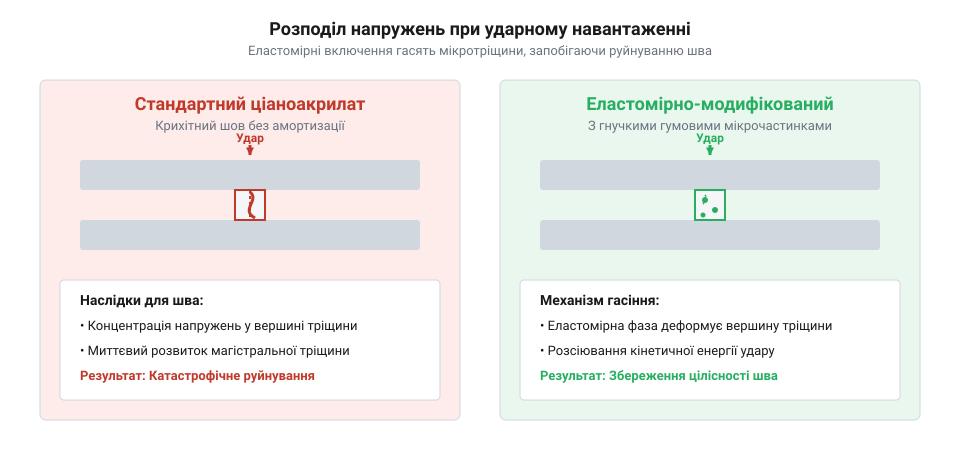
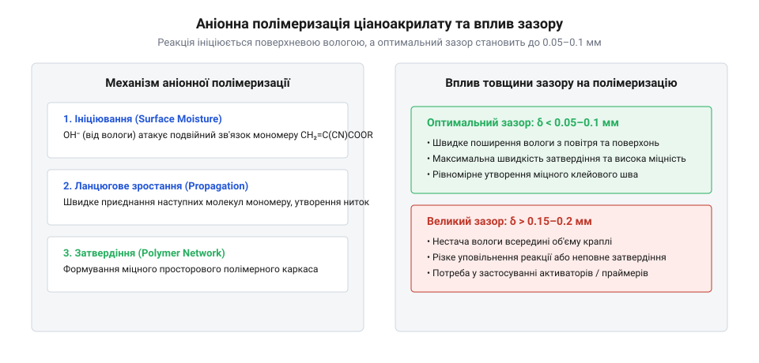
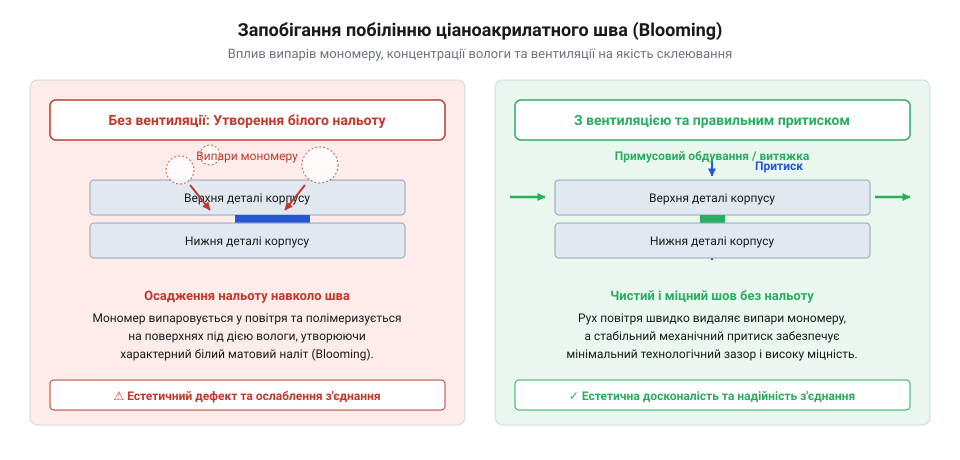
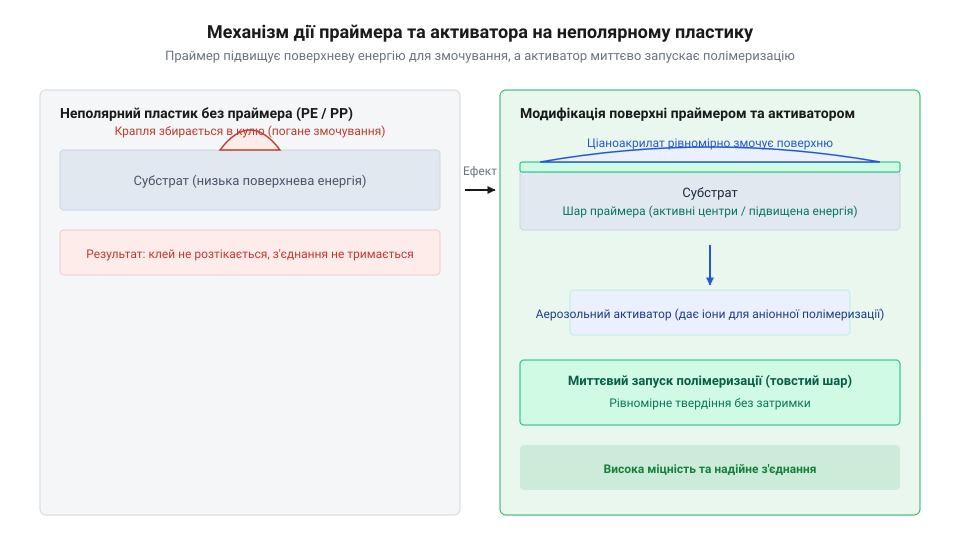

# Клей ціаноакрилатний

<preknowlist>
- [Неодимові магніти (диски й кільця)](root:cat-hw-parts/neodymium-magnets) — специфіку адгезії ціаноакрилатів до металевих нікельованих поверхонь та фіксації магнітів у клейових гніздах
- [Стійки М2/М3 (латунь, нейлон)](root:cat-hw-parts/standoffs) — особливості фіксації латунних та нейлонових нарізних втулок у корпусі за допомогою клейових складів
</preknowlist>

## Руйнування клейових швів у корпусах

Під час збирання радіоелектронної апаратури та приладових корпусів інженери й майстри постійно стикаються з потребою швидко зафіксувати дрібні елементи конструкції. Це може бути монтування [нарізних латунних стійок](root:cat-hw-parts/standoffs) для друкованих плат, встановлення [неодимових магнітів](root:cat-hw-parts/neodymium-magnets) у гнізда знімних кришок або кріплення кутових кронштейнів із пластику. Використання рідкого складу, яким є ціаноакрилат (від грецького @@el|kyanos@@ — темно-синій та латинського @@la|acer@@ — гострий), здається ідеальним рішенням: крапля речовини вхоплює деталі за 3–5 секунд, утворюючи зовні міцне та нерухоме з'єднання. Проте така первинна надійність часто виявляється ілюзорною. За кілька днів експлуатації або під час першого ж випадкового удару корпусу зафіксована стійка відпадає з гладким сколом, а магніт вискакує з гнізда разом із крихкими залишками полімерної плівки.

Причина таких раптових відмов полягає в глибокій невідповідності між високою статичною міцністю ціаноакрилату на розтяг та його вразливістю до динамічних навантажень. Стандартний розчин, в якому присутній мономер (від грецького @@el|monos@@ — один та @@el|meros@@ — частина), після завершення полімеризації формує склоподібну, надзвичайно жорстку полімерну сітку. Цей полімер володіє високою граничною міцністю на чистий розрив (від 15 до 25 МПа), проте його @@en|ударна в'язкість@@ прямує до нуля, а @@en|напруження відшарування@@ є вкрай низьким. Оскільки у полімерній структурі відсутні гнучкі еластомірні сегменти, клейовий прошарок не здатний поглинати й розсіювати кінетичну енергію. Усі зовнішні механічні імпульси, вібрації або зсувні зусилля перетворюються на локальні піки напружень уздовж границі контакту.

При накладанні зсувного або згинального зусилля на жорсткий стик напруження розподіляється нерівномірно по всій площі контакту, як це відбувається при ідеальному розтягу. Максимальне @@en|зсувне напруження@@ концентрується на зовнішній кромці клейового шва. У крихкій речовині найменша мікротріщина на цій кромці стає осередком руйнування. Оскільки матеріал не має пластичності для релаксації напружень, тріщина миттєво поширюється крізь весь клейовий прошарок зі швидкістю звуку. Окремо це проявляється при фіксації [нейлонових нарізних втулок](root:cat-hw-parts/standoffs) або металевих деталей у пластикових корпусах з ABS чи полікарбонату: через розрізненість модулів пружності пластик деформується під навантаженням значно сильніше за метал, викликаючи чистове відшарування клейової плівки від гладкої поверхні.

Щоб кількісно оцінити навантаження у клейовому стику при використанні металевого фурнітурного елемента, звернемося до розрахунку зсувних сил. Обчислимо руйнівне зсувне напруження `τ` для клейового шва неодимового магніту діаметром 8 мм при бічному зсувному зусиллі `F` рівному 120 Н. Площу колового контакту `A` визначаємо через радіус `r` рівний 0.004 м, а число пі `π` приймаємо як 3.1416.

```
A = π · r²
  = 3.1416 × (0.004)²      [підстановка радіуса контакту]
  = 3.1416 × 0.000016      [піднесення радіуса до квадрата]
  = 0.00005027 м²          [обчислення площі контакту]

τ = F / A
  = 120 / 0.00005027       [підстановка зсувного зусилля та площі]
  = 2387109 Па             [ділення сили на площу]
  = 2.39 МПа               [переведення паскалів у мегапаскалі]
```

Отримане середнє значення `τ = 2.39 МПа` здається безпечним, адже воно значно нижче за табличний показник міцності клею на розрив (20 МПа). Однак через геометричний крайовий ефект і відсутність пластичної деформації реальне локальне напруження на кромці клейового шва виявляється в 5–8 разів вищим за середнє обчислене. Детальні [формули та методи розрахунку](root:cat-hw-parts/cyanoacrylate-glue/math-joint-stress-gap-calc.md) розтягувальних і зсувних навантажень дають змогу точно обчислити необхідну площу контакту з урахуванням геометричного коефіцієнта концентрації напружень.

Ще одним прихованим чинником руйнування клейового шва в корпусах є температурне розширення матеріалів. Коефіцієнт лінійного теплового розширення (КТР) латуні становить близько `19 × 10⁻⁶ K⁻¹`, алюмінію — `23 × 10⁻⁶ K⁻¹`, тоді як конструкційні пластики корпусів (ABS, полікарбонат) мають КТР у межах `60–80 × 10⁻⁶ K⁻¹`. Під час нагрівання електронного блоку при роботі пластиковий корпус розширюється утричі швидше за латунну стійку або металеві [різьбові болти і шайби](root:cat-hw-parts/bolts-and-washers). Це викликає постійний циклічний зсув на межі розподілу фаз, який поступово накопичує мікропошкодження в жорсткому клейовому шві та призводить до самовільного відшарування під час охолодження. Крім того, нехтування вимогами до товщини зазору (коли рідкий клей заливають у занадто великі технологічні отвори) призводить до утворення об'ємних усадкових порак всередині полімеру.

Для запобігання крихкому руйнуванню розроблені модифіковані склади, в які введено дисперсні частинки каучуку або еластомірів.


*Порівняння крихкого руйнування стандартного ціаноакрилату та демпфування ударної енергії еластомірними добавками в модифікованому складі.*

Як видно з діаграми розподілу напружень, введення модифікаторів дозволяє еластомірним включенням розсіювати ударну хвилю та зупиняти ріст мікротріщин. Цікаво, що сама [історія відкриття ціаноакрилатів](root:cat-hw-parts/cyanoacrylate-glue/hist-coover-discovery.md) розпочалася саме з пошуку надміцних прозорих матеріалів для оптичних прицілів, де надмірна адгезійна реактивність спочатку вважалася браком. Щоб правильно обирати між звичайними та еластомірно-зміцненими складами для монтажу корпусу, необхідно докладно розібратися у хіміко-фізичному механізмі тверднення рідкого мономеру.

## Механізм полімеризації та класифікація в'язкості

В основі миттєвої дії ціаноакрилатних клеїв лежить @@en|anionic polymerization@@ (від грецького @@el|ana@@ — вгору та @@el|ion@@ — той, що йде), яка ініціюється мікроскопічними слідами поверхневої вологи. Рідкий клей у флаконі являє собою рідкоплинний мономер, найчастіше етиловий ефір α-ціаноакрилової кислоти (етил-2-ціаноакрилат). Молекула мономеру містить подвійний вуглецевий зв'язок `C=C`, до якого приєднані дві потужні електронно-акцепторні групи: ціаногрупа (`-CN`) та складноефірна група (`-COOR`). Ці групи інтенсивно відтягують на себе електронну густину, створюючи на кінцевому атомі вуглецю значний позитивний заряд. Через це молекула мономеру стає надзвичайно чутливою до атаки будь-якими нуклеофільними частинками — донорами електронів.

Найпоширенішим і найактивнішим нуклеофілом у реальних умовах є @@en|гідроксил-іон@@ (`OH⁻`), який утворюється при дисоціації молекул води (`H₂O`), що завжди присутні у вигляді тонкої адсорбованої плівки на поверхні будь-яких матеріалів у повітряному середовищі. Коли крапля клею розмазується між деталями, гідроксил-іон `OH⁻` з поверхні приєднується до електрофільного атома вуглецю подвійного зв'язку. В результаті зв'язок `C=C` розкривається, й утворюється активний карбаніон (від латинського @@la|carbo@@ — вугілля та грецького @@el|ion@@ — той, що йде) — негативно заряджений іон вуглецю. Отриманий карбаніон миттєво атакує подвійний зв'язок сусідньої молекули мономеру, приєднуючи її та переносячи негативний заряд на край ланцюга. Ця полімеризація поширюється за ланцюговим механізмом із колосальною швидкістю: за частки секунди тисячі молекул мономеру об'єднуються у довгі лінійні та частково зшиті полімерні нитки поліетилціаноакрилату.

Виникає логічне запитання: чому рідкий склад не полімеризується прямо у герметичному флаконі? Справа в тому, що під час виробництва в клей додають кислотний інгібітор (від латинського @@la|inhibere@@ — затримувати) — леткий газ на зразок діоксиду сірки (`SO₂`) або метансульфонової кислоти. Протони кислоти (`H⁺`) зв'язують будь-які випадкові гідроксил-іони, блокуючи початок реакції. Однак під час нанесення клею тонким шаром на деталь газоподібний інгібітор випаровується у повітря, а величезне співвідношення площі контакту до об'єму клею дає змогу поверхневій волозі миттєво нейтралізувати залишки кислоти й запустити тверднення. З цього механізму випливає критична залежність від кислотності (pH) поверхонь:
- Кислі поверхні (необроблена деревина, дублена шкіра, кислі паперові прокладки, окислені алюмінієві сплави) нейтралізують гідроксил-іони `OH⁻`, уповільнюючи тверднення у десятки разів або повністю його блокуючи. - Лужні поверхні (скло, кераміка, деякі види термопластів) або спеціальні хімічні активатори, навпаки, постачають надлишок аніонів і прискорюють полімеризацію до часток секунди.

Оскільки джерелом ініціюючих іонів `OH⁻` є виключно поверхня деталей, товщина клейового зазору `δ` є визначальним фізичним параметром всієї технології.


*Каталітичний вплив гідроксильних іон-ініціаторів поверхневої вологи на полімеризацію мономеру та стрімке уповільнення реакції зі збільшенням монтажного зазору.*

Як наочно демонструє схема реакції, при оптимальному технологічному зазорі `δ = 0.02–0.05 мм` фронт полімеризації від обох поверхонь рівномірно змикається по всьому об'єму за 5–15 секунд, утворюючи монолітний клейовий шов. Якщо ж зазор перевищує `0.1–0.15 мм`, волога з поверхонь не здатна дифундувати вглиб товстого шару рідкого мономеру. Внутрішній об'єм клею залишається рідким або утворює пухку аморфну масу низької молекулярної маси, в якій накопичуються внутрішні напруження та виникають порожнини, що знижує підсумкову міцність з'єднання на 80–90%.

Для компенсації неідеальності геометричних зазорів та оптимізації монтажу під конкретні завдання корпусного збирання ціаноакрилатні склади класифікують за реологічною характеристикою, якою є @@en|в'язкість@@. Динамічна в'язкість вимірюється в сантипуазах (cP) або міліпаскаль-секундах (мПа·с). За цим показником клеї поділяють на три основні технологічні категорії:

1. **Низьков'язкі (рідкоплинні) склади (1–20 cP):** За консистенцією нагадують воду. Завдяки високій плинності вони володіють сильним капілярним ефектом і здатні самостійно затікати у зібрані щільні з'єднання з зазором `δ < 0.03 мм`. Вони ідеально підходять для фіксації деталей із гладкими непористими поверхнями, мікротріщин у пластику або як нарізний фіксатор для [монтажних гвинтів М3](root:cat-hw-parts/m3-screw-kits). Проте вони легко витікають із відкритих стиків і дають рясне випаровування мономеру. 2. **Середньов'язкі склади (100–500 cP):** За консистенцією схожі на моторну олію. Це універсальні ремонтні та монтажні склади для повсякденних завдань. Вони добре утримуються на краплі, не розтікаються миттєво по поверхні й дають змогу надійно монтувати [пластикові та металеві стійки](root:cat-hw-parts/standoffs) при зазорах до `0.05–0.1 мм`. Початкова фіксація відбувається за 10–30 секунд, що залишає невеликий час для точного позиціонування деталі. 3. **Високов'язкі склади та гелі (1000–100 000 cP):** Тіксотропні гелі (від грецького @@el|thixis@@ — дотик та @@el|trope@@ — зміна). @@en|тиксатропія@@ проявляється у здатності гелю розріджуватися під дією механічного тиску та миттєво густішати у стані спокою. Гелі незамінні при роботі на вертикальних та стельових поверхнях, склеюванні пористих матеріалів (дерево, кераміка) та заповненні великих монтажних зазорів до `0.2–0.25 мм`. Гелева форма запобігає передчасному всмоктуванню клею в пори матеріалу до моменту початку полімеризації.

Для акуратного зберігання різних марок клеїв, праймерів та додаткового інструменту на робочому місці зручно використовувати окремий осередковий блок з [пластикового органайзера](root:cat-hw-parts/parts-organizer). У випадках, коли корпусні деталі виготовлені з важкосклеювальних неполярних пластиків (поліпропілен, поліетилен, фторопласт) або вимагають негайного застигання у товстому шарі, звичайної поверхневої вологи стає недостатньо. У таких умовах обов'язково застосовують допоміжну хімію — праймери та активатори. Докладний [технологічний регламент підготовки](root:cat-hw-parts/cyanoacrylate-glue/proj-enclosure-bonding-technology.md) поверхонь, правила нанесення праймерів і безпечного поводження з активаторами визначають успіх формування стійкого до зовнішніх впливів клейового з'єднання.

## Модифіковані ціаноакрилати для підвищених навантажень

Перш за все варто зрозуміти, чому стандартний етилціаноакрилат ламається там, де корпусна деталь зазнає найменшого удару чи вібрації. Тверднення звичайного мономеру під дією поверхневої вологи формує лінійний крихкий полімер, який має високу міцність на прямий розрив, але практично не здатен до пластичної деформації. Коли корпусна деталь зазнає ударного навантаження, падіння чи постійної вібрації, у монолітному склянистому шві виникають мікротріщини. Оскільки крихкий полімер не має внутрішніх елементів для поглинання механічної енергії, верхівка тріщини миттєво проростає крізь усю товщу клейового контакту, спричиняючи катастрофічне руйнування з'єднання.

Особливо гостро ця проблема проявляється при навантаженнях на відшарування та зсув. У таких умовах напруження зосереджується не по всій площі контакту, а вузькою смугою вздовж зовнішнього краю шва. Крихка полімерна матриця не здатна перерозподілити це локальне напруження, що призводить до послідовного зрізання молекулярних зв'язків ланцюг за ланцюгом.

Для подолання цієї фізичної обмеженості розроблено еластомірно-зміцнені склади. Термін @@en|elastomer@@ (від грец. @@el|elatos@@, гнучкий, та @@el|meros@@, частина) позначає полімерні матеріали з високою еластичністю. У рідку фазу мономеру вносять мікроскопічні фазово-розділені частинки синтетичного каучуку, наприклад каучуку @@en|NBR@@ (від англ. @@en|Nitrile Butadiene Rubber@@, нітрильний каучук) або @@en|EPR@@ (від англ. @@en|Ethylene Propylene Rubber@@). Ці частки розміром від `0.1` до `1.0 мкм` перебувають у підвішеному стані та утворюють двофазну структуру після полімеризації.

Принциповим хімічним моментом є наявність полярних нітрильних груп у каучуку @@en|NBR@@, які забезпечують термодинамічну сумісність із мономерною матрицею під час зберігання клею в рідкому стані. Однак у процесі аніонної полімеризації розчинність еластомера стрімко знижується, спричиняючи мікрофазове розшарування. У результаті виникає матриця рідкого етилціаноакрилату з рівномірно розподіленими нанокраплями еластомера.

Коли на шов діє зовнішній удар чи зсув, каучукові вкраплення виконують роль мікроскопічних демпферів. Вони перерозподіляють локальні напруження, викликають мікротечію навколишньої матриці та зупиняють розповсюдження тріщин, розсіюючи кінетичну енергію у вигляді тепла. У верхівці тріщини, що починає рости, каучукова частинка зазнає локального витягування та мікрокавітації, поглинаючи енергію та закруглюючи гострий фронт тріщини.

Завдяки еластомірній модифікації ударостійкість клейового з'єднання зростає у `5–10` разів, а міцність на відшарування підвищується у кілька разів порівняно з базовими складами. Це робить такі клеї незамінними при монтажі рухомих або вібраційно-навантажених вузлів, наприклад при фіксації [неодимових магнітів](root:cat-hw-parts/neodymium-magnets) у гніздах корпусів або при вклеюванні важких елементів живлення.

Обчислимо допустиме статичне навантаження `P` на шов площею `A` при розрахунковій міцності на зсув `τ_max` для модифікованого складу:

```
P = A × τ_max                      [рівняння статичної рівноваги]
  = 50 × 18                        [підстановка площі 50 мм² та міцності 18 МПа]
  = 900 Н                          [граничне зсувне зусилля]
```

Значення `900 Н` показує статичну руйнівну силу, однак головна перевага еластомірного клею полягає в тому, що при динамічному ударі шов зберігає цілісність, тоді як ззвичайний склад руйнується вже при `200 Н`. Детальніше математичний апарат розрахунку геометрії шва та розподілу зсувних напружень подано у матеріалі з [математичним розрахунком клейового шва](root:cat-hw-parts/cyanoacrylate-glue/math-joint-stress-gap-calc.md).

Другою критичною перешкодою є температурна деструкція. Стандартний поліетилціаноакрилат починає деполімеризуватися при температурах понад `80°C` через реверсивний розрив вуглець-вуглецевих зв'язків у головному ланцюзі полімеру (механізм @@en|unzipping@@). Додатково ситуацію ускладнює різниця коефіцієнтів термічного розширення (КТР) металу та пластику, яка створює нищівні зсувні напруження на межі розділу поверхонь. Наприклад, при нагріванні електронного блоку латунь чи алюміній мають КТР близько `18–23 × 10⁻⁶ K⁻¹`, тоді як пластиковий корпус з АБС чи полікарбонату має КТР `60–80 × 10⁻⁶ K⁻¹`. При коливаннях температури пластик розширюється у `3–4` рази сильніше за метал, що призводить до зрізання клейового шару.

Для роботи в умовах підвищених температур застосовують термостійкі ціаноакрилати. Їхня хімічна формула містить додаткові біс-ціаноакрилати (мономери з двома функціональними ціаноакрилатними групами) або ангідридні добавки, такі як малеїновий чи фталевий ангідрид. Полімеризація мономеру @@en|bis-cyanoacrylate@@ приводить до формування не лінійних полімерних ланцюгів, а густозшитої тривимірної полімерної сітки. Зшита структура унеможливлює розгортання ланцюгів при нагріванні та підвищує температуру склування полімеру `T_g` з `65°C` до понад `140°C`.

У результаті термостійкі марки витримують тривалий нагрів до `120°C–140°C` і короткочасні пікові навантаження до `150°C`, зберігаючи адгезію при вклеюванні металевих [стійок М2 та М3](root:cat-hw-parts/standoffs) або нарізних елементів, які контактують із силовою електронікою або радіаторами. При цьому для монтажу масивних силових кронштейнів краще застосовувати традиційне нарізне з'єднання з використанням [болтів М5](root:cat-hw-parts/bolts-and-washers), поєднуючи його з хімічною фіксацією.

Третьою проблемою при складанні корпусної фурнітури є ефект побіління, або @@en|blooming@@ (від англ. @@bloom@@, цвітіння). Молекули стандартного мономеру етилціаноакрилату мають високий тиск насиченої пари (`~0.2 мм рт. ст.` при `20°C`). У процесі дозування та тверднення частина мономеру інтенсивно випаровується у навколишнє повітря. Зітовхуючись із вологою повітря над поверхнею корпусу, випарувані молекули полімеризуються безпосередньо у повітряному середовищі та осідають у вигляді найдрібнішого білого полімерного пилу навколо клейового шва. Це псує зовнішній вигляд декоративних панелей, прозорих світловодів та темного пластику.


*Підпис: Механізм випаровування мономеру з утворенням білого осадження на пластикових деталях та його запобігання шляхом примусового повітряного обдування шва.*

Для усунення побіління розроблено слабовипаровувані марки на основі алкоксіалкільних ефірів. Мономер @@en|alkoxyalkyl cyanoacrylate@@ містить важчу ефірну групу, таку як @@en|methoxyethyl cyanoacrylate@@ або @@en|ethoxyethyl cyanoacrylate@@. Збільшення молекулярної маси мономеру знижує тиск пари більш ніж у `20` разів (`< 0.01 мм рт. ст.`). Мономери практично не випаровуються з поверхні краплі, що повністю виключає утворення білого нальоту навіть без примусової вентиляції.

Слід зауважити, що алкоксіалкільні ціаноакрилати мають дещо меншу статичну міцність на розрив (близько `14–16 МПа` проти `20–22 МПа` в етилових складів), проте для більшості завдань закріплення елементів корпусу цього показника цілком достатньо. Історичні аспекти вивчення прозорих мономерів та розробки перших клеїв описані у матеріалі про [випадковому відкритті ціаноакрилату](root:cat-hw-parts/cyanoacrylate-glue/hist-coover-discovery.md).

## Праймери, активатори та деактиватори полімеризації

Застосування навіть найстійкішого модифікованого ціаноакрилату стає неможливим, якщо поверхня деталі не здатна змочуватися рідким мономером або якщо кліматичні умови середовища блокують аніонну полімеризацію. Корпусні деталі часто виготовляють із неполярних полімерів із низькою поверхневою енергією, таких як поліпропілен (@@en|polypropylene@@, PP), поліетилен (@@en|polyethylene@@, PE) та політетрафторетилен (@@en|polytetrafluoroethylene@@, @@en|PTFE@@, фторопласт).

З фізичної точки зору змочуваність описується рівнянням Юнга:

```
cos θ = (γ_SV - γ_SL) / γ_LV       [рівняння Юнга для крайового кута змочування]
```

де `γ_SV` — поверхневий натяг твердого тіла на межі з газом, `γ_SL` — міжфазний натяг між твердим тілом і рідиною, а `γ_LV` — поверхневий натяг рідини. Для неполярних полімерів поверхнева енергія `γ_SV` становить менше `30 мН/м` (для PTFE — лише `18 мН/м`), тоді як рідкий ціаноакрилат має поверхневий натяг `γ_LV` близько `35–40 мН/м`. Оскільки `γ_SV < γ_LV`, крапля клею не розтікається по поверхні, а згортається у сферу з крайовим кутом змочування `θ > 90°`. Рідкий мономер не здатний утворити молекулярний контакт із пластиком, і після тверднення шов легко відшаровується без жодної адгезії.

Для забезпечення високої міцності зчеплення з неполярними пластиками використовують спеціальний хімічний засіб — праймер. Термін @@en|primer@@ (від лат. @@la|primus@@, перший) позначає ґрунтувальний склад, який наноситься перед основним клеєм. Праймер є розчином металоорганічних сполук (наприклад, трифенілового фосфіну або аліфатичних третинних амінів) у надзвичайно леткому неполярному розчиннику, якому слугує @@en|heptane@@ (від грец. @@el|hepta@@, сім, за кількістю атомів вуглецю).

Механізм дії праймера полягає у двох послідовних фізико-хімічних етапах. Спочатку гептан здатний змочувати неполярну поверхню завдяки низькому власному поверхневому натягу (`18.4 мН/м`). Він розчиняє тонкий приповерхневий шар полімеру й переношує активні амфіфільні молекули праймера в глибину поверхневої зони. Протягом `10–20` секунд гептан повністю випаровується, залишаючи на поверхні мономолекулярний шар активних нуклеофільних центрів.

Полярна частина молекули праймера спрямована назовні, модифікуючи поверхневу енергію пластику та підвищуючи її до `45–50 мН/м`. Коли після цього наноситься ціаноакрилат, нуклеофільні групи праймера миттєво ініціюють аніонну полімеризацію мономеру прямо на межі розділу фаз, забезпечуючи високу хімічну адгезію. Такий підхід є критичним, зокрема, при герметизації корпусу навколо [захисних клапанів ePTFE](root:cat-hw-parts/eptfe-protective-vents), де поверхня мембрани вимагає акуратної обробки без засмічення мікропор.

Іншим технологічним викликом є занадто низька відносна вологість повітря (< `40%`), великий монтажний зазор (> `0.1 мм`) або кисла реакція поверхні. Наприклад, деревина, папір або пасовані металеві поверхні після хімічного травлення мають кисле середовище (pH < `6`). Кислотні іони нейтралізують гідроксил-іони вологи, у результаті чого полімеризація базового клею сповільнюється до декількох годин або припиняється взагалі.

Для прискорення полімеризації у складноступних умовах застосовують активатори, або акселератори. Активатор містить третинні аліфатичні чи ароматичні аміни, такі як @@en|dimethyl-p-toluidine@@, розчинені у швидковипаровуваному ізопропанолі або гептані, і поставляється у вигляді аерозольного балончика.


*Підпис: Схема модифікації поверхні неполярного пластику праймером та дія аерозольного активатора в об'ємі клею.*

При розпиленні активатора на поверхню або безпосередньо на клейовий шов молекули аміну діють як потужні автономні ініціатори полімеризації. Вони віддають електронну пару мономеру незалежно від наявності поверхневої вологи чи pH матеріалу. Це викликає миттєве затвердіння всієї маси клею у зазорах до `0.5 мм` за `1–3` секунди.

Активатори застосовують при фіксації металевих деталей з використанням [наборів гвинтів М3](root:cat-hw-parts/m3-screw-kits) або антикорозійного [кріплення М2.5](root:cat-hw-parts/m25-fastener-kit), коли потрібно негайно знерухомити нарізне з'єднання або заповнити технологічний зазор між втулкою та отвором у корпусі.

Проте при використанні активаторів слід враховувати фізичні обмеження. Вибухоподібна полімеризація викликає сильний екзотермічний ефект — температура клейової краплини може піднятися до `80°C–100°C`, що загрожує термічною деформацією тонкостінних пластикових корпусів. Крім того, надто швидке тверднення не дає макромолекулам сформувати впорядковану упаковку, що знижує підсумкову статичну міцність шва на `15–20%`.

У процесі монтажних робіт виникає і протилежне завдання — видалення випадкових патьоків клею, розклеювання помилково з'єднаних деталей або очищення інструменту. Оскільки звичайний ціаноакрилат є лінійним термопластом, його можна розчинити за допомогою спеціальних деактиваторів.

Основними діючими речовинами деактиваторів є високополярні апротонні розчинники, такі як @@en|nitromethane@@ (від лат. @@la|nitrum@@ та грец. @@el|methy@@) або @@en|dimethyl sulfoxide@@ (@@en|DMSO@@, диметилсульфоксид).

Молекули нітрометану мають високий дипольний момент (`3.46 D`), який відповідає параметрам розчинності Гільдебранда для поліціаноакрилату. Вони легко проникають між полімерними ланцюгами, руйнують міжмолекулярні диполь-дипольні взаємодії та сольватують макромолекули, перетворюючи твердий клейовий шов на в'язкий рухливий гель.

Деактиватор, нанесений на шов, розм'якшує його протягом `5–15` хвилин, дозволяючи відокремити деталі без механічних пошкоджень та скласти очищене металеве кріплення в [органайзері деталей](root:cat-hw-parts/parts-organizer) для повторного використання.

Повний цикл підготовки поверхонь, дозування складів, внесення активатора та витримки під притиском детально описаний у практичному матеріалі з [технологічним процесом склеювання](root:cat-hw-parts/cyanoacrylate-glue/proj-enclosure-bonding-technology.md).

## Підготовка поверхонь, монтаж та безпека

Найпродуманіша хімічна формула модифікованого ціаноакрилату виявляється безсилою, якщо клейовий контакт формується на забрудненій, гладкій або вкритій технологічними змазками поверхні. При складанні корпусних вузлів основною причиною раптового руйнування з'єднань є не деструкція самого полімеру, а відшарування шва по межі розділу фаз. Щоб потенціал міцності рідкого мономеру реалізувався повною мірою, підготовка деталей, дозування клею та дотримання правил безпеки мусять утворювати єдиний суворий регламент.

Першим невід'ємним етапом є механічне абразивне оброблення поверхонь. Термін @@en|abrasive@@ (від нім. @@de|Abrasiv@@, від лат. @@la|abrasio@@, зіскрібання) позначає матеріал або процес підготовки поверхні шляхом мікрорізання й знімання верхнього шару. Литі пластикові корпуси майже завжди несуть на собі залишки силіконових або воскових агентів розформування, а металеві деталі вкриті оксидними плівками й пасувальними змазками, які блокують хімічну адгезію. Абразивне оброблення видаляє цей слабкий приповерхневий шар і створює мікрорельєф із розвиненою площею контакта. Завдяки утворенню канавок та мікропоглиблень ефективна площа молекулярного зчеплення зростає у `2–3` рази, а полімеризований @@en|ціаноакрилат@@ отримує додаткову механічну фіксацію за рахунок анкерування в шорсткій структурі. Для більшості конструкційних матеріалів оптимальною вважається шорсткість `Ra 1.6–3.2 мкм`, яка досягається шліфуванням дрібнозернистим папером із зернистістю `P240–P400` або абразивним волокном. При цьому для неполярних пластиків механічне зачищення має передувати нанесенню хімічного @@en|primer@@, а для тонкостінних пластикових деталей оброблення виконують з мінімальним натиском, щоб не порушити посадочні геометричні допуски.

Наступним кроком є ретельне знежирення поверхонь, або @@en|degreasing@@ (від англ. @@en|degrease@@, знежирювати). Навіть найменший слід жиру від пальців або залишок мастила створює суцільний гідрофобний бар'єр, який перешкоджає змочуванню деталі мономерним рідким клеєм. Основним розчинником для знежирення є чистий ізопропіловий спирт (від грец. @@el|isos@@, рівний, та @@el|protos@@, перший, @@el|pion@@, жир) із вмістом основної речовини понад `99.8%` або чистий @@en|heptane@@. Застосування ацетону (від нім. @@de|Aceton@@, від лат. @@la|acetum@@, оцет) чи агресивних розчинників для розрядження фарб строго обмежене: @@en|acetone@@ спричиняє розтріскування під напруженням та часткове розчинення аморфних пластиків, таких як АБС-пластик, полістирол або полікарбонат (@@en|polycarbonate@@). Знежирення виконують безворсовими серветками, просоченими розчинником, рухаючись в одному напрямку, щоб не розмазувати видалений жир по зачищеній зоні. Після оброблення обов'язково витримують технологічну паузу на випаровування розчинника тривалістю `30–60 секунд`. Якщо нанести клей на вологий від спирту шов, залишки розчинника розбавлять мономер і спричинять його передчасну каламутну полімеризацію в об'ємі з втратою міцності.

Дозування мономеру та контроль монтажного притиску вимагають точного розуміння фізики тверднення. Оскільки аніонна @@el|полімеризація@@ ініціюється поверхневою вологою, швидке й повне тверднення можливе лише у тонкому монтажному зазорі товщиною `0.02–0.05 мм`. Надлишкове внесення клею є найпоширенішою технологічною помилкою: товстий шар мономеру ізолює внутрішній об'єм від вологи повітря, у результаті чого всередині шва годинами залишається рідкий мономер, а надлишки клею видавлюються назовні. Нормою дозування є `1` крапля рідкого складу на `2–3 см²` площі з'єднання. Одразу після нанесення краплі деталі суміщають і стискають із рівномірним зусиллям `0.1–0.3 МПа`. Початкова фіксація відбувається протягом `5–30 секунд`. У цей проміжок деталі категорично заборонено зсувати чи повертати відносно одна одної: будь-який бічний зсув під час первинного схоплювання руйнує перші сформовані макромолекулярні ланцюги полімерної сітки, знижуючи підсумкову міцність зчеплення більш ніж удвічі. Повний набір механічної міцності (до `20–25 МПа`) триває `12–24 години`.

Ці правила є вирішальними при складанні відповідальних вузлів корпусної фурнітури. Зокрема, при встановленні латунних чи нейлонових [стійок М2 та М3](root:cat-hw-parts/standoffs) у глухі гнізда корпусу клей дозують мікрокраплею на бічну стінку отвору, уникаючи потрапляння рідкого мономеру у внутрішній нарізний канал. Якщо @@en|ціаноакрилат@@ затікає на різьбу, він блокує наступне закручування [наборів гвинтів М3](root:cat-hw-parts/m3-screw-kits) або антикорозійного [кріплення М2.5](root:cat-hw-parts/m25-fastener-kit). При фіксації [неодимових магнітів](root:cat-hw-parts/neodymium-magnets) у металеві нікельовані посадочні місця гладку поверхню нікелю обов'язково піддають легкій абразивній обробці та знежиренню ізопропанолом, а для клейового контакту застосовують еластомірно-модифіковані склади, здатні гасити ударні навантаження при магнітному притяганні деталей. При герметизації монтажних фланців навколо [захисних клапанів ePTFE](root:cat-hw-parts/eptfe-protective-vents) на поверхню фланця попередньо наносять @@en|primer@@, а клей дозують високов'язким гелем строго по периметру, не допускаючи розтікання мономеру на мікропористу дихаючу мембрану.

Запобігання ефекту побіління, або @@en|blooming@@, досягається комбінацією технологічних прийомів. Випари мономеру з відкритих крапель клею інтенсивно осідають на холодних полірованих і темних поверхнях корпусу у вигляді білого полімерного нальоту. Щоб запобігти цьому дефекту, зону склеювання піддають примусовому обдуванню спрямованим потоком сухого повітря або підключають витяжну вентиляцію на весь час первинної полімеризації, видаляючи випари мономеру від декоративних панелей. Додатково застосовують слабовипаровувані ефірні мономери, такі як @@en|alkoxyalkyl cyanoacrylate@@, або прискорюють поверхневе тверднення за допомогою аерозольного @@en|activator@@, який миттєво зшиває мономер до того, як той встигне випаруватися.

Якщо під час стискання деталей виникли надлишки клею, їхнє видалення залежить від стану мономеру. Рідкі патьоки видаляють сухою безворсовою серветкою одразу після з'єднання, не розмазуючи їх по пластику. Затверділі патьоки або помилково зафіксовані деталі обробляють спеціальним засобом — деактиватором. Склад, де діє @@en|nitromethane@@ або диметилсульфоксид (@@en|DMSO@@), наносять на шов і витримують `5–15 хвилин`. Полярний @@en|деактиватор@@ сольватує макромолекули й перетворює твердий шов на м'який гель, який легко знімається скребком. При випадковому склеюванні пальців категорично заборонено розривати шкіру силою — це призводить до болісного розриву епідермісу. Пальці слід занурити у теплу мильну воду або обробити спиртом/ацетоном і повільно здійснювати обертальні рухи, дозволяючи клейовому плівковому контакту розм'якшитися природним шляхом.

Окрему увагу при роботі з ціаноакрилатами слід приділити правилам безпеки через ризик виникнення екзотермічної реакції. Виразом @@en|exothermic reaction@@ (від грец. @@el|exo@@, зовні, та @@el|therme@@, тепло) позначають хімічний процес із виділенням великої кількості теплової енергії. Мономер ціаноакрилату вкрай активно реагує з натуральними волокнами бавовни, вовни та паперу. Гідроксильні групи целюлози виступають масованими ініціаторами аніонної полімеризації, викликаючи вибухоподібне затвердіння всієї маси клею. При потраплянні краплі мономеру на бавовняні рукавички чи одяг температура у зоні контакту миттєво стрибає понад `100–120 °C`, що спричиняє важкі термічні опіки шкіри та загрожує самозайманням тканин. З цієї причини категорично заборонено використовувати бавовняні або вовняні рукавички під час склеювання — слід застосовувати виключно @@en|nitrile@@ (нітрилові) або поліетиленові захисні рукавички. Крім того, оператор мусить працювати у захисних окулярах для відбиття випадкових бризок клею при стисканні деталей та у добре вентильованому приміщенні для захисту слизових оболонок від подразнювальних мономерних випарів.

Повний покроковий опис регламенту підготовки поверхонь, дозування складів, витримки під притиском та контролю якості вузлів міститься у практичному матеріалі з [технологічним процесом склеювання](root:cat-hw-parts/cyanoacrylate-glue/proj-enclosure-bonding-technology.md).