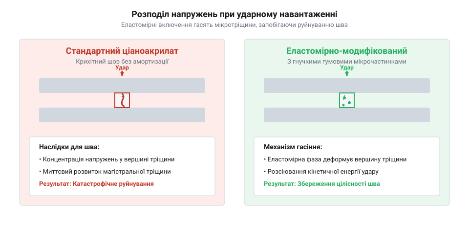
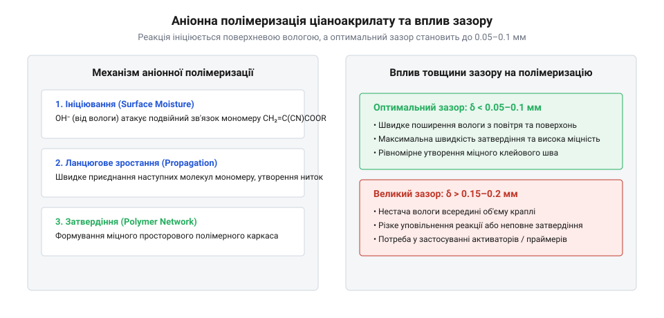
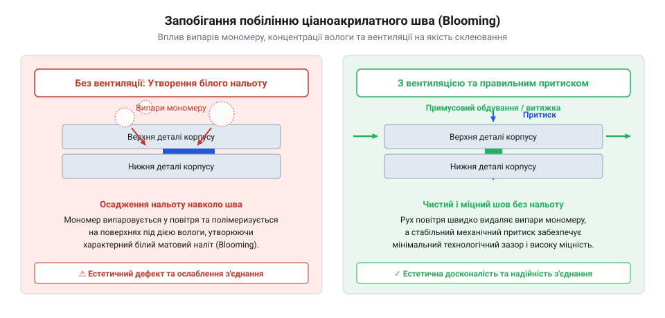

# Ціаноакрилатний клей у конструкціях РЕА

<preknowlist>
- [Неодимові магніти (диски й кільця)](root:cat-hw-parts/neodymium-magnets) — Специфіку адгезії ціаноакрилатів до нікельованих поверхонь магнітів та фіксації їх у гніздах.
- [Стійки М2/М3 (латунь, нейлон)](root:cat-hw-parts/standoffs) — Особливості фіксації нарізних втулок у корпусі за допомогою клейових складів.
</preknowlist>

## Руйнування клейових швів у корпусах

Під час збирання корпусних пристроїв часто виникає потреба миттєво зафіксувати деталі, проте звичайний ціаноакрилатний клей (у побуті відомий як суперклей) під час ударів чи механічних коливань раптово тріскається. Причиною цього є надзвичайна крихкість полімерної сітки, яка утворюється після застигання, через що будь-який різкий навантажувальний імпульс миттєво проростає у вигляді магістральної тріщини вздовж усієї площини з'єднання. Цей деструктивний процес посилюється так званим крайовим ефектом, коли напруга концентрується на межі клейового шару й країв деталей, особливо якщо матеріали мають різний коефіцієнт температурного розширення й під час нагрівання деформуються нерівномірно. Через це жорсткий шов не здатний амортизувати мікрозміщення, що призводить до відриву стійок чи інших елементів кріплення при найменшому падінні пристрою.

*Порівняння ударної стійкості стандартного та модифікованого клейових швів демонструє, як концентрація напружень у крихкій структурі призводить до миттєвого руйнування.*

## Механізм полімеризації та в'язкість

Для того щоб рідкий клей перетворився на тверду монолітну сполуку, не потрібні ані ультрафіолет, ані підвищена температура чи змішування компонентів із каталізатором. Процес запускається під дією найдрібніших часток вологи, адсорбованих на поверхні деталей або розсіяних у повітрі, які ініціюють миттєву аніонну полімеризацію мономеру (@@en|cyanoacrylate@@). Молекули ефіру ціаноакрилату під впливом гідроксильних груп починають ланцюгову реакцію, миттєво зшиваючись у довгі полімерні ланцюги. Ця швидкість безпосередньо залежить від ширини монтажного зазору: занадто товстий шар клею заважає рівномірному доступу вологи з повітря, через що внутрішні об'єми залишаються рідкими або полімеризуються з утворенням пористої структури. Тому для точних з'єднань використовують низьков'язкі склади, що затікають у мікрозазори капілярним методом, тоді як для заповнення нерівностей чи пористих поверхонь обирають густіші гелеві варіанти.

*Вплив монтажного зазору на аніонну полімеризацію ціаноакрилату: надто широкий зазор сповільнює реакцію та утворює слабкі ділянки.*

## Модифіковані склади та безпека

Щоб подолати природну крихкість непосилених складів, до формули вводять спеціальні еластомірні добавки та каучукові мікрочастинки, які працюють як демпфери, зупиняючи поширення мікротріщин і підвищуючи стійкість до ударів та вібрацій. Під час роботи з такими потужними швидкодіючими клеями слід пам'ятати про екзотермічний характер реакції: виділення тепла при контакті з бавовняними тканинами чи серветками може спричинити миттєве займання, а випаровування легких мономерів викликають подразнення слизових оболонок очей і дихальних шляхів. Щоб запобігти появі білого нальоту (так званого ефекту «вицвітання» або blooming) навколо шва через осідання летких продуктів реакції, необхідно забезпечити інтенсивну примусову вентиляцію робочого місця та уникати надмірного дозування матеріалу. Для надійного збирання вузлів часто використовують якісне кріплення, наприклад [набори гвинтів М3](root:cat-hw-parts/m3-screw-kits) (шестигранник, потайні DIN 7991) або [стійки М2/М3](root:cat-hw-parts/standoffs) (латунь, нейлон), комбінуючи механічну фіксацію з хімічною.

*Організація вентиляції та контрольоване дозування дозволяють уникнути утворення білого нальоту навколо клейового шва.*
