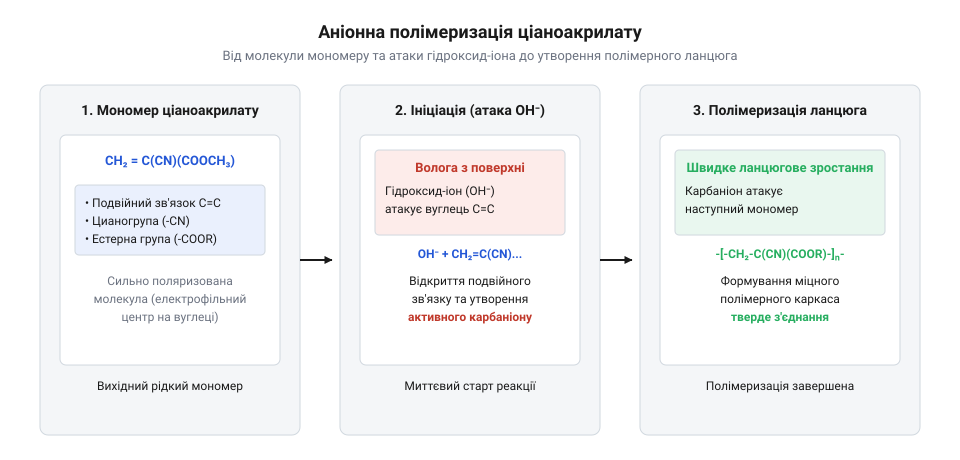
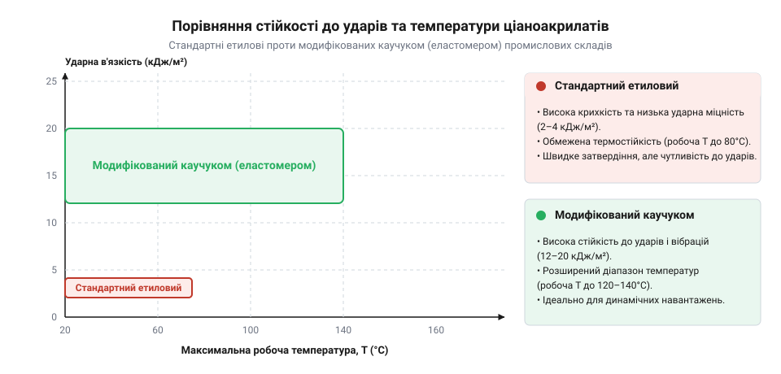

# Відкриття та еволюція ціаноакрилатних клеїв

## Пошук пластиків для авіаційних прицілів

Під час Другої світової війни військова авіація гостро потребувала легких, міцних і абсолютно прозорих полімерних матеріалів для виготовлення прицільних пристроїв стрілецького озброєння та бомбардувальних прицілів літаків. Звичне скло було важким, тендітним і створювало небезпеку для екіпажу при пошкодженнях, тому дослідницькі лабораторії по всьому світу активізували пошуки нових органічних сполук. У 1942 році в лабораторії компанії Eastman Kodak американський хімік Гаррі Кувер (@@en|Harry Coover@@) разом із колегами досліджував властивості ефірів ціаноакрилової кислоти, прагнучи створити прозорий пластик для авіаційних прицілів. 

Під час чергового етапу випробувань ефіри етилціаноакрилату (@@en|ethyl cyanoacrylate@@) продемонстрували вкрай незвичну поведінку: замість того, щоб сформувати зручний для обробки листовий пластик у формі, вони миттєво й намертво склеїли між собою скляні поверхні лабораторних призм рефрактометра. Для хіміків того часу це означало повний провал експерименту, адже дорогі оптичні прилади виявилися безповоротно зіпсованими через надзвичайну липкість і швидкість твердіння невідомої речовини. Кувер визнав сполуку непридатною для оптики та перспективного авіаційного застосування, призупинивши подальші дослідження цього класу речовин на кілька років, оскільки промислові стандарти вимагали передбачуваних термопластичних матеріалів, а не неконтрольованих клейких субстанцій.

Первинний синтез мономерів алкілціаноакрилатів здійснювався через реакцію конденсації ефірів ціанооцтової кислоти (@@en|cyanoacetate@@) з формальдегідом у присутності каталізаторів основного характеру з наступним термічним розкладанням утвореного полімерного проміжного продукту. Проте отримані ефіри виявилися абсолютно непридатними для лиття під тиском у металевих прес-формах через свою надзвичайну, катастрофічну реакційну здатність: найменші мікроскопічні сліди вологи чи адсорбованої води на поверхні оснастки миттєво ініціювали миттєву аніонну полімеризацію рідкого мономера, перетворюючи його на тверду неплавку масу ще до завершення циклу формування деталі. В умовах оптичного виробництва та точного лиття пластмас під тиском така чутливість унеможливлювала контроль за процесом, оскільки полімер застигав безпосередньо в канальних соплах і прес-формах, що повністю блокувало обладнання та робило серійне виготовлення лінз і корпусів неможливим.

## Повторне переосмислення сполуки у 1951 році

Через дев'ять років, у 1951 році, Гаррі Кувер працював керівником групи дослідників у лабораторії Eastman Kodak у Кінгспорті, штат Теннессі, де розробляв термостійкі покриття для кабін реактивних винищувачів серії @@en|F-102 Delta Dagger@@. Під час вимірювання показників заломлення за допомогою нового ефірного мономеру один із його співробітників, Фред Джойнер (@@en|Fred Joyner@@), помітив, що дорога оптика знову намертво склеїлася тонким шаром невідомої речовини. Цього разу Кувер підійшов до проблеми з інженерної точки зору, вирішивши досконало дослідити причину надзвичайної адгезії, яка раніше вважалася лише лабораторним браком.

Дослідивши фізичні та хімічні властивості мономеру, дослідники з'ясували, що матеріал полімеризується не внаслідок звичного охолодження чи випаровування розчинника, а під дією найменшої кількості вологи або слабких лужних сполук на поверхнях предметів. Молекули етилціаноакрилату під впливом гідроксид-іонів води миттєво запускають ланцюгову реакцію аніонної полімеризації (@@en|anionic polymerization@@), перетворюючись на міцний твердий полімер за лічені секунди без будь-якого зовнішнього нагрівання чи тиску.



*Аніонна полімеризація етилціаноакрилату під дією поверхневої вологи формує міцний полімерний ланцюг за лічені секунди.*

Це відкриття повністю змінило уявлення про можливості з'єднання матеріалів, адже з'явився інструмент для миттєвого монтажу деталей без складного обладнання. Для забезпечення надійності приладів у польових умовах інженери часто використовували надійне кріплення, наприклад, набори гвинтів М3 (шестигранник, потайні DIN7991) (root:cat-hw-parts/m3-screw-kits), проте новий клей відкривав принципово нові шляхи для швидкого ремонту та фіксації елементів конструкцій.

Під час прецизійного вимірювання показників заломлення нового ефіру на рефрактометрі Abbe сталася непередбачувана хімічна взаємодія, що продемонструвала виняткову реакційну здатність мономеру. Навіть після ретельного очищення оптичних поверхонь на мікрорівні на них неминуче залишаються сліди силанових груп (`Si-OH`) та адсорбована мономолекулярна плівка вологи із повітря. Коли крапля ціаноакрилату заповнила мікрозазор між важкими скляними призмами, поверхневі гідроксильні та силанольні центри скла спричинили миттєву нуклеофільну атаку на сильно поляризований і електронодефіцитний вінільний зв'язок мономеру. Це запустило ланцюгову реакцію аніонної полімеризації без жодного зовнішнього каталізатора чи нагрівання, перетворивши рідку пробійну плівку на тривимірну сітку полімеру, яка намертво склеїла коштовні вимірювальні призми вартістю в тисячі доларів.

## Комерційний дебют суперклею Eastman 910

У 1958 році компанія Eastman Kodak вивела на ринок перший у світі комерційний ціаноакрилатний клей під назвою @@en|Eastman 910@@, який згодом отримав загальну назву суперклей (@@en|super glue@@). Назва продукту походила від початкової лабораторної номенклатури та терміну випробувань, а сам вихід на ринок супроводжувався чималим подихом інженерної спільноти. У середовищі техніків та споживачів одразу виникло чимало стійких міфів щодо принципу його дії: багато хто помилково вважав, що клей твердне завдяки випаровуванню рідкого розчинника чи охолодженню на повітрі, подібно до звичайних нітроцелюлозних чи гумових клеїв.

Насправді ніякого випаровування не відбувалося: рідкий мономер не містив розчинників, а весь процес тримався на хімічній реакції з вологою повітря та поверхонь, що склеювалися. Щобільше, надлишок вологи міг не прискорити, а навпаки, зіпсувати шов через занадто бурхливу реакцію, яка утворювала крихку структуру. Попри початковий скепсис і високу ціну, новинка швидко завоювала популярність у промисловості, медицині (де його випробовували для зупинки кровотеч під час операцій у В'єтнамі) та побуті, змінивши стандарти швидкого складання складних виробів, де часто застосовувалися прецизійні стійки М2/М3 (латунь, нейлон) (root:cat-hw-parts/standoffs) та інші елементи приладобудування.

## Механізм миттєвої аніонної полімеризації

Миттєве перетворення рідкого мономеру на твердий полімерний моноліт довгий час здавалося магією, проте в його основі лежить чіткий фізико-хімічний процес — @@en|anionic polymerization@@ (аніонна полімеризація). На відміну від класичних двокомпонентних епоксидних систем, які потребують точного змішування смоли та затверджувача у певних масових пропорціях, ціаноакрилати реагують із мікроскопічними слідами вологи, що неминуче присутні у вигляді адсорбованої плівки на будь-якій поверхні або навіть у навколишньому повітрі. Коли крапля рідкого ефіру ціаноакрилової кислоти розподіляється між деталями, ланцюгова реакція утворення полімеру ініціюється за лічені частки секунди.

Фундаментом цього процесу є унікальна електронна будова молекули мономеру. Вона містить дві потужні електроноакцепторні групи: ціаногрупу `(-CN)` та алкілефірну групу `(-COOR)`, приєднані до одного атома вуглецю. Вони створюють сильний індуктивний та мезомерний ефект, який поляризує подвійний вуглець-вуглецевий зв'язок `(C=C)`. Внаслідок цього атоми вуглецю вінільної групи набувають вираженого електрофільного характеру, роблячи всю молекулу надзвичайно чутливою до найменшої присутності нуклеофільних агентів.

У реальних умовах у ролі ініціатора реакції найчастіше виступають слабкі осно́вні агенти, зокрема гідроксид-іони `(OH⁻)`, які утворюються в результаті дисоціації слідів води на поверхні твердого тіла:

```
H₂O + поверхневі центри ⇄ OH⁻ + H⁺
```

Коли утворений гідроксид-іон або інша нуклеофільна частка атакує електрофільний вуглець вінільного зв'язку, відбувається миттєвий розрив `π`-зв'язку та утворення активного карбаніону. Цей етап являє собою класичну нуклеофільну атаку (@@en|nucleophilic attack@@), яка запускає безперервне зростання ланцюга. Новоутворений активний центр передається на сусідні молекули мономеру зі швидкістю, що забезпечує миттєве затвердіння всієї маси клейового шару. Процес росту ланцюга (propagation) триває доти, доки просторові перешкоди або обрив (termination) не зупинять реакцію через повне вичерпання вільних мономерних одиниць.

Щоб запобігти передчасному твердінню клею всередині герметичного флакона під час зберігання, виробники обов'язково вводять до складу рідкого мономеру стабілізатори кислотного типу — наприклад, газоподібний діоксид сірки `(SO₂)` або сульфонові кислоти. Ці кислотні інгібітори зв'язують випадкові сліди вологи та нейтралізують лужні мікродомішки на стінках тари. Проте щойно клей виходить із флакона і наноситься тонким шаром, кислотний стабілізатор миттєво нейтралізується поверхневою лужністю субстрату або вологою, відкриваючи шлях до бурхливої полімеризації.

## Сучасні модифікації та правила застосування

Класичні етилові ціаноакрилати забезпечують виняткову адгезію та міцність на зсув на більшості жорстких матеріалів, проте вони мають суттєві експлуатаційні обмеження: підвищену крихкість сформованого шва, низьку стійкість до ударних навантажень та обмежений температурний діапазон працездатності. Для подолання цих недоліків сучасна хімічна промисловість розробила цілу низку спеціалізованих модифікацій. Заміна етилової групи на вищі алкільні або алкоксидні радикали дозволяє знизити рівень неприємного запаху та мінімізувати ефект вицвітання (блумінгу), коли випаровування летких мономерів осідають навколо клейового шва у вигляді непривабливого білого нальоту.

Особливе місце в інженерній практиці займають модифіковані еластомерами склади, в які під час синтезу вводять мікроскопічні частки каучуку або спеціальні зшиваючі агенти. Вони кардинально змінюють механічні властивості полімерної матриці, суттєво підвищуючи ударну в'язкість, трещиностійкість та стійкість до багаторазових термічних циклів. Це робить їх незамінними при складанні відповідальних вузлів, де конструкція піддається вібраціям і деформаціям, що вимагає надійного з'єднання з використанням [Стійки М2/М3 (латунь, нейлон)](root:cat-hw-parts/standoffs) або точного механічного кріплення через [Набори гвинтів М3 (шестигранник, потайні DIN7991)](root:cat-hw-parts/m3-screw-kits).


*Порівняння ударної в'язкості та робочого температурного діапазону для базових етилових та модифікованих еластомерами ціаноакрилатних клеїв.*

Як наочно демонструє графік, введення спеціальних еластомірних модифікаторів дозволяє підвищити стійкість до ударних навантажень у кілька разів і суттєво розширити верхню межу робочих температур, зберігаючи високу міцність з'єднання в складних умовах експлуатації. Для впорядкованого зберігання різноманітних марок клею та допоміжних матеріалів у лабораторії чи майстерні зручно використовувати спеціальний [Органайзер для дрібних деталей](root:cat-hw-parts/parts-organizer).

Правила практичного застосування ціаноакрилатних клеїв вимагають бездоганного дотримання технологічного регламенту. Поверхні склеюваних деталей мають бути ретельно очищені від забруднень, слідів мастил та знежирені, оскільки наявність бруду чи надмірної вологи призводить до миттєвої неконтрольованої полімеризації на поверхні ще до стикування елементів, що катастрофічно знижує кінцеву міцність. Оптимальна товщина клейового зазору повинна бути мінімальною і не перевищувати `0.05`–`0.1` мм; нанесення надмірно товстого шару спричиняє утворення крихких неущільнених ділянок усередині об'єму шва. Оскільки реакція супроводжується виділенням тепла та ризиком миттєвого склеювання шкіри, необхідно неухильно дотримуватися правил техніки безпеки, використовувати захисні рукавички та забезпечувати ефективну вентиляцію робочого місця.