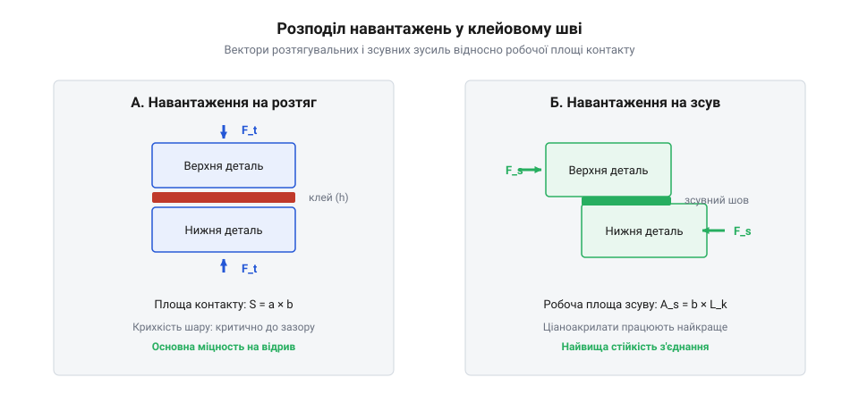

# Обчислення міцності ціаноакрилатного клейового шва та геометрії з'єднання

## Руйнування клейового шва під навантаженням

Коли збирається корпусний виріб або фіксується деталь у навантаженому вузлі, найпростішим рішенням здається нанести кілька крапель швидкого клею та міцно з'єднати поверхні. Проте на практиці часто трапляється ситуація, коли з'єднання ламається від найменшого удару або несподіваного зусилля, хоча здавалося, що клею було нанесено вдосталь. Причина криється не в самій якості полімеру, а в тому, як саме прикладене зусилля розподіляється всередині тонкого шару матеріалу. Ціаноакрилатні полімери утворюють надзвичайно тверду й жорстку структуру, яка чудово витримує стиснення, але має дуже низьку стійкість до розтягування та зрізу, якщо навантаження прикладене нерівномірно або виникають концентратори напружень. 

*Схема розкладання сил на розтяг і зсув у клейовому шві показує вектори навантажень та площу робочого перерізу.*

Коли до деталей прикладається зовнішнє зусилля, воно ніколи не розподіляється абсолютно рівномірно по всій площі контакту. У реальних умовах збирання завжди існують мікроскопічні перекоси, нерівності поверхонь або ексцентриситети. Через це навантаження концентрується на окремих ділянках клейового шва, найчастіше по краях стику. Ціаноакрилат не здатний до пластичної деформації чи пружного перерозподілу напружень, як, наприклад, епоксидні смоли з модифікаторами чи конструкційні метали. У результаті мікротріщина, що виникла в місці найбільшої концентрації напружень, миттєво поширюється по всьому перерізу, спричиняючи катастрофічне руйнування з'єднання. Збільшення кількості клею в зазорі не розв'язує цю проблему, оскільки товстий шар полімеру лише посилює внутрішні напруження від усадки та знижує загальну стійкість конструкції до деформацій.

Окрім розподілу напружень, критичним фактором для надійності клейового з'єднання є підготовка поверхонь, оскільки ціаноакрилати (en|cyanoacrylate@@) потребують ідеальної чистоти для утворення міцних хімічних зв'язків. Мікроскопічні шари жиру, пилу чи технологічних мастил діють як розділювальні агенти, що повністю блокують змочування та полімеризацію мономеров на межі поділу фаз. Навіть найменше забруднення знижує ефективну площу адгезійного контакту на порядок, перетворюючи розрахункове навантаження на локальний концентратор напружень. Тому механічне знежирення розчинниками та видалення оксидних плівок є обов'язковим етапом, що забезпечує безпосередній контакт клейової композиції з активними центрами субстрату.

Коли до деталей прикладається зовнішнє зусилля, вектори навантажень неминуче розкладаються на нормальні розтягувальні та дотичні зсувні компоненти, що діють на робочий переріз клейового шару. Через мікроскопічні нерівності поверхонь і неминучі перекоси під час збирання ці зусилля ніколи не розподіляються рівномірно, а концентруються на окремих ділянках, переважно по краях стику. Оскільки полімерна структура ціаноакрилату вирізняється високою жорсткістю та повною відсутністю пластичної деформації, вона не здатна пружно перерозподілити локальні піки напружень шляхом згладжування чи текучості. У результаті навіть незначне перевищення граничного навантаження на краях призводить до миттєвого зародження мікротріщини, яка лавиноподібно поширюється по всьому перерізу шва, спричиняючи раптове катастрофічне руйнування з'єднання.

## Розрахунок площі з'єднання для розтягу та зсуву

Щоб з'єднання витримало робочі навантаження без руйнування, необхідно заздалегідь обчислити мінімальну площу контакту поверхонь, виходячи з прикладених зусиль та механічних характеристик клейового шару. Оскільки ціаноакрилати працюють по-різному залежно від напрямку сили, розрахунок завжди розділяють на два основних сценарії: чистий розтяг, коли зусилля намагається розірвати деталі перпендикулярно до площини склеювання, та зсув, коли сили діють уздовж площини шва. Базою для обчислень є просте співвідношення між силою, площею та механічною напругою в матеріалі.

Для розрахунку площі з'єднання на розтяг використовують максимальне розтягувальне зусилля та допустиму напругу на відрив.

    F_t = σ_adm · A
    A = F_t / σ_adm              [визначення необхідної площі контакту для розтягу]

де `F_t` — розтягувальне зусилля, `σ_adm` — допустима напруга на розтяг для затверділого ціаноакрилату, а `A` — мінімальна площа клейового контакту. Для зсувних навантажень формула виглядає аналогічно, проте замість напруги на відрив підставляється допустима напруга на зріз, яка для ціаноакрилатів зазвичай у кілька разів перевищує опір розтягуванню.

    F_s = τ_adm · A
    A = F_s / τ_adm              [визначення необхідної площі контакту для зсуву]

де `F_s` — зсувне зусилля, а `τ_adm` — допустима напруга на зсув. Наприклад, якщо на з'єднання діє зсувне зусилля в п'ятсот ньютонів, а допустима напруга на зсув становить десять мегапаскалів, розрахунок дає мінімальну площу контакту, яка забезпечить надійну фіксацію деталей за умов статичного навантаження.

    A = 500 / (10 · 10⁶)
    A = 0.00005 m² = 50 mm²      [обчислення мінімальної площі зсуву на прикладі]

Отримане значення означає, що поверхні деталі повинні перекриватися щонайменше на п'ятдесят квадратних міліметрів робочої площі, інакше шов зруйнується навіть за відсутності динамічних перевантажень.

## Вплив товщини клейового зазору на міцність

Поширена інженерна помилка полягає в переконанні, що товстіший шар клейової речовини здатен компенсувати нерівності деталей або утворити міцніший буферний прошарок. У випадку з ціаноакрилатами все працює з точністю до навпаки. Рідкі ціаноакрилатні склади заповнюють стики завдяки капілярним ефектам, розтікаючись у надзвичайно тонких зазорах між щільно припасованими поверхнями. Полімеризація ціаноакрилату відбувається миттєво під дією залишкової вологи на поверхнях, і найкраща структура полімерної сітки утворюється саме тоді, коли товщина шару мінімальна.

Коли зазор між деталями збільшується вище критичного значення, клей усередині масиву твердне повільніше та нерівномірно, оскільки доступ вологи з повітря або з поверхні обмежений об'ємом. Крім того, під час полімеризації відбувається неминуча усадка матеріалу, і в товстому шарі утворюються величезні внутрішні напруження, мікропори та тріщини. Це призводить до катастрофічного падіння кінцевої міцності з'єднання, роблячи його вразливим до найменших коливань. Тому якісне проєктування завжди вимагає мінімізації зазору та забезпечення щільного прилягання елементів, таких як компоненти з набору для збирання корпусів [Набори гвинтів М3 (шестигранник, потайні DIN7991)](file:///cat-hw-parts/m3-screw-kits) або з'єднувальні [Стійки М2/М3 (латунь, нейлон)](file:///cat-hw-parts/standoffs), де точність геометрії відіграє вирішальну роль.

## Коефіцієнт запасу та динамічні навантаження

Навіть ідеально розрахована площа з'єднання та мінімальний зазор не гарантують довговічності, якщо під час експлуатації виникають удари, вібрації або різкі ривки. Ціаноакрилатні полімери є матеріалами підвищеної крихкості, через що вони погано поглинають кінетичну енергію імпульсних навантажень. Для компенсації цього фактора в інженерних розрахунках обов'язково застосовують коефіцієнт запасу міцності, який збільшує розрахункове навантаження з урахуванням умов роботи та ймовірності непередбачуваних перенапружень.

Розрахунок робочого зусилля з урахуванням коефіцієнта запасу виконується множенням номінального навантаження на безрозмірний коефіцієнт.

    F_design = n · F_nominal
    F_design = 2.5 · 200         [множення номінального зусилля на коефіцієнт запасу]
    F_design = 500 N             [отримання розрахункового зусилля для підбору площі]

де `n` — коефіцієнт запасу міцності, який для стабільних статичних умов може дорівнювати одиниці з половиною, а для умов із вібраціями та ударними впливами зростає до чотирьох або п'яти. Отримане розрахункове зусилля `F_design` підставляється у формули визначення площі замість початкового значення, що дозволяє закласти необхідний запас надійності. Для критично важливих вузлів, де руйнування корпусної фурнітури може призвести до відмови всього пристрою, додатково використовують механічне підкріплення або комбіновані види фіксації, поєднуючи клей із елементами з розділу [Болти М5/М6 і шайби М3/М4](file:///cat-hw-parts/bolts-and-washers).