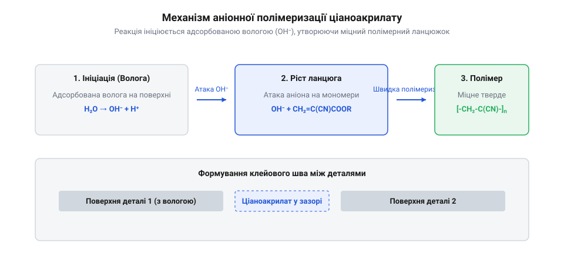

# Технологічний процес склеювання деталей корпусу з підготовкою поверхонь та активацією

<preknowlist>
- [Набори гвинтів М3 (шестигранник, потайні DIN7991)](root:cat-hw-parts/m3-screw-kits) — розуміння альтернативних рознімних механічних з'єднань корпусів
- [Органайзер для дрібних деталей](root:cat-hw-parts/parts-organizer) — навички організації робочого місця та зберігання компонентів збірки
</preknowlist>

## Проблема з'єднання корпусних деталей

Під час експлуатації електронних пристроїв корпуси зазнають постійних механічних навантажень, вібрацій та температурних коливань. Традиційні механічні кріплення, такі як гвинти та саморізи, з часом послаблюються через втомні явища в матеріалі або випадіння кріплення від вібрації. Використання рознімних елементів на кшталт [наборів гвинтів М3 (шестигранник, потайні DIN7991)](root:cat-hw-parts/m3-screw-kits) чи [набору кріплення М2.5 (нікельований)](root:cat-hw-parts/m25-fastener-kit) не завжди можливе через обмежені габарити виробу, вимоги до естетики або необхідність забезпечення абсолютної герметичності. Звичайні побутові клеї на основі розчинників або водні дисперсії випаровуються дуже повільно в замкнутих об'ємах пластикових корпусів, а утворений шов не витримує ударних навантажень і руйнується при першому ж падінні пристрою. Інженерна задача полягає в пошуку методу швидкого, міцного та герметичного з'єднання корпусних деталей з різнорідних матеріалів без створення зайвих напружень. Тому виникає потреба у застосуванні спеціальних однокомпонентних реактопластичних систем — @@en|cyanoacrylate@@ (ціанакрилатів), здатних полімеризуватися за лічені секунди без використання нагрівання чи складного обладнання.

Під час експлуатації електронних пристроїв корпуси зазнають постійних механічних навантажень, вібрацій та температурних коливань. Традиційні механічні кріплення, такі як гвинти та саморізи, з часом послаблюються через втомні явища в матеріалі або випадіння кріплення від вібрації. Використання рознімних елементів на кшталт [наборів гвинтів М3 (шестигранник, потайні DIN7991)](root:cat-hw-parts/m3-screw-kits) чи [набору кріплення М2.5 (нікельований)](root:cat-hw-parts/m25-fastener-kit) не завжди можливе через обмежені габарити виробу, вимоги до естетики або необхідність забезпечення абсолютної герметичності. Звичайні побутові клеї на основі розчинників або водні дисперсії випаровуються дуже повільно в замкнутих об'ємах пластикових корпусів, а утворений шов не витримує ударних навантажень і руйнується при першому ж падінні пристрою. Інженерна задача полягає в пошуку методу швидкого, міцного та герметичного з'єднання корпусних деталей з різнорідних матеріалів без створення зайвих напружень. Водночас важливо враховувати механічні характеристики клейового шва: ціанакрилати демонструють надзвичайно високу міцність на зріз (часто перевершуючи міцність самих пластиків), але є дуже чутливими до навантажень на відрив і скручування, оскільки їхній полімерний шар має високу жорсткість і мінімальну еластичність на відміну від гвинтових з'єднань, що рівномірніше розподіляють локальні зусилля. Тому виникає потреба у застосуванні спеціальних однокомпонентних реактопластичних систем — @@en|cyanoacrylate@@ (ціанакрилатів), здатних полімеризуватися за лічені секунди без використання нагрівання чи складного обладнання, за умови ретельного проєктування площі склеювання.

## Фізико-хімічні принципи ціанакрилатів

Секрет миттєвого твердіння @@en|cyanoacrylate@@ (ціанакрилату) полягає в унікальному механізмі @@en|anionic polymerization@@ (аніонної полімеризації), яка запускається під дією слабкихлужних агентів або мікроскоπічної кількості адсорбованої вологи на поверхнях, що склеюються. Рідкий мономер є надзвичайно реакційноздатним ефіром ціанакрилової кислоти, який у пляшечці стабілізується кислотними добавками для запобігання передчасному затвердінню. Щойно клей наноситься тонким шаром між деталями, волога із повітря та поверхонь нейтралізує інгібітор кислотності, і молекули мономеру миттєво з'єднуються в довгі ланцюги, утворюючи міцний акриловий полімер.

*Схема аніонної полімеризації ціанакрилату та утворення полімерного ланцюжка між поверхнями деталей, демонструючи ключову роль адсорбованої вологи у запуску реакції.*

Оскільки реакція ініціюється ззовні всередину шару, швидкість затвердіння прямо залежить від товщини клейової плівки та доступності вологи. У мікрозазорах між щільно підігнаними деталями корпусу процес завершується за лічені секунди, тоді як крапля чи товстий шар залишаються рідкими всередині та утворюють крихку структуру з низькою механічною міцністю. Це вимагає ретельного проектування зазорів: оптимальна товщина шва для ціанакрилату становить від сотих часток до кількох десятих міліметра. Відповідно, для заповнення більших пустот або фіксації елементів з різними допусками застосовують спеціальні конструкційні матеріали та [стійки М2/М3 (латунь, нейлон)](root:cat-hw-parts/standoffs) чи механічні [болти М5/М6 і шайби М3/М4](root:cat-hw-parts/bolts-and-washers). Обираючи в'язкість клею — від рідкої води до гелю — інженер керує швидкістю розтікання по поверхні та здатністю заповнювати мікронерівності з'єднуваваних корпусних елементів.

Секрет миттєвого твердіння @@en|cyanoacrylate@@ (ціанакрилату) полягає в унікальному механізмі @@en|anionic polymerization@@ (аніонної полімеризації), яка запускається під дією слабких лужних агентів або мікроскопічної кількості адсорбованої вологи на поверхнях, що склеюються. Усередині герметичної пляшечки рідкий мономер стабілізується кислими добавками — зазвичай стабілізаторами на кшталт триоксиду сірки чи метаносульфонової кислоти, які створюють кисле середовище та надійно блокують передчасне зшивання молекул. Щойно клей наноситься тонким шаром між деталями, волога із повітря — причому оптимальна відносна вологість (@@en|relative humidity@@, RH) для стабільного процесу становить від 40% до 60% — нейтралізує інгібітор кислотності, і вільні гідроксильні групи чи слабкі основані центри миттєво запускають ланцюгову реакцію перетворення мономеру на твердий полімер.

## Підготовка поверхонь та активація

Навіть найякісніший клей не забезпечить міцного з'єднання, якщо поверхні корпусних деталей забруднені або мають низьку поверхневу енергію, яка перешкоджає змочуванню. Гладкі пластики та метали перед склеюванням обов'язково піддають механічному шорсткованню дрібнозернистим абразивом для збільшення площі контакту та видалення захисних оксидних чи жирових плівок. Після цього поверхню ретельно знежирюють спеціальними розчинниками, що швидко випаровуються і не залишають маслянистих слідів. Однак для неполярних полімерів, таких як поліпропілен чи поліетилен, стандартне знежирення не дає результату через хімічну інертність матеріалу. Для таких деталей використовують спеціальний @@en|polyolefin primer@@ (поліолефіновий праймер) на основі летких розчинників і модифікованих органічних сполук, який наносять тонким шаром перед склеюванням для активації поверхневої енергії. Праймер створює на неактивному пластику активні центри, здатні надійно зв'язуватися з молекулами ціанакрилату, перетворюючи «несклеюваний» матеріал на придатний для міцного монтажу. За потреби герметизації корпусів у місцях виходу кабелів чи датчиків додатково враховують особливості встановлення елементів на кшталт [вентиляційних захисних клапанів та мембран ePTFE: вирівнювання тиску, гідрофобність та захист від конденсату](root:cat-hw-parts/eptfe-protective-vents), які також вимагають чистоти та сухості поверхонь.

## Контрольоване затвердіння та запобігання дефектам

У виробництві електронних корпусів часто виникає потреба миттєвої фіксації деталей у точному положенні без тривалого утримування вручну або заповнення широких технологічних зазорів, де волога з повітря не встигає ініціювати полімеризацію. У таких випадках застосовують спеціальні @@en|activator@@ (активатори) або прискорювачі у вигляді аерозолів чи рідких аплікаторів, які наносять на одну з поверхонь перед з'єднанням або розпилюють поверх свіжого шва для миттєвого затвердіння композиції. Проте надлишок активатора або випаровування мономеру в замкнутому просторі корпусу призводить до появи характерного білого нальоту на сусідніх ділянках — так званого @@en|bloom effect@@ (блюм-ефекту або вицвітання). Цей наліт складається з дрібних часточок полімеризованого ціанакрилату, що осідають на лицьових панелях пристрою через недостатню вентиляцію зони склеювання. Щоб запобігти цьому дефекту, активатор застосовують дозовано, забезпечують інтенсивне провітрювання робочої зони під час полімеризації, а для акуратного зберігання компонентів збірки використовують зручний [органайзер для дрібних деталей](root:cat-hw-parts/parts-organizer), який виключає перехресне забруднення поверхонь. Для естетичних корпусних виробів також корисно застосовувати декоративні [неодимові магніти (диски й кільця)](root:cat-hw-parts/neodymium-magnets) у якості прихованих рознімних фіксаторів замість ризикованого суцільного склеювання лицьових панелей.