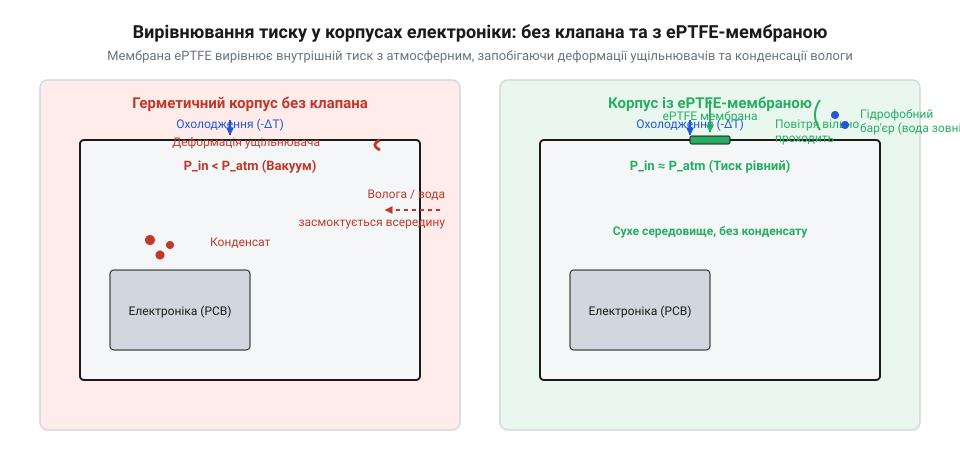

# Механічний інтерфейс, геометрія монтажу та характеристики ePTFE-клапанів

<preknowlist>
- [Неодимові магніти (диски й кільця)](root:cat-hw-parts/neodymium-magnets) — Потрібно знати принципи герметизації корпусів з ущільнювальними кільцями, оскільки клапани працюють спільно з ними в герметичних виробах.
- [Клей ціаноакрилатний](root:cat-hw-parts/cyanoacrylate-glue) — Необхідно розуміти базові правила нанесення клейових сумішей для фіксації самоклеючих мембран та ущільнювачів.
</preknowlist>

## Навіщо в корпусах електронні клапани

Коли герметичний пристрій працює на відкритому повітрі або зазнає циклічних температурних коливань від внутрішніх нагрівальних елементів, повітря всередині корпусу нагрівається і починає розширюватися. Якщо корпус зроблено абсолютно герметичним без жодних засобів компенсації, надлишковий внутрішній тиск неминуче вигинає стінки, створює критичні навантаження на місця стиків та поступово руйнує еластичні ущільнювачі @@en|O-ring@@ (від англ. @@en|O@@ — кругла форма та @@en|ring@@ — кільце). У зворотній ситуації, коли пристрій різко охолоджується (наприклад, під час зливи або занурення в холодну воду), внутрішній тиск різко падає нижче атмосферного відповідно до закону Шарля P1/T1 = P2/T2 або через зміну тиску за виразом дельта P дорівнює P0 помножити на дельта T поділене на T0. Охолодження повітря всередині замкненого об'єму навіть на 30-40 градусів Цельсія створює перепад у 10-15 кілопаскалів, що еквівалентно 100-150 мілібарам. Такий перепад створює зусилля в десятки кілограмів на кришку пристрою або здатне засмоктати стовп води понад 1 метр крізь мікрощілини навколо ущільнювачів @@en|O-ring@@. Такий вакуум створює потужну всмоктувальну силу, яка здатна протягнути вологу та мікрочастинки пилу крізь найменші дефекти ущільнень. Щоб надійно захистити електроніку від таких руйнівних перепадів тиску без зниження загального рівня пиловологозахисту, використовують спеціальні захисні клапани.

*Порівняння глухого герметичного корпусу та вентильованого корпусу з мікропористою захисною ePTFE-мембраною.*

## Будова та принцип роботи ePTFE-мембран

Основою будь-якого сучасного захисного елемента є мікропориста мембрана з еспандованого політетрафторетилену ePTFE (англ. @@en|expanded polytetrafluoroethylene@@, від лат. @@la|poly-@@ — багато, грец. @@el|tetra-@@ — чотири, фтор, етилен). Цей унікальний матеріал отримують шляхом контрольованого швидкого розтягування нагрітого фторопласту, в результаті чого утворюється складна вузлово-фібрилярна структура, що складається з масивних полімерних вузлів, з'єднаних найтоншими орієнтованими фібрилами. Розмір пор у цій павутиноподібній структурі становить від 0.1 до 3.0 мкм. Для порівняння, молекули газів азоту та кисню, а також водяної пари мають розмір близько 0.3–0.4 нм, що приблизно в тисячу разів менше за розмір пори, тоді як краплі туману мають розмір 10–50 мкм, а дощові краплі — від 100 до 5000 мкм, що в сотні й тисячі разів перевищує розмір пор мембрани. Завдяки такому співвідношенню розмірів та надзвичайно високій гідрофобності поверхні рідка вода затримується високим поверхневим натягом і не може проникнути всередину, тоді як пара та повітря вільно проходять крізь мікропори, миттєво вирівнюючи тиск по обидва боки стінки корпусу.

## Механічний інтерфейс та типи монтажу

Конструктивне виконання захисних елементів залежить від призначення пристрою та матеріалу корпусу, поділяючись на різьбові клапани, запресовані втулки та самоклеючі мембранні пластирі. Для встановлення різьбових деталей у стінці корпусу готують отвір із нарізаною різьбою, а для надійної фіксації внутрішніх платок поруч із вентиляційним каналом часто використовують латунні чи нейлонові [стійки М2/М3](root:cat-hw-parts/standoffs). Збирання корпусних елементів та кришок здійснюється за допомогою відповідних [наборів гвинтів М3](root:cat-hw-parts/m3-screw-kits), що забезпечують рівномірний притиск ущільнювачів. Самоклеючі мембрани вимагають ідеальної чистоти та знежирення поверхні перед нанесенням, а для нерозбірних пластикових конструкцій інколи застосовують [клей ціаноакрилатний](root:cat-hw-parts/cyanoacrylate-glue) для надійної герметизації країв рамки.

## Розрахунок пропускної здатності та вибір

Правильний підбір площі та діаметра захисної мембрани базується на аналізі внутрішнього об'єму порожнини корпусу та максимальної швидкості зміни температури довкілля під час штатної експлуатації. Швидке нагрівання повітря всередині створює об'ємний потік, який повинен безперешкодно виходити назовні без виникнення надмірного перепаду тиску, здатного напружити ущільнювачі. Розрахунок спирається на оцінку максимальної маси повітря, що розширюється за законами термодинаміки, та номінальну пропускну здатність вибраної мембрани за заданого тиску. Недостатня площа активної поверхні призведе до появи значного опору газообміну, через що вирівнювання тиску затримуватиметься, створюючи додаткові механічні навантаження на конструкцію. Точний підбір пропускної здатності вимагає виконати [термічний розрахунок внутрішнього об'єму корпусів](root:ph-thermodynamics/thermal-expansion) для оцінки пікових витрат повітря.

## Експлуатаційні обмеження та типові помилки

Навіть високоякісний захисний елемент може втратити працездатність через порушення правил монтажу або недотримання експлуатаційних лімітів. Найпоширенішою помилкою є випадковий механічний прокол або пошкодження тендітної мікропористої структури гострим інструментом під час остаточного збирання внутрішніх компонентів. Крім того, необхідно враховувати хімічну стійкість матеріалу до агресивних розчинників, мастил та мийних засобів, здатних забити пори або зруйнувати клейовий шар. Для остаточного контролю якості збирання проводять виробничі тести на герметичність, вимірюючи стійкість до проникнення води WEP (англ. @@en|Water Entry Pressure@@, тиск проникнення води). Для підтвердження заявленого класу захисту після встановлення клапанів проводять регламентні [методики тестування ступенів захисту IP](root:sys-notary/ingress-protection-standards-ip67-ip68-ip69k).