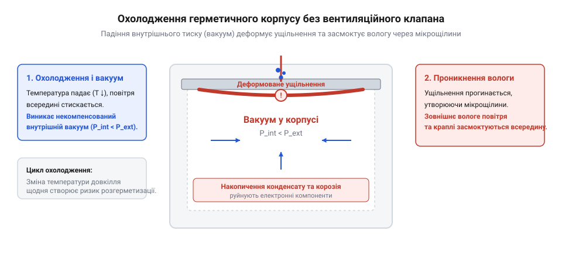
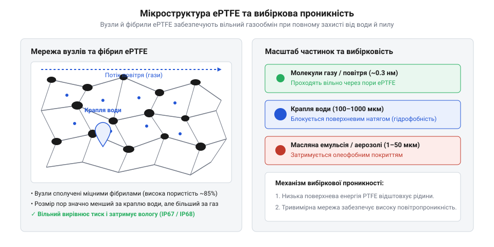
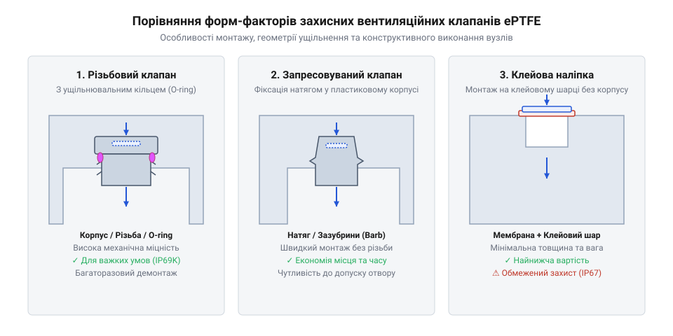
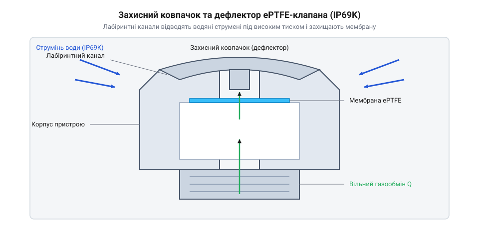
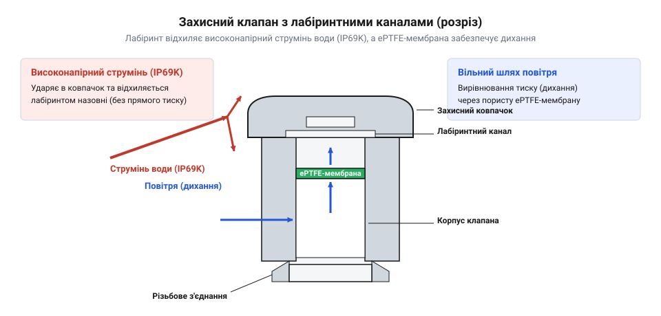

# Вентиляційні захисні клапани та мембрани ePTFE: вирівнювання тиску, гідрофобність та захист від конденсату

<preknowlist>
- [Болти М5/М6 і шайби М3/М4](root:cat-hw-parts/bolts-and-washers) — стандарти різьбових з'єднань M5/M6 та механіка створення рівномірного зусилля притиску ущільнювальних кілець
- [Клей ціаноакрилатний](root:cat-hw-parts/cyanoacrylate-glue) — хімічні властивості клейових сполук, підготовка полімерних поверхонь та специфіка фіксації елементів фурнітури
</preknowlist>

## Термоперепади тиску та деформація корпусів

При проектуванні герметичного обладнання — від світлодіодних вуличних світильників та залізничних датчиків до автомобільних блоків управління та систем відеоспостереження — інженери прагнуть повністю ізолювати внутрішній об'єм від впливу довкілля. Для цього застосовують міцні металеві або полімерні оболонки, затягують кришки за допомогою [наборів різьбових болтів](root:cat-hw-parts/bolts-and-washers) і шайб та встановлюють еластичні [статичні ущільнювальні прокладки](root:hw-pcb/enclosure-sealing-and-gaskets) з силікону, EPDM чи фтореластомерів. Під час сертифікаційних лабораторних випробувань за регламентами [стандартів захисту оболонок](root:sys-notary/ingress-protection-standards-ip67-ip68-ip69k) такий пристрій показує бездоганні результати, легко витримуючи короткочасне занурення у воду на глибину одного метра за класом @@en|IP67@@. Проте реальна тривала експлуатація на відкритому повітрі часто призводить до раптових відмов: всередині герметичної камери з'являються краплі води, прозорі оптичні вікна запотівають, а на друкованих платах розвивається електрохімічна корозія та виникають міждоріжкові замикання.

Причина цього руйнівного явища полягає у термодинаміці газу, замкненого у незмінному об'ємі корпусу. Повітря всередині закритого приладу підпорядковується закону Шарля для ідеальних газів, за яким тиск газу при сталому об'ємі прямо пропорційний його абсолютній температурі. Коли внутрішні електронні компоненти (силові транзистори, процесори, світлодіодні матриці) працюють на повній потужності, температура повітря всередині оболонки стрімко зростає. Якщо пристрій збирали та герметизували за кімнатної температури +20 °C (293.15 K), то під час інтенсивної роботи повітряний об'єм може прогрітися до +70 °C (343.15 K). Розширення газу створює внутрішній надлишковий тиск близько +17.28 кПа (+172.8 мбар), що тисне на стінки оболонки та прокладки зсередини.

Проте найнебезпечніший динамічний перехід відбувається під час різкого охолодження корпусу. Уявіть сонячний день, коли корпус приладу нагрітий на сонці та від власних компонентів до +70 °C, і раптово починається холодна злива з температурою води +5 °C (278.15 K). Зовнішні стінки оболонки миттєво охолоджуються, викликаючи стрімке зниження температури внутрішнього повітря та його об'ємне стиснення.

При зміні температури зміна внутрішнього тиску газу `ΔP` обчислюється на основі вихідного тиску `P₁`, початкової абсолютної температури `T₁` та кінцевої температури `T₂`:

```
ΔP = P₁ × (T₂ / T₁ - 1)
   = 101.325 × (278.15 / 343.15 - 1)    [підстановка початкової температури +70 °C та кінцевої +5 °C у Кельвінах]
   = 101.325 × (0.8106 - 1)              [відношення абсолютних температур газу]
   = 101.325 × (-0.1894)                 [відносна зміна абсолютної температури]
   ≈ -19.19 kPa                          [розрахунок внутрішнього розрядження]
```

Отримане значення перепаду тиску `ΔP ≈ -19.19` кПа показує, що всередині корпусу виникає вакуумна сила близько 192 мбар (або майже 2 метри водяного стовпа розрядження).

Цей термодинамічний перепад тиску генерує значні механічні напруження, які руйнують герметичність системи. При від'ємному тиску внутрішній вакуум починає втягувати стінки корпусу та еластомерні ущільнення всередину. Більшість статичних ущільнень, таких як @@en|O-ring@@ (англ. *O-ring* — кільцеподібне ущільнення), розраховані на протидію зовнішньому тиску, який притискає гуму до посадкової канавки. Коли ж вакуум тягне ущільнення у зворотний бік, еластомер деформується, зміщується і втрачає необхідне контактне зусилля, особливо в умовах накопиченої залишкової деформації стиску.

У результаті на стиках корпусних деталей та кабельних вводах виникають мікроскопічні зазори. Якщо у цей момент зовнішня поверхня корпусу вкрита плівкою дощової води або конденсату, виникає @@en|помповий ефект@@ (англ. *pumping effect* — ефект всмоктування під дією змінного тиску). Внутрішнє розрядження буквально засмоктує рідку воду, вологий туман і пил крізь мікрощілини в ущільненнях безпосередньо у внутрішній об'єм пристрою.


*Механізм виникнення від'ємного тиску та всмоктування вологи в герметичному корпусі без вентиляційного клапана при різкому зниженні зовнішньої температури.*

Волога, що потрапила всередину корпусу під час охолодження, вже не може самостійно випаруватися назовні через герметичні стінки. Зі зростанням внутрішньої температури вода знову перетворюється на пару, підвищуючи відносну вологість повітря всередині камери до 100%. При кожному наступному циклі охолодження точка роси досягається миттєво, і відбувається @@la|конденсація@@ (лат. *condensatio* — згущення) водяної пари у вигляді крапель на найхолодніших внутрішніх поверхнях — оптичних вікнах, захисному склі та друкованих платах.

Спроби вирішити цю проблему шляхом збільшення товщини стінок корпуса або жорсткішого затискання кришки [наборами гвинтів М3](root:cat-hw-parts/m3-screw-kits) не дають бажаного результату. Внутрішній перепад тиску створює зусилля у сотні кілограмів, розтягуючи матеріал та викликаючи пластичну повзучість полімерів або втомні мікротріщини в металі. Повне заливання внутрішнього об'єму силіконовими або епоксидними компаундами позбавляє пристрій ремонтопридатності, збільшує його вагу і створює критичні механічні напруження на SMD-компонентах через різницю коефіцієнтів лінійного розширення.

Єдиним надійним інженерним розв'язком є забезпечення безперервної вентиляції та вирівнювання внутрішнього й зовнішнього тисків без порушення захисного бар'єра проти вологи та пилу. Щоб правильно розрахувати параметри такого газообміну для конкретного об'єму та температурного діапазону, виконують інженерний [розрахунок повітряного потоку та тиску прориву](root:cat-hw-parts/eptfe-protective-vents/math-vent-flow-and-wep-calculation.md) мембранних елементів.

## Мікропориста структура та вибіркова проникність ePTFE

Щоб забезпечити вільний газообмін і водночас заблокувати проникнення рідин та твердих часточок, потрібен матеріал із механізмом вибіркової проникності. Ззвичайні сітки або пористі фільтри з розміром отворів у десятки мікрометрів пропускають воду навіть при незначному гідростатичному тиску. Ідеальним розв'язком цієї задачі став пористий розтягнутий політетрафторетилен — @@en|ePTFE@@ (англ. *expanded Polytetrafluoroethylene* — розтягнутий політетрафторетилен). Дослідження [історії винайдення ePTFE](root:cat-hw-parts/eptfe-protective-vents/hist-eptfe-history.md) Робертом Гором у 1969 році демонструє, як термічне розтягування монолітного @@la|PTFE@@ (лат./англ. *Polytetrafluoroethylene* — політетрафторетилен) перетворило хімічно інертний фторполімер на унікальну мембрану з об'ємною мікропористою структурою.

Внутрішня будова мембрани @@en|ePTFE@@ є тривимірною павутиною, що складається з монолітних полімерних вузлів та з'єднаних між ними надтонких ниток — фібрил. Ця вузлово-фібрилярна морфологія формує мільярди мікроскопічних пор на кожен квадратний сантиметр поверхні, забезпечуючи пористість (частку вільного об'єму) від 50% до 90%.

Секрет вибіркової проникності @@en|ePTFE@@ полягає у суттєвій різниці між розмірами мікропор мембрани та розмірами молекул газу і крапель рідини:

- Молекули газів (азот N₂, кисень O₂, водяна пара H₂O) мають ефективний діаметр від 0.3 до 0.4 нм (0.0003–0.0004 мкм). - Середній діаметр мікропор мембрани @@en|ePTFE@@ становить від 0.1 до 3.0 мкм (100–3000 нм), найчастіше — 0.2–1.0 мкм. - Краплі дрібного водяного аерозолю або туману мають розміри від 10 до 100 мкм (10 000–100 000 нм). - Краплі дощу або бризки мають діаметр від 100 до 3000 мкм (100 000–3 000 000 нм).

Оскільки розмір пори мембрани в 500–2500 разів більший за молекулу водяної пари чи кисню, гази вільно проходять крізь полімерну сітку шляхом молекулярної @@la|дифузії@@ (лат. *diffusio* — розтікання) та конвективного перенесення, миттєво вирівнюючи найменші термоперепади тиску. Водночас найменша крапля рідкої води у 10–100 разів перевищує розмір мікропори і не здатна проникнути всередину без зовнішнього руйнівного зусилля.


*Співвідношення масштабів мікропористої структури ePTFE з молекулами газів, краплями води та забрудниками, що забезпечує вибіркову проникність.*

Перенесення газів крізь вузькі пори ePTFE відбувається за змішаним механізмом: коли діаметр пори порівняний із довжиною вільного пробігу молекул газу (близько 60–70 нм для повітря за нормальних умов), молекули частіше зіштовхуються зі стінками пор, ніж одна з одною. Це явище описується дифузією Кнудсена, яка забезпечує високу швидкість вирівнювання тиску навіть при мікроскопічній товщині мембрани.

Проте самого лише геометричного обмеження за розміром пор недостатньо: під дією зовнішнього тиску рідина могла б утискатися в капіляри. Головним фізичним бар'єром проти води є @@gr|гідрофобність@@ (грец. *hydor* — вода, *phobos* — страх) матеріалу. Фторвуглецеві зв'язки C-F у молекулах PTFE мають надзвичайно низьку поверхневу енергію (близько 18–20 мН/м). Оскільки поверхневий натяг чистої води становить близько 72.8 мН/м при 20 °C, вода не змочує поверхню ePTFE, формуючи високий крайовий кут змочування `θ > 110°...120°`.

Визначальним параметром водостійкості мембрани є тиск прориву води — @@en|WEP@@ (англ. *Water Entry Pressure* — тиск прориву води). Формула Лапласа-Янга описує залежність тиску прориву від поверхневого натягу рідини `γ`, крайового кута змочування `θ` та радіуса мікропор `r`.

Критичний тиск прориву води `WEP` обчислюється через поверхневий натяг рідини `γ`, крайовий кут змочування `θ` та радіус мікропор `r`:

```
WEP = (2 × γ × cos θ) / r
    = (2 × 0.0728 × cos(120°)) / (0.5 × 10⁻⁶)    [підстановка γ для води, кута 120° та радіуса пори 0.5 мкм]
    = (0.1456 × (-0.5)) / (5 × 10⁻⁷)             [обчислення косинуса тупого кута змочування]
    = -0.0728 / (5 × 10⁻⁷)                       [визначення капілярного опору]
    = -145600 Pa                                 [абсолютний тиск прориву в Паскалях]
    ≈ -1.46 bar                                  [переведення тиску в бари]
```

Значення `WEP ≈ -1.46` бар свідчить про те, що для проштовхування води через гідрофобну мікропору потрібне зовнішнє гідростатичне зусилля понад 1.46 бар. Це дозволяє приладам із клапанами @@en|ePTFE@@ відповідати найсуворішим вимогам за [стандартами IP67 та IP68](root:sys-notary/ingress-protection-standards-ip67-ip68-ip69k).

У реальних умовах експлуатації базової @@gr|гідрофобності@@ може виявитися недостатньо. На обладнання автомобілів, промислових верстатів чи вуличного освітлення часто потрапляють моторні оливи, дизельне пальне, гідравлічні рідини або дощова вода з домішками мийних засобів і поверхнево-активних речовин (ПАР). Молекули ПАР є амфіфільними: вони мають гідрофільну головку та ліпофільний хвіст, що дозволяє їм знижувати поверхневий натяг рідини до 20–35 мН/м.

Потрапивши на стандартну гідрофобну мембрану, такі рідини розтікаються по її поверхні, змочують полімер (`θ < 90°`) та всмоктуються в пори за рахунок капілярного ефекту. Виникає так зване заповнення пор рідиною — @@en|wet-out@@. Затоплена пориста структура повністю втрачає газопроникність, а при незначному тиску рідина проникає всередину корпусу.

Для захисту від масел та ПАР застосовують @@la|олеофобні@@ (лат. *oleum* — олія, грец. *phobos* — страх) мембрани. @@la|Олеофобність@@ досягається шляхом хімічної модифікації внутрішньої поверхні вузлів і фібрил ePTFE спеціальним фторорганічним покриттям. Це покриття знижує поверхневу енергію мембрани до 10–12 мН/м. Завдяки цьому навіть оливи та органічні розчинники формують на поверхні мембрани стійкі краплі з тупим кутом змочування `θ > 90°` і не забивають мікропори. Фізика змочування та методи оцінки олеофобності за рейтингом AATCC 118 розглядаються в огляді про [гідрофобні та олеофобні покриття](root:ph-thermodynamics/oleophobic-and-hydrophobic-coatings).

Таким чином, використання мембран @@en|ePTFE@@ вирішує комплексну інженерну задачу:
- Забезпечує постійне вирівнювання тиску (`ΔP ≈ 0`), запобігаючи деформації корпусних деталей і руйнуванню прокладок. - Блокує @@en|помповий ефект@@, унеможливлюючи всмоктування вологи та пилу при різкому охолодженні. - Сприяє безперервному виведенню водяної пари з внутрішнього об'єму, запобігаючи накопиченню @@la|конденсату@@. - Ґарантує надійний герметичний захист приладу від пилу, води та олив за найвищими класами захисту.

## Розрахунок проникності та вибір клапана

Герметичний корпус вуличного електроприладу, виготовлений за класом захисту IP67, при тривалому сонячному нагріві підвищує температуру внутрішнього повітря від +20 °C до +60 °C. Це призводить до зростання внутрішнього тиску. Якщо в цей момент починається раптова злива, температура корпусу стрімко падає до +10 °C за декілька хвилин. Охолодження закритого об'єму повітря створює внутрішнє розрядження, через яке зовнішній атмосферний тиск починає стискати корпус із силою в сотні кілограмів на квадратний метр. Еластомерне кільцеве ущільнення @@en|O-ring@@, розраховане на герметизацію при статичному стиску, під дією зсувного перепаду тиску зміщується або зминається. Виникає помповий ефект: герметик всмоктує краплі вологи та бруд безпосередньо з лінії стику.

Щоб уникнути руйнівної деформації корпусу та всмоктування конденсату, пристрій повинен мати вільний газообмін із зовнішнім середовищем при збереженні повного водозахисту. Захисний вентиляційний клапан на основі мембрани з пористого розтягнутого політетрафторетилену (@@en|ePTFE@@, англ. @@en|expanded polytetrafluoroethylene@@ — розтягнутий політетрафторетилен) вирівнює тиск за рахунок вільної дифузії газу. Головне інженерне завдання при виборі клапана — обчислити мінімальну ефективну площу мембрани, яка здатна пропустити потрібний об'єм повітря за час температурного стрибка, не допустивши перевищення гранично допустимого тиску на ущільнення.

Газодинаміка герметичного об'єму описується залежністю між вільним внутрішнім об'ємом корпусу `V_net`, амплітудою температурного перепаду `ΔT` та швидкістю остигання або нагріву. Вільний об'єм `V_net` обчислюють як повний внутрішній об'єм корпусу за вирахуванням фізичного об'єму печатних плат, трансформаторів, акумуляторів та інших внутрішніх компонентів. За законом ідеального газу Клапейрона — Менделєєва зміна температури газу в замкненому об'ємі викликає пропорційну зміну тиску. Якщо припустити, що тиск усередині корпусу підтримується близьким до атмосферного за рахунок вентиляції, то об'єм повітря `ΔV`, який має пройти крізь клапан для повної компенсації температурного розширення або стиснення, виражається формулою:

ΔV = V_net · (ΔT / T_1)

У цій формулі `V_net` позначає вільний об'єм корпусу в кубічних сантиметрах або літрах, `ΔT` — абсолютний перепад температур у кельвінах (`ΔT = |T_1 - T_2|`), а `T_1` — початкову абсолютну температуру газу перед початком термодинамічного переходу. Для розрахунку об'ємної витрати повітря `Q_required` у мілілітрах за хвилину необхідно поділити обчислений об'єм `ΔV` на час тривалості температурного стрибка `Δt` у хвилинах.

Кожна ePTFE-мембрана має параметр специфічної проникності `q_spec`, який виробник вказує у паспорті виробу. Цей параметр вимірюється в мілілітрах повітря, що проходять крізь один квадратний сантиметр мембрани за одну хвилину при стандартному тестовому перепаді тиску `ΔP_test` (зазвичай `ΔP_test = 70` мбар або `7` кПа). Оскільки реальний допустимий перепад тиску в корпусі `ΔP_max` має бути нижчим за поріг деформації ущільнень (типово `20–50` мбар), ефективна робоча проникність мембрани `q_eff` пропорційно зменшується. Робочу площу мембрани `A_eff` визначають шляхом ділення необхідного об'ємного потоку `Q_required` на ефективну проникність `q_eff`.

Для практичної демонстрації розрахунку розглянемо герметичний модуль вуличного виконання з вільним внутрішнім об'ємом `V_net = 2400` мл. Пристрій зазнає раптового охолодження зливою від початкової температури `T_1 = 333.15` K (+60 °C) до кінцевої температури `T_2 = 283.15` K (+10 °C). Час активної фази остигання становить `Δt = 5` хвилин. Гранично допустимий перепад тиску для корпусу обмежений значенням `ΔP_max = 35` мбар, щоб запобігти зсуву еластомерної прокладки. Для монтажу вибрано мембрану зі специфічною проникністю `q_spec = 120` мл / (хв · см²) при випробувальному тиску `ΔP_test = 70` мбар.

Розрахунок необхідних параметрів вентиляційного клапана виконується кроками:

ΔV = V_net · (ΔT / T_1)
   = 2400 · (50 / 333.15)            [закон розширення газу при сталому тиску]
   = 360.2 мл                         [теоретичний об'єм стиснення повітря]

Q_required = ΔV / Δt
           = 360.2 / 5               [необхідна об'ємна витрата за хвилину]
           = 72.04 мл/хв              [необхідний потік повітря]

q_eff = q_spec · (ΔP_max / ΔP_test)
      = 120 · (35 / 70)               [лінійна корекція проникності за тиском]
      = 60 мл/(хв·см²)                [ефективна специфічна проникність]

A_eff = Q_required / q_eff
      = 72.04 / 60                   [обчислення мінімальної ефективної площі]
      = 1.20 см²                     [мінімальна площа мембрани ePTFE]

Отримане значення `A_eff = 1.20` см² показує мінімально припустиму активну площу ePTFE-мембрани, яка гарантує збереження тиску в безпечних межах. Якщо вибрати клапан із меншою площею, швидкість газообміну не встигатиме за швидкістю остигання, і в корпусі виникне небезпечне розрядження. Більш деталізований математичний апарат із урахуванням режимів дифузії Кнудсена та нелінійних термодинамічних процесів винесено в окремий матеріал: розрахункову модель подано в [математичному розрахунку проникності](root:cat-hw-parts/eptfe-protective-vents/math-vent-flow-and-wep-calculation.md). Натурні випробування клапана в герметичному блоці під дією температурного шоку висвітлено в [практичному проєкті випробувань](root:cat-hw-parts/eptfe-protective-vents/proj-outdoor-enclosure-vent-integration.md).

При виборі клапана інженер завжди стикається з фізичним компромісом між проникністю газу та водостійкістю. Водостійкість мембрани характеризується тиском прориву води @@en|WEP@@ (англ. @@en|Water Entry Pressure@@ — тиск прориву води). Показник WEP визначає мінімальний гідростатичний тиск рідини, при якому вода долає капілярні сили в порах ePTFE й проникає всередину пристрою. За рівнянням Лапласа — Янга тиск прориву зворотний діаметру пор: чим менші пори, тим вищий WEP і кращий рівень водозахисту.

Проте зменшення діаметра пор для досягнення високих класів водонепроникності за [стандартами IP67 та IP68](root:sys-notary/ingress-protection-standards-ip67-ip68-ip69k) різко збільшує гідродинамічний опір мембрани, що призводить до падіння специфічної проникності `q_spec`. Мембрана з WEP = 300 кПа (3 бар) може мати у 4 рази меншу проникність повітря порівняно з мембраною з WEP = 100 кПа (1 бар) при тому самому розмірі. Спроба забезпечити надлишковий захист від занурення змушує збільшувати габарити клапана в кілька разів.

Окремою пасткою при експлуатації вуличних або промислових приладів є контакт мембрани з робочими рідинами, оліями, паливом або миючими засобами. Стандартна гідрофобна ePTFE-мембрана ефективно відштовхує чисту воду з високим поверхневим натягом (приблизно 72 мН/м). Однак технічні оливи, дизельне пальне та поверхнево-активні речовини (ПАР) мають низький поверхневий натяг (20–30 мН/м). При попаданні таких рідин на гідрофобну поверхню виникає явище заповнення пор рідиною — @@en|wet-out@@ (англ. @@en|wet-out@@ — змочування та заповнення пор).

Під час wet-out рідина легко змочує стінки мікропор, всмоктується в капіляри мембрани й повністю блокує дифузію газів. Навіть після висихання рідини на вузлах і фібрилах ePTFE залишається тонка плівка нелетких компонентів, яка назавжди позбавляє клапан здатності пропускати повітря. Для захисту від таких впливів застосовують олеофобні мембрани. Їхню поверхню модифікують фторорганічними сполуками, що знижує власну поверхневу енергію матеріалу й забезпечує стійкість до заповнення оліями. Детальніше фізико-хімічні механізми змочування та класифікацію олеофобності розкрито в матеріалі про [гідрофобні покриття](root:ph-thermodynamics/oleophobic-and-hydrophobic-coatings).

## Конструктивні виконання та монтаж клапанів

Після обчислення необхідної ефективної площі мембрани наступним кроком є вибір конструктивного виконання вентиляційного елемента та способу його фіксації на корпусі приладу. Конструкція клапана повинна не лише утримувати ePTFE-мембрану, а й забезпечувати довговічне герметичне з'єднання з корпусом у визначених умовах експлуатації.

На практиці застосовують три основні форм-фактори вентиляційних елементів: різьбові клапани, запресовувані елементи та клейові мембранні наліпки.

Різьбове виконання (@@en|screw-in@@) є найміцнішим механічним рішенням. Клапан складається з металевого (латунь, нержавіюча сталь) або високоміцного полімерного (поліамід PA66, полікарбонат) корпусу із зовнішньою метричною різьбою (найчастіше M6×0.75, M12×1.5 або M20×1.5). У нижній частині корпусу розташовано канавку під еластомерне кільце @@en|O-ring@@ (із силікону, EPDM або Viton). При загвинчуванні клапана в різьбовий отвір корпусу O-ring стискається на 20–25% своєї товщини, забезпечуючи надійну герметизацію стику.

Різьбові клапани розраховані на жорсткі умови експлуатації, високу вібрацію та можливий багаторазовий демонтаж під час обслуговування. Вони ідеально підходять для литих алюмінієвих або товстостінних пластикових корпусів. При монтажі в тонкостінні металеві корпуси різьбовий клапан фіксують із внутрішнього боку контргайкою, використовуючи стандартні [болти М5/М6 і шайби](root:cat-hw-parts/bolts-and-washers) або спеціалізоване нарізне кріплення для затягування з контрольованим моментом.

Запресовуване виконання (@@en|press-fit@@ або @@en|snap-fit@@) призначене для високопродуктивного серійного виробництва. Корпус клапана виготовляють із пружного пластику з гнучкими фіксуючими вусиками або кільцевими засувками. Монтаж здійснюється шляхом прямого запресовування клапана в гладкий отвір корпусу приладу «в один клік» без використання нарізного інструменту. Інтегрована еластомерна прокладка герметизує посадкову поверхню. Запресовувані клапани застосовують у пластикових корпусах із товщиною стінки від 1.5 до 4.0 мм. Головна вимога при монтажі — висока точність діаметра отвору (допуск не гірше ±0.05 мм) та відсутність заудирок, які можуть пошкодити ущільнювальне кільце при посадці.

Клейові мембранні наліпки (@@en|adhesive vent@@ або @@en|membrane sticker@@) є найкомпактнішим та найдешевшим виконанням. Такий елемент являє собою плаский диск із мембрани ePTFE, на периферичне кільце якого нанесено шар клею, чутливого до тиску (@@en|PSA@@, англ. @@en|pressure-sensitive adhesive@@ — клей, чутливий до тиску) на акриловій або силіконовій основі. Клейові наліпки мають нульовий виступаючий профіль, мінімальну вагу й можуть монтуватися як на зовнішню, так і на внутрішню поверхню корпусу безпосередньо біля джерела тепла.


*Порівняльний розріз трьох типів виконання вентиляційних елементів: різьбового металевого корпусу з кільцевим ущільненням, пластикового запресовуваного клапана та плоскої клейової мембрани.*

Під час експлуатації обладнання на відкритому повітрі або в промислових цехах вентиляційні клапани піддаються прямому механічному впливу, випромінюванню, а також миттю струменями води під високим тиском. За стандартом @@en|IP69K@@ випробування передбачають дію струменя води з температурою +80 °C під тиском до 100 бар із відстані 10–15 см. Прямий удар такого струменя здатний миттєво зруйнувати тонку структуру ePTFE-мембрани або створити локальний тиск, який перевищує WEP.

Для захисту мембрани різьбові та запресовувані клапани оснащують зовнішнім захисним ковпачком із лабіринтною системою перегородок — @@en|baffle@@ (англ. @@en|baffle@@ — захисна перегородка, дефлектор) та @@en|labyrinth seal@@ (англ. @@en|labyrinth seal@@ — лабіринтне ущільнення).


*Конструкція захисного ковпачка з внутрішніми перегородками для захисту ePTFE-мембрани від прямих механічних ударів та вирівнювання потоку.*

Механізм роботи захисного ковпачка полягає у фізичному розділенні векторів руху високонапірного струменя рідини та повітряного потоку. Зовнішній суцільний щиток ковпачка приймає на себе кінетичний удар струменя. Вода відхиляється вбік і стікає через нижні дренажні щілини. Повітря при цьому вільно огинає внутрішній лабіринтний канал, змінюючи напрямок руху на 180°, і безперешкодно проходить крізь мембрану ePTFE.


*Схема руху середовищ у клапані IP69K: високонапірний струмінь води відхиляється зовнішнім дефлектором, тоді як повітря вільно проходить крізь внутрішній лабіринт і мембрану.*

Надійність інтеграції вентиляційного клапана в корпус критично залежить від технології підготовки посадкової поверхні. Для різьбових та запресовуваних клапанів ущільнювальна поверхня корпусу повинна мати параметр шорсткості `R_a ≤ 1.6` мкм. Наявність радіальних подряпин, ливарних швів або заудирок на фасці отвору призводить до порушення контакту з O-ring і витоку газу або рідини повз клапан.

При монтажі клейових мембранних наліпок вирішальним фактором є чистота та поверхнева енергія матеріалу корпусу. Поверхню необхідно ретельно знежирити ізопропіловим спиртом для видалення залишків змащувальних емульсій та силіконових розділювачів ливарних форм. Полімери з низькою поверхневою енергією (поліпропілен PP, поліетилен PE) вимагають попередньої обробки праймером для підвищення адгезії. При збиранні пластикових корпусів слід враховувати хімічну сумісність клейових матеріалів, подібну до вимог при роботі з [ціаноакрилатним клеєм](root:cat-hw-parts/cyanoacrylate-glue).

Детальний аналіз конструктивних типів еластомерних прокладок та посадкових місць наведено в матеріалі про [герметизацію корпусів та ущільнення](root:hw-pcb/enclosure-sealing-and-gaskets). Повні геометричні параметри, допуски на отвори та механічні специфікації різних типів клапанів винесено в [механічну специфікацію клапанів](root:cat-hw-parts/eptfe-protective-vents/api-eptfe-vent-mechanical-spec.md). Історію винайдення розтягнутого політетрафторетилену Робертом Гором у 1969 році та еволюцію захисних клапанів від перших текстильних ламінатів до сучасних автомобільних та промислових рішень висвітлено в [історії розробки ePTFE](root:cat-hw-parts/eptfe-protective-vents/hist-eptfe-history.md).

## Захист мембран від зовнішніх впливів

Тонка полімерна мембрана з пористого розтягнутого політетрафторетилену (@@en|ePTFE@@), навіть за умови оптимального вибору її площі та високої олеофобності, залишається вразливим елементом у конструкції герметичного корпусу. Товщина робочого мембранного полотна зазвичай становить від 10 до 50 мікрометрів, а разом із захисною нетканою підкладкою з поліестеру чи поліпропілену — не перевищує 0.2–0.5 міліметра. Якщо такий вентиляційний вузол монтують на зовнішню стінку обладнання, що експлуатується у відкритому середовищі, мембрана опиняється під загрозою прямого руйнування. Механічні удари від дрібного гравію на автомобільній дорозі, випадкові контакти з гострим інструментом під час монтажу чи обслуговування, а також пряме випромінювання сонячного ультрафіолету здатні миттєво пошкодити фторполімерну матрицю.

Ще більшу небезпеку становить технічне миття приладів струменями води під високим тиском, яке є стандартною процедурою обслуговування автомобільного транспорту, сільськогосподарської техніки, залізничних вузлів та промислового харчового обладнання. Згідно зі [стандартами захисту оболонок](root:sys-notary/ingress-protection-standards-ip67-ip68-ip69k) за класом @@en|IP69K@@, випробувальна установка спрямовує на корпус приладу веєрний або точковий струмінь води з віддалі 10–15 сантиметрів під тиском від 80 до 100 бар (8–10 МПа) при температурі рідини +80 °C та витраті води до 16 літрів на хвилину.

Гідродинамічна фізика прямого удару високонапірного струменя описується рівновагою кінетичної та потенціальної енергії рідини. У точці зіткнення струменя з перешкодою швидкісний напір води миттєво гальмується, перетворюючись на динамічний тиск гальмування `P_dyn`, який обчислюють за формулою:

P_dyn = (1/2) · ρ · v²

У цій формулі `ρ` позначає густину води (приблизно 1000 кг/м³), а `v` — швидкість вильоту струменя з сопла миючого апарата, яка може досягати 100–140 метрів на секунду. Динамічний тиск `P_dyn` у зоні прямого контакту перевищує 500–1000 кПа (5–10 бар). Водночас значення тиску прориву води @@en|WEP@@ для стандартних високопроникних ePTFE-мембран знаходиться у діапазоні від 50 до 300 кПа (0.5–3.0 бар). Отже, прямий удар високонапірного струменя неминуче викликає гідравлічний прорив мембрани: вода під тиском протискується крізь мікропори всередину герметичного блоку або механічно розриває тонку фторполімерну плівку.

Для запобігання фізичному руйнуванню та гідравлічному прориву ePTFE-мембрану ніколи не залишають відкритою на зовнішній поверхні корпусу. Її інтегрують усередину спеціалізованого захисного вузла, оснащеного суцільним ковпачком та внутрішньою системою перегородок-відбивачів — бафлів (від англ. @@en|baffle@@ — відбивальна перегородка, дефлектор) і лабіринтних каналів (від грецьк. *labyrinthos* — лабіринт). @@el|λαβύρινθος@@ — заплутаний хід; англ. @@en|labyrinth seal@@ — лабіринтний канал).


*Конструктивний розріз захисного ковпачка клапана з лабіринтними каналами та внутрішніми перегородками для розсіювання кінетичної енергії струменя води та захисту ePTFE-мембрани.*

Механізм дії захисного ковпачка з лабіринтними каналами базується на розсіюванні кінетичної енергії рідини та розділенні шляхів транспортування газу й рідкої фази. Зовнішній суцільний ковпачок приймає на себе прямий кінетичний удар високонапірного струменя або механічного предмета, повністю закриваючи мембрану по лінії прямої видимості. Водяний струмінь, вдаряючись об зовнішню стінку ковпачка, втрачає імпульс і розприскується вбік.

Далі рідина потрапляє у внутрішній лабіринтний канал. Геометрія каналу змушує потік рідини неодноразово змінювати напрямок руху на 90° та 180°. При кожному повороті відбувається інтенсивне турбулентне гальмування та тертя об стінки вузла, внаслідок чого залишковий динамічний тиск `P_dyn` стрімко падає до нульового значення. Відпрацьована вода вільно стікає донизу через спеціальні дренажні пази, розташовані по нижньому периметру ковпачка. Повітряний потік, маючи у сотні разів меншу густину та в’язкість порівняно з водою, проходить крізь лабіринтні канали з мінімальним аеродинамічним опором, забезпечуючи безперешкодне вирівнювання внутрішнього тиску в корпусі приладу.

Окрім прямого струменя води, суттєву загрозу для стабільної роботи вентиляційного клапана становить накопичення довкільного бруду, пилу, масляних емульсій та криги. Під час експлуатації автомобільної електроніки на поверхню клапана потрапляє дорожня брудна суспензія, яка містить дрібнодисперсний пісок, сажу та хлористі солі. При висиханні крапель води на відкритій мембрані солі та тверді частки кристалізуються, утворюючи щільну кірку, яка повністю закорковує мікропори ePTFE.

У зимовий період додатково виникає ризик льодоутворення (@@en|ice capping@@ — утворення льодяного кірокового шару). Якщо замерзаюча вода перекриває вентиляційний отвір, пристрій втрачає здатність до газообміну саме в момент найгострішого термодинамічного стрибка тиску при вимиканні нагрітих внутрішніх компонентів на морозі. Захисний ковпачок запобігає прямому осадженню дорожнього бруду на фторполімерний матеріал. Гідрофобні та олеофобні властивості мембранного матеріалу додатково перешкоджають адгезії вологи до стінок лабіринту, сприяючи самоочищенню вузла під дією вібрації. Для забезпечення найвищої стійкості до олив та палива використовують олеофобні мембрани, механізми змочування яких розкрито в матеріалі про [олеофобні та гідрофобні покриття](root:ph-thermodynamics/oleophobic-and-hydrophobic-coatings).

Критично важливим фактором довговічності вентиляційного вузла є правильне орієнтування та розміщення клапана на корпусі пристрою під час проектування. Залежно від просторового розташування посадкової площини виділяють три основні варіанти монтажу:

1. **Монтаж на нижній грані корпусу (орієнтування донизу)** — є найефективнішим конструктивним рішенням для вуличних та автомобільних приладів. При такому розташуванні дренажні пази захисного ковпачка спрямовані строго вниз за напрямком вектора гравітації. Будь-яка волога, що потрапляє всередину ковпачка під час зливи чи миття, миттєво стікає донизу під власною вагою, не затримуючись біля поверхні мембрани. Крім того, нижнє розташування повністю затіняє ePTFE-матеріал від прямого сонячного ультрафіолетового випромінювання та захищає його від вертикального падіння дощу, граду й снігу.

2. **Монтаж на вертикальній бічній стінці** — допускається для більшості промислових і телекомунікаційних блоків. У цьому разі клапан орієнтують так, щоб дренажні щілини ковпачка дивилися донизу. Це забезпечує вільний злив конденсату та запобігає затримуванню вологи в лабіринті.

3. **Монтаж на верхній горизонтальній кришці (критична конструктивна помилка)** — категорично не рекомендується для зовнішньої експлуатації. При горизонтальному розташуванні клапана захисний ковпачок перетворюється на збірник для дощової води, бруду та опалого листя. Вода утворює стійку калюжу безпосередньо над мембраною, створюючи постійний гідростатичний тиск. У спекотну погоду брудна вода випаровується, залишаючи сухий шар солей і глини, який назавжди блокує пори, а взимку вода замерзає в суцільний льодяний затор.

Під час інтеграції клапана важливо також дотримуватися вимог щодо вільних зазорів із внутрішнього та зовнішнього боків корпусу. З зовнішнього боку перед захисним ковпачком необхідно залишати не менше 15–20 міліметрів вільного простору до найближчих конструктивних елементів чи монтажних кронштейнів, щоб не перешкоджати вільній дифузії повітря та стіканню води. З внутрішнього боку герметичної камери між мембраною ePTFE та внутрішніми компонентами (друкованими платами, дротами, акумуляторами чи ребрами радіаторів) слід передбачити технологічний повітряний зазор величиною не менше 3–5 міліметрів. Прямий механічний контакт внутрішніх деталей із тонкою мембраною може призвести до її продавлювання, стирання або перекриття ефективної робочої площі.

При проектуванні вузлів герметизації для особливо жорстких умов експлуатації, таких як підкапотний простір автомобілів або глибоководні занурювальні прилади, інженери поєднують використання ePTFE-клапанів із надійними [ущільнювальними прокладками та O-ring](root:hw-pcb/enclosure-sealing-and-gaskets), а фіксацію металевих чи пластикових корпусів здійснюють за допомогою [наборів різьбових болтів](root:cat-hw-parts/bolts-and-washers) або [наборів гвинтів М3](root:cat-hw-parts/m3-screw-kits).

Повні точні креслення посадкових місць, рекомендовані моменти затягування різьбових корпусів та геометрія захисних ковпачків зведені в [механічній специфікації клапанів](root:cat-hw-parts/eptfe-protective-vents/api-eptfe-vent-mechanical-spec.md). Практичну методику випробування герметичного вуличного блоку із захищеним ePTFE-клапаном у дощовій камері та при циклічному нагріві подано в [практичному проєкті випробувань](root:cat-hw-parts/eptfe-protective-vents/proj-outdoor-enclosure-vent-integration.md). Математичне обґрунтування вибору площі мембрани для компенсації стрімкого охолодження під час миття під тиском наведено в [математицій моделі розрахунку](root:cat-hw-parts/eptfe-protective-vents/math-vent-flow-and-wep-calculation.md), а з еволюцією конструктивних рішень від перших фторполімерних фільтрів до сучасних автомобільних клапанів IP69K можна ознайомитися в [історії розробки ePTFE](root:cat-hw-parts/eptfe-protective-vents/hist-eptfe-history.md).