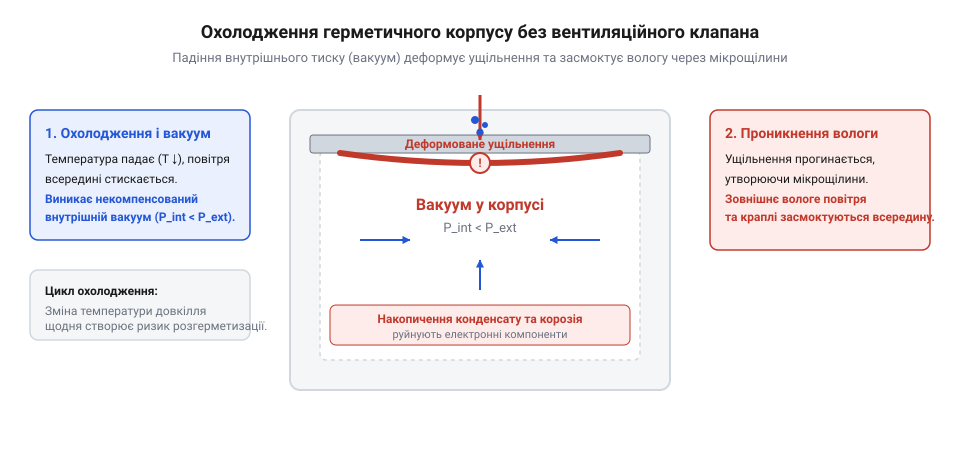
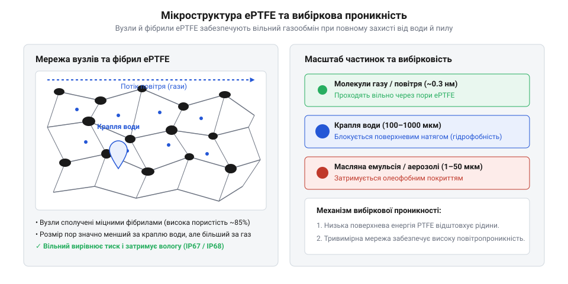

# Вентиляційні захисні клапани та мембрани ePTFE: вирівнювання тиску, гідрофобність та захист від конденсату

## Термоперепади тиску та деформація корпусів

Коли електронний пристрій працює на відкритому повітрі або піддається швидкому охолодженню під час дощу чи ввечері, герметично замкнений об'єм повітря всередині корпусу стикається з класичними термодинамічними законами. Згідно із законом Шарля, різке зниження температури всередині оболонки неминуче призводить до значного падіння тиску. Оскільки конструкція надійно запечатана еластомерним ущільненням типу @@en|O-ring@@, вільний газообмін із довкіллям повністю відсутній, через що всередині утворюється руйнівне внутрішнє розрядження.

Під дією цього перепаду тисків зовнішнє атмосферне повітря починає тиснути на стінки корпусу, викликаючи локальну деформацію еластомерних ущільнень та відкриття мікрощілин на стиках. Через утворені нещільності вологе повітря із зовні силоміць засмоктується всередину герметичного пристрою. Згодом пара конденсується на холодних платах і радіодеталях, утворюючи краплі води, які призводять до корозії металу та аварійного виходу електроніки з ладу.

*Механізм виникнення від'ємного тиску та всмоктування вологи в герметичному корпусі без вентиляційного клапана при різкому зниженні зовнішньої температури.*

Для ефективного розв'язання проблеми перепадів тиску в герметичних корпусах використовують захисні вентиляційні елементи на основі мікропористого експандованого тефлону або @@en|ePTFE@@ (політетрафторетилену). Завдяки своїй унікальній вузлово-фібрилярній структурі мембрана має мільйони мікроскопічних пор, які вільно пропускають молекули газів, забезпечуючи миттєве вирівнювання внутрішнього тиску з атмосферним (ΔP ≈ 0) та запобігаючи деформації ущільнень. Водночас надзвичайно високі гідрофобні та олеофобні властивості матеріалу створюють надійний бар'єр для крапель води, бруду й мастил, витримуючи значний тиск водяного стовпа перед гідравлічним проривом (@@en|WEP@@ — Water Entry Pressure). Необхідну мінімальну площу мембрани інженер розраховує виходячи з вільного об'єму внутрішньої порожнини корпусу, максимальної швидкості зміни температури та прогнозованого температурного перепаду, а монтаж клапана здійснює на вертикальних або нижніх стінках корпусу в зонах, захищених від прямого потоку дощової води.

*Вузлово-фібрилярна будова розтягнутого політетрафторетилену (ePTFE), де мікропори забезпечують вирівнювання тиску газом і затримують воду.*