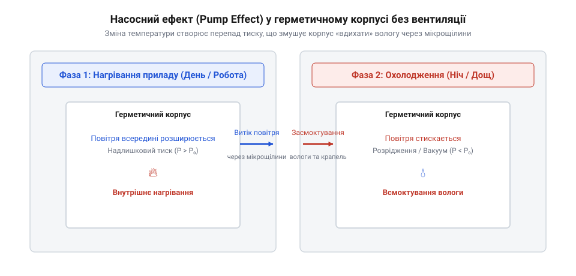

# Історія винайдення ePTFE та еволюції захисних вентиляційних клапанів

## Проблема герметизації електроніки

Чутлива електроніка в промисловому та автомобільному обладнанні потребує захисту від агресивних зовнішніх факторів, таких як пил, волога, бруд і механічні пошкодження. Традиційним рішенням для цього є створення герметичного корпусу за допомогою гумових ущільнень, силікону та щільних з'єднань. Проте повна герметичність створює нову, неочікувану інженерну проблему. Під час роботи приладу або зміни умов навколишнього середовища температура всередині та зовні корпусу постійно коливається. 

Коли прилад працює або нагрівається під сонячними променями, повітря всередині нього розширюється. Оскільки корпус герметичний, тиск усередині зростає, намагаючись знайти вихід через будь-які мікрощілини або нещільності ущільнень. Навпаки, коли прилад вимикається або потрапляє в холодну воду, повітря всередині охолоджується і стискається, створюючи розрідження. Цей перепад тисків діє як справжній насос, що засмоктує вологу та краплі води крізь найменші дефекти ущільнень усередину приладу. Докладніше термодинаміку перепаду тиску описано в матеріалі [Насосний ефект в електроніці](root:ph-thermodynamics/pump-effect).

*Герметичний корпус під час температурних коливань створює перепад тиску, який засмоктує вологу всередину через ущільнення.*

Усередині замкнутого простору засмоктана волога осідає на платах і компонентах у вигляді конденсату. Згодом це призводить до корозії електричних контактів, коротких замикань та повного виходу обладнання з ладу. Спроби зробити корпус ще міцнішим лише посилюють проблему: зростаючий тиск деформує стінки та розриває прокладки, а під час охолодження розрідження стає ще більшим.

## Винайдення розтягнутого політетрафторетилену Робертом Гором

Тривалий час інженери не могли розірвати це замкнуте коло між герметичністю та диханням корпусів, доки не з'явився новий матеріал із унікальними фізичними властивостями. У 1969 році американський інженер і підприємець Роберт Гор (en|Robert W. Gore@@) експериментував із політетрафторетиленом (en|polytetrafluoroethylene@@, більш відомим як тефлон). Стандартний метод обробки цього полімеру полягав у повільному розтягненні нагрітого матеріалу, що давало обмежене подовження.

Під час чергового експерименту Роберт Гор вирішив різко і з великою швидкістю смикнути заготовку з тефлону, замість того щоб тягнути її повільно. Восьмикратне швидке розтягнення не порвало матеріал, а спричинило несподіваний ефект: полімер розширився у понад десять разів, перетворившись на мікропористу структуру, яка складалася переважно з повітря. Цей новий матеріял отримав назву розтягнутий політетрафторетилен (en|expanded polytetrafluoroethylene@@, ePTFE).

Мікроскопічний аналіз показав, що ePTFE має унікальну будову, яка складається з міцних вузликів (en|nodes@@), з'єднаних між собою тонкими волокнами (en|fibrils@@). Така структура нагадує павутину, де пори займають понад вісімдесят відсотків об'єму матеріалу. Завдяки надзмовій кривині та мікроскоiпічним розмірам цих пор повітря та гази проходять крізь мембрану безперешкодно, тоді як рідка вода у вигляді крапель фізично не може крізь них пройти через високий поверхневий натяг.

## Перехід до мікропористих захисних мембран

Властивості розтягнутого політетрафторетилену відкрили принципово новий підхід до захисту електронних приладів. Замість того щоб намагатися зробити корпус абсолютно герметичним і боротися з руйнівним тиском, інженери почали інтегрувати в стінки корпусів мікропористі захисні мембрани (en|protective vents@@). Мембрана з ePTFE забезпечує постійний газообмін, вирівнюючи внутрішній тиск із атмосферним у режимі реального часу.

Коли прилад нагрівається, повітря вільно виходить назовні крізь пори мембрани, запобігаючи деформації стінок і настанню критичного тиску на ущільнення. При охолодженні повітря надходить назад через мембрану, але будь-яка волога, дощ чи бруд затримуються на зовнішній поверхні. Таким чином, «насосний ефект» нейтралізується: всередині приладу не утворюється розрідження, здатне затягнути воду крізь стики.

Окрім вирівнювання тиску, мембрани з ePTFE пропускають звукові хвилі практично без спотворень, що є критично важливим для датчиків, динаміків і мікрофонів у захищених корпусах. Водночас поривата структура ефективно затримує дрібний пил і бруд, відповідаючи найвищим вимогам промислової безпеки.

## Олеофобна обробка та стійкість до агресивних середовищ

Попри високі гідрофобні властивості, звичайна мембрана з розтягнутого політетрафторетилену має суттєве обмеження в реальних умовах експлуатації. В автомобільній промисловості та важкому машинобудуванні прилади часто стикаються не лише з водою, а й з мастилами, моторним паливом, розчинниками та поверхнево-активними речовинами (en|surfactants@@). Онали та мастила мають значно нижчий поверхневий натяг, ніж вода, тому вони здатні змочувати звичайний тефлон і просочуватися крізь мікропори мембрани, повністю блокуючи її здатність пропускати повітря.

Для вирішення цієї проблеми розробники застосували спеціальну олеофобну обробку (en|oleophobic treatment@@). Мембрану покривають надзвичайно тонким шаром спеціального водовідштовхувального та оливовідштовхувального полімеру, який змінює поверхневу енергію волокон ePTFE без помітного зменшення розміру пор. Детальніше про механізм поверхневої енергії читайте в темі [Олеофобна обробка мембран](root:ph-condensed/oleophobic-coating).

Це модифіковане покриття змушує будь-які рідини з низьким поверхневим натягом збиратися в краплі та скочуватися з поверхні мембрани, замість того щоб розтікатися і проникати всередину. Завдяки олеофобному захисту вентиляційні клапани зберігають свою проникність для повітря навіть після контакту з автомобільними мастилами, мийними засобами під високим тиском та паливом, що забезпечує довготривалу надійність обладнання в екстремальних умовах.

## Сучасні стандарти захисту IP67, IP68 та IP69K

Надійність роботи електронних та електричних приладів у суворих умовах регулюється суворими міжнародними стандартизаціями. Найпоширенішими є ступені захисту оболонки (en|Ingress Protection@@, IP), які визначають стійкість приладу до проникнення твердих предметів і вологи. Традиційні методи досягнення високих класів захисту спиралися виключно на суцільні герметичні ущільнення, що неминуче призводило до проблем із внутрішнім тиском.

Стандарти IP67 (захист від тимчасового занурення у воду на глибину до 1 метра) та IP68 (захист від тривалого занурення під тиском) тепер успішно досягаються не герметизацією у глуху, а використанням дихаючих мембран, які витримують значний водяний стовпчик, одночасно пропускаючи повітря. Найвищий сучасний стандарт IP69K вимагає стійкості до високотемпературного миття під високим тиском, коли струмені води з температурою до 80 градусів Цельсія б'ють по корпусу під тиском до 100 бар з мінімальної відстані.

Досягнення стандарту IP69K стає можливим завдяки міцним металевим або пластиковим корпусам клапанів із впаяними олеофобними мембранами з ePTFE. Такі вентиляційні елементи не лише витримують механічний удар гарячого струменя води, а й миттєво стабілізують різкий перепад температур, який виникає, коли розпечений автомобільний двигун або промисловий блок потрапляє під холодну воду.