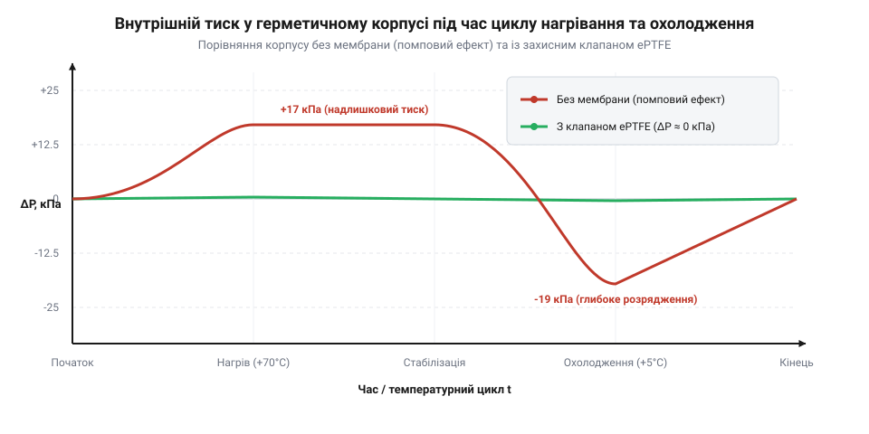

# Розрахунок повітряного потоку та тиску прориву води ePTFE-мембран

<preknowlist>
- [Набори гвинтів М3 (шестигранник, потайні DIN7991)](root:cat-hw-parts/m3-screw-kits) — розуміння механічної жорсткості корпусів і точок кріплення, на які впливає перепад тиску.
</preknowlist>

## Проблема герметичності та тиску

Коли електронний пристрій працює в польових умовах, його корпус прагнуть зробити повністю герметичним, щоб захистити чутливу плату від пилу та води. Проте абсолютна герметичність створює неочікувану фізичну проблему під час зміни температур, що безпосередньо випливає із закону Шарля: за незмінного об'єму тиск газу прямо пропорційний його абсолютній температурі. Під час роботи приладу або нагрівання сонячним промінням повітря всередині пристрою нагрівається і прагне розширитися, створюючи надлишковий тиск, який навантажує стінки корпуса та механічні точки кріплення, зокрема набори гвинтів М3 (шестигранник, потайні DIN7991). Натомість при вимиканні чи різкому охолодженні дощовою водою повітря всередині стискається, утворюючи глибоке розрідження (вакуум). Оскільки виходу назовні немає, цей перепад тисків змушує корпус деформуватися та втягувати вологу крізь найдрібніші нещільності ущільнень, затягуючи краплі всередину до пристрою. Вплив теплової зміни розмірів матеріалів детально описано у статті [Коефіцієнти теплового розширення матеріалів корпусу](root:ph-thermodynamics/thermal-expansion).

Ці коливання тиску діють на стінки корпусу та механічні ущільнювачі. Під час нагрівання внутрішній тиск намагається роздути корпус, навантажуючи точки кріплення та гвинти, наприклад, набори гвинтів М3 (шестигранник, потайні DIN7991). При охолодженні створюється розрідження, яке змушує корпус втягувати повітря всередину. Якщо ущільнення не витримує, через мікрощілини починається всмоктування вологи разом із повітрям. Зокрема, краплі дощу або роса затягуються всередину за рахунок різниці тисків, після чого вода осідає на платі й викликає корозію чи коротке замикання. Для розв'язання цієї проблеми в корпус вмонтовують захисну ePTFE-мембрану (розширений політетрафторетилен), яка є непроникною для рідкої води та пилу, але вільно пропускає повітря для вирівнювання тиску.

## Закон ідеального газу та потік повітря

Коли герметичний електронний пристрій працює в умовах змінних температур — під час увімкнення, сонячного нагріву на відкритому повітрі чи охолодження вночі — внутрішнє повітря реагує на зміну теплової енергії. Оскільки корпус повністю ізольований від зовнішнього середовища, кількість повітря та доступний об'єм залишаються незмінними. Нагрівання змушує молекули газу рухатися швидше, що створює надлишковий тиск, здатний деформувати стінки корпусу та пошкодити ущільнювачі в місцях кріплення (наприклад, де використовуються [набори гвинтів М3](root:cat-hw-parts/m3-screw-kits)). Натомість охолодження призводить до розрідження (вакууму), через яке волога та пил можуть бути засмоктані крізь найменші мікрощілини.

*Графік ілюструє амплітуду коливань тиску в невентильованому корпусі протягом добових температурних циклів.*

Щоб зрозуміти, як саме температура керує станом газу, звернемося до рівняння стану ідеального газу. Воно зв'язує тиск, об'єм і температуру у вигляді добутку макроскопічних параметрів:

        P · V = n · R · T
        d(P · V) / dt = d(n · R · T) / dt      [диференціювання рівняння стану ідеального газу за часом]
        V · (dP / dt) = n · R · (dT / dt)      [урахування сталості об'єму та кількості речовини в закритому корпусі]

Оскільки кількість речовини та об'єм корпусу не змінюються, швидкість зміни тиску `dP / dt` прямо пропорційна швидкості зміни температури `dT / dt`. Виразивши добуток `n · R` через початкові параметри стану як `(P · V) / T`, підставимо його в диференціальну форму:

        V · (dP / dt) = ((P · V) / T) · (dT / dt) [підстановка зв'язку газових параметрів]
        dP / dt = (P / T) · (dT / dt)          [отримання швидкості зміни внутрішнього тиску]

Отримана залежність показує, що навіть помірна швидкість зміни температури викликає значний приріст тиску в замкненому просторі. Щоб запобігти руйнуванню конструкції, необхідно забезпечити безперервний газообмін за допомогою спеціальної @@en|ePTFE membrane@@ (пористої політетрафторетиленової мембрани), яка пропускає повітря, але затримує воду та бруд.

Для розрахунку необхідної пропускної здатності використовують похідну об'єму газу за часом. За умови стабілізації внутрішнього тиску (коли тиск дорівнює атмосферному, а об'єм повітря змінюється термічно), об'ємна витрата повітря `Q`, яку повинна забезпечити мембрана, виводиться з рівняння ідеального газу при `P = const`:

        V / T = const
        d(V / T) / dt = 0                      [диференціювання відношення об'єму до температури]
        (1 / T) · (dV / dt) - (V / T²) · (dT / dt) = 0 [правило диференціювання частки]
        dV / dt = (V / T) · (dT / dt)          [перенесення доданку та множення на температуру]
        Q = (V / T) · (dT / dt)                [перехід до об'ємної витрати повітря через мембрану]

Де `Q` — об'ємна витрата повітря у кубічних сантиметрах на хвилину, `V` — внутрішній вільний об'єм корпусу, `T` — абсолютна температура в кельвінах, а `dT / dt` — швидкість зміни температури за хвилину. Завдяки цій формулі інженер може точно розрахувати мінімально необхідну площу та пропускну здатність захисного елемента для найсуворіших умов експлуатації.

У цьому розділі розкрито застосування закону ідеального газу для моделювання тиску в замкненому корпусі, виведено диференціальну залежність зміни тиску та отримано формулу об'ємної витрати повітря `Q` через мембрану; введено терміни @@en|ePTFE membrane@@ та об'ємна витрата повітря.

## Тиск проникнення води та капілярний ефект

Повітропроникність мембрани забезпечується її мікропористою структурою, проте пори не повинні пропускати краплі води під час дощу чи миття пристрою під тиском. Захисна властивість ePTFE проти рідкої води описується через капілярний ефект та гідрофобність матеріалу. Вода не змочує поверхню тефлону через високий кут контакту, утворюючи опуклі меніски в мікропорах.

Мінімальний тиск, за якого вода починає проникати крізь пори мембрани, відомий як тиск проникнення води —@@en|Water Entry Pressure, WEP@@. Цей показник залежить від фізичних властивостей рідини та геометрії пористої структури. Для розрахунку критичного тиску застосовують капілярне рівняння Лапласа-Янга:

        WEP
        = (2 · γ · cos(θ)) / r   [рівновага сил поверхневого натягу та гідростатичного тиску]
        = P_critical             [критичний тиск проникнення води]

Де `γ` — поверхневий натяг води, `θ` — краевий кут смачування між водою і поверхнею ePTFE, а `r` — ефективний радіус найбільшої мікропори мембрани. З формули випливає, що чим менший радіус пор та чим вища гідрофобність (більший кут смачування), тим більший тиск води витримує мембрана без протікання. Це дозволяє захистити прилад навіть при зануренні на невелику глибину або потраплянні під струмінь води.

## Підбір мембрани та перевірка стінок

Маючи розраховану об'ємну витрату повітря та знаючи показник тиску проникнення води, інженер переходить до практичного підбору типорозміру захисної мембрани. Недостатня площа мембрани призведе до того, що повітря не встигатиме проходити крізь пори під час різкого нагрівання, і внутрішній тиск перевищить допустиму межу для стінок корпусу. Надто велика мембрана займатиме зайве місце на корпусі та може знизити загальну механічну міцність конструкції.

Спочатку перевіряють максимально припустиму різницю тисків для стінок корпусу та ущільнень, щоб уникнути їх остаточної деформації. Потім за каталожними даними виробника обирають мембрану, чия пропускна здатність перевищує розрахункове значення `Q`, а показник WEP забезпечує необхідний клас захисту від вологи (наприклад, IP67 або IP68). Правильно підібрана ePTFE-мембрана гарантує тривалу безвідмовну роботу герметичного пристрою в умовах щоденних температурних коливань. Класифікацію та вимоги до випробувань регламентують [Стандарти захисту оболонок IP67 та IP68](root:sys-notary/ingress-protection-standards-ip67-ip68-ip69k).