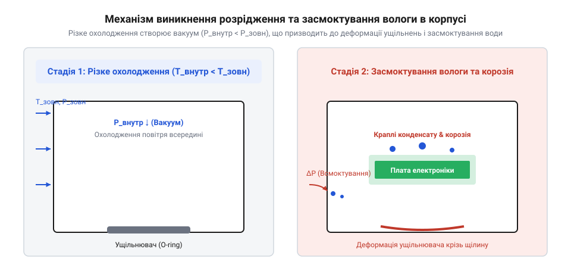

# Інтеграція та випробування ePTFE-клапана в герметичному вуличному модулі

<preknowlist>
- [Набори гвинтів М3](root:cat-hw-parts/m3-screw-kits) — знання про кріпильні елементи для механічної фіксації корпусних деталей.
- [Клей ціаноакрилатний](root:cat-hw-parts/cyanoacrylate-glue) — розуміння умов надійного клейового з'єднання на металевих і пластикових поверхнях.
</preknowlist>

## Проблема утворення конденсату в герметичних корпусах

Коли герметичний електронний прилад чи вулична розподільна шафа працюють на відкритому повітрі, вони зазнають постійних температурних коливань. Протягом сонячного дня корпус нагрівається сонячним промінням та внутрішніми тепловими виділеннями силових компонентів. Повітря всередині розширюється, підвищуючи внутрішній тиск, і частково виходить крізь мікрощілини гумових ущільнювачів або кабельних вводів. Вночі або при різкій зміні погоди (наприклад, під час літньої зливи) поверхня корпусу миттєво охолоджується. Внутрішнє повітря стискається, утворюючи глибоке розрідження (барометричний вакуум), причому динаміка наростання цього вакууму прямо залежить від внутрішнього вільного об'єму шафи та швидкості охолодження під час зливи: що більший об'єм повітря в замкненому просторі й різкіше падає температура стінок від крижаних дощових крапель, то стрімкіше зменшується тиск усередині порівняно із зовнішнім атмосфером. Оскільки герметичність за холодного стану стає ще щільнішою через дубіння гуми, створений перепад тиску починає буквально засмоктувати вологе зовнішнє повітря крізь найдрібніші дефекти конструкції.

*Механізм перепаду тиску та проникнення вологи в герметичний корпус.*

Коли вологе повітря потрапляє всередину холодної зони, його температура падає нижче точки роси (@@en|dew point@@), і надлишкова волога конденсується на стінках металевої шафи та на холодних платах електроніки. З кожним добовим циклом нагріву й охолодження кількість води всередині накопичується, оскільки зворотного виходу для пари немає — ущільнювачі працюють як ніпелі, пропускаючи повітря всередину під час вакууму, але перешкоджаючи виходу пари назовні. Це призводить до корозії друкованих плат, витоків струму, хибних спрацьовувань датчиків і повної відмови обладнання. Щоб надійно розірвати цей руйнівний ланцюг, використовують спеціальні захисні клапани, які вирівнюють тиск без допуску крапельної вологи. Для механічного кріплення компонентів корпусу та монтажних планок часто застосовують набори гвинтів М3 (@@en|M3 screw kits@@) [набори гвинтів М3](file:///root:cat-hw-parts/m3-screw-kits), забезпечуючи міцність конструкції без порушення геометричної цілісності стінок.

## Принцип роботи та властивості ePTFE мембран

Традиційні глухі заглушки або герметизація наглухо не вирішують проблему конденсату, оскільки не здатні зупинити фізику теплового стискання повітря. Ефективним розв'язком є інтеграція проникної мембрани з експандованого політетрафторетилену (@@en|ePTFE@@ від англ. expanded polytetrafluoroethylene — експандований політетрафторетилен). Матеріал отримують шляхом швидкого розтягування фторопласту за високих температур, унаслідок чого утворюється унікальна тривимірна мікропориста мережа з вузлів, з'єднаних мікрофібрилами. Пористість такого матеріалу сягає 80–90 %, а середній розмір пор становить від 0.1 до 1.0 мікрометра, що у кілька разів менше за краплю води, але в сотні разів за молекулу водяної пари. На мікрорівні краплі води стикаються з розгалуженою сіткою вузлів і фібрил, де завдяки надзвичайно низькій поверхневій енергії фторопласту формується високий крайовий кут змочування понад 110-120°, що перешкоджає розтіканню рідини. Виникає капілярний тиск Лапласа, який блокує меніск і перешкоджає проникненню води крізь пори. Для запобігання змочуванню агресивними рідинами проводиться додаткова олеофобна обробка шляхом модифікації поверхні фторалкільними моношарами, що знижує поверхневу енергію та надійно захищає пори від проникнення низькополярних олійних парів, поверхнево-активних речовин та паливно-мастильних аерозолів.

Завдяки такій структурі ePTFE мембрана вільно пропускає газоподібну вологу та повітря, забезпечуючи постійне вирівнювання тиску між внутрішнім об'ємом корпусу та навколишнім середовищем. Водночас поверхнева енергія фторопласту є надзвичайно низькою, що робить матеріал гідрофобним та олеофобним. Рідка вода та олії збираються у сферичні краплі на поверхні завдяки високому поверхневому натягу і не можуть подолати бар'єр без прикладання критичного тиску — так званої точки витікання води (@@en|water entry pressure@@, WEP). Надійність цього бар'єра вимірюється в кілопаскалях або метрах водяного стовпа; якісні клапани витримують WEP понад 70 кПа (близько 7 метрів водяного стовпа), залишаючись проникними для повітря. Це дозволяє приладу «дихати», повністю блокуючи потрапляння дощу, бризок, пилу та бруду.

## Розрахунок повітрообміну та вибір типорозміру клапана

Щоб захисний клапан не створював надмірного перепаду тиску під час різких температурних коливань, необхідно розрахувати максимальну об'ємну витрату повітря, що витікає або засмоктується через мембрану. Розрахунок базується на рівнянні стану ідеального газу та законі Шарля, враховуючи швидкість зміни температури довкілля та геометричний об'єм герметичної частини корпусу.

:::code proj-outdoor-enclosure-vent-integration/py/vent_flow_calc.py

Проведений розрахунок за допомогою скрипта показує, що для герметичного корпусу об'ємом 2.5 літра при швидкому охолодженні від 55 °C до 15 °C за 10 хвилин пікова витрата повітря становить приблизно 0.33 л/хв. Знаючи цей параметр та питому повітропроникність обраної мембрани (наприклад, 400 мл/хв/см² при перепаді 70 мбар), за допомогою мінімальної площі мембрани визначають необхідний типорозміровий виріб. Для надійного з'єднання герметичних кришок чи фланців корпусу часто використовують клей ціаноакрилатний (@@en|cyanoacrylate glue@@) [клей ціаноакрилатний](file:///root:cat-hw-parts/cyanoacrylate-glue), який забезпечує миттєву фіксацію допоміжних елементів.

## Монтаж, герметизація та захист клапана в корпусі

Фізична інтеграція ePTFE-клапана в стінку корпусу вимагає суворого дотримання технології підготовки поверхні, оскільки будь-які залишки мастила, пилу чи вологи на місці приклеювання призведуть до порушення герметичності клейового шару. Поверхню металевого або пластикового корпусу ретельно знежирюють ізопропіловим спиртом за допомогою безворсової серветки та витримують до повного висихання. Самоклеючий клапан акуратно відокремлюють від захисної підкладки пінцетом, уникаючи дотиків пальцями до клейової основи та самої ePTFE мембрани, щоб не забити мікропори жировими виділеннями шкіри.

Клапан центрують над попередньо просвердленим технологічним отвором і притискають із зусиллям близько 15 Н протягом 10 секунд за допомогою спеціального силіконового ролика або торця пластмасової втулки. Для різьбових моделей використовують кільцеві ущільнювачі та затягування з регламентованим крутним моментом, щоб не деформувати корпус. З зовнішнього боку поверх клапана обов'язково встановлюють захисний пластиковий ковпачок з лабіринтовими каналами. Цей ковпачок захищає ніжну мікропористу мембрану від прямих струменів води під високим тиском під час миття шафи, а також від налипання бруду, листя чи утворення крижаної кірки, які можуть повністю заблокувати повітрообмін.

## Випробування герметичності та термоциклювання

Завершальним етапом створення надійного вуличного приладу є лабораторне випробування змонтованого вузла в умовах термоциклювання для перевірки стійкості до перепадів тиску. Зібраний корпус із встановленим ePTFE-клапаном та внутрішнім датчиком тиску і вологості поміщають у кліматичну камеру. Протягом випробування проводять не менше 50 повних циклів зміни температури від мінус 40 °C до плюс 70 °C зі швидкістю зміни не менше 1 °C за хвилину.

Під час циклу за допомогою цифрових манометрів високої точності контролюють різницю тисків між внутрішньою порожниною корпусу та камерним середовищем. Максимальний перепад тиску на мембрані не повинен перевищувати розрахункових 70–100 мбар, що підтверджує достатню пропускну здатність клапана. Додатково аналізують показники внутрішньої відносної вологості: вона повинна залишатися стабільною без ознак випадання конденсату навіть у фазах різкого охолодження. Якщо тиск усередині різко зростає або падає до критичних значень, це вказує на брак клейового шару або забруднення пори мембрани, що вимагає заміни вузла.