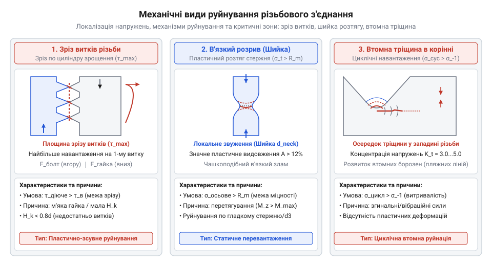
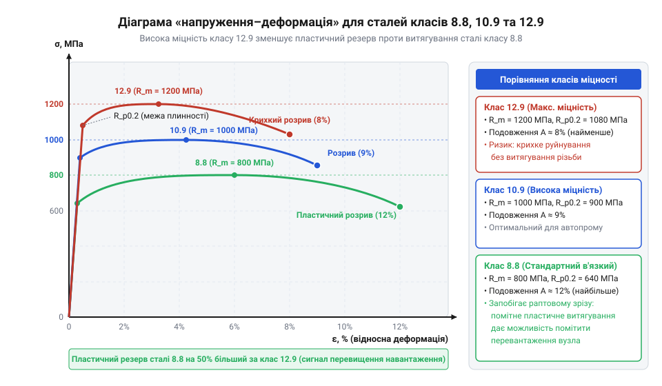
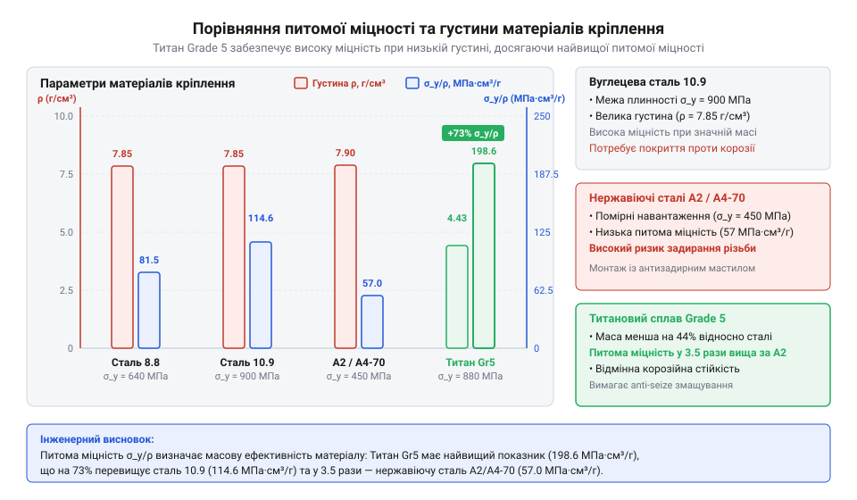
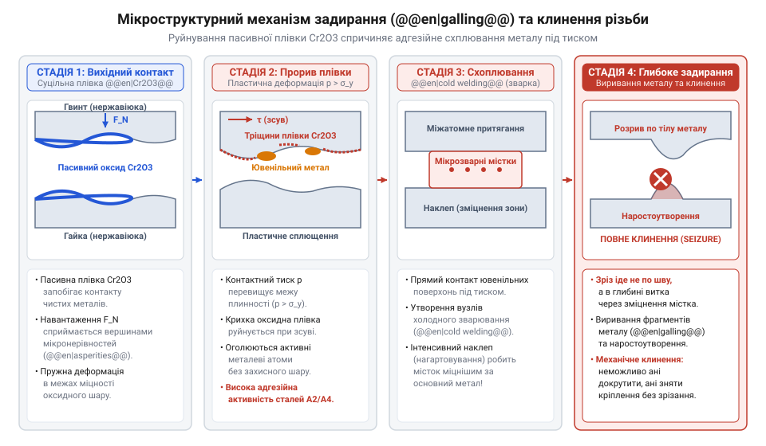
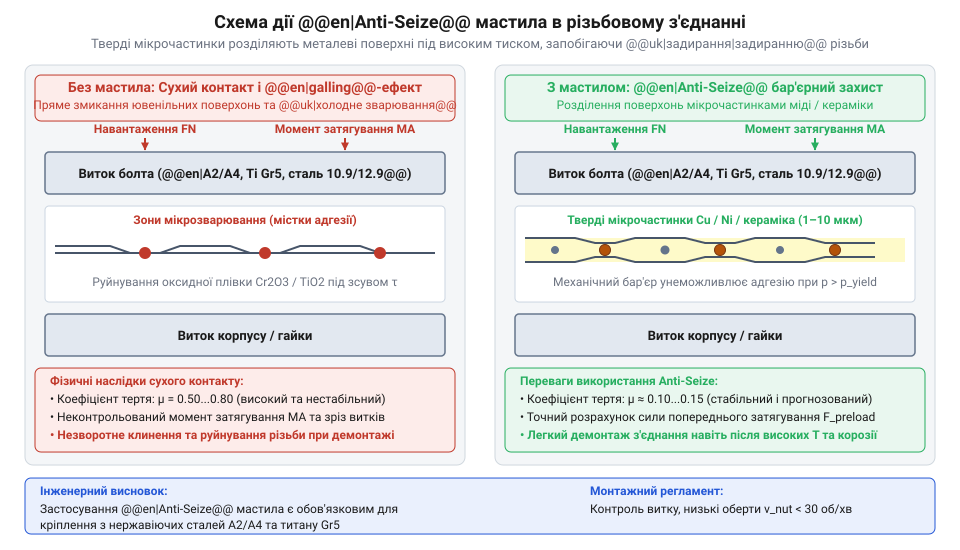

# Класи міцності та матеріали кріплення: сталі 8.8–12.9, нержавійка A2/A4, титан Gr5 та задирання різьби

<preknowlist>
- [Нарізні втулки та футорки](root:cat-hw-parts/threaded-inserts-and-heat-set) — геометрія метричної різьби та базові принципи передачі механічного навантаження через витки з'єднання
- [Пружинні контакти Pogo Pins](root:cat-hw-parts/pogo-pins) — принципи поверхневого контактного тиску, оксидації та фретинг-зносу металевих поверхонь
</preknowlist>

## Механічні руйнування та клинення різьби

Під час монтажу силового рамного вузла чи встановлення корпусного елемента затягування сталевого болта динамометричним ключем раптом втрачає опір, і гвинт починає прокручуватися без збільшення зусилля. В іншому випадку, при загвинчуванні нержавіючого гвинта в алюмінієву чи нержавіючу деталь ручним гайкокрутом, різьба напівшляху раптово заклинює намертво: болт неможливо ані докрутити до кінця, ані викрутити назад, навіть застосовуючи екстремальний момент. Звичайна інженерна ілюзія сприймає будь-яке металеве @@en|fastener@@ (кріплення, від англійського @@en|fastener@@ — фіксатор, зв'язка) як абсолютне тверде тіло, що зберігає геометрію під будь-яким навантаженням. Проте під дією реальних механічних зусиль у різьбовому з'єднанні виникають складні пружні й пластичні деформації, а на контактних мікроповерхнях витків розгортаються трибологічні та фізико-хімічні процеси, здатні повністю зруйнувати вузол.

Механічний вихід різьбового з'єднання з ладу відбувається за трьома основними сценаріями: зрізання витків, пластичне витягування стержня та втомний злам. Зрізання витків виникає тоді, коли зсувні напруження на контактних фасках різьби перевищують межу зсуву матеріалу. Це типово для випадків із недостатньою глибиною вкручування або при використанні м'якого базового матеріалу; для запобігання цьому в м'які або композитні структури монтують [нарізні втулки та футорки](root:cat-hw-parts/threaded-inserts-and-heat-set), які розподіляють зусилля на більшу площу. Витягування та розрив стержня відбуваються при осьовому перевантаженні, коли виникає пластична деформація та утворення звуження (шийки) в найслабшому перерізі — по западині витка. Третій варіант — втомне руйнування (детальніше це описує [фізика втомного зламу](root:ph-mechanics/fatigue-fracture-of-threaded-joints) різьби) під дією циклічних вібрацій, де корінь витка слугує концентратором напружень, породжуючи мікротріщину, яка поступово розростається до раптового крихкого зрізу.


*Схема механічних видів руйнування різьбового з'єднання показує розподіл ліній напружень при зрізі витків, утворенні шийки розтягу та виникненні втомної тріщини в корінні різьби.*

Окремою й дуже підступною формою аварійного клинення є задирання (англ. @@en|galling@@, від @@en|gall@@ — роздратування, стирання) різьби, яке часто плутають із простим засміченням чи перекосом. На мікроскопічному рівні бічні поверхні витків різьби не є ідеально гладкими. При загвинчуванні реальний контакт відбувається лише на окремих вершинах мікронерівностей (асперитетах). Оскільки фактична площа цього мікроконтакту становить лише частки відсотка від номінальної площі витка, локальний контактний тиск у цих точках досягає гігантських значень, що перевищують межу пластичності металу. Схожі явища високого притиску виникають і тоді, коли аналізується [мікротрібологічний фретинг-знос поверхні](root:cat-hw-parts/pogo-pins), де цикли мікрозсувів руйнують оксидні шари.

Вирішальну роль у процесі @@en|galling@@ відіграє захисна оксидна плівка. Конструкційні матеріали з високою корозійною стійкістю, як-от нержавіючі сталі чи титан, захищені природним шаром оксидів завтовшки у кілька нанометрів (відбувається пасивація, від латинського @@la|passivus@@ — пасивний, бездіяльний, @@la|passivatio@@). Коли нержавіючий гвинт закручують «всуху» під високим тиском або з високою швидкістю обертання, тертя зрізає та руйнує крихку природну оксидну плівку. Ювенільні (абсолютно чисті) металеві поверхні оголюються й вступають у прямий безпосередній атомний контакт. Під дією стискання та локального нагріву між кристалічними ґратками двох витків миттєво формуються міжатомні зв'язки — виникає холодне зварювання (англ. @@en|cold welding@@).

При подальшому обертанні @@en|fastener@@ сформовані мікрозварні містки не просто зрізаються, а виривають шматки металу з протилежної поверхні. Ці вирвані мікрочастинки металу й викришені тверді фрагменти потрапляють у зазор між витками, який задають [геометричні параметри метричної різьби](root:cat-hw-parts/thread-types-and-pitch-standards). Виникає ефект лавиноподібного заклинювання: пластично деформовані стружки та задирки діють як розпираючі клини. Тертя зростає експоненційно, крутний момент злітає в рази, і протягом частки секунди з'єднання незворотно зварюється. Спроба викрутити такий гвинт призводить лише до повного зрізання або скручування його головки.

Розуміння механізмів механічного руйнування та трибологічного заклинювання показує, що правильний вибір кріпильного елемента неможливий без глибокого знання механічних характеристик матеріалу. Для розрахунку стійкості до розтягу й зсуву інженери спираються на чітку систему стандартизованих класів міцності сталей.

## Маркування та деформація сталевого кріплення

Для вуглецевих та легованих сталей міжнародний стандарт визначає чітку систему позначення класів міцності у вигляді двох чисел, розділених крапкою: 8.8, 10.9, 12.9. Як розкриває [історія стандартизації класів](root:cat-hw-parts/fastener-strength-classes-and-materials/hist-fastener-standards.md) метричних нарізей, це маркування не є довільним порядковим номером, а містить пряму інформацію про критичні механічні напруження матеріалу. Перше число, помножене на 100, задає номінальну межу міцності (англ. @@en|ultimate tensile strength@@) `R_m` у мегапаскалях (МПа або Н/мм²). Межа міцності визначає максимальне механічне напруження розтягу, яке матеріал здатний витримати перед остаточним руйнуванням. Відповідно, для класу 8.8 `R_m = 8 × 100 = 800 МПа`, для класу 10.9 `R_m = 10 × 100 = 1000 МПа`, а для вищого класу 12.9 `R_m = 12 × 100 = 1200 МПа`.

Друге число після крапки вказує на співвідношення між межею плинності (англ. @@en|yield strength@@) `R_e` (або умовною межею плинності `R_{p0.2}`) та межею міцності @@en|ultimate tensile strength@@ `R_m`, виражене у десяткових частках (або у відсотках, поділених на 10). Межа плинності задає поріг напруження, після якого в металі починаються незворотні пластичні деформації. Для класу 8.8 число `.8` означає, що @@en|yield strength@@ становить 80% від @@en|ultimate tensile strength@@:

```
R_{e, 8.8} = R_m × 0.8
= 800 МПа × 0.8      [множення межі міцності на співвідношення 0.8]
= 640 МПа            [поріг початку пластичної деформації для 8.8]
```

Для класів 10.9 та 12.9 друге число `.9` вказує на те, що @@en|yield strength@@ становить 90% від межі міцності. Отже, для 10.9 маємо `R_{e, 10.9} = 1000 × 0.9 = 900 МПа`, а для класу 12.9 — `R_{e, 12.9} = 1200 × 0.9 = 1080 МПа`.

Фізику деформацій сталевого кріплення під навантаженням наочно описує діаграма напруження-деформація (англ. @@en|stress-strain curve@@).


_Діаграма напруження-деформація для сталевих болтів класів 8.8, 10.9 та 12.9: видно пружну ділянку (закон Гука), точку плинності та зону пластичного витягування перед руйнуванням._

На графіку чітко простежуються дві характерні зони: пружна та пластична. На початковому лінійному відрізку діє закон Гука, де напруження `σ` прямо пропорційне відносній деформації `ε` через модуль Юнга (англ. @@en|Young's modulus@@), який для сталей становить `E ≈ 205 ГПа`. У цій зоні деформація є цілком оборотною: після зняття навантаження @@en|fastener@@ повертається до початкової довжини. Будь-яке розрахункове робоче навантаження та сила попереднього затягування (англ. @@en|preload@@) мають лежати виключно в пружній зоні, не перевищуючи контрольне навантаження (англ. @@en|proof load@@) `F_p`, яке зазвичай становить близько 90% від @@en|yield strength@@.

Коли розтягуюче напруження перевищує `R_e`, матеріал переходить у зону пластичної деформації (англ. @@en|plastic deformation@@). Траєкторія цієї зони суттєво відрізняється залежно від класу міцності:
- **Клас 8.8** виготовляють із середньовуглецевих або легованих сталей із подальшим гартуванням та високим відпуском. Він має високу пластичність (відносне подовження `A ≥ 12 %`). При перевантаженні такий болт помітно витягується, утворюючи шийку, що дає візуальне попередження про критичний стан вузла перед остаточним зламом. - **Класи 10.9 та 12.9** виготовляють із високолегованих сталей (хромомолібденових або борвмісних) із низьким відпуском. Вони мають вищу твердість і значно вужчий діапазон між `R_e` та `R_m` (лише 10%). Пластичний резерв у них значно менший (відносне подовження для 12.9 становить лише `A ≈ 8 %`). Під надмірним навантаженням болт 12.9 руйнується майже крихко, без попереднього помітного видовження. Крім того, вироби класу 12.9 надзвичайно чутливі до концентраторів напружень та водневої крихкості, коли наносяться [захисні поверхневі покриття](root:cat-hw-parts/surface-treatments-and-coatings-for-fasteners) методом електролітичного цинкування (докладніше це розкриває [воднева крихкість високоміцних сталей](root:ph-condensed/hydrogen-embrittlement-in-fasteners)).

Щоб обчислити максимальне допустиме напруження та розрахункову силу на болт перед початком пластичної деформації, використовують розрахункову площу перерізу різьби `A_s`. Для прикладу розглянемо болт М10 з кроком 1.5 мм, розрахункова площа перерізу різьби якого становить `A_s = 58.0 мм²`.

Обчислимо граничну силу плинності `F_{yield}` для класів 8.8 та 10.9:

```
F_{yield, 8.8} = A_s × R_{e, 8.8}
= 58.0 мм² × 640 Н/мм²       [множення розрахункової площі на межу плинності 8.8]
= 37120 Н                    [37.12 кН — граничне зусилля без пластичної деформації]

F_{yield, 10.9} = A_s × R_{e, 10.9}
= 58.0 мм² × 900 Н/мм²       [множення розрахункової площі на межу плинності 10.9]
= 52200 Н                    [52.20 кН — граничне зусилля плинності для класу 10.9]
```

Виходячи з отриманих значень, номінальна сила попереднього затягування @@en|preload@@ `F_{preload}` зазвичай обирається на рівні 70–75% від `F_{yield}` (наприклад, близько `39.15 кН` для класу 10.9), щоб зберегти резерв міцності на додаткові робочі динамічні навантаження та зсуви. Повний розрахунок моментів закручування з урахуванням коефіцієнтів тертя висвітлює [математичний апарат затягування](root:cat-hw-parts/fastener-strength-classes-and-materials/math-fastener-torque-and-preload.md) у розрахунковій вставці, а практичне затягування за допомогою динамометричного інструмента викладено у [практикумі зі збирання](root:cat-hw-parts/fastener-strength-classes-and-materials/proj-fastener-assembly-and-galling-prevention.md) високонавантажених вузлів.

## Особливості нержавіючих сталей та титану

Під час проектування обладнання для морських платформ, хімічних реакторів або легких безпілотних літальних апаратів використання вуглецевих сталей класів 8.8 чи 10.9 виявляється неприпустимим через швидку корозію або надлишкову масу. На перший погляд, логічним розв'язком здається проста заміна сталевого кріплення на нержавіючі метизи груп A2 чи A4 або титанові болти. Проте пряма заміна без урахування матеріалознавчих характеристик часто призводить до несподіваного механічного руйнування вузла: з'єднання витягується й втрачає сила попереднього затягування @@en|preload@@ при навантаженнях, які вуглецева сталь 10.9 витримувала без жодних деформацій.

Причина такої поведінки полягає у суттєво різній мікроструктурі металів. Вуглецеві й леговані сталі мають ферум-карбонову структуру з вираженою межею плинності `R_e`. Натомість найпоширеніші нержавіючі сталі груп A2 (вітчизняний аналог 08Х18Н10, міжнародний AISI 304) та A4 (10Х17Н13М2, AISI 316) мають аустенітну кристалічну ґратку (від англ. @@en|austenite@@, на честь англійського металурга В. Остеніта), яка залишається стабільною при кімнатній температурі завдяки високому вмісту хрому (16–18%) та нікелю (8–14%). Хром утворює на поверхні самовідновлювану захисну оксидну плівку хрому `Cr2O3`, яка забезпечує високу стійкість до окиснення. Додавання 2–3% молібдену в сталь групи A4 додатково захищає кріплення від пітингової (поінкової) корозії у середовищах із хлоридами (морська вода, розбризкування сольових сумішей) та агресивними кислотами.

На відміну від конструкційних сталей, аустенітні нержавіючі сталі не мають чітко вираженого майданчика плинності на діаграмі напруження-деформація. Пружна деформація дуже рано переходить у пластичну, але супроводжується інтенсивним наклепом (англ. @@en|work hardening@@ або @@en|strain hardening@@ — зміцнення металу в процесі пластичної деформації). Через відсутність фізичної межі плинності для нержавіючого кріплення визначають умовну межу плинності `R_{p0.2}` (англ. @@en|proof stress@@) — це напруження, за якого залишкова пластична деформація досягає 0.2% від початкової довжини зразка.

Маркування нержавіючого кріплення за стандартом ISO 3506 складається з позначення групи сталі та класу міцності через дефіс: A2-70, A4-80 тощо. Перша літера з цифрою вказує на хімічний склад (A2 — аустенітна хромонікелева, A4 — аустенітна хромонікельмолібденова), а число після дефісу вказує на 1/10 від межі міцності (англ. @@en|ultimate tensile strength@@) `R_m` у мегапаскалях. Для найпоширенішого класу A2-70 межа міцності становить `R_m = 700 МПа`, а умовна межа плинності `R_{p0.2}` — лише близько `450 МПа`. Навіть для високоміцного нержавіючого кріплення A4-80 при межі міцності `R_m = 800 МПа` умовна межа плинності досягає близько `600 МПа`.

Порівняння з вуглецевими сталями показує, що за силовою витривалістю нержавіюче кріплення A2-70 поступається навіть сталі класу 8.8 (`R_e = 640 МПа`), і тим більше класи 10.9 (`900 МПа`) чи 12.9 (`1080 МПа`). Хоча нержавіюча сталь має високу загальну пластичність (відносне подовження `A > 40 %`), вона починає незворотно деформуватися за значно нижчих осьових сил. Тому нержавіюче кріплення не може застосовуватися як пряма силова заміна високоміцних сталевих болтів у з'єднаннях із високим попереднім натягом. Крім того, при взаємодії з алюмінієвими або вуглецевими деталями у вологому середовищі може розвиватися [гальванічна корозія металів](root:ph-condensed/corrosion-types-and-galvanic-couples), яка прискорює руйнування контактних поверхонь.

Коли вирішальними чинниками є мінімальна маса та висока міцність, інженерним стандартом стає титановий сплав Grade 5 (міжнародне позначення Ti-6Al-4V, вітчизняний аналог ВТ6). Це двофазний α+β сплав, який містить 6% алюмінію та 4% ванадію. Титан має вкрай низьку густину `ρ ≈ 4.43 г/см³` порівняно зі сталями (`ρ ≈ 7.85–7.90 г/см³`), володіючи при цьому механічною міцністю, що співвідносна з високоміцними легованими сталями: межа міцності `R_m ≈ 895–1000 МПа`, а умовна межа плинності `R_{p0.2} ≈ 828–910 МПа`.

Для об'єктивного зіставлення матеріалів використовують показник питомої міцності (англ. @@en|specific strength@@) `σ_{sp}` — відношення межі плинності матеріалу до його густини `ρ` (від англ. @@en|density@@):

```
σ_{sp, 10.9} = R_{e, 10.9} / ρ_{steel}
= 900 МПа / 7.85 г/см³          [ділення межі плинності сталі 10.9 на її густину]
= 114.65 (МПа·см³)/г            [питома міцність сталі класу 10.9]

σ_{sp, A4-70} = R_{p0.2, A4-70} / ρ_{stainless}
= 450 МПа / 7.90 г/см³          [ділення умовної межі плинності A4-70 на її густину]
= 56.96 (МПа·см³)/г             [питома міцність нержавіючої сталі A4-70]

σ_{sp, Gr5} = R_{p0.2, Gr5} / ρ_{titanium}
= 830 МПа / 4.43 г/см³          [ділення умовної межі плинності титану Gr5 на його густину]
= 187.36 (МПа·см³)/г            [питома міцність титанового сплаву Grade 5]
```

Як видно з обчислень, титановий сплав Grade 5 переважає сталь класу 10.9 за питомою міцністю в 1.63 раза, а нержавіючу сталь A4-70 — у 3.29 раза. Це забезпечує збереження високої тримальної здатності при зменшенні маси кріпильного вузла майже удвічі. Корозійна стійкість титану базується на формуванні надзвичайно щільної пасивуючої плівки діоксиду титану `TiO2`, яка не руйнується у солоній воді, киплячих кислотах та вологому клорі. Для вкручування титанового та нержавіючого кріплення в легкі сплави чи композити застосовують спеціальні [нарізні втулки та футорки](root:cat-hw-parts/threaded-inserts-and-heat-set), які запобігають зрізанню витків у м'якому базовому матеріалі.


_Графік порівняння питомої міцності та густини для вуглецевої сталі 10.9, нержавійок A2/A4 та титанового сплаву Grade 5: виразно видно перевагу титанового сплаву за питомою міцністю та суттєву надлишкову густину сталі._

Незважаючи на високу корозійну стійкість та відмінну міцність, аустенітні сталі та титанові сплави мають одну спільну й дуже критичну фізико-хімічну особливість: схильність до адгезійного руйнування різьбової поверхні при зсуві.

## Фізика задирання та холодного зварювання

Під час монтажу нержавіючого або титанового болта за допомогою викрутки чи гайкокрута різьба нерідко заклинює абсолютно раптово — задовго до досягнення розрахункового моменту затягування. Спроба прикласти більше зусилля лише остаточно зварює деталі, а при викручуванні стержень болта просто скручується навпіл. Це явище не пов'язане з перекосом чи засміченням різьби, а має глибоку трибологічну природу, відому як задирання (англ. @@en|galling@@) або адгезійне схоплювання (від лат. @@la|adhaesio@@ — прилипання, англ. @@en|adhesive wear@@).

Фізичний механізм задирання починається з мікрогеометрії контактних поверхонь. Реальний контакт між витками гвинта та гайки відбувається не по всій площі профілю, а виключно на окремих мікровиступах — асперитетах (від лат. @@la|asperitas@@ — шорсткість, англ. @@en|asperity@@). Оскільки сумарна площа асперитетів становить лише частки відсотка від номінальної площі різьби, локальний контактний тиск у цих точках миттєво перевищує межу плинності матеріалу. Аналогічні процеси високого поверхневого тиску та руйнування оксидів спостерігаються й тоді, коли досліджується [фретинг-зношування контактних поверхонь](root:cat-hw-parts/pogo-pins) при мікрозсувах.

У звичайних вуглецевих сталях поверхня вкрита пухкими оксидами заліза та мастилом, які діють як розділовий шар. Натомість нержавіючі сталі A2/A4 та титановий сплав Grade 5 захищені дуже тонкими (2–5 нм), але крихкими пасивними оксидними плівками (`Cr2O3` або `TiO2`). Під дією високого контактного тиску та зсувного тертя при загвинчуванні ця крихка оксидна плівка на вершинах асперитетів механічно руйнується й зіскрібається.


_Схема мікроконтакту різьбових витків з нержавіючої сталі під тиском із руйнуванням пасивної оксидної плівки: показано процес адгезійного зварювання мікронерівностей та подальшого розриву й клинення різьби._

Внаслідок руйнування оксидного шару оголюється ювенільний поверхневий шар (від лат. @@la|juvenilis@@ — юний, чистий, без оксидів) — атомарно чистий метал із незадоволеними валентними зв'язками. Коли дві ювенільні поверхні стискаються одна з одною на міжатомній відстані (менше 1 нм), між кристалічними ґратками двох витків виникає миттєве міжатомне притягання — розгортається холодне зварювання (англ. @@en|cold welding@@).

Кристалічна структура матеріалу відіграє в цьому процесі вирішальну роль. Аустенітні сталі мають граноцентровану кубічну (ГЦК) ґратку з низькою енергією дефекту упаковки (англ. @@en|stacking-fault energy@@). Це сприяє легкому дислокаційному ковзанню та швидкому наклепу металу у місці контакту. Коли гвинт продовжують обертати, утворені мікрозварні містки не зсуваються по лінії контакту, а виривають шматки металу з протилежної поверхні. Титан Grade 5 володіє ще вищою хімічною активністю й схильністю до самогегезії, що робить титанову різьбу ще чутливішою до задирання, ніж нержавіюча.

Вирвані мікрочастинки металу й тверді оксидні фрагменти потрапляють у вузький [зазор між витками різьби](root:cat-hw-parts/thread-types-and-pitch-standards). Ці нарости діють як жорсткі абразивні клини. Процес набуває лавиноподібного характеру:
1. Вирваний мікрооб'єм металу розпирає витки різьби, збільшуючи локальний контактний тиск у сусідніх зонах. 2. Локальне тертя викликає швидке адіабатичне нагрівання контактної зони, що призводить до термічного розширення стержня болта й додаткового зменшення радіального зазору. 3. Коефіцієнт тертя зростає від нормального значення `μ ≈ 0.12–0.15` до екстремальних `μ > 0.8–1.2`. 4. Крутний момент злітає в десятки разів за частки секунди, утворюючи суцільний зварний масив із переплутаних кристалічних ґраток.

Головними чинниками, що провокують @@en|galling@@ та клинення різьби під час монтажу, є:
- **Висока швидкість загвинчування**: використання пневматичних або акумуляторних гайкокрутів створює високі швидкості ковзання витків. Миттєве тепловиділення не встигає відводитися в масу деталі, руйнуючи оксидні плівки й провокуючи термічне розширення. - **Сухий монтаж (відсутність мастила)**: відсутність розділювальної мастильної плівки дозволяє асперитетам вступати в безпосередній металевий контакт. - **Однорідність контактної пари**: з'єднання «нержавіючий болт A2 + нержавіюча гайка A2» або «титановий болт Gr5 + титановий корпус Gr5» має ідентичні кристалічні ґратки та однаковий потенціал схоплювання. Використання різнорідних пар (наприклад, нержавіючий болт у поєднанні з латунною або алюмінієвою гайкою, чи гайкою підвищеної твердості A4-80) значно знижує ризик схоплювання. - **Шорсткість та наявність заусенців**: нарізана виточуванням різьба з гострими мікрогребенями та заусенцями зрізає оксидні шари набагато швидше, ніж гладка накатана різьба.

Розуміння фізики задирання та холодного зварювання показує, що запобігти клиненню нержавіючого й титанового кріплення виключно геометричною точністю неможливо. Це створює пряму потребу у застосуванні спеціальних технологічних заходів монтажу, які детально розглядає [практикум із запобігання задиранню](root:cat-hw-parts/fastener-strength-classes-and-materials/proj-fastener-assembly-and-galling-prevention.md).

## Інженерні методи запобігання задиранню різьби

Спроба закрутити нержавіючий болт у нержавіючу гайку або титанову втулку «насухо» за допомогою високошвидкісного шуруповерта часто закінчується мертвим заклинюванням на півшляху: різьба не рухається ані вперед, ані назад, а спроба прикласти більший момент просто зрізає головку болта. В основі цієї аварійної ситуації лежить @@en|адгезійне схоплювання@@ під дією контактного тиску, коли мікроскопічні виступи (@@la|асперитет@@, від лат. *asperitas* — шорсткість) руйнують тонкі @@la|пасивація@@ оксидні плівки та утворюють міжкристалічні містки @@en|холодне зварювання@@. Для запобігання цьому трибологічному катастрофічному руйнуванню в інженерній практиці застосовують п'ять рубежів захисту: фізичне бар'єрне розділення поверхонь, стабілізацію коефіцієнта тертя, металургійну розсувність пар, поверхневу керамізацію та контроль кінетики монтажу.

Першим і найпоширенішим способом захисту є застосування пластичних мастильних композицій типу @@en|протизадирне мастило@@ (від англ. *anti-seize* — проти заклинювання). На відміну від звичайних машинних олив, @@en|Anti-Seize@@ пасти містять до 40% об'єму дрібнодисперсних твердих мікрочастинок металів або мінералів, диспергованих у синтетичній або мінеральній оливі-носії. Під час затягування з'єднання рідка фаза витісняється з зони максимального контактного тиску або вигорає при високих температурах, проте тверді мікрочастинки залишаються затиснутими між впадинами та вершинами витків. Вони створюють механічний демпферний шар, який не дозволяє ювенільним поверхням металу зійтися на відстань дії міжатомних сил зв'язку.


*Дія протизадирного мастила Anti-Seize: тверді мікрочастинки утримують зазор між контактними поверхнями витків під тиском.*

Хімічний склад протизадирного мастила добирають під робочу температуру та хімічне середовище вузла. Мідні пасти (на основі мікролусочок міді) ефективні до температур порядку 1100 °C, проте вони створюють високий ризик, коли виникає @@fr|гальванічна пара@@ (від прізвища Гальвані) у вологому середовищі між міддю та алюмінієвими сплавами або нержавіючою сталлю. Нікелеві пасти витримують нагрів до 1400 °C та стійкі до концентрованих кислот, але нікель є токсичним та заборонений у харчовій і медичній промисловості. Універсальним та найбільш безпечним рішенням є керамічні пасти на основі мікрочастинок нітриду бору або оксиду алюмінію: вони витримують нагрівання до 1500 °C, є повними діелектриками та не викликають електрохімічної корозії у нержавіючих і титанових з'єднаннях.

Другий інженерний метод полягає у зміні кристалографічної симетрії контактної пари шляхом підбору різнорідних матеріалів. Коли болт і гайка виготовлені з одного й того ж матеріалу (наприклад, болт A2-70 і гайка A2-70), їхні кристалічні ґратки, мікротвердість та системи ковзання дислокацій повністю тотожні. Під дією зсуву асперитети обох поверхонь деформуються пластично в однакових напрямках, що прискорює @@en|задирання@@. Якщо замінити матеріали — наприклад, використати болт з аустенітної нержавіючої сталі A4 у парі з гайкою з кремнієвої бронзи, латуні або спеціальних протизадирних аустенітних сплавів (типу Nitronic 60), — виникає фундаментальна різниця у мікротвердості та граничній плинності поверхонь. Виступи м'якшого або легованого кремнієм металу зминаються без утворення адгезійних містків. Під час вибору різнорідних металів необхідно враховувати [гальванічна корозія та контактна несумісність](root:ph-condensed/corrosion-types-and-galvanic-couples), щоб уникнути прискореного електролітичного руйнування анодного компонента.

Третім методом є нанесення постійних твердих покриттів, які модифікують поверхневий шар витків. Для титанового кріплення обов'язковою технологічною операцією є @@gr|анодне оксидування@@ (від грец. *anodos* — рух вгору, анод) або @@en|плазмове електролітичне оксидування@@ (від англ. *plasma electrolytic oxidation*). Під час анодування на поверхні титану створюється товста, щільна діелектрична плівка діоксиду титану TiO₂, яка повністю ізолює ювенільні шари металу. Для сталевого та нержавіючого кріплення застосовують @@en|твердомастильне покриття@@ (від англ. *solid film lubricant*) на основі @@la|дисульфід молібдену@@ (від лат. *molybdaena*, MoS₂), політетрафторетилену (PTFE) або @@en|хімічне нікелювання@@ (від англ. *electroless nickel plating*). Детальний аналіз таких технологій наведено у матеріалі [покриття та поверхнева обробка сталевого кріплення](root:cat-hw-parts/surface-treatments-and-coatings-for-fasteners).

Четвертий важливий чинник — суворий контроль кінетики монтажу та механічного зусилля. Застосування високошвидкісного імпульсного інструмента (@@de|імпульсний гайкокрут@@, від нім. *Impuls* + *Mutter*) під час монтажу нержавіючого чи титанового кріплення є головною причиною заклинювання. При високій кутовій швидкості деформація асперитетів відбувається адіабатично: локальне виділення тепла в мікроконтактах за мілісекунди розігріває шар металу до температур понад 500 °C, що різко знижує межу плинності виступів та миттєво руйнує рідку мастильну плівку. Закручування нержавіючого кріплення слід виконувати вручну або на низьких обертах (не більше 20–30 об/хв). Для контролю сили попереднього затягування обов'язково використовують @@gr|динамометричний ключ@@ (від грец. *dynamis* — сила + *metron* — міра). Слід враховувати, що використання протизадирного мастила знижує @@en|коефіцієнт тертя@@ `μ` з 0.20 (для сухої різьби) до 0.10–0.12, тому розрахунковий момент затягування зменшують приблизно на 40–50%, щоб уникнути пластичного витягування болта.

Розрахункову модель для точного обчислення сили попереднього стискання, моменту затягування та дотичних напружень зсуву наведено у вставці [математика розрахунку затягування та напружень](root:cat-hw-parts/fastener-strength-classes-and-materials/math-fastener-torque-and-preload.md), де подано векторний розрахунок сил на похилій площині витка.

П'ятим інженерним рішенням є відновлення та захист різьби у м'яких конструкційних матеріалах (алюмінієві та магнієві сплави, композити, термопласти) за допомогою нарізних втулок і футорок. Пряме закручування сталевого чи нержавіючого болта у різьбу, нарізану в м'якому алюмінії, при багаторазовому збиранні викликає знос витків і задирання. Встановлення пружинних втулок Helicoil або суцільнометалевих футорок розподіляє навантаження по більшій площі зовнішньої різьби втулки та забезпечує тверду сталеву поверхню для контакту з болтом. Детально монтаж таких елементів описано в статті [нарізні втулки та футорки](root:cat-hw-parts/threaded-inserts-and-heat-set). Крім того, для запобігання самовідкручуванню та одночасного ізолювання різьби від вологи й кисню застосовують анаеробні фіксатори, про що детальніше йдеться у матеріалі [методи фіксації та запобігання самовідкручуванню](root:cat-hw-parts/thread-locking-and-retention-methods).

Для практичного відпрацювання навичок монтажу, добору мастил та контролю затягування розроблено [практикум зі збирання нержавіючого вузла](root:cat-hw-parts/fastener-strength-classes-and-materials/proj-fastener-assembly-and-galling-prevention.md). У цьому практичному матеріалі покроково показано процес збирання силових і нержавіючих різьбових з'єднань без ризику схоплювання.

## Критерії вибору кріплення під задачі

Системний інженерний підбір кріпильних елементів вимагає узгодження трьох критичних факторів: силових навантажень у вузлі (статичне розтягування, зріз, втомна циклічність), умов навколишнього середовища (хімічна агресивність, температура, вологість) та маса-габаритних обмежень конструкції. Необґрунтоване завищення класу міцності або використання дорогих сплавів без потреби здорожчує вироби та додає трибологічних ризиків, тоді як недооцінка навантажень чи корозії призводить до раптового руйнування вузла.

Вуглецеві та леговані конструкційні сталі класів міцності 8.8, 10.9 та 12.9 є основними матеріалами для високонавантажених механічних конструкцій. Вони мають високу межу плинності (`R_e` від 640 до 1100 MPa), високий модуль Юнга (`E ≈ 210 GPa`) та прогнозовану пружну деформацію, що дозволяє створювати значні сили попереднього затягування. Це робить їх незамінними у силових каркасах, автомобільній підвісці та важкому машинобудуванні. Еволюцію міжнародної класифікації та систем маркування від перших промислових регламентів до сучасних ISO 898-1 та ISO 3506 описує вставка [історія стандартизації класів міцності](root:cat-hw-parts/fastener-strength-classes-and-materials/hist-fastener-standards.md).

Головним обмеженням вуглецевих сталей є їхня схильність до корозії, що вимагає застосування захисних гальванічних покриттів (цинкування, фосфатування). Проте для високоміцних сталей класу 12.9 існує критична пастка — @@de|воднева крихкість@@ (від нім. *Wasserstoffversprödung* — крихкість від проникаючого водню). Під час гальванічного цинкування або кислотного травлення атомарний водень проникає у мікродефекти кристалічної ґратки високоміцної сталі. Під дією постійного статичного напруження затягнутого болта водень мобілізується у зони максимальних напружень, викликаючи раптове крихке руйнування болта без помітних пластичних деформацій. Детальніше фізику цього явища описано у матеріалі [воднева крихкість високоміцного сталевого кріплення](root:ph-condensed/hydrogen-embrittlement-in-high-strength-fasteners).

Нержавіючі аустенітні сталі груп A2 та A4 добирають для середовищ із підвищеною вологістю та хімічною агресивністю. Сталь A2 (AISI 304) забезпечує надійний корозійний захист у прісній воді, атмосферних умовах та харчовому обладнанні. Сталь A4 (AISI 316), за рахунок легування 2–3% молібдену, має високу стійкість до пітингової корозії в середовищах із морською водою, хлоридами та кислотами. Проте механічні характеристики нержавіючого кріплення класичної категорії 70 (наприклад, A2-70, A4-70) мають умовну межу плинності `R_{p0.2} = 450 MPa`, що удвічі менше за сталь класу 10.9 (`R_e = 900 MPa`). Для компенсації меншої міцності доводиться або збільшувати діаметр різьби, або використовувати зміцнене категорією 80 кріплення.

Титановий сплав Grade 5 (Ti-6Al-4V) є еталоном для застосувань, де вирішальними є висока @@en|питома міцність@@ (від англ. *specific strength* — відношення межі плинності до густини) та корозійна інертність. За межею плинності (`R_e ≈ 830–900 MPa`) титан Grade 5 практично не поступається сталі класу 10.9, проте його густина (`ρ = 4.43 g/cm³`) на 43% менша за густину сталі (`ρ = 7.85 g/cm³`). Це робить титан ідеальним вибором для авіаційної техніки, безпілотних літальних апаратів, гоночних коптерів та підводних робототехнічних комплексів. Проте титан має менший модуль пружності (`E ≈ 114 GPa`), що викликає удвічі більшу пружну деформацію подовження під навантаженням, а також дуже високу схильність до задирання різьби, що вимагає обов'язкового анодування та застосування протизадирних мастил.

Для наочного порівняння розрахуємо необхідну площу перерізу різьби `A_s` та масу стрижня болта довжиною `L = 50 мм` при розтягуючому зусиллі `F = 40 kN` із коефіцієнтом запасу міцності `S = 1.5`.

Розрахунок виконується за послідовними кроками:

```
[1] Допустиме напруження розтягу: σ_d = R / S
    для Сталі 10.9 (R_e = 900 MPa):            σ_d = 900 / 1.5 = 600.00 N/mm²
    для Нержавійки A4-70 (R_{p0.2} = 450 MPa): σ_d = 450 / 1.5 = 300.00 N/mm²
    для Титану Grade 5 (R_e = 830 MPa):        σ_d = 830 / 1.5 = 553.33 N/mm²

[2] Необхідна площа перерізу: A_s = F / σ_d  (при F = 40 000 N)
    для Сталі 10.9:       A_s = 40000 / 600.00 = 66.67 mm²    [обрано стандартний болт M12, A_s = 84.3 mm²]
    для Нержавійки A4-70: A_s = 40000 / 300.00 = 133.33 mm²   [обрано стандартний болт M16, A_s = 157.0 mm²]
    для Титану Grade 5:   A_s = 40000 / 553.33 = 72.29 mm²    [обрано стандартний болт M12, A_s = 84.3 mm²]

[3] Обчислення маси стрижня (L = 5.0 cm): m = A_s · L · ρ
    для Сталі 10.9 (ρ = 7.85 g/cm³):       m = 0.843 cm² · 5.0 cm · 7.85 g/cm³ = 33.09 g
    для Нержавійки A4-70 (ρ = 7.98 g/cm³): m = 1.570 cm² · 5.0 cm · 7.98 g/cm³ = 62.64 g
    для Титану Grade 5 (ρ = 4.43 g/cm³):   m = 0.843 cm² · 5.0 cm · 4.43 g/cm³ = 18.67 g
```

Обчислення демонструють, що використання нержавіючої сталі A4-70 вимагає збільшення розміру різьби з M12 до M16, що збільшує масу вузла майже вдвічі порівняно зі сталлю 10.9. Натомість титан Grade 5 зберігає компактний габарит M12 та забезпечує зниження маси на 43.6% відносно сталі 10.9.

Підсумовуючи критерії вибору, інженер може керуватися наступною матрицею застосування:

- **Силові вузли машин та важких конструкцій (сухі приміщення/захищені корпуси):** Оптимальним є кріплення класів 8.8 та 10.9 із гальванічним цинкуванням. Вузли зрізу та розтягу розраховують з урахуванням геометричного профілю різьби, про що детальніше описано в матеріалі [метричні та дюймові різьби](root:cat-hw-parts/thread-types-and-pitch-standards). - **Морське обладнання, хімічні апарати, зовнішні електротехнічні шафи:** Застосовують нержавіючу сталь A4 (або A2 для прісної води). Для силового монтажу плати, силових блоків чи планок [силових роз'ємів XT](root:cat-hw-parts/xt-connectors) у морському виконанні кріплення збірають обов'язково з керамічним Anti-Seize мастилом. - **Бортове обладнання авіації, дрони, легка робототехніка:** Застосовують титановий сплав Grade 5 з анодованим покриттям. Кріплення плати авіоніки чи чутливих датчиків часто монтують через [тросові та еластомірні віброізолятори](root:cat-hw-parts/wire-rope-isolators) або використовують пружинні модулі [пружинні контакти Pogo Pins](root:cat-hw-parts/pogo-pins) для компенсації пружних розширень титанових металоконструкцій.