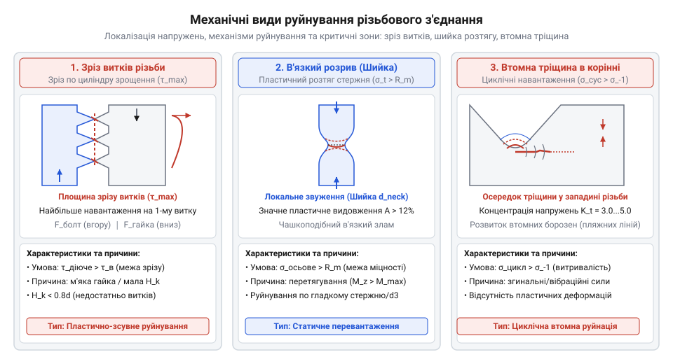
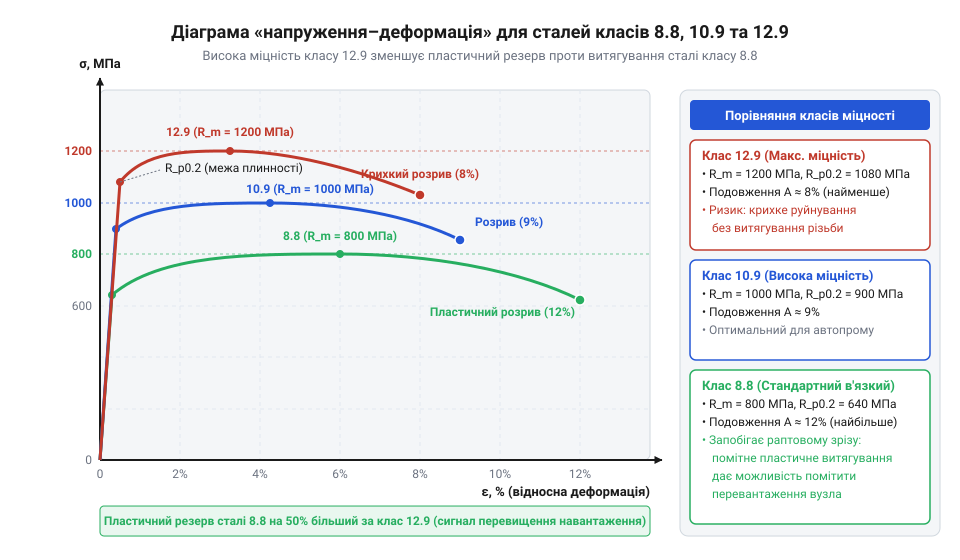
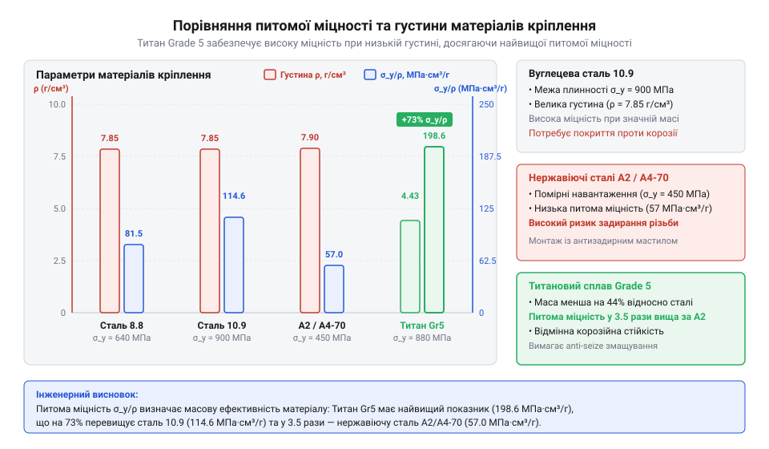
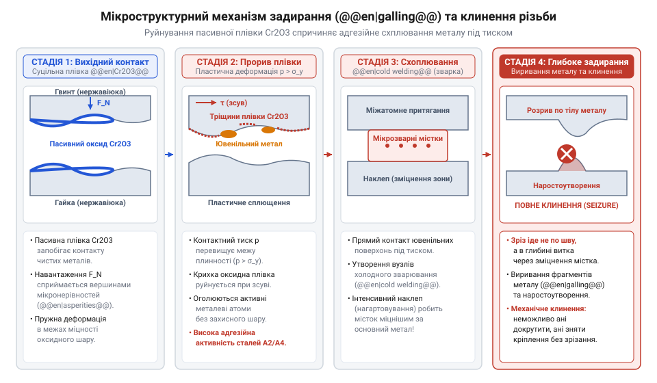
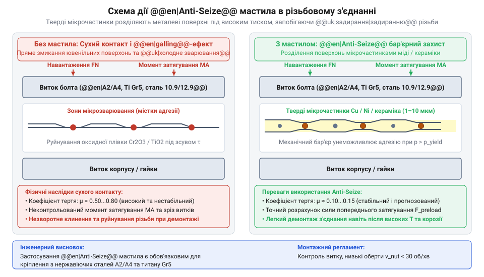

# Класи міцності та матеріали кріплення: сталі 8.8–12.9, нержавійка A2/A4, титан Gr5 та задирання різьби

<preknowlist>
- [Нарізні втулки та футорки](root:cat-hw-parts/threaded-inserts-and-heat-set) — геометрія метричної різьби та базові принципи передачі механічного навантаження через витки з'єднання
- [Пружинні контакти Pogo Pins](root:cat-hw-parts/pogo-pins) — принципи поверхневого контактного тиску, оксидації та фретинг-зносу металевих поверхонь
</preknowlist>

## Механічні руйнування та клинення різьби

У силових вузлах нарізне з'єднання зазнає осьового розтягу стержня та зсувних напружень у витках. Перевищення навантажень викликає пластичне витягування чи зрізання витків по западині. Під дією вібрацій концентрація напружень у корінних витках ініціює [фізика втомного зламу](root:ph-mechanics/fatigue-fracture-of-threaded-joints). Для захисту застосовують [тросові та еластомірні віброізолятори](root:cat-hw-parts/wire-rope-isolators).

Заклинювання різьби має трибологічну природу адгезійного схоплювання (@@en|galling@@). Під екстремальним тиском на асперитетах руйнуються захисні оксидні плівки, викликаючи холодне зварювання (@@en|cold welding@@) з мікромістками схвачування. Розрахунок надійності вимагає аналізу класів міцності.


*Механізми руйнування різьби при перевищенні допустимих зсувних та розтягувальних напружень.*

## Маркування та деформація сталевого кріплення

Двоцифрове маркування (8.8, 10.9, 12.9) регламентує міцність сталевого кріплення. Перше число, помножене на 100, задає номінальну межу міцності @@en|ultimate tensile strength@@ `R_m`, а друге вказує відношення межі плинності @@en|yield strength@@ `R_e` до `R_m`.

Деформацію сталі під навантаженням описує діаграма напруження-деформація @@en|stress-strain curve@@. Пружна ділянка підпорядковується закону Гука з модулем Юнга @@en|Young's modulus@@ `E ≈ 210 ГПа`. Сила попереднього затягування @@en|preload@@ `F_preload` обмежується 70–80% межі плинності задля запобігання залишковим деформаціям. Сталь 8.8 дає в'язке подовження, а 12.9 — крихкий злам.

Обчислення механічних параметрів болта M10 класу 10.9:

```
R_m = 10 × 100          [визначення межі міцності]
    = 1000 МПа          [номінальне значення R_m]

R_e = R_m × 0.9         [визначення межі плинності]
    = 1000 × 0.9        [підстановка коефіцієнта]
    = 900 МПа           [номінальне значення R_e]

F_yield = R_e × A_s     [максимальне пружне навантаження]
        = 900 × 58      [підстановка площі перерізу A_s = 58 мм²]
        = 52200 Н       [граничне пружне зусилля 52.2 кН]
```


*Характер деформації та межі міцності сталевих метизів залежно від їхнього класу.*

## Особливості нержавіючих сталей та титану

Аустенітні нержавіючі сталі груп @@en|A2@@ (AISI 304) та @@en|A4@@ (AISI 316) не мають чіткого майданчика плинності, тому їхню міцність оцінюють за умовною межею плинності `R_p0.2` при пластичному подовженні 0.2%. Маркування `A2-70` чи `A4-80` позначає групу сталі та межу міцності. У контакті з вуглецевою сталлю виникає [гальванічна корозія металів](root:ph-condensed/corrosion-types-and-galvanic-couples).

Титановий сплав Grade 5 (Ti-6Al-4V) поєднує корозійну стійкість і низьку густину `ρ ≈ 4.43 г/см³`, забезпечуючи високу питому міцність (від англ. *specific strength*, @@en|specific strength@@).

Порівняння питомої міцності титану (`R_p0.2 = 830 МПа`) та сталі 10.9 (`R_e = 900 МПа`, густина `7.85 г/см³`):

```
S_steel = R_e ÷ ρ_steel        [питома міцність сталі 10.9]
        = 900 ÷ 7.85            [ділення межі плинності на густину]
        = 114.65 МПа / (г/см³)  [значення для сталі 10.9]

S_Ti = R_p0.2 ÷ ρ_Ti           [питома міцність титану Grade 5]
     = 830 ÷ 4.43               [ділення умовної межі плинності на густину]
     = 187.36 МПа / (г/см³)     [значення для титану Grade 5]

K_ratio = S_Ti ÷ S_steel        [коефіцієнт переваги питомої міцності]
        = 187.36 ÷ 114.65       [обчислення відношення]
        = 1.63                  [титан переважає сталь 10.9 у 1.63 раза]
```


*Співвідношення густини та межі плинності для вибору конструкційних матеріалів.*

## Фізика задирання та холодного зварювання

У нержавіючих сталях та титані високий тиск на асперитетах витків (див. [параметри метричної різьби](root:cat-hw-parts/thread-types-and-pitch-standards)) руйнує оксидну плівку `Cr2O3` чи `TiO2`. 

Оголений ювенільний метал утворює міжкристалічні містки схоплювання (@@en|galling@@) та холодне зварювання (@@en|cold welding@@). Клиненню сприяють швидке загвинчування, сухий монтаж і чисті поверхні. Подібне зношування спостерігають і в [пружинних контактах pogo pins](root:cat-hw-parts/pogo-pins).


*Етапи розвитку адгезійного схоплювання та руйнування оксидного шару при терті.*

## Інженерні методи запобігання задиранню різьби

Протизадирні пасти (від англ. *anti-seize*, @@en|anti-seize@@) на основі мікрочастинок міді, нікелю чи кераміки утворюють механічний бар'єр між витками при руйнуванні масляного шару. Твердомастильні покриття (від англ. *solid film lubricant*, @@en|solid film lubricant@@) з `MoS2` або PTFE, захисні [покриття сталевого кріплення](root:cat-hw-parts/surface-treatments-and-coatings-for-fasteners) й анодування титану виключають прямий контакт металів.

Для трибологічної сумісності добирають металургійно розсувні пари (гайка з бронзи чи нержавіючої сталі іншої марки) та обмежують швидкість монтажу. Зусилля нормує @@gr|динамометричний ключ@@ (від грец. *δύναμις* — сила та *μέτρον* — вимірювач), а розвантаження різьби в м'яких матеріалах забезпечують [нарізні втулки та футорки](root:cat-hw-parts/threaded-inserts-and-heat-set).


*Розділення контактних поверхонь різьби дисперсними фазами антифрикційної пасти.*

## Критерії вибору кріплення під задачі

Вибір матеріалу та класу міцності базується на навантаженні, температурі й середовищі, розраховуючи переріз `A_s` за межею плинності. Сталі 12.9 у вологих умовах породжують ризик, який створює @@de|воднева крихкість@@, детально описана в матеріалі [воднева крихкість сталей](root:ph-condensed/hydrogen-embrittlement-in-fasteners). Для хімічного обладнання беруть нержавійку A4-80, а для бортів БПЛА — титан Grade 5. У силових вузлах із [силові роз'єми XT](root:cat-hw-parts/xt-connectors) застосовують латунні чи бронзові метизи.