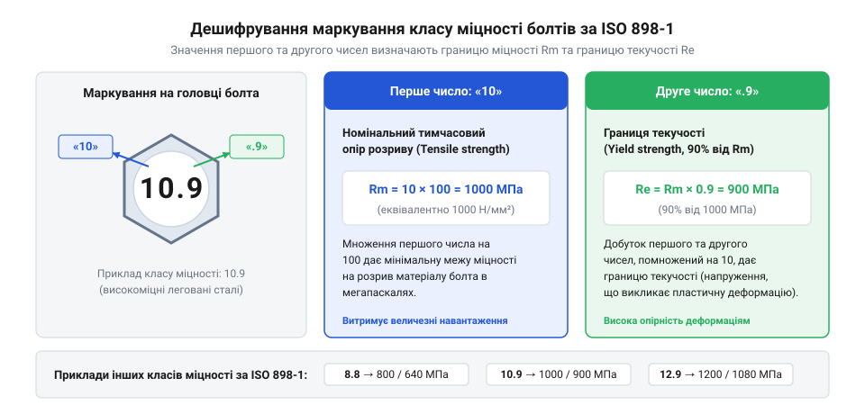
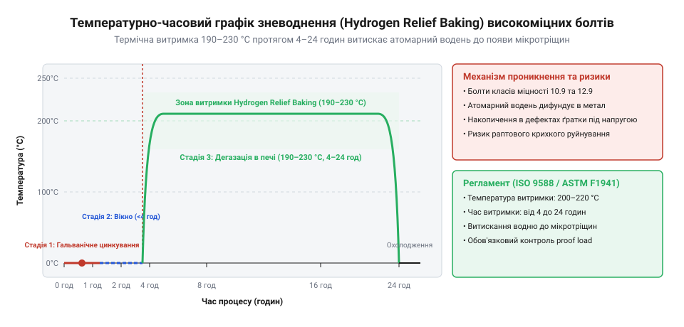

# Історія стандартизації класів міцності та позначень кріплення

<preknowlist>
- [Нарізні втулки та футорки](root:cat-hw-parts/threaded-inserts-and-heat-set) — базові механічні принципи передачі зсувних і розтягувальних зусиль через метричну різьбу
- [Тросові та еластомірні віброізолятори](root:cat-hw-parts/wire-rope-isolators) — природу динамічних знакозмінних навантажень та вібраційного розгвинчування різьбових з'єднань
</preknowlist>

## Хаос заводських специфікацій та аварійні руйнування

У середині XX століття стрімкий розвиток важкого машинобудування, мостобудування та авіаційної промисловості наразився на критичну інженерну перешкоду. Промислові підприємства масово застосовували відповідальні нарізні з'єднання, виготовлені за довільними заводськими специфікаціями (англ. @@en|works standards@@) або різнородними національними регламентами. У Німеччині домінували ранні стандарти @@de|DIN@@ (Deutsches Institut für Normung), у США — нормативи @@en|SAE@@ (Society of Automotive Engineers) та @@en|ASTM@@, а у Великій Британії — специфікації @@en|BS@@ (British Standards). Відсутність єдиного міжнародного інженерного критерію нормування механічних властивостей призводила до того, що зовні однакові металеві метизи мали радикально відмінну несучу здатність та реакцію на статичні чи динамічні навантаження.

Головки різьбових деталей маркували локальними заводськими клеймами, літерними індексами чи довільними позначеннями гартування, які не містили жодної прямої інформації про тимчасовий опір розриву або межу плинності. Під час експлуатації складних механізмів це унеможливлювало швидку розрізненість високонавантажених елементів від рядових метизів з м'якої вуглецевої сталі. Коли у процес збирання чи технічного обслуговування втручався людський фактор, у вузли з високим рівнем зсувних та розтягувальних напружень випадково потрапляло кріплення з низькою міцністю. Принцип передачі зусиль через метричну різьбу, відомий із конструкції [нарізних втулок та футорок](root:cat-hw-parts/threaded-inserts-and-heat-set), вимагав суворого розрахунку зрізу й зім'яття витків, однако неуніфікований матеріал зводив нанівець усі теоретичні розрахунки.

Масові наслідки такої розрізненості проявилися у повоєнний період під час відновлення мостових конструкцій, залізничного транспорту та цивільної авіації. Під дією інтенсивного вібраційного впливу й знакозмінних циклічних навантажень, які в сучасній техніці поглинають за допомогою [тросових та еластомірних віبروізоляторів](root:cat-hw-parts/wire-rope-isolators), неуніфіковане кріплення зазнавало втомного руйнування. Відсутність чітких вимог до відпуску сталі спричиняла або надмірну крихкість деталі, або її передчасну пластичну деформацію під робочим натягом. Вузол втрачав попередній затискний шарнір, що призводило до зрізу болтів і аварійного обвалу опорних секцій мостів та відмови моторам авіаційної техніки.

Загострення міжнародної торгівлі та виникнення глобальних коопераційних ланцюгів у 1940-х роках остаточно довели недоцільність локальних технічних умов. У 1947 році заснували Міжнародну організацію зі стандартизації (@@en|ISO@@, від грецького @@el|isos@@ — рівний), у складі якої спеціалізований комітет @@en|ISO/TC 2@@ узяв на себе завдання створити уніфікований міжгалузевий регламент. Промисловість потребувала прозорої, універсальної кодифікації, яка б описувала механічний потенціал матеріалу без прив'язки до локальної марки сталі чи бренду виробника. Саме ця неминучість зумовила перехід від хаотичних позначень до єдиного міжнародного стандарту для [класів міцності сталей](root:cat-hw-parts/fastener-strength-classes-and-materials), адаптованого під використання [метричного різьбового кріплення](root:cat-hw-parts/metric-threaded-fasteners).

## Впровадження двоцифрової десяткової системи ISO 898-1

Розроблений комітетами @@en|ISO@@ стандарт @@en|ISO 898-1@@ запровадив принципово нову, математично виважену систему кодування механічних властивостей кріпильних деталей із вуглецевих та легованих сталей. Замість довільних назв чи локальних шифрів на головку болта або шпильки почали наносити двоцифровий десятковий код, розділений крапкою (наприклад, 8.8, 10.9, 12.9). Кожне з двох чисел має строгий фізико-математичний зміст, що дозволяє інженеру без додаткових таблиць обчислити граничні навантаження деталі.

Перша цифра коду позначає соту частку номінального тимчасового опору розриву (англ. @@en|tensile strength@@; від латинського @@la|tensio@@ — натяг) `R_m` у мегапаскалях. Для обчислення номінальної міцності на розрив значення першої цифри множать на 100. Друга цифра після крапки позначає десятикратне відношення границі текучості (англ. @@en|yield strength ratio@@; від латинського @@la|ratio@@ — розрахунок) `R_e` (або умовної границі текучості `R_{p0.2}`) до тимчасового опору розриву `R_m`. Множення першого числа на друге та на 10 дає значення границі текучості в мегапаскалях.

Для класу міцності 10.9 математичний розрахунок граничних параметрів матеріалу має такий вигляд:

```text
Rₘ = 10 × 100
   = 1000 МПа      [сота частка тимчасового опору розриву]

Rₚ₀.₂ = 1000 × (9 ÷ 10)
      = 900 МПа       [десятикратне відношення границі текучості]
```


*Графічна схема дешифрування маркування головки болта за ISO 898-1 із геометричними вказівниками на перше та друге число класу міцності.*

Визначення допустимої пластичної деформації через відношення `R_{p0.2} / R_m` критично важливе для розрахунку розтягувальних зусиль під час збирання. Граничний рівень попереднього затягування не повинен перевищувати 70–90% від границі текучості, аби запобігти залишковому видовженню стержня. Прозорість коду за @@en|ISO 898-1@@ стала основою для нормованого [контролю затяжки болтів](root:cat-hw-parts/bolt-torque-and-pretension-control) за допомогою динамометричних ключів та кутових методів дотягування.

Створення уніфікованого стандарту розвінчало сталий промисловий міф про доцільність застосування метизів найвищого класу міцності (зокрема 12.9) у будь-яких відповідальних вузлах. Підвищення границі текучості досягається глибоким гартуванням із низьким відпуском, що неминуче знижує ударну в'язкість (англ. @@en|impact strength@@) і підвищує чутливість сталі до надрізів (англ. @@en|notch sensitivity@@). У конструкціях із динамічними чи ударними навантаженнями болти класу 12.9 руйнуються крихко без попереднього витягування, тоді як клас 8.8 демонструє високу пластичну деформацію й згладжує пікові напруження.

Паралельно для корозійностійких середовищ створено окремий стандарт @@en|ISO 3506@@ для [аустенітних нержавіючих сталей](root:cat-hw-parts/stainless-steel-fasteners) (від імені англійського металурга сера Вільяма Робертса-Остена, @@en|Sir William Roberts-Austen@@). Традиційні марки @@en|A2-70@@ та @@en|A4-80@@ використовують іншу кодифікацію: літера з цифрою (A2 або A4) позначає хімічний склад (хром-нікелевий або хром-нікель-молібденовий сплав), а число після дефіса — 1/10 тимчасового опору розриву в мегапаскалях (700 або 800 МПа). Практика виявила ще один інженерний парадокс: аустенітна сталь @@en|A2-70@@, яка у вихідному загартованому стані є повністю парамагнітною, після холодної висадки різьби починає притягуватися магнітом. Це пояснюється деформаційним мартенситним перетворенням (англ. @@en|strain-induced martensite@@; від імені німецького металурга Адольфа Мартенса, @@de|Adolf Martens@@), коли механічне пластичне деформування кристалічної ґратки частково переводить аустеніт у феромагнітну мартенситну фазу.

## Уроки водневого окрихчування та регламенти зневоднення

Збільшення частки використання кріпильних деталей високих класів міцності (10.9 та 12.9) у другій половині XX століття призвело до виникнення підступного металургійного явища — затриманого крихкого руйнування (англ. @@en|delayed brittle fracture@@). Змонтовані болти, які успішно пройшли первинний контроль затягування й перебували під статичним розтягувальним навантаженням, раптово руйнувалися через кілька годин або діб без жодних видимих ознак пластичної деформації.

Головною причиною цього процесу стало абсорбування атомарного водню під час технологічних операцій хімічного травлення в кислотах та електролітичного нанесення захисних гальванічних покриттів (цинкування, кадміювання). Високомічна мартенситна структура сталі після гартування має високу густину дислокацій та внутрішніх напружень. Впроваджені атоми водню `H^0`, що мають малий атомний радіус, легко дифундують (від латинського @@la|diffusio@@ — розтікання) крізь кристалічну ґратку в зони максимальних концентратів напружень — до впадин різьби й жолобків під головкою. Накопичення водню на границях зерен знижує міжкристалічну міцність металу та ініціює субмікроскопічні тріщини, що утворює розгалужене мережеве окрихчування. Докладно металургійні чинники цього пошкодження розглядаються у матеріалах про запобігання [явищу водневої крихкості](root:cat-hw-parts/hydrogen-embrittlement-prevention).

Аварійний досвід аерокосмічної та мостобудівної галузей змусив комітети @@en|ISO@@ та @@en|ASTM@@ упровадити суворі обов'язкові регламенти термообробки дегазації — зневоднення (англ. @@en|hydrogen relief baking@@; від німецького @@de|backen@@ — випікати, піддавати тривалій термообробці). Стандарт вимагає піддавати всі вироби з твердістю понад 320 HV (що відповідає класам 10.9 та 12.9) витримуванню при температурі 190–230 °C протягом 2–24 годин.


*Часова діаграма процесу дегазації водню під час гальванічного оброблення високоміцних болтів із відображенням температурних інтервалів витримки hydrogen relief baking.*

Найважливішою умовою регламенту є часове вікно: процес випікання має розпочинатися негайно після закінчення гальванічного осадження металу — не пізніше ніж через 1–4 години. Затримка понад цей інтервал призводить до того, що водень фіксується у глибоких структурних пастках кристалічної ґратки, дегазація стає неефективною, а в тілі метиза починають формуватися незворотні мікротріщини.

Паралельно з удосконаленням технології термообробки змінювалися інструментальні методи контролю якості різьбових деталей. Базовий візуальний огляд та контрольне випробування напругою витримування (англ. @@en|proof load testing@@; від латинського @@la|probare@@ — випробовувати), яке полягало в прикладанні розрахункового розтягувального зусилля без залишкового видовження стержня, виявилися недостатніми для виявлення прихованих водневих тріщин. Сучасний контроль якості базується на ультразвуковій дефектоскопії із вимірюванням часу проходження акустичної хвилі для оцінки залишковій деформації стержня під навантаженням. Для виявлення поверхових та підповерхових гартувальних тріщин застосовують магнітопорошковий контроль (англ. @@en|magnetic particle testing@@), що гарантує надійність кріплення у критичних промислових застосуваннях.

## Кодифікація корозійностійких аустенітних сталей ISO 3506

Промислове застосування різьбових деталей у корозійно-активних середовищах вимагає відходу від стандарту @@en|ISO 898-1@@, оскільки аустенітні нержавіючі сталі (англ. @@en|austenitic stainless steel@@, від прізвища англійського металурга Вільяма Робертса-Остена, англ. @@en|Sir William Roberts-Austen@@) мають принципово іншу мікроструктуру та механіку зміцнення. На відміну від вуглецевих і легованих сталей, які піддаються термообробці із загартуванням на мартенсит та наступним відпуском для формування чіткої границі текучості, гранецентрована кубічна (ГЦК) ґратка аустеніту не має вираженої площадки текучості. Спроба застосувати класичну двоцифрову систему позначень (наприклад 8.8 чи 10.9) виявляється фізично некоректною, адже при механічному навантаженні аустенітні метизи зміцнюються за рахунок пластичної деформації — наклепу (деформаційного зміцнення, англ. @@en|work hardening@@, від давньоангл. @@en|worc@@ — праця, та @@en|heardian@@ — робити твердим). Через це міжнародний комітет @@en|ISO@@ розробив окремий регламент @@en|ISO 3506-1@@, який впроваджує комбіновану кодифікацію з літерної групи сплаву, цифрового хімічного класу та двоцифрового показника міцності на розрив.

Маркування корозійностійкого кріплення починається з літери, яка вказує на кристалічну структуру матеріалу: `A` відповідає аустенітним сталям, `F` — феритним, а `M` — мартенситним. У загальному машинобудуванні найбільшого поширення набули аустенітні групи `A2` та `A4`. Цифра `2` позначає хромонікелевий сплав типу 18/8 (аналог @@en|AISI 304@@ із вмістом близько 18% хрому та 8% нікелю), що володіє високою стійкістю до атмосферної корозії та прісної води. Цифра `4` відповідає хромонікельмолібденовому сплаву (аналог @@en|AISI 316@@), де додавання 2–3% молібдену радикально підвищує опір пітинговій та щілинній корозії у середовищах із підвищеним вмістом іонів хлору. Другий елемент коду — двоцифрове число — визначає соту частку мінімальної границі міцності на розрив `R_m` у мегапаскалях:

```
R_m = 70 × 10
    = 700 МПа      [сота частка 70 перераховується у мінімальну границю міцності на розрив]
```

Для аустенітних деталей нормалізовано три основні класи міцності: `50` (відпалений стан, `R_m` = 500 МПа), `70` (холоднодеформований стан після накатування різьби, `R_m` = 700 МПа) та `80` (високоміцний холоднодеформований стан, `R_m` = 800 МПа). Оскільки умовна границя текучості `R_p0.2` визначається за остаточною деформацією 0.2%, для класу @@en|A2-70@@ вона становить 450 МПа, що дозволяє проектувати відповідальні з'єднання з розрахунковими параметрами, близькими до класу 8.8, але із забезпеченням пасивності металу.

Вибір між марками @@en|A2-70@@ та @@en|A4-80@@ потребує врахування експлуатаційних температур та ризиків задирання різьби. При підвищенні температури понад 300 °C в аустенітних сталях починається виділення карбідів хрому по межах зерен, що знижує корозійну стійкість, а при тривалих навантаженнях виникає схильність до повзучості. Крім того, внаслідок високої пластичності та відсутності окисних плівок під час затягування нержавіючого кріплення виникає ефект фретингу та холодного зварювання різьби. При [монтажі нарізних втулок](root:cat-hw-parts/threaded-inserts-and-heat-set) у корпусних деталях це вимагає обов'язкового застосування протизадирних паст на основі дисульфіду молібдену або фторполімерних покриттів для збереження стабільності коефіцієнта тертя.

## Еволюція дефектоскопії та спростування міфу 12.9

Забезпечення надійності високоміцних різьбових з'єднань у сучасній інженерній практиці базується на переході від суцільного руйнівного контролю до комбінації неруйнівних інструментальних методів. Дефектоскопія (від латин. @@la|defectus@@ — недолік, та грец. @@el|skopeo@@ — спостерігати) починається з обов'язкового візуального та магнітопорошкового контролю (англ. @@en|magnetic particle testing@@). Під час випробування до метизу прикладають контрольне розтягувальне навантаження `S_p`, яке становить 85–90% від умовної границі текучості `R_p0.2`, з утриманням протягом 10 секунд. Відсутність залишкового видовження болта вимірюється за допомогою високоточних мікрометрів. Розрахунок випробувального зусилля здійснюється за формулою:

```
F_p = A_s × S_p
    = A_s × (0.85 × R_p0.2)      [множення розрахункової площі перерізу різьби на напругу витримування]
```

Для відповідальних метизів авіаційного та енергетичного машинобудування стандартний механічний контроль доповнюють ультразвуковим вимірюванням часової затримки акустичного імпульсу вздовж осі затягнутого болта, що дає змогу визначати залишковий попередній натяг без розбирання вузла, а також магнітопорошковим моніторингом (англ. @@en|magnetic particle inspection@@) для виявлення поверхневих мікротріщин у жолобі різьби та в зоні переходу від стрижня до головки.

Інструментальний контроль дозволяє спростувати один із найпоширеніших промислових міфів — уявлення про абсолютну перевагу класу міцності 12.9 над класами 8.8 та 10.9 у будь-яких експлуатаційних умовах. Підвищення тимчасового опору розриву до значення `R_m` = 1200 МПа та границі текучості до `R_e` = 1080 МПа досягається за рахунок високого гартування сталі з формуванням твердості 39–44 HRC. Однак металургійною розплатою за надвисоку міцність є різке зниження ударної в'язкості (англ. @@en|impact toughness@@) та підвищення чутливості до концентраторів напружень (англ. @@en|stress concentration sensitivity@@). У вузлах із динамічними та знакозмінними навантаженнями, зокрема у [віброізоляційних демпферних вузлах](root:cat-hw-parts/wire-rope-isolators) або при від'ємних температурах, болти класу 12.9 демонструють тенденцію до раптового крихкого руйнування без попереднього пластичного видовження. Крім того, надвисока твердість робить клас 12.9 вкрай вразливим до водневого окрихчування під час гальванічного цинкування.

Другим поширеним міфом у монтажній практиці є твердження, що справжня нержавіюча сталь не повинна притягуватися магнітом, а наявність магнітних властивостей у метизів @@en|A2-70@@ свідчить про використання низькоякісної вуглецевої сталі. У вихідному відпаленому стані аустенітні сталі мають парамагнітну ГЦК ґратку і справді не реагують на магнітне поле. Проте під час холодної пластичної деформації при швидкісному накатуванні різьби або висадці головки відбувається деформаційне мартенситне перетворення (англ. @@en|strain-induced martensitic transformation@@). Частина метастабільного аустеніту переходить у деформаційний мартенсит (англ. @@en|martensite@@, нім. @@de|Martensit@@, на честь німецького металознавця Адольфа Мартенса, нім. @@de|Adolf Martens@@), який має ферромагнітну об'ємноцентровану тетрагональну (ОЦТ) ґратку. Внаслідок цього сформована різьбова частина метизу @@en|A2-70@@ набуває чітко вираженої намагнічуваності, повністю зберігаючи свій хімічний склад, вихідну вміст хрому та високу корозійну стійкість.