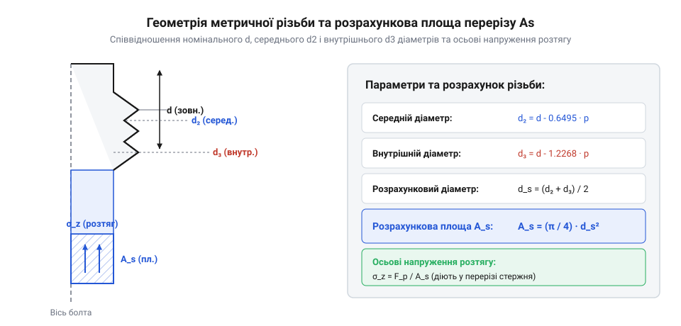
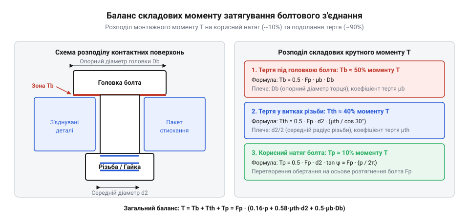

# Математика розрахунку затягування та напружень у нарізному з'єднанні

<preknowlist>
- [Нарізні втулки та футорки](root:cat-hw-parts/threaded-inserts-and-heat-set) — механіка передачі розтягувального зусилля від металевого витка на стінки втулки в композитах та розрахунок довжини згвинчування для запобігання вириванню.
- [Тросові та еластомірні віброізолятори](root:cat-hw-parts/wire-rope-isolators) — вплив зовнішніх вібраційних і динамічних навантажень на падіння сили попереднього натягу в різьбовому вузлі.
</preknowlist>

## Проблематика неконтрольованого затягування різьбових з'єднань

Монтаж відповідальних вузлів за допомогою [метричному різьбовому кріпленні](root:cat-hw-parts/metric-threaded-fasteners) традиційно вважається однією з найпростіших технологічних операцій. Проте сліпе застосування узагальнених табличних моментів затягування з довідників є джерелом катастрофічних аварійних відмов у машинобудуванні та приладобудуванні. Довідникові таблиці розраховуються за усередненим коефіцієнтом тертя (англ. @@en|friction coefficient@@, від латинського *coefficiens* — той, що сприяє) `μ = 0.14`. На практиці стан поверхонь метизу має колосальний розкид: суха оцинкована сталь має коефіцієнт тертя `μ = 0.20...0.25`, тоді як фосфатована поверхня зі змащенням або фторопластовим покриттям знижує його до `μ = 0.08...0.10`. При затягуванні сухого з'єднання номінальним моментом понад 80% прикладеної енергії витрачається на подолання тертя, а сам болт отримує недостатню силу [попереднього натягу болтів](root:cat-hw-parts/bolt-torque-and-pretension-control). Під дією зовнішніх динамічних навантажень та вібрацій таке з'єднання втрачає затиск, виникає розкриття стику та прискорене втомне руйнування тіла болта або мимовільне розкручування вузла, протидіяти якому здатні лише спеціалізовані [еластомірні віброізолятори](root:cat-hw-parts/wire-rope-isolators).

Зворотна ситуація виникає під час випадкового або нерегламентованого змащення різьби, коли довідниковий момент прикладається до елемента зі зниженим коефіцієнтом тертя. Падіння тертя призводить до того, що той самий монтажний момент створює осьове розтягувальне зусилля, яке у 1.5–2 рази перевищує розрахункове значення. В результаті напруження в болті миттєво перетинають границю текучості (англ. @@en|yield strength@@, від праслов'янського *tekti* — пливти, протікати), викликаючи шейкування (англ. @@en|necking@@) тіла болта, необоротне пластичне подовження або пластичний зсув витків, який провокує зріз різьби (англ. @@en|thread stripping@@, від англійського *strip* — здирати). Окрім того, при згвинчуванні метизів із м'якими або композитними матеріалами без застосування додаткових елементів, як-от [нарізні втулки та футорки](root:cat-hw-parts/threaded-inserts-and-heat-set), виникає зріз внутрішньої різьби корпусу через недостатню довжину згвинчування.

Критичною фізичною особливістю монтажного процесу є складний тривимірний напружений стан матеріалу кріплення під час динамічного обертання гайки чи болта. Метиз піддається не лише поздовжньому розтягу силою попереднього натягу (осьове напруження `σ`), але й сильному крученню від момента тертя в різьбі (дотичне напруження `τ`). Згідно з гіпотезою формозміни, сумісна дія розтягу та кручення створює еквівалентне напруження фон Мізеса (англ. @@en|von Mises stress@@), яке суттєво перевищує чисте осьове напруження. Нераціональний вибір геометричних параметрів або неврахування варіативності тертя призводить до того, що матеріали метизів переходять у пластичну область ще до досягнення необхідного зусилля затиску деталей, що унеможливлює надійне функціонування відповідального різьбового з'єднання.

## Геометрія різьби та несуча спроможність

Для точного математичного оцінювання несучої спроможності метричної різьби за стандартом ISO 68-1 необхідно визначити дійсний геометричний переріз, який сприймає розтягувальні навантаження. Зовнішній номінальний діаметр (англ. @@en|nominal diameter@@) `d` та крок різьби (англ. @@en|pitch@@) `p` задають фундаментальний трикутник профілю з висотою `H = (√3 / 2) · p ≈ 0.866025 · p`. Несучий середній діаметр різьби `d_2` (діаметр уявного циліндра, де ширина витка дорівнює ширині западини) обчислюється як `d_2 = d - 0.649519 · p`. Внутрішній діаметр різьби болта за западиною `d_3`, що визначає найменший суцільний переріз стержня, розраховується за формулою `d_3 = d - 1.226870 · p`.

Оскільки спіральна гвинтова лінія створює об'ємний розподіл напружень вздовж витків, напруження розтягу прикладається не до мінімального діаметра `d_3` і не до номінального `d`, а до ефективного розрахункового діаметра `d_s`, що є середнім арифметичним між `d_2` та `d_3`. Розрахункова площа перерізу різьби (англ. @@en|tensile stress area@@) `A_s` виводиться шляхом математичного інтегрування геометрії контактного профілю:

d_2 = d - 0.649519 · p                      [обчислення середнього діаметра різьби]
d_3 = d - 1.226870 · p                      [обчислення внутрішнього діаметра за западиною]
d_s = (d_2 + d_3) / 2
    = d - 0.938194 · p                      [середнє значення розрахункового діаметра]
A_s = (π / 4) · (d_s)²
    = 0.785398 · (d - 0.938194 · p)²       [формула розрахункової площі перерізу різьби]

Виведена площа `A_s` є базовим параметром для визначення межі міцності та пружності всього болтового з'єднання. Наведена нижче схема ілюструє співвідношення геометричних діаметрів профілю метричної різьби та зону формування площі `A_s`.


_*Геометричні параметри профілю метричної різьби та формування розрахункової площі перерізу A_s.*_

Максимально допустима сила попереднього натягу (англ. @@en|pretension@@) `F_p` обмежується виходом матеріалу кріплення за межі пружності. Конструкційні вузли стандартизують [класи міцності сталей](root:cat-hw-parts/fastener-strength-classes-and-materials), які позначаються двома числами (наприклад, 8.8, 10.9, 12.9). Перше число вказує на 1/100 межі міцності при розтягу `R_m` у мегапаскалях (МПа), а друге — на відношення границі текучості `R_p0.2` до межі міцності у відсотках, поділене на 10. - Клас 8.8: `R_m = 800 МПа`, `R_p0.2 = 0.8 · 800 = 640 МПа`. - Клас 10.9: `R_m = 1000 МПа`, `R_p0.2 = 0.9 · 1000 = 900 МПа`. - Клас 12.9: `R_m = 1200 МПа`, `R_p0.2 = 0.9 · 1200 = 1080 МПа`.

Для корозійностійких сплавів стандарту ISO 3506 позначення описує групу сталі та рівень міцності: A2-70 та A4-80 відповідають аустенітним хромонікелевим і хромонікельмолібденовим сталям із межою текучості `R_p0.2 = 450 МПа` (для A2-70) та `R_p0.2 = 600 МПа` (для A4-80). Високоміцний титановий сплав Grade 5 (Ti-6Al-4V) володіє межою текучості `R_p0.2 ≈ 828...910 МПа` при суттєво меншій питомій масі.

Для запобігання залишковим пластичним деформаціям у розрахунках застосовують навантаження витримування (англ. @@en|proof load@@) `F_sp`, яке обчислюється через напруження витримування `σ_sp ≈ 0.85 · R_p0.2`:

F_sp = A_s · σ_sp                            [граничне навантаження витримування без пластики]

Номінальна сила [попереднього натягу болтів](root:cat-hw-parts/bolt-torque-and-pretension-control) `F_p` у відповідальних з'єднаннях вибирається у діапазоні від 70% до 90% від `F_sp` (тобто `F_p = (0.70...0.90) · F_sp`), що забезпечує резерв пружної деформації для компенсації крутильних напружень при монтажі.

**Приклад розрахунку геометричних параметрів та сили натягу для болта М10 класу міцності 10.9**
Необхідно розрахувати розрахункову площу `A_s`, навантаження витримування `F_sp` та рекомендовану силу монтажного натягу `F_p` для болта М10 (`d = 10.0 мм`, `p = 1.5 мм`), виготовленого зі сталі класу 10.9 (`R_p0.2 = 900 МПа`, `σ_sp = 0.85 · 900 = 765 МПа`).

d_s = 10.0 - 0.938194 · 1.5
    = 10.0 - 1.407291
    = 8.592709 мм                        [розрахунковий діаметр перерізу d_s]
A_s = (π / 4) · (8.592709)²
    = 0.785398 · 73.834648
    = 57.989 мм² ≈ 58.00 мм²             [розрахункова площа перерізу різьби A_s]
F_sp = 58.00 мм² · 765 Н/мм²
     = 44370 Н = 44.37 кН               [граничне навантаження витримування F_sp]
F_p = 0.75 · F_sp
    = 0.75 · 44370 Н
    = 33277.5 Н ≈ 33.28 кН               [рекомендована сила монтажного натягу F_p]

Отже, для метричного болта М10 класу міцності 10.9 розрахункова площа перерізу становить `A_s = 58.00 мм²`, а гранично припустиме монтажне зусилля попереднього натягу дорівнює `F_p = 33.28 кН`.

## Фізика тертя та момент затягування

Для створення розрахованої у попередньому розділі сили попереднього натягу `F_p` до головки болта або гайки прикладається зовнішній монтажний крутний момент `T`. Фізика затягування різьбового вузла полягає в подоланні трьох незалежних опорів: момента підйому по похилій гвинтовій лінії `T_p`, момента тертя на витках різьби `T_th` та момента тертя під опорною поверхнею головки чи гайки `T_b`.

Момент підйому по гвинтовій лінії виникає внаслідок нахилу витка під кутом підйому `ψ` (де `tan ψ = p / (π · d_2)`). Момент тертя у різьбі враховує кут профілю метричної різьби `α = 30°` (половина кута 60°), через який нормальна сила реакції на витку зростає у `1 / cos 30° ≈ 1.1547` раза порівняно з осьовим зусиллям. Ефективний коефіцієнт тертя в різьбі (англ. @@en|friction coefficient@@) `μ_th` діє на середньому діаметрі `d_2`. Сума цих двох складових утворює повний момент опору у різьбі:

T_th_total = F_p · (d_2 / 2) · [ (p / (π · d_2)) + (μ_th / cos 30°) ]
           = F_p · [ (p / (2 · π)) + 0.577 · μ_th · d_2 ]
           = F_p · (0.16 · p + 0.58 · μ_th · d_2)    [момент опору в різьбі T_th]

Третя складова — момент тертя під опорною головкою болта `T_b` — залежить від коефіцієнта тертя під головкою `μ_b` та ефективного опорного діаметра `D_b` (середній діаметр кільцевої площадки контакту між головкою та затисканою деталлю). Оскільки реактивна сила тертя розподілена по опорній поверхні, момент опору становить `T_b = F_p · μ_b · D_b`. Додаючи всі складові, отримуємо повну аналітичну залежність монтажного моменту затягування:

T = T_th_total + T_b
  = F_p · (0.16 · p + 0.58 · μ_th · d_2 + μ_b · D_b)  [повна аналітична формула моменту затягування]

Графічний розподіл затискного моменту на його фізичні складові представлено на наведеній нижче діаграмі.


_*Розподіл монтажного крутного моменту затягування T на складові підйому по гвинтовій лінії, тертя в різьбі та тертя під опорною головкою.*_

Для практичних інженерних розрахунків аналітичну формулу згортають через узагальнений коефіцієнт моменту (англ. @@en|torque coefficient@@) `K`:

K = 0.16 · (p / d) + 0.58 · μ_th · (d_2 / d) + μ_b · (D_b / d)  [узагальнений коефіцієнт моменту K]
T = K · F_p · d                                                 [інженерна формула затягування]

Аналіз енергетичного балансу монтажу показує деструктивну роль тертя: лише від 10% до 15% прикладеного моменту `T` витрачається на корисну роботу розтягу болта (підйом по гвинтовій лінії). Близько 40%–45% моменту розсіюється у вигляді тертя у різьбі, а решта 45%–50% втрачається на тертя під опорною головкою. Звідси випливає, що зміна коефіцієнта тертя всього на ±20% призводить до зміни сили натягу `F_p` на ±30%...50% при однаковому показі динамометричного ключа.

Під час динамічного прикладання моменту `T` тіло болта перебуває в складному напруженому стані. Осьова сила `F_p` створює нормальне напруження розтягу `σ = F_p / A_s`, а момент тертя в різьбі `T_th_total` генерує крутильні дотичні напруження `τ = T_th_total / W_p`, де `W_p = (π / 16) · (d_3)³` — полярний момент опору перерізу. Оцінка міцності здійснюється за гіпотезою формозміни через еквівалентне напруження фон Мізеса (англ. @@en|von Mises stress@@) `σ_eq`:

σ = F_p / A_s                                [нормальне напруження осьового розтягу]
τ = T_th_total / [ (π / 16) · (d_3)³ ]       [дотичне напруження кручення тіла болта]
σ_eq = √(σ² + 3 · τ²)                        [еквівалентне напруження за гіпотезою фон Мізеса]

Через наявність дотичних напружень `τ` еквівалентне напруження `σ_eq` під час динамічного монтажу виявляється на 15%–20% вичим за суто осьове напруження `σ`. Якщо не врахувати `τ`, болт може зазнати пластичної деформації ще до досягнення розрахункової сили натягу. Після зняття монтажного ключа крутильні напруження частково релаксують за рахунок пружної деформації деталей, проте саме в момент затягування небезпека пластичного руйнування є найвищою. Точний математичний розрахунок параметрів різьбового вузла дає змогу складати регламенти [розрахунку моменту затягування](root:cat-hw-parts/fastener-strength-classes-and-materials/math-fastener-torque-and-preload), що гарантують надійне з'єднання без ризику зрізу витків чи розкручування, орієнтуючись на багатий досвід [історії стандартизації різьбових з'єднань](root:cat-hw-parts/fastener-strength-classes-and-materials/hist-fastener-standards).

## Напружений стан за гіпотезою фон Мізеса

Під час силового збирання відповідального різьбового з'єднання стержень метизу зазнає не лише осьового розтягу від робочого зусилля, а й активного кручення в момент прикладання динамічного затягування. Спрощений розрахунок міцності, який враховує лише поздовжнє розтягувальне зусилля `F_p`, створює ілюзію достатнього запасу міцності, що нерідко призводить до раптової пластичної деформації або зрізу стержня болта в зоні першого незвинченого витка. Джерелом небезпеки є дотичні напруження кручення `τ`, які виникають у наслідок долання моменту тертя у різьбі `T_th` при обертанні головки чи гайки.

Для оцінки реального навантаженого стану матеріалу застосовується четверта теорія міцності — енергетична гіпотеза формозміни або еквівалентне напруження за гіпотезою фон Мізеса (англ. @@en|von Mises stress@@, від прізвища вченого Richard von Mises) `σ_eq` (англ. @@en|equivalent stress@@).

Складник осьового розтягу визначається через розрахункову площу перерізу різьби (англ. @@en|tensile stress area@@) `A_s`:

```
σ_z = F_p / A_s                  [осьове напруження розтягу]
```

Паралельно з поздовжнім натягом (англ. @@en|pretension@@) `F_p` у стержні виникає крутний момент `T_th`, що передається через різьбові витки:

```
T_th = F_p · (0.16 · p + 0.58 · μ_th · d_2)    [момент у різьбовому каналі]
```

де `p` — крок метричної різьби, `d_2` — середній діаметр різьби, а `μ_th` — коефіцієнт тертя у різьбі (англ. @@en|friction coefficient@@).

Викликане цим моментом дотичне напруження кручення (англ. @@en|torsional stress@@) `τ` досягає максимуму на зовнішній поверхні внутрішнього діаметра різьби `d_3` (або розрахункового діаметра перерізу стержня):

```
τ = T_th / W_p                   [дотичне напруження кручення]
= T_th / (π · d_3³ / 16)         [полярний момент опору крученню]
```

За гіпотезою фон Мізеса еквівалентне напруження `σ_eq` для поєднання розтягу й зсуву (англ. @@en|shear stress@@) обчислюється як вираз:

```
σ_eq = √(σ_z² + 3 · τ²)          [еквівалентне напруження фон Мізеса]
```

Оскільки крутний момент у різьбі `T_th` пропорційний `F_p`, дотичне напруження `τ` можна виразити безпосередньо через `σ_z`. Для стандартних геометричних співвідношень метричної різьби ISO у діапазоні М6–М24 та коефіцієнті тертя `μ_th ≈ 0.14` дотичне напруження становить приблизно `τ ≈ 0.15 ... 0.20 · σ_z`.

Підставивши це співвідношення у формулу фон Мізеса, отримуємо узагальнений вираз сумісного навантаження:

```
σ_eq = √(σ_z² + 3 · (0.18 · σ_z)²)   [підстановка співвідношення τ до σ_z]
= √(σ_z² + 3 · 0.0324 · σ_z²)       [піднесення до квадрата]
= √(1.0972 · σ_z²)                  [зведення подібних доданків]
≈ 1.05 ... 1.35 · σ_z               [підсумковий коефіцієнт зростання]
```

Отже, еквівалентне напруження під час монтажу перевищує чисто осьове напруження на 15%–35%. Якщо інженер налаштовує [попередній натяг болтів](root:cat-hw-parts/bolt-torque-and-pretension-control) на рівні 90% від границі текучості (англ. @@en|yield strength@@) `R_e` (або `R_p0.2`), виходячи лише з розрахунку `σ_z`, то з урахуванням кручення реальне еквівалентне напруження `σ_eq` виходить за межі плинності (`σ_eq > R_e`), викликаючи пластичний витяг стержня та втрату сили затиску.

**Обчислення еквівалентного напруження для болта М10 класу міцності 10.9**
Розрахуємо еквівалентне напруження при затягуванні болта М10 класу міцності 10.9 (`R_p0.2 = 900 МПа`), з коефіцієнтом тертя `μ_th = 0.12`, кроком `p = 1.5 мм`, середнім діаметром `d_2 = 9.026 мм`, внутрішнім діаметром `d_3 = 8.16 мм`, площею перерізу `A_s = 58 мм²` та зусиллям натягу `F_p = 33.5 кН`:

```
σ_z = 33500 / 58
= 577.59 МПа                      [осьове розтягувальне напруження]

T_th = 33500 · (0.16 · 0.0015 + 0.58 · 0.12 · 0.009026)
= 33500 · (0.00024 + 0.0006282)
= 33500 · 0.0008682
= 29.08 Н·м                       [крутний момент у різьбовому каналі]

W_p = π · (0.00816)³ / 16
= 3.14159 · 5.43 · 10⁻⁷ / 16
= 1.066 · 10⁻⁷ м³                 [полярний момент опору перерізу d_3]

τ = 29.08 / 1.066 · 10⁻⁷
= 272.79 · 10⁶ Па
= 272.79 МПа                      [дотичне напруження кручення]

σ_eq = √((577.59)² + 3 · (272.79)²)
= √(333610 + 3 · 74414)
= √(333610 + 223242)
= √556852
= 746.23 МПа                      [еквівалентне напруження за фон Мізесом]
```

Отримане значення `σ_eq = 746.23 МПа` становить 82.9% від границі текучості `R_p0.2 = 900 МПа`, що перебуває у безпечному діапазоні пружних деформацій та відповідає допустимому навантаженню витримування (англ. @@en|proof load@@). При застосуванні сухих поверхонь без змащення коефіцієнт тертя зростає до `μ_th = 0.20`, що піднімає `T_th` та `τ`, викликаючи стрибок `σ_eq` понад `R_p0.2`. Для захисту з'єднань від послаблення при вібраціях часто застосовують демпфувальні елементи з асортименту [тросових та еластомірних віброізоляторів](root:cat-hw-parts/wire-rope-isolators), які зменшують амплітуду динамічних коливань осьового зусилля.

## Розрахунок зрізу різьби та згвинчування

Навіть якщо стержень болта розраховано за еквівалентними напруженнями фон Мізеса і його пружні деформації перебувають у нормі, з'єднання може катастрофічно вийти з ладу через зріз різьби (англ. @@en|thread stripping@@). Ця проблема стає критичною під час укручування високоміцних сталевих метизів [класів міцності сталей](root:cat-hw-parts/fastener-strength-classes-and-materials) 10.9 чи 12.9 у деталі з матеріалів із нижчою міцністю — алюмінієвих та магнієвих сплавів, сірого чавуну, м'якої конструкційної сталі або термопластів. У таких випадках руйнування відбувається не по стержню болта, а по циліндричній поверхні зрізу внутрішньої різьби деталі чи гайки.

Міцність різьби на зріз визначається сумарною площею зрізу витків, яка залежить від довжини згвинчування (англ. @@en|length of engagement@@) `L_e` та геометрії контактної поверхні.

Розрахункова площа зрізу внутрішньої різьби деталі `A_n` на довжині `L_e` обчислюється через зовнішній діаметр метричної різьби `d` та коефіцієнт повноти профілю:

```
A_n = π · d · k_n · L_e          [площа зрізу внутрішньої різьби]
```

де `k_n ≈ 0.75 ... 0.87` — геометричний коефіцієнт, що враховує перекриття витків за ISO.

Площа зрізу зовнішньої різьби болта `A_s_shear` визначається аналогічно через середній діаметр `d_2` та коефіціент профілю `k_s ≈ 0.58 ... 0.63`:

```
A_s_shear = π · d_2 · k_s · L_e  [площа зрізу зовнішньої різьби болта]
```

Викликане поздовжньою силою `F_p` дотичне напруження зрізу на витках внутрішньої різьби `τ_n` не повинно перевищувати допустиме значення `τ_adm`:

```
τ_n = F_p / A_n ≤ τ_adm          [умова міцності витків на зріз]
```

За критерієм фон Мізеса допустиме напруження зсуву пов'язане з тимчасовим опором розриву матеріалу корпусної деталі `R_m_mating`:

```
τ_adm = 0.577 · R_m_mating / n_s [допустиме напруження зсуву]
```

де `n_s` — коефіцієнт запасу міцності (англ. @@en|safety factor@@).

Для забезпечення принципу рівноміцності вузла (коли міцність різьбового захоплення на зріз дорівнює або перевищує розривну міцність стержня болта `F_ult = A_s · R_m_bolt`), критична мінімальна довжина згвинчування `L_e_min` виводиться з рівності сил руйнування:

```
A_s · R_m_bolt = A_n · (0.577 · R_m_mating)               [рівність граничних сил]
A_s · R_m_bolt = (π · d · k_n · L_e_min) · 0.577 · R_m_mating [підстановка площі A_n]
L_e_min = (A_s · R_m_bolt) / (0.577 · π · d · k_n · R_m_mating) [виведення L_e_min]
```

У практичному інженерному розрахунку для метричного різьбового кріплення мінімальну глибину закручування виражають через номінальний діаметр різьби `d`:

- Для з'єднання сталевого болта зі сталевою гайкою або сталевим корпусом однакової міцності: `L_e_min ≥ 0.8 · d ... 1.0 · d`. - Для згвинчування з чавуном або ливарними бронзами: `L_e_min ≥ 1.25 · d ... 1.5 · d`. - Для закручування сталевого болта в алюмінієві сплави: `L_e_min ≥ 1.5 · d ... 2.0 · d`. - Для встановлення кріплення у термопласти, м'які композити чи деталі 3D-друку застосовують закладення або впресування спецкомпонентів із роду [нарізних втулок та футорок](root:cat-hw-parts/threaded-inserts-and-heat-set), де `L_e` визначається висотою втулки.

При розрахунку довжини згвинчування необхідно також ураховувати нерівномірність розподілу осьового навантаження по витках різьби. Через різницю поздовжніх деформацій розтягнутого стержня болта та стиснутого тіла гайки/корпусу, навантаження між витками розподіляється нерівномірно:

```
P_1 ≈ 0.34 · F_p                 [навантаження на 1-й виток від опорної поверхні]
P_2 ≈ 0.22 · F_p                 [навантаження на 2-й виток]
P_3 ≈ 0.15 · F_p                 [навантаження на 3-й виток]
P_4...P_8 ≈ 0.29 · F_p           [сумарна частка решти витків]
```

Перший робочий виток сприймає до 34% усього поздовжнього зусилля `F_p`, а перші три витки — понад 70% навантаження. Починаючи з 8-го–10-го витка, подальше збільшення довжини згвинчування `L_e` майже не підвищує статичну міцність різьби на зріз.

Підсумковий регламент [розрахунку моменту затягування](root:cat-hw-parts/fastener-strength-classes-and-materials/math-fastener-torque-and-preload) вимагає сумісного узгодження еквівалентного напруження `σ_eq`, глибини згвинчування `L_e` та коефіцієнтів тертя `μ_th`, `μ_b`. Ці правила формувалися впродовж розвитку стандартизації різьбових елементів, як розкрито в розборі [історії стандартизації різьбових з'єднань](root:cat-hw-parts/fastener-strength-classes-and-materials/hist-fastener-standards).