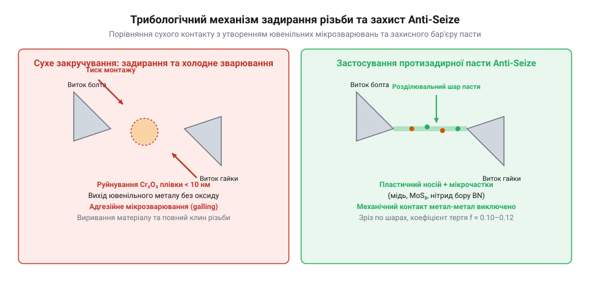
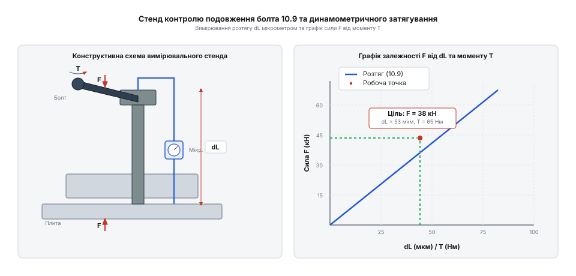

# Практикум із збирання високонавантаженого та нержавіючого нарізного вузла

<preknowlist>
- [Нарізні втулки та футорки](root:cat-hw-parts/threaded-inserts-and-heat-set) — специфіка відновлення або монтажу нарізних гнізд у м'яких та композитних матеріалах для забезпечення необхідного зусилля затиску F_p без руйнування основи.
- [Тросові та еластомірні віброізолятори](root:cat-hw-parts/wire-rope-isolators) — вплив зовнішніх вібраційних навантажень на мимовільне розгвинчування та вимоги до збереження сили попереднього натягу високонавантажених болтових з'єднань.
</preknowlist>

## Аварії нарізних вузлів та задирання

Надійність будь-якого сучасного механічного обладнання, транспортного засобу чи робототехнічної системи безпосередньо залежить від працездатності розбірних роз'ємних з'єднань. Серед них домінуючу позицію займають нарізні з'єднання, що забезпечують можливість багаторазового монтажу, демонтажу, регулювання та точного позиціонування деталей. Проте під час експлуатації та монтажу відповідальних високонавантажених вузлів інженери й технологи регулярно стикаються з катастрофічними відмовами. Серед найпоширеніших аварійних сценаріїв виділяються три основні явища: втомний обрив стержня болта внаслідок недостатнього або надмірного натягу, мимовільне розгвинчування під дією циклічних вібраційних навантажень та критичне адгезійне заклинювання витків, відоме у міжнародній практиці як @@en|galling@@. Для запобігання цим проблемам на етапі проєктування необхідно чітко керуватися вимогами щодо вибору [класів міцності метизів](root:cat-hw-parts/fastener-strength-classes-and-materials) та точним дотриманням технологічних регламентів збирання.

Фізична природа обриву стержня зазвичай пов'язана з неправильним розподілом зовнішніх сил і напружень. Якщо під час монтажу зусилля попереднього натягу @@en|preload@@ виявляється нижчим за мінімально необхідне розрахункове значення, з'єднання під дією змінних експлуатаційних зусиль починає «дихати». Циклічне розкриття стику деталей призводить до того, що майже вся змінна амплітуда зовнішнього навантаження припадає безпосередньо на болт. На діаграмі деформацій стику (діаграмі Речера) це відображається крутим зростанням динамічної складової напружень у стержні замість її розсіювання у пружно стиснутому пакеті з'єднуваних плит. Циклічні розтяжні коливання провокують втомні мікротріщини у концентраторах напружень — біля перших двох-трьох робочих витків різьби, що входять у зачеплення з гайкою або нарізним отвором корпусу, де амплітуда знакозмінних навантажень максимальна. Натомість неконтрольоване надмірне затягування спрямовує матеріал за межу плинності Re, викликаючи пластичну шийку та зріз витків ще під час монтажу.

Особливо гостро проблема якісного монтажу постає під час роботи з корозійностійкими сталями та легкими сплавами. Намагання швидко затягнути нержавіючі чи титанові елементи часто призводить до миттєвого сухого тертя, перегріву та руйнування поверхонь. Розуміння геометричних і допускових особливостей, закладених у стандартах на [параметри метричної різьби](root:cat-hw-parts/thread-types-and-pitch-standards), дозволяє уникнути заклинювання ще на етапі підбору пари тертя «болт — гайка». Ключем до запобігання аваріям стає комплексний підхід, що поєднує точний [розрахунок моменту затягування](root:cat-hw-parts/fastener-strength-classes-and-materials/math-fastener-torque-and-preload) з використанням спеціальних розділювальних покриттів і мастил.

## Трибологія адгезійного заклинювання та мащення

Адгезійне заклинювання (англ. @@en|galling@@) та холодне зварювання (англ. @@en|cold welding@@) витків є одними з найдеструктивніших видів трибологічного руйнування в нарізних з'єднаннях. Це явище характерне для матеріалів, які завдяки своїй хімічній природостійкості утворюють щільні, але тонкі пасивні оксидні плівки на поверхні — наприклад, оксид хрому Cr2O3 на аустенітних нержавіючих сталях або оксидні плівки на титанових сплавах. Товщина цих захисних плівок становить усього від 2 до 5 нанометрів. Вони утворюються спонтанно при контакті чистого металу з киснем повітря і захищають кристалічну гратку від корозії, однак володіють високою крихкістю та низькою пружною деформацією.

Під час закручування сухої різьби з високою кутовою швидкістю або під дією монтажного осьового тиску контакт між сполученими витками відбувається лише на дискретних мікронерівностях шорсткості. Реальна площа контакту становить менше 1% від геометричної площі витків, через що локальний питомий тиск сягає кількох гігапаскалів, перевищуючи межу текучості матеріалу. Внаслідок тертя ковзання на цих мікровиступах виникають так звані температурні спалахи (англ. @@en|flash temperatures@@), коли температура в мікрооб'ємах за долі мілісекунди стрибає до 800–1000 °C. Це спричиняє миттєве термічне розм'якшення металу та механічне злущування крихкої оксидної плівки.

*Механізм адгезійного схоплювання (galling) нержавіючої різьби та його блокування захисним бар'єрним шаром протизадирної пасти Anti-Seize.*

Як показано на схемі, під впливом високого контактного тиску мікронерівності та крихкі оксидні плівки руйнуються, обнажаючи чисті, реакційно здатні атомні шари металу — так званий ювенільний метал. За відсутності розділювального бар'єра відбувається прямий атомний контакт, що призводить до міттєвого мікрозварювання (англ. @@en|cold welding@@) та утворення міцних металевих містків зрощення. Подальше обертання ключа не розриває ці зв'язки по площині тертя, а викликає втомне виривання цілих фрагментів кристалічної гратки з глибини матеріалу витка. Відбувається лавиноподібне накопичення деформаційних задирок, коефіцієнт тертя неконтрольовано стрибає від 0.15 до 0.50 і більше, а з'єднання безповоротно заклинює за кілька обертів до досягнення проєктного стиску.

Уникнути цього дефекту дозволяє застосування спеціалізованих протизадирних паст @@en|Anti-Seize@@ на основі тонкодисперсної міді, графіту або гексагонального нітриду бору. Тверді мікрочастинки разом із синтетичною термостійкою оливою-носієм створюють стабільний незруйнівний розділювальний шар. Навіть при екстремальному контактному тиску, коли рідка олива видавлюється із зони тертя, тверді мастильні лусочки утворюють механічний екран, який перешкоджає прямому контакту ювенільних поверхонь металу, надійно усуває ризик холодного мікрозварювання, стабілізує коефіцієнт тертя на рівні 0.10–0.12 та гарантує плавне й контрольоване затягування нарізного з'єднання.

## Розрахунок моменту затягування та натягу

Для забезпечення надійності роз'ємного з'єднання необхідно точно обчислити силу попереднього натягу @@en|preload@@ та крутний момент затягування. Розрахунок ґрунтується на визначенні напруженої площі поперечного перерізу різьби As (мм^2), яка залежить від середнього діаметра d2 та внутрішнього діаметра d3:

- As = (pi / 4.0) * ((d2 + d3) / 2.0)^2

Осьова сила попереднього натягу F_p (Н) обчислюється як частка від межі плинності матеріалу Re з урахуванням коефіцієнта затягування:

- F_p = preload_factor * Re * As

Крутний момент T (Н*м), який необхідно прикласти до гайки або головки болта за допомогою динамометричного ключа, враховує тертя в різьбі та на опорній поверхні головки:

- T = F_p * (0.16 * P + 0.58 * d2 * mu_th + 0.5 * d_head * mu_b) / 1000.0

Цей аналітичний апарат дозволяє проєктувати з'єднання для високоміцної сталі класу 10.9, корозійностійкої нержавійки A4-70 та легких титанових метизів з урахуванням реальних умов змащення.

## Покрокова збірка та контроль подовження

Монтаж високонавантаженого нарізного з'єднання вимагає суворого дотримання технологічної послідовності та застосування інструментального контролю для досягнення проєктного попереднього натягу без перевищення межі плинності матеріалу. Перед початком збирання поверхні різьби та опорних торців ретельно очищуються від забруднень і знежирюються. Для відповідальних вузлів зі сталі класу міцності 10.9, нержавіючих метизів A4-70 або титанових сплавів Grade 5 обов'язковим етапом є нанесення спеціалізованих захисних паст або протизадирних мастил Anti-Seize, які стабілізують коефіцієнт тертя та запобігають адгезійному схопленню витків.

*Тестовий стенд для покрокового затягування нарізного вузла динамометричним ключем і контролю пружного подовження болта мікрометром.*

Процес затягування виконується у кілька етапів. На першому кроці за допомогою каліброваного динамометричного ключа створюється попередній крутний момент, що становить приблизно 30% від розрахункового значення \(T\). Це забезпечує рівномірне прилягання опорних поверхонь головки болта та гайки до деталей, що з'єднуються, вибираючи початкові зазори в стику. На другому кроці моменти плавно збільшують до 60% від цільового рівня, після чого здійснюють перевірку положення елементів конструкції. Заключний етап передбачає досягнення 100% розрахункового моменту затягування плавним рухом без ривків, щоб уникнути динамічних перевантажень.

Для високоточних з'єднань окрім контролю крутного моменту застосовують метод прямого вимірювання пружного подовження стержня болта \(\Delta L\). Оскільки момент затягування залежить від коливань коефіцієнта тертя у різьбі та під головкою, він може давати похибку до 25-30% у визначенні фактичного осьового зусилля натягу \(F_p\). Вимірювання подовження за допомогою мікрометра або спеціальних ультразвукових датчиків дозволяє безпосередньо за законом Гука визначити деформацію стержня та переконатися в досягненні необхідного зусилля затиску.

Для програмної реалізації та автоматизації інженерних розрахунків параметрів монтажу використовується спеціалізована процедурна бібліотека мовою C, яка охоплює всі ключові етапи обчислень:
:::code proj-fastener-assembly-and-galling-prevention/c/include/fastener_calc.h
:::code proj-fastener-assembly-and-galling-prevention/c/src/fastener_calc.c
:::code proj-fastener-assembly-and-galling-prevention/c/src/main.c

Аналогічні обчислювальні моделі та структурування трибологічних параметрів реалізовано і в об'єктно-орієнтованій архітектурі на C++ для моделювання поведінки кріплення в різних умовах змащення:
:::code proj-fastener-assembly-and-galling-prevention/cpp/include/FastenerCalculator.hpp
:::code proj-fastener-assembly-and-galling-prevention/cpp/src/FastenerCalculator.cpp
:::code proj-fastener-assembly-and-galling-prevention/cpp/src/main.cpp

## Дефектовка та механічне відновлення різьби

Під час експлуатації та багаторазового розбирання нарізних з'єднань виникає необхідність ретельної дефектовки деталей з метою виявлення зношування, задирів, мікротріщин або зминання профілю витків. Особливо вразливими до пошкоджень є внутрішні різьби в корпусах з алюмінієвих та магнієвих сплавів, а також нержавіючі й титанові елементи, які через високий тиск і руйнування пасивних плівок схильні до локального руйнування. Візуальний огляд за допомогою лупи багаторазового збільшення та калібрування різьбовими калібрами-пробками дозволяють вчасно відбракувати дефектні деталі до настання аварійної відмови.

У разі незначних пошкоджень або забруднення профілю витків застосовують механічне відновлення за допомогою ручних або машинних мітчиків (для внутрішньої різьби) та плашок (для зовнішньої). Наріжний інструмент акуратно вводять у виткову зону з використанням різальних мастил або охолоджувальних рідин, здійснюючи плавні обертальні рухи з періодичним реверсуванням для зламу та видалення металевої стружки. Забороняється докладати надмірне зусилля, оскільки це може призвести до зрізання залишкових робочих витків.

Якщо різьбове гніздо зазнало критичного зносу, зриву витків або повного руйнування, стандартне відновлення мітчиком стає неможливим через втрату початкового діаметра. У таких випадках застосовують технологію встановлення [нарізних втулок і футорок](root:cat-hw-parts/threaded-inserts-and-heat-set), яка дозволяє сформувати нову високоміцну внутрішню різьбу з номінальними характеристиками. Пошкоджене гніздо розсвердлюється до більшого діаметра, нарізається допоміжна різьба під футорку, після чого вгвинчується армувальна спіральна або різьбова вставка. Це забезпечує відновлення несучої здатності з'єднання та захищає м'які матеріали від подальшого зношування при повторних збірках.