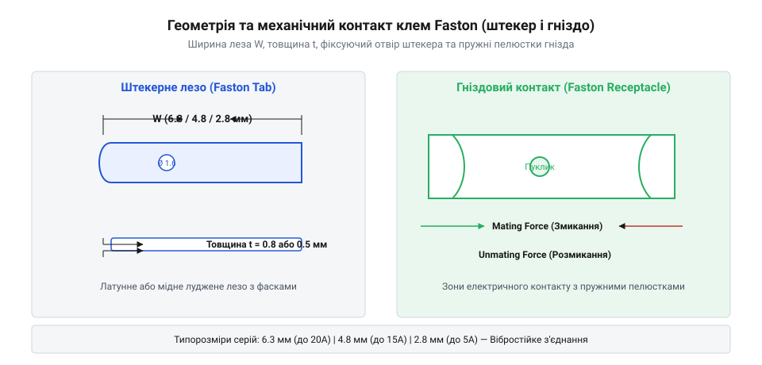
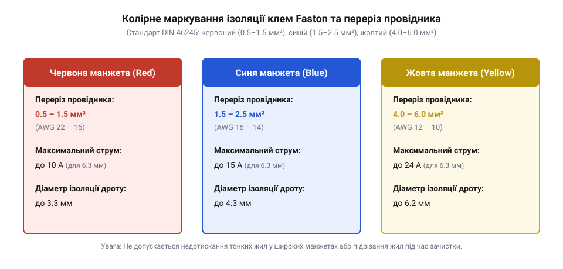

# Геометричні та електричні параметри стандартних ізольованих Faston-клем

<preknowlist>
- [Монтажний провід 18 і 20 AWG](root:cat-hw-parts/hookup-wire) — Маркування провідників за системою AWG, поняття перерізу багатожильного проводу та вибір струмонесучої жили.
</preknowlist>

## Проблема ненадійних силових і сигнальних з'єднань

Пряме з'єднання електропроводів у силі й сигналах стає першим слабким місцем при розробці та складанні будь-якого пристрою. Коли виникає потреба підключити сильний струм від блоку живлення до плати, перемикача, силового реле чи нагрівального елемента, пряме пайка товстого дріт створює жорстке нероз'ємне з'єднання. Під час вібрації або теплового розширення паяний стик зазнає механічної втоми й тріскається. Натомість гвинтові затискачі вимагають багато часу на монтаж і схильні до самовільного відкручування. Якщо ж використати випадкові або ненадійно притиснуті контакти, у місці стику виникає високий контактний опір.

Електричний опір контактного переходу перетворює електричну енергію на теплову. За законом Джоуля-Ленца, теплова потужність локального нагріву зростає пропорційно квадрату струму:

P = I² · R

Під час проходження струму в 15–20 А навіть незначний опір у 0,05 Ом виділяє 15–20 Вт тепла безпосередньо на мікроскопічних точках дотику металу. Це викликає теплову лавину (`@@en|thermal runaway@@`): метал контакту швидко окислюється, плівки оксиду додатково збільшують опір, ізоляція навколо клеми плавиться, виникає іскріння, а в найгіршому випадку — повний відпал металу або пожежа. У сигнальних колах ненадійний контакт призводить до викривлення даних, падіння напруги та періодичних збоїв, які вкрай важко діагностувати.

Для розв'язання цієї проблеми застосовують стандартизовані швидкороз'ємні обтискні контакти — клеми `@@en|Faston@@ (від англ. *fast on* — швидке надівання)`. Вони створюють пружне механічне з'єднання з високим питомим тиском дотику, яке розбирається без застосування паяльника чи викрутки. Використання якісних клем при [монтажного проводу 18 AWG](root:cat-hw-parts/hookup-wire) дає змогу гарантувати стабільний низький опір контакту та довговічність силового вузла. Там, де потрібне швидке обслуговування, клемне з'єднання стає надійною альтернативою нерозбірному пайці та конкурентом таким рішенням, як родина [силових роз'ємів XT](root:cat-hw-parts/xt-connectors).

## Геометричні типорозміри та стандарти товщини штирів

В основі механіки з'єднання `@@en|Faston@@` лежить суворо нормована геометрична пара: плоский чоловічий контакт-штекер (`@@en|tab@@ (від англ. *tab* — виступ чи хвостовик)` або `@@en|blade@@`) та жіночий контакт-гніздо (`@@en|receptacle@@ (від латинського *receptaculum* — вмістище)`). Гніздо має дві бічні пружні пелюстки, які охоплюють плоский штир із обох боків і притискають його до центральної опорної площадки.

Стандарт `@@en|Faston@@` ділить клеми на три основні геометричні серії за шириною плоского хвостовика:

1. **Серія 6,3 мм** (`@@en|series 250@@`, номінальна ширина 0,250 дюйма або 6,35 мм): найпоширеніший стандарт для силових кіл з робочими струмами до 20–25 А. Застосовується в силових реле, комутаторах, блоках живлення та побутовій техніці. 2. **Серія 4,8 мм** (`@@en|series 187@@`, номінальна ширина 0,187 дюйма або 4,75 мм): проміжний розмір для середніх навантажень до 10–15 А. Застосовується в кнопках, перемикачах та компактних силових блоках. 3. **Серія 2,8 мм** (`@@en|series 110@@`, номінальна ширина 0,110 дюйма або 2,8 мм): малогобаритні контакти для слабострумових і сигнальних ліній із струмом до 5 А. Для малих сигналів їх часто зіставляють із такими варіантами, як [сигнальних роз'ємів JST-SM](root:cat-hw-parts/jst-sm-connectors), [сигнальних кабелів JST-GH](root:cat-hw-parts/jst-gh-cable) або відрізками [штирьових з'єднувачів male](root:cat-hw-parts/pin-headers).

Окрім ширини хвостовика, критично важливо враховувати товщину штиря (`@@en|tab thickness@@`). Для серії 6,3 мм стандартною є товщина 0,8 мм (0,032 дюйма). Однак у серії 4,8 мм та 2,8 мм існують ДВА абсолютно несумісні стандарти товщини: **0,5 мм** (0,020 дюйма) та **0,8 мм** (0,032 дюйма).

Помилка у виборі товщини створює небезпечну пастку:
* Якщо гніздо `@@en|receptacle@@`, розраховане на 0,5 мм, надіти на штир `@@en|tab@@` товщиною 0,8 мм, пружні пелюстки надмірно деформуються або взагалі не дозволять з'єднати деталі без пошкодження металу. * Якщо ж гніздо під 0,8 мм надіти на штир товщиною 0,5 мм, механічний притиск буде практично відсутнім. З'єднання буде вільно бовтатися, утворюючи мікродуги, високий контактний опір та миттєвий перегрів під навантаженням.


*Геометрія контактної пари Faston: пропорції штекера (tab) та гнізда (receptacle) із завитками та стопорним елементом.*

## Колірне маркування ізоляції та перерізи провідника

Для швидкого візуального розпізнавання та запобігання помилкам обтискання ізольовані клеми `@@en|Faston@@` мають колірне маркування пластикових манжет (`@@en|color-coded insulation sleeves@@`). Кожен колір строго відповідає визначеному діапазону перерізу мідної жили провідника, вираженому в квадратних міліметрах або за системою `@@en|AWG@@ (від англ. *American Wire Gauge* — американський калібр проводів)`:

* **Червоний колір (Red)**: призначений для дротів малого перерізу від **0,5 мм² до 1,5 мм²** (калібри `@@en|AWG@@` 22 – 16). * **Синій колір (Blue)**: призначений для дротів середнього перерізу від **1,5 мм² до 2,5 мм²** (калібри `@@en|AWG@@` 16 – 14). * **Жовтий колір (Yellow)**: призначений для силових дротів великого перерізу від **4,0 мм² до 6,0 мм²** (калібри `@@en|AWG@@` 12 – 10).

Суворе дотримання відповідності кольору й перерізу провідника обумовлене внутрішньою конструкцією клеми. Під кольоровою пластиковою манжетою розташована металева гільза обтискання провідника (`@@en|wire barrel@@`). Внутрішній діаметр цієї гільзи розрахований на точне заповнення мідними жилами відповідного сумарного перерізу під час обтискання прес-кліщами.

Якщо обтиснути тонкий дріт (наприклад, 0,5 мм²) у жовтій клемі, обтискна гільза не зможе стиснути жили до стану безповітряного моноліту. Дріт легко вискочить при механічному натягу, а площа контакту буде недостатньою. Натомість спроба запхати товстий дріт 4,0 мм² у червону клему призведе до зрізання частини мідних жилок під час зняття ізоляції або їх заминання, що штучно звузить переріз провідника на вході в контакт і створить зону локального перегріву.

За ступенем закриття контакту манжети поділяються на частково ізольовані (`@@en|partially insulated@@`) та повністю ізольовані (`@@en|fully insulated@@`). У частково ізольованих клемах манжета закриває лише хвостовик обтиску дріт, залишаючи металеві пелюстки гнізда відкритими. У повністю ізольованих клемах еластичний корпус повністю закриває всю контактну пара. Це виключає ризик випадкового короткого замикання на металевий корпус пристрою або сусідні контакти при монтажі у щільних кабельних джгутах.


*Колірна гама манжет Faston: червоний (0.5–1.5 мм²), синій (1.5–2.5 мм²) та жовтий (4.0–6.0 мм²).*

## Допустимі електричні навантаження та матеріали сплавів

Граничний струм, який може безпечно проводити клема `@@en|Faston@@`, визначається трьома факторами: геометричною площею контакту, перерізом під'єднаного провідника та матеріалом металевого сплаву. За нормальних умов навколишнього середовища (температура до 25 °C) граничні тривалі струми становлять:

* Серія 6,3 мм з жовтою манжетою (переріз 4,0–6,0 мм²): до **24 А**. * Серія 6,3 мм з синьою манжетою (переріз 1,5–2,5 мм²): до **15–20 А**. * Серія 4,8 мм з червоною або синьою манжетою: до **10–15 А**. * Серія 2,8 мм з червоною манжетою: до **3–6 А**.

Електрична якість контакту характеризується переходним опором `R_contact`, який у чистої справної пари становить від 0,5 мОм до 1,5 мОм. Для оцінки теплових втрат розглянемо покроковий розрахунок виділення потужності в контакті при струмі 20 А:

**Розрахунок виділення потужності в справному та деградованому контакті Faston:**

```
P = I² · R
  = (20 A)² × 0.0015 Ом       [підстановка робочого струму та нормального опору]
  = 400 A² × 0.0015 Ом
  = 0.6 Вт                    [теплова потужність справного контакту]
```

Якщо внаслідок окислення чи послаблення пружності опір контакту зросте до 15 мОм:

```
P = I² · R_degraded
  = (20 A)² × 0.0150 Ом       [підстановка струму та деградованого опору]
  = 400 A² × 0.0150 Ом
  = 6.0 Вт                    [теплова потужність деградованого контакту]
```

Виділення 6,0 Вт тепла у точковій зоні площею лише кілька квадратних міліметрів розігріває контакт понад 150 °C. Це призводить до обвуглювання ізоляційного матеріалу манжети та термічної деградації металу.

Матеріал сплаву клем прямо визначає їхню провідність, пружність та температурну стійкість:

* **Латунь (`@@en|brass@@`)**: базовий сплав міді та цинку. Має добру провідність і низьку вартість. Проте непокрита латунь на повітрі покривається плівкою оксиду, що підвищує опір. Максимальна робоча температура обмежена 105 °C. * **Луджена латунь (`@@en|tin-plated brass@@`)**: найпопулярніший стандарт. Шар олова захищає латунь від корозії, забезпечує стабільно низький опір і полегшує змикання. Працює при температурах до 105–125 °C. * **Фосфориста бронза (`@@en|phosphor bronze@@`)**: має підвищений модуль пружності та високу стійкість до механічної втоми. Гнізда з бронзи зберігають зусилля притиску навіть після сотень циклів перепідключення та при підвищених температурах до 150 °C, де звичайна латунь втрачає пружність. * **Нікельована сталь (`@@en|nickel-plated steel@@`)**: застосовується в екстремально гарячих зонах (нагрівальні елементи, печі) з температурою до 300–400 °C. Має нижчу електричну провідність, ніж мідні сплави, але не розм'якшується від високого тепла.

Матеріал ізоляційної манжети — полівінілхлорид (`@@en|PVC@@`) або нейлон (`@@en|Nylon@@`) — визначає електричну міцність ізоляції та робочу напругу, яка зазвичай нормується до **300 В** для `@@en|PVC@@` та до **600 В** для `@@en|Nylon@@`.

## Механічні зусилля сопряження та вібростійкість монтажу

Надійність клемного з'єднання в умовах вібрації залежить від механічних зусиль притиску контактної пари. Стандарти (зокрема UL 310 та DIN 46247) суворо нормують механічні характеристики Faston-клем:

* **Зусилля змикання (`@@en|Mating force@@ (від англ. *mating force* — зусилля змикання)`)**: сила, необхідна для повного вставляння штиря `@@en|tab@@` у гніздо `@@en|receptacle@@`. Для серії 6,3 мм перше зусилля змикання становить від **35 Н до 80 Н** (приблизно 3,5–8,0 кгс). Це забезпечує прорив оксидних плівок на металі під час сопряження. * **Зусилля розмикання (`@@en|Unmating force@@ (від англ. *unmating force* — зусилля розмикання)`)**: сила, необхідна для роз'єднання пари. Для першого розмикання серії 6,3 мм вона становить **30–70 Н**. Для шостого розмикання (після 6 циклів обслуговування) зусилля не повинно падати нижче **18–25 Н**, щоб відвернути самовільне сповзання гнізда.

Механічна фіксація забезпечується стопорними елементами. На штирі `@@en|tab@@` виштамповується кругла стопорна заглибина або отвір (`@@en|detent hole@@`), а на центральному язичку гнізда `@@en|receptacle@@` знаходиться випукла пукля. При повному вставлянні пукля із клацанням заходить в отвір, створюючи фіксацію (`@@en|detent latching@@`). У вузлах з підвищеною вібрацією застосовують клеми із замковим важелем (`@@en|Positive Lock@@`), які розмикаються лише при натисканні на спеціальний фіксатор.

У рухомих або вібраційних пристроях мікрозміщення між штирем і гніздом викликають фретинг-корозію (`@@en|fretting corrosion@@ (від англ. *fretting corrosion* — корозія від тертя)`). При мікротерті поверхневе покриття стирається, оголений метал окислюється, і шар оксидного пилу розриває контакт.

Для забезпечення високої вібростійкості клемного вузла застосовують комплексний підхід:

1. Використовують гнізда з `@@en|phosphor bronze@@`, які утримують високий пружний тиск пелюсток. 2. Фіксують підведені дроти за допомогою [пластикових кабельних хомутів](root:cat-hw-parts/cable-ties), розвантажуючи клему від маса кабельного джгута. 3. Усі вібруючі блоки ізолюють за допомогою [тросових та еластомірних віброізоляторів](root:cat-hw-parts/wire-rope-isolators). 4. У стендових і вимірювальних системах пружні клемні механіки порівнюють за стабільністю із [пружинних контактах Pogo Pins](root:cat-hw-parts/pogo-pins).