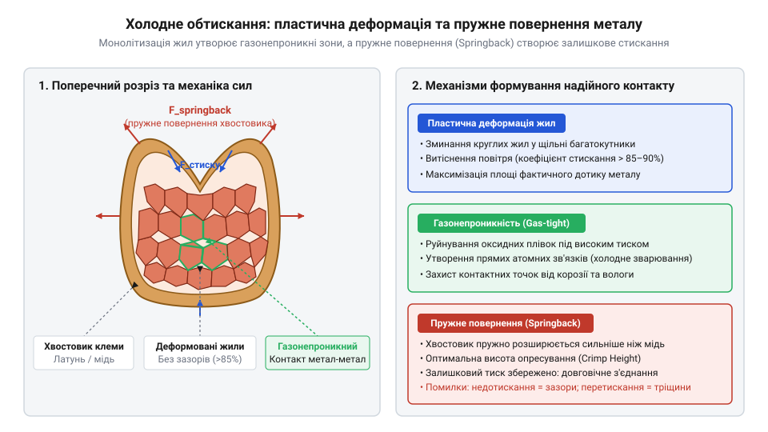
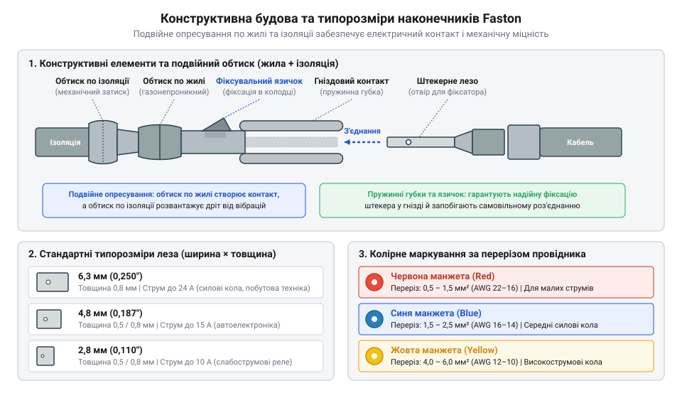
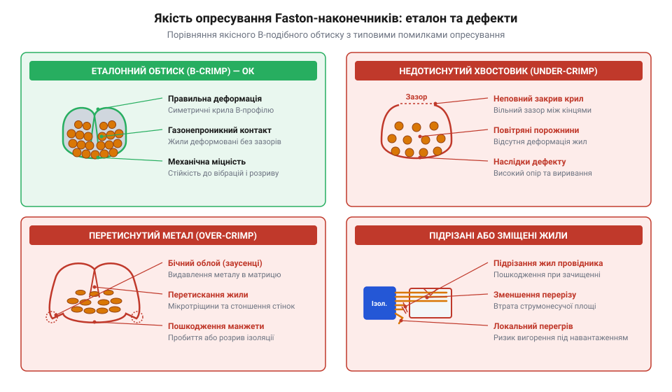
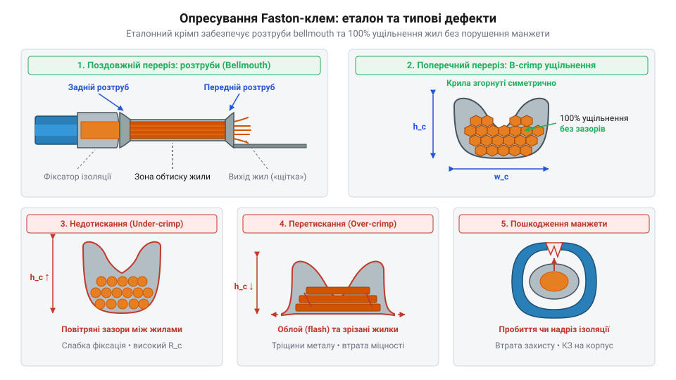

# Ізольовані наконечники Faston та технологія обтискання

<preknowlist>
- [Монтажний провід 18 і 20 AWG](root:cat-hw-parts/hookup-wire) — Розуміння будови багатожильного провідника, калібрів AWG та токового навантаження жил.
- [Родина силових роз'ємів XT (AMASS: XT30/60/90/120)](root:cat-hw-parts/xt-connectors) — Розуміння вимог до надійності силового контакту та мінімізації перехідного опору при високих струмах.
</preknowlist>

## Проблема деградації контакту у вібрації

У рухомих робототехнічних платформах, важких безпілотних апаратах, автомобільній електроніці та промислових верстатах електричні з'єднання постійно зазнають впливу знакозмінних механічних коливань, високих вібраційних прискорень та ударних навантажень. Системні відмови обладнання в таких умовах найчастіше викликані прихованим руйнуванням електричних контактів. Вузли, які бездоганно працюють у лабораторних умовах на стаціонарному стенді, після кількох сотень годин експлуатації в реальному середовищі починають демонструвати спорадичні збої, плаваючий опір або раптові обриви кіл живлення та керування. При цьому зовні провідник може здаватися неушкодженим, оскільки його захисна ізоляція приховує внутрішні мікроскопічні деструктивні процеси. Спроби вирішити цю проблему за допомогою традиційного паяння або стандартних гвинтових клемників у вібраційному середовищі майже завжди призводять до аварійних ситуацій через принципові фізичні обмеження цих методів.

Паяння багатожильного дроту створює небезпечну зону концентрації механічного напруження біля межі просочування припою. Під час нагрівання рідкий олов'яно-свинцевий або безсвинцевий припій під дією капілярного ефекту затікає між мідними жилками [багатожильного провідника](root:cat-hw-parts/hookup-wire), перетворюючи гнучкий пучок на суцільний моноліт. Проте на зрізі, де капілярне просочування припою зупиняється, виникає різка межа між жорсткою пропаяною ділянкою та гнучкою неізольованою жилою. Жорсткість пропаяного сегмента суттєво перевищує гнучкість вільних жил. Під час вібраційних коливань провідник неминуче вигинається саме на цій вузькій межі розродження жорсткості, яка стає точковим концентратором механічного напруження.

Постійні циклічні вигини міді викликають у її кристалічній ґратці накопичення дислокацій, що призводить до явища, відомого як @@en|наклеп@@ (від укр. *клепати* — пластично ущільнювати метал ударами; також @@en|нагартування@@). У результаті наклепу мідь втрачає пластичність, стає крихкою та вразливою до мікротріщин. З кожним новим циклом коливань мікротріщини розростаються, і мідні жилки послідовно обламуються одна за одною, зменшуючи ефективний переріз провідника. Крім того, олов'яні припої схильні до @@en|крип-ефекту@@ (від англ. *creep* — сповзати, повільно деформуватися), тобто пластичної повзучості металу під постійним механічним навантаженням та термічними циклами. Припій повільно перерозподіляється та деформується під дією власного внутрішнього напруження, що додатково послаблює шов і прискорює втомне руйнування.

Гвинтові клемні блоки потерпають від іншого деструктивного механізму — динамічної релаксації притискного зусилля. Під дією постійної вібрації різьбова пара гвинта схильна до саморозкручування за рахунок мікрозсувів у витках різьби. Навіть якщо гвинт зафіксовано пружинною шайбою, мідна жила під високим точковим тиском гвинта зазнає повільної пластичної деформації. З часом сила притиску гвинта неминуче падає, і в утворені мікропроміжки між контактом та жилою проникає кисень і волога.

Виникнення мікропроміжків оголює мідь для атмосферного окислення. Оксиди міді мають питомий опір у мільйони разів вищий за чисту мідь. Зменшення площі чистого металевого контакту змушує струм протікати крізь рідкісні точкові контактні плями, що спричиняє локальне сплескове нагрівання за законом Джоуля — Ленца:

```
P = I² · R_c
```
[де P — потужність теплових втрат у ватах, I — робочий струм у амперах, R_c — перехідний опір контакту в омах]

Локальне нагрівання прискорює окислення металу, що ще більше збільшує опір. Під час циклічних змін температури розширення та стискання металів створюють @@en|фретинг-корозію@@ (від англ. *fretting* — руйнівне стирання поверхонь під дією мікрозсувів). У результаті фретингу контактне з'єднання інтенсивно вкривається оксидним порошком, вигоряє, плавить пластиковий корпус або спричиняє дуговий розряд. На відміну від жорстких гвинтових блоків, спеціальні [тросові та еластомірні віброізолятори](root:cat-hw-parts/wire-rope-isolators) захищають лише загальну структуру приладу, але не вирішують проблему внутрішнього деградування розхитаного гвинтового затискача.

Для створення надійного електричного з'єднання у вібраційному середовищі необхідна технологія, яка забезпечує три ключові умови:
1. Повна відсутність термічного нагрівання та крихких температурних меж у структурі провідника. 2. Постійний пружний притиск контактних поверхонь без застосування різьбових елементів. 3. Повна газонепроникність та герметичність зони електричного контакту від впливу зовнішнього середовища.

Цим вимогам ідеально відповідає технологія холодного опресування контакту.

Під час холодного обтискання металева гільза клеми та мідні жилки дроту зазнають глибокої спільної пластичної деформації під дією високого радіального тиску опресувальної матриці. Сумарна площа поперечного перерізу жил усередині клеми зменшується на 15–20%. Мідні жилки зміщуються, сплющуються й стискаються в щільну монолітну багатогранну структуру, повністю витісняючи повітряні проміжки. У результаті інтенсивного взаємного зсуву поверхневі крихкі плівки оксидів на мідних жилках та внутрішньому лудженому покритті клеми руйнуються й видавлюються з зони контакту. Ювенільні surfaces металів притискаються одна до одної на міжатомні відстані, утворюючи газонепроникні контактні плями — мікрозварні зони холодного зчеплення. Оскільки атмосферний кисень, волога та агресивні гази більше не можуть проникнути всередину цього моноліту, опресований контакт зберігає нульове окислення протягом усього терміну служби.

Визначальним фізичним чинником долговічності обтиснутого контакту є @@en|пружне повернення@@ (від англ. *springback* — повернення пружини після деформації). Металевий хвостовик клеми виготовляють із матеріалу (латунь або фосфориста бронза), що має вищу границю плинності та вищий коефіціент пружності, ніж м'яка мідь провідника. Після зняття навантаження з боку матриці зовнішня гільза клеми демонструє пружне відновлення — вона намагається розпрямитися на мікроскопічну величину, але зберігає потужне радіальне залишкове напруження. Цей залишковий пружний тиск діє як постійна внутрішня пружина, яка безперервно стискає деформований мідний осердечник. Завдяки цьому пружному поверненню контакт не розхитується та самокомпенсує термічні розширення і вібраційні мікрозсуви.


*Поперечний переріз опресованого контакту: пластично деформовані жили формують газонепроникну монолітну структуру, що перебуває під постійним тиском сил пружного повернення.*

Історія винайдення роз'ємів @@en|Faston@@ (від англ. *fast* — швидкий та *on* — надівати, фіксувати) сягає середини XX століття, коли компанія @@en|AMP@@ (від англ. *Aircraft Marine Products*) розробила технологію безпайкового опресування для прискорення монтажу та підвищення надійності бортової електрики авіації, автопрому та побутової техніки. Докладніше передісторію виникнення та еволюцію цього стандарту висвітлено у матеріалі про [історію винайдення роз'ємів Faston](root:cat-hw-parts/faston-crimp-terminals/hist-faston-history.md).

Детальний математичний апарат для розрахунку ступеня деформації, коефіцієнтів розривної міцності та підрахунку контактного опору подано у вставці про [механіку опресування та опору контакту](root:cat-hw-parts/faston-crimp-terminals/math-crimp-mechanics-and-pullout.md).

## Геометрія та різновиди клем Faston

Конструкція швидкорознімного з'єднання @@en|Faston@@ побудована на принципі плоскої ножової пари, що складається з двох сумісних елементів: штекерного плоского контакта (від @@de|штекер@@, нім. *Stecker* — той, що встромляється; також male tab) та гніздового контакту (роз'ємного гнізда; female receptacle). З'єднання виконується шляхом поздовжнього насування гнізда на плоский ніж із подоланням сили пружного тертя, що забезпечує швидкий монтаж та демонтаж без застосування гвинтового інструменту.

Стандартизація геометрії клем @@en|Faston@@ базується на ширині контактного ножа. Виділяють три основні типорозмірні серії, кожна з яких призначена для відповідного діапазону струмових навантажень і габаритних обмежень:

1. **Серія 6,3 мм (0,250 дюйма)** — найбільш поширений силовий стандарт. Товщина штекерного ножа становить 0,8 мм. Призначена для комутації струмів від 15 А до 24 А (залежно від перерізу провідника та матеріалу клеми). Застосовується в автомобільних силових реле, вимикачах живлення, силових трансформаторах, побутовій техніці та промислових контролерах. Для з'єднань високої потужності, таких як [силові роз'єми XT](root:cat-hw-parts/xt-connectors), використовують пайкові з'єднувачі, але у вузлах, що потребують швидкої заміни реле та блоків, серія 6,3 мм є незамінним стандартом. 2. **Серія 4,8 мм (0,187 дюйма)** — середньосиловий та сигнально-силовий стандарт. Товщина ножа становить 0,5 мм або 0,8 мм. Розрахована на струми від 10 А до 15 А. Використовується в панельних перемикачах, клавішних кнопках, засобах автоматизації та приладах середньої потужності. 3. **Серія 2,8 мм (0,110 дюйма)** — компактний сигнальний та малогабаритний стандарт. Товщина ножа становить 0,5 мм або 0,8 мм. Призначена для струмів від 5 А до 8 А. Застосовується для підключення мікроперемикачів (@@en|microswitch@@), дрібних електромагнітних клапанів, акустичних динаміків, а також у щільних монтажних відсіках.

Повні геометричні розміри ножів, допуски товщини, матеріальні специфікації та табличні значення граничних струмів зведені у [специфікації параметрів Faston-клем](root:cat-hw-parts/faston-crimp-terminals/api-faston-geometric-electrical-spec.md).

Надійність механічної фіксації рознімної пари в умовах постійної вібрації забезпечується двома узгодженими геометричними елементами. По-перше, бокові краї гнізда загнуті у вигляді двох пружинних роликових пелюсток, які щільно охоплюють ніж з обох боків і створюють постійне перпендикулярне притискне зусилля. Для полегшення стикування кінчик штекерного ножа має зняті фаски (скоси), які запобігають впиранню ножа у пелюстки.

По-друге, штекерний ніж містить круглий фіксувальний отвір або півсферичне заглиблення — @@de|пуклю@@ (від нім. *Buckel* — округла опуклість, горбок; англ. *detent hole / dimple*). У центрі гніздового контакту розташований відповідний пружинний виступ (фіксувальний язичок). Під час повного вводу ножа в гніздо пружинний язичок зі клацанням заходить у пуклю ножа, створюючи позитивний фіксувальний замок. Це розрізняє зусилля вводу та зусилля витягування: якщо введення вимагає помірного натискання (близько 15–20 Н), то для витягування клеми із защепнутою пуклею необхідно прикласти зусилля 40–60 Н, що повністю виключає самовільне роз'єднання від вібрації кабельного джгута.


*Конструктивна будова з'єднання Faston: плоский штекер із фіксувальною пуклею та гніздо з подвійним хвостовиком для жили й ізоляційного пояса.*

Головною конструктивною особливістю якісної обтискної клеми @@en|Faston@@ є будова подвійного хвостовика (двох послідовних обтискних зон):

1. **Хвостовик жили (wire barrel)** — внутрішня металева зона з відкритими або закритими пелюстками, призначена для безпосереднього опресування зачищеного мідного провідника. На внутрішній поверхні хвостовика жили виконуються поперечні насічки (канавки). Під час опресування мідні жилки втискаються в ці канавки, що створює механічний замок проти поздовжнього висмикування дроту та руйнує залишкові поверхневі оксиди. 2. **Хвостовик ізоляції (insulation barrel)** — зовнішні розширені пелюстки металевого хвостовика, які опресовуються поверх зовнішньої полімерної ізоляційної оболонки дроту.

Призначення хвостовика ізоляції полягає в механічному розвантаженні натягу та вигину (@@en|strain relief@@). Якщо кабель зазнає вигинання або вібраційних коливань, механічний момент сили сприймається еластичною ізоляцією, затиснутою в хвостовику ізоляції. Завдяки цьому згинальне напруження не передається на межу обтиснутих мідних жил у хвостовику жили, що повністю усуває втому металу та запобігає переламанню жил на вході в клему.

На відміну від відкритих неізольованих клем, про які можна дізнатися у розділі про [відкриті та неізольовані клеми](root:cat-hw-parts/non-insulated-crimp-terminals-and-open-barrel), ізольовані наконечники @@en|Faston@@ мають заводську захисну манжету з термопласту, яка повністю закриває обидва хвостовики. Для виготовлення манжет використовують два основні матеріали:
- **Вініл (полівінілхлорид, PVC)** — еластичний, доступний матеріал з робочим температурним діапазоном від -10 °C до +75 °C. Забезпечує базову електричну ізоляцію та захист від короткого замикання. - **Нейлон (поліамід, PA66)** — високоміцний термопласт із підвищеною стійкістю до мастил, палива та розчинників, який працює у діапазоні від -40 °C до +105 °C. Нейлонова манжета має високу механічну в'язкість і не розтріскується під час опресування за низьких температур.

Усередині ізоляційної манжети виконано конусний перехід (воронку), який спрямовує зачищену жилу безпосередньо в хвостовик, запобігаючи заламуванню окремих мідних волокон під час вводу дроту в клему.

Практичні рекомендації щодо вибору інструментарію подано у статті про [кримпери та обтискні матриці](root:cat-hw-instruments/crimp-tools-and-dies), правильну підготовку провідника описано в матеріалі про [технологію зачищення провідників](root:cat-hw-instruments/wire-stripping-and-preparation-tech), а приклад побудови повноцінного кабельного вузла висвітлено у [практикумі виготовлення кабельного джгута](root:cat-hw-parts/faston-crimp-terminals/proj-faston-crimp-harness-assembly.md).

## Фізика холодного обтискання та мікрозварювання

Механічне притискання металевого хвостовика клемного роз'єму до багатожильного провідника виглядає простим і зрозумілим завданням. Проте спроба стиснути мідний дріт звичайними пасатижами або затиснути його гвинтом без спеціального профілювання неминуче призводить до швидкої деградації контакту. При кімнатній температурі поверхня будь-якого мідного або латунного провідника миттєво покривається тонким шарком оксидів (`Cu₂O` та `CuO`). Ці оксидні плівки є діелектриками. У разі слабкого притискання мідні жили торкаються одна одної та стінок хвостовика лише у кількох мікроскопічних точках шорсткості — пичках або асперитетах. Оскільки реальна площа електричного контакту становить лише незначну частку від геометричної площі перерізу, електричний опір з'єднання різко зростає. У силових кола це викликає локальне нагрівання, яке прискорює подальше окислення металу та підсилює @@en|фретинг-корозію@@ (від англ. *fretting corrosion* — деградація контактних поверхонь через мікрозсуви під дією вібрації).

Щоб утворити довговічне з'єднання з мінімальним опором, необхідно примусити метал деформуватися за межу його плинності. Під час опресування кримпер прикладає до @@en|хвостовика жили@@ (від англ. *wire barrel* — металева частина клеми, яка обтискає мідні провідники) локалізоване зусилля у сотні мегапаскалів. Під цим тиском матеріали стінок клеми та внутрішніх мідних жил зазнають глибокої @@en|пластичної деформації@@ (від англ. *plastic deformation* — незворотна зміна геометрії та кристалічної ґратки металу під дією механічного навантаження). Зрізне напруження змушує верхні шари металу текти, а крихкі оксидні плівки на поверхнях мідних жил тріскаються і зсуваються вбік. В результаті оголюються ювенільні, атомарно чисті шари міді.

Коли чисті атомарні поверхні мідних жил та внутрішньої поверхні @@en|хвостовика жили@@ притискаються одна до одної на відстані порядку кількох ангстрем без доступу кисню, відбувається @@en|холодне зварювання@@ (від англ. *cold welding* — процес міжатомного зчеплення та формування спільних кристалічних зерен між металевими поверхнями під високим тиском без зовнішнього нагріву). Круглі у перерізі окремі провідники [багатожильного монтажного дроту](root:cat-hw-parts/hookup-wire) під дією обтискної матриці кардинально змінюють свою геометрію. Вони плющаться, заповнюють усі внутрішні порожнини та формують щільну структуру безповітряного стільника з шестигранними або овальними гранями. Зникають будь-які повітряні зазори між жилами. Утворюється @@en|газонепроникний контакт@@ (від англ. *gas-tight contact* — монолітна металева зона, повністю ізольована від проникнення кисню, вологи та агресивних газів). Оскільки кисень повітря більше не може потрапити всередину опресованої зони, реакція окислення зупиняється назавжди, що гарантує стабільність електричного опору протягом десятиліть експлуатації.

Зняття опресувального зусилля після завершення робочого ходу інструмента активує явище, що має назву @@en|пружне повернення@@ (від англ. *elastic recovery* або *springback* — часткове пружне відновлення первинних розмірів металу після зняття зовнішнього механічного навантаження). Будь-який метал після @@en|пластичної деформації@@ зберігає певну частку пружної деформації. Мідний пучок жил і латунна або мідна гільза клеми мають різні модулі пружності та границі плинності. Для того щоб @@en|газонепроникний контакт@@ не втратив щільності після розмикання матриці інструмента, зовнішній @@en|хвостовик жили@@ мусить мати достатню товщину стінок і відповідні механічні властивості. Залишкове пружне напруження розтягу у зовнішній гільзі повинно безперервно стискати внутрішній пучок жил із зусиллям, яке перевищує можливі термічні розширення під час протекання струму. Саме цей постійний радіальний тиск компенсує [фізичні релаксаційні процеси в контактних матеріалах](root:hw-components/contact-materials-and-plating-technologies) та запобігає мікрозсувам провідників при вібраціях.

Розуміння фізики холодного мікрозварювання сформувалося в середині XX століття завдяки інженерним розробкам компанії AMP (Aircraft Marine Products). Прагнучи замінити ненадійне та трудомістке паяння в авіабудуванні, вони розробили роз'ємні плоско-ножові клеми Faston та стандартизований технологічний процес їх опресування. Інженери довели, що контрольована @@en|пластична деформація@@ без термообробки забезпечує вищу вібростійкість та механічну міцність, ніж пайка, яка створює жорстку зону концентрації напружень на межі припою. Детальніше про це можна дізнатися, дослідивши [історію винайдення роз'ємів Faston](root:cat-hw-parts/faston-crimp-terminals/hist-faston-history.md) та появу перших промислових кримперів.

Для досягнення еталонного @@en|газонепроникного контакту@@ критично важливо дотримуватися розрахованого ступеня деформації. @@en|Ступінь деформації@@ (від англ. *compaction ratio* — відносна площа ущільнення металу в опресованій зоні) визначається співвідношенням площі перерізу опресованого вузла до суми початкових площ провідника та хвостовика. Величина `C_{r}` (у відсотках) розраховується за формулою:

```
C_{r} = (A_{crimp} ÷ A_{total}) × 100%
      = (A_{crimp} ÷ (A_{wire} + A_{barrel})) × 100%      [визначення відносної площі після опресування]
```

Де `A_{crimp}` — геометрична площа перерізу обтисненої зони після змикання матриці, `A_{wire}` — загальна площа суцільного перерізу усіх мідних жил провідника, а `A_{barrel}` — площа металевого перерізу стінок @@en|хвостовика жили@@.

При оптимальному опресуванні значення `C_{r}` становить від 80% до 90% (що відповідає зменшенню початкової площі порожнин на 15–20%). Якщо обтискання виконується недостатньо, у структурі залишаються повітряні каверни, оксидні плівки руйнуються лише частково, а механічна міцність на виривання `F_{pull}` залишається низькою. Якщо ж перетиснути клему (`C_{r} < 75%`), відбувається надмірне стоншення стінок хвостовика та підрізання мідних жил, що зменшує корисний переріз провідника і призводить до локального перегріву під навантаженням. Точний алгоритм та [математичні формули розрахунку міцності](root:cat-hw-parts/faston-crimp-terminals/math-crimp-mechanics-and-pullout.md) дозволяють обчислити падіння напруги та граничне зусилля виривання провідника для будь-якого калібру.

## Колірне маркування та вибір кримпера

Знання мікроскопічної фізики обтискання залишається суто теоретичним, якщо майстер вибирає клеми наосліп, зачищає дріт «на око» та стискає хвостовик випадковим інструментом. Для виключення людського фактора та забезпечення сумісності клем із перерізом провідників електротехнічна індустрія прийняла жорсткий стандарт колірного маркування ізоляційних манжет. Ізольовані Faston-клеми випускаються з трьома основними кольорами манжет, кожен з яких відповідає чітко визначеному діапазону калібрів провідника за системою AWG та метричною системою перерізів у квадратних міліметрах:
- @@en|червоний колір@@ (від англ. *Red insulation code*) — призначений для провідників перерізом від `0.5 мм²` до `1.5 мм²` (калібри `AWG 22` – `AWG 16`). Робочий струм таких клем зазвичай становить до `10 А` для типорозміру `4.8 мм` та до `15 А` для `6.3 мм`. - @@en|синій колір@@ (від англ. *Blue insulation code*) — розрахований на провідники перерізом від `1.5 мм²` до `2.5 мм²` (калібри `AWG 16` – `AWG 14`). Допустимий робочий струм сягає `15 А` – `20 А`. - @@en|жовтий колір@@ (від англ. *Yellow insulation code*) — розроблений для силових провідників перерізом від `4.0 мм²` до `6.0 мм²` (калібри `AWG 12` – `AWG 10`) з робочим струмом до `24 А` – `28 А`.

Спроба затиснути провідник калібру `AWG 22` у синю клему призведе до браку: обтискна матриця не зможе стиснути металевий @@en|хвостовик жили@@ до потрібного @@en|ступеня деформації@@, і провідник вільно вислизне з роз'єму. І навпаки, спроба запресувати силовий дріт `AWG 12` у червону клему призведе до пошкодження жили або неможливості вставити дріт в ізоляційне гніздо.

Якість обтисненого з'єднання значною мірою залежить від підготовки провідника. Застосовуючи [досконалу технологію зачищення провідників](root:cat-hw-instruments/wire-stripping-and-preparation-tech), необхідно розрахувати довжину зачищення жили `L_{strip}`, яка точно відповідає довжині опресувальної зони металевого @@en|хвостовика жили@@ з додаванням технічного виступу. Розрахунок виконується за формулою:

```
L_{strip} = L_{barrel} + ΔL
          = L_{barrel} + (1.0 мм ... 1.5 мм)      [додавання технічного виступу жили]
```

Де `L_{barrel}` — внутрішня довжина металевої опресувальної частини хвостовика, а `ΔL` — величина безпечного виступу мідної жили за межі хвостовика у бік контактної зони (ножа або гнізда).

Якщо зачистити дріт занадто коротко, мідні жили не заповнять усю довжину опресувальної зони, що зменшить площу @@en|газонепроникного контакту@@ та механічну міцність на виривання. Якщо ж зачистити дріт занадто довго, оголені мідні жили виступатимуть далеко за межі захисного ізоляційного ковпачка, що створює ризик короткого замикання на сусідні контакти або металевий корпус пристрою. Крім того, зовнішня манжета опресується по ізоляції провідника, а не по оголеному металу, забезпечуючи з'єднання механічним розвантаженням від вигину — @@en|strain relief@@ (від англ. *strain relief* — механічне розвантаження жили від вигинального напруження).


*Відповідність колірного маркування ізоляційних манжет діапазонам перерізу провідників та геометрія підготовки дроту із дотриманням довжини зачищення.*

Категорично забороняється виконувати опресування ізольованих Faston-клем за допомогою універсальних пасатижів або дешевих пластинчастих кліщів без фіксації зусилля. Справді якісне опресування можливе лише із застосуванням спеціалізованого інструмента — @@en|кримпера@@ (від англ. *crimper* — прес-кліщі для опресування клем) з відповідними [кримперами та обтискними матрицями](root:cat-hw-instruments/crimp-tools-and-dies).

Головним елементом професійного @@en|кримпера@@ є @@en|храповий фіксатор@@ (від нім. *Knarre* або англ. *ratchet lock* — механічний блокувальний пристрій зі зубчастим колесом і собачкою). Храповик не дозволяє рукояткам інструмента розімкнутися доти, доки матриця не пройде повний робочий хід і не стисне клему до розрахованої висоти обтиску — @@en|crimp height@@ (від англ. *crimp height* — нормована висота обтисненого профілю клеми). Це гарантує 100% повторюваність результату незалежно від втоми чи фізичної сили оператора. Для точного регулювання опресувального зусилля та усунення недотискання дивіться матеріал про [калібрування та налаштування ексцентрика храпових кримперів](root:cat-hw-instruments/ratchet-crimp-mechanism-calibration).

Матриця для ізольованих Faston-клем має особливу подвійну овальну або сочевицеподібну геометрію профілю (на відміну від F-подібного профілю @@en|F-crimp@@ (від англ. *F-crimp* — двопелюстковий профіль обтискання), який використовується для [відкритих неізольованих клем](root:cat-hw-parts/non-insulated-crimp-terminals-and-open-barrel)). Вона одночасно формує два пояси деформації:
- Перша секція матриці стискає металевий @@en|хвостовик жили@@ крізь пластикову манжету, утворюючи щільний @@en|газонепроникний контакт@@. - Друга секція матриці деформує задню частину пластикової манжети навколо зовнішньої ізоляції провідника, створюючи механічний фіксатор @@en|strain relief@@ без пробиття або розриву пластику.

Надійність контакту в екстремальних умовах визначається сплавом клеми та типом полімеру ізоляційної манжети. Згідно з [геометричними та електричними специфікаціями клем](root:cat-hw-parts/faston-crimp-terminals/api-faston-geometric-electrical-spec.md), під час вибору виробу слід враховувати такі параметри:
- **Матеріал контакту**: Найчастіше використовується пружинна @@en|латунь@@ (від англ. *brass* — сплав міді з цинком CuZn30 або CuZn37), яка забезпечує високу пружність гніздових контактів при багаторазовому з'єднанні. Для кіл з підвищеним струмовим навантаженням та підвищеною вологістю застосовується @@en|луджена мідь@@ (від англ. *tinned copper* — електролітична мідь із гальванічним покриттям оловом), яка володіє вищою провідністю та стійкістю до окислення. - **Матеріал ізоляції**: Найдешевші та найпоширеніші клеми використовують манжети з полівінілхлориду — @@en|полівінілхлорид@@ (від англ. *polyvinyl chloride*, PVC). Вони розраховані на температури від `-10 °C` до `+75 °C`. У відповідальних силових вузлах, автопромі та авіації застосовують манжети з нейлону — @@en|нейлон@@ (від англ. *nylon*, polyamide PA66). Нейлон витримує температури від `-40 °C` до `+105 °C` (і короткочасно до `+125 °C`), не тріскається при негативних температурах під час обтискання та володіє високою діелектричною міцністю.

Після виконання опресування необхідно провести контроль якості. Первинним методом оперативного контролю в польових або лабораторних умовах є @@en|тест на виривання@@ (від англ. *pull-out test* — механічне випробування з'єднання на розрив шляхом прикладання нормованого осьового зусилля). Провідник не повинен вислизати з хвостовика при прикладанні зусилля від `40 N` (для `0.5 мм²`) до `200 N` і більше (для `6.0 мм²`).

Візуальна діагностика дозволяє виявити типові виробничі дефекти:
- @@en|недотискання@@ (від англ. *under-crimping* — незавершений цикл опресування зі збереженням внутрішніх зазорів) — виникає через використання інструмента без храповика або некоректне налаштування кримпера. Призводить до високого контактного опору та випадання дроту. - @@en|перетискання@@ (від англ. *over-crimping* — надмірне плющення металу із стоншенням стінок хвостовика) — виникає при виборі занадто малої матриці. Супроводжується розривом металу хвостовика та різким зниженням механічної міцності. - @@en|підрізання жил@@ (від англ. *strand shearing* — пошкодження окремих дротів пучка при зачищенні) — зменшує діючий переріз провідника, що викликає локальне перегрівання при підключенні провідника до [силових роз'ємів серії XT](root:cat-hw-parts/xt-connectors) чи релейних блоків. - @@en|пробиття ізоляції@@ (від англ. *insulation puncture* — розрив захисної манжети краями матриці) — створює загрозу короткого замикання та корозії.


*Порівняльна схема еталонного опресованого профілю Faston-клеми з типовими дефектами обтискання та руйнування ізоляційної манжети.*

Під час розведення провідників у шафах автоматики готовий джгут із Faston-клемами впорядковують [гнучкими органайзерами кабелів](root:cat-hw-parts/cable-organizer) та стягують [пластиковими кабельною хомутами](root:cat-hw-parts/cable-ties). Засвоєні правила вибору клем, підготовки провідників та контролю якості обтискання дозволяють створювати надійні джгути, стійкі до жорстких умов експлуатації. Практичні кроки щодо виготовлення готових кабельних збірок детально викладено у [практикумі з виготовлення силових джгутів](root:cat-hw-parts/faston-crimp-terminals/proj-faston-crimp-harness-assembly.md), де продемонстровано порядок монтажу клем у реальних проектах.

## Сплави клем та види ізоляції

Коли клемне з'єднання працює в силовому вузлі перетворювача чи моторного відсіку, воно зазнає одночасного впливу високого струму, циклічного нагріву та постійної вібрації. Клема, що ідеально підходить за геометричним розміром ножа, може розплавитися або окиснитися за кілька місяців роботи, якщо її металевий сплав та ізоляційна манжета вибрані без урахування електричних і термічних навантажень. Різниця між надійним контактом та аварійною відмовою полягає у фізиці поведінки металу під тиском і термомеханічним розширенням.

Основою клемних контакторів є мідні сплави, проте їхній хімічний склад критично визначає провідність, пружність та стійкість до корозії.

Латунь — сплав міді та цинку (від нім. *@@de|Messing@@*) — виступає найпоширенішим конструкційним матеріалом для недорогих клем. Цинк надає сплаву високої механічної міцності та пружності, що важливо для виготовлення пружинних пелюсток роз'єму @@en|Faston@@ (від англ. *@@en|fast on@@* — «швидко надівати»). Тобто пелюстка гнізда утримує затиснутий штекер за рахунок високого модуля пружності латуні. Однак питомий електричний опір латуні становить `ρ ≈ 0.06 - 0.07 Ом·мм²/м`, що у 3-4 рази вище за опір чистої міді. При проходженні струмів понад `10-15 А` у латунній клемі виникає помітне джоулеве нагрівання. Крім того, під впливом вологи та залишкових напружень латунь схильна до корозійного розтріскування та інтенсивного окислення, що призводить до зростання перехідного опору контакту.

Луджена мідь — чиста мідь (від лат. *@@la|cuprum@@*), покрита тонким гальванічним шаром олова (від лат. *@@la|stannum@@* завтовшки `3-5 мкм`) — є стандартом для силових та відповідальних кіл. Чиста мідь володіє мінімальним питомим опором `ρ ≈ 0.017 Ом·мм²/м` та високою теплопровідністю, що запобігає перегріву при високих струмових навантаженнях. Шарувальне лудження виконує дві фундаментальні функції. По-перше, олово захищає мідну основу від атмосферного окислення. По-друге, м'який шар олова при опресуванні пластично деформується й заповнює мікроскопічні порожнини між жилами провідника, створюючи герметичний газонепроникний контакт. Це запобігає виникненню фретинг-корозії при спряженні контакту з іншими елементами кіл, де розглядаються [гальванічні покриття контактів](root:hw-components/contact-materials-and-plating-technologies).

Історія винайдення швидкороз'ємних клем сягає середини XX століття, коли компанія @@en|AMP@@ (від англ. *@@en|Aircraft Marine Products@@*) розробила концепцію безпайкового опресування для авіаційної та побутової техніки. Детальніше про це розкрито в матеріалі про [історію винайдення роз'ємів Faston](root:cat-hw-parts/faston-crimp-terminals/hist-faston-history.md). Використання пластично деформованих металевих хвостовиків замість трудомісткого паяння дозволило кардинально підвищити вібростійкість та швидкість монтажу кабельних джгутів.

Окрім металевого хвостовика, ізольована клема має зовнішню захисну манжету. Її призначення — не лише електрична ізоляція струмопровідних частин, а й розвантаження механічного напруження жили на виході з обтискної зони.

Полівінілхлорид (@@en|PVC@@, від англ. *@@en|polyvinyl chloride@@*) — термопластичний полімер, що застосовується у базових версіях клем (зазвичай із червоним, синім та жовтим колірним маркуванням). @@en|PVC@@-ізоляція розрахована на робочий температурний діапазон від `-10 °C` до `+75 °C` (рідше до `+105 °C`). При підвищенні температури вініл розм'якшується, а при від'ємних температурах стає крихким і тріскається під впливом вібрації. Крім того, вінілова манжета має прямі стінки циліндра, через що багатожильний провідник при вставлянні може впиратися краями жил у торець металевого хвостовика.

Нейлон (поліамід, @@en|Nylon@@, від англ. *@@en|nylon@@*) — високоміцний інженерний пластик для важких умов експлуатації. Нейлонова ізоляція зберігає еластичність та механічну міцність у діапазоні від `-40 °C` до `+105 °C` (або `+125 °C`), стійка до дії мастил, палива та розчинників. Конструктивною перевагою якісних нейлонових клем є наявність внутрішньої конусної втулки @@en|funnel entry@@ (від англ. *@@en|funnel entry@@* — «воронкоподібний вхід»). Конус спрямовує всі тонкі мідні жили безпосередньо всередину обтискного циліндра, виключаючи загибання чи підрізання окремих дротів під час збирання. Під нейлоновою манжетою часто розташовується додаткова суцільна мідна втулка подвійного обтиску, яка рівномірно стискає ізоляцію провідника, створюючи повноцінний @@en|strain relief@@ (від англ. *@@en|strain relief@@* — «гасіння механічного напруження»).

Розрахунок допустимого струмового навантаження для провідників із різними видами ізоляції та сплавів базується на рівнянні теплового балансу контакту. Втрата потужності на перехідному опорі не повинна перевищувати швидкість відведення тепла в навколишнє середовище:

```
P_loss = I² × R_contact
= I² × (R_bulk + R_constriction + R_film)    [розкладання опору контакту]
```

Де `I` — робочий струм у амперах, `R_bulk` — об'ємний опір металу клеми, `R_constriction` — опір струдження струмових ліній у точках мікроконтакту, `R_film` — опір оксидних плівкоутворень. Для латунних клем `R_bulk` у 3-4 рази вищий, ніж для лудженої міді, що обмежує максимальний струм для розміру 6,3 мм величиною `15 А` для латуні проти `24 А` для лудженої міді. Порівняти параметри клем за номінальним струмом та напругою можна у [технічній специфікації роз'ємів](root:cat-hw-parts/faston-crimp-terminals/api-faston-geometric-electrical-spec.md).

При виборі матеріалу для силових кіл, де використовується [багатожильний монтажний провід](root:cat-hw-parts/hookup-wire) або [силові роз'єми живлення](root:cat-hw-parts/xt-connectors), перевагу завжди віддають лудженій міді з нейлоновою ізоляцією. Латунні клеми з @@en|PVC@@-манжетою застосовують у сигнальних колах та приладах побутового призначення з обмеженим температурним режимом.

## Контроль якості та усунення дефектів

Навіть найдорожча клема з лудженої міді та нейлону не забезпечить надійного контакту, якщо технологія її опресування була порушена. Неякісний крімп створює прихований дефект: контакт може демонструвати електричну провідність під час перевірки мультиметром, але під навантаженням або вібрацією від перегріву й механічного виривання провідника станеться аварійне розмикання.

Опресування починається з розрахунку довжини зачищення жили. Для ізольованої клеми @@en|Faston@@ довжина зняття ізоляції `L_strip` вираховується з довжини металевого хвостовика жили `L_barrel` з урахуванням переднього виходу:

```
L_strip = L_barrel + ΔL
= 5.0 + 0.8               [підстановка для клеми 6.3 мм]
= 5.8 мм                  [оптимальна довжина зачищення]
```

Правильне зачищення провідника регулюється [технологією підготовки багатожильних провідників](root:cat-hw-instruments/wire-stripping-and-preparation-tech). Зачищена жила вставляється в хвостовик клеми так, щоб ізоляція провідника зупинилася на зрізі хвостовика ізоляції, а мідні жили вийшли у передній розкрій на `0.5-1.0 мм`.

Після позиціонування клеми у відповідному овалі матриці кримпера виконується повний стиск рукояток. Храповий механізм інструмента блокує зворотний хід доти, доки губки не зійдуться на розраховану висоту. Використовувані при цьому [обтискні матриці інструмента](root:cat-hw-instruments/crimp-tools-and-dies) деформують металеву гільзу та мідні жили у суцільний моноліт.


*Геометричний огляд правильної форми опресування жили та ізоляції в порівнянні з основними видами деформаційних дефектів.*

Визначення якості обтисненого з'єднання проводиться трьома послідовними методами: візуальним оглядом, геометричним вимірюванням та механічним випробуванням.

1. **Візуальний контроль.** Якісний крімп повинен відповідати наступним геометріям:
   - **Передній розтруб (передній @@en|bellmouth@@):** Мідні жили виступають за передній край хвостовика на `0.5-1.0 мм` у вигляді рівного пучка («павлинячого хвоста»), але не заходять на контактний ніж чи пуклю гнізда. - **Задній розтруб (задній @@en|bellmouth@@, від англ. *@@en|bellmouth@@* — «розтруб у формі дзвона»):** На задньому краї хвостовика жили обов'язково присутній невеликий відгин металу радіусом `0.1-0.4 мм`. Він запобігає гострому підрізанню жил при вигинанні проводу. - **Охоплення ізоляції:** Ізоляційна манжета стиснута рівномірно на `360°` без пробиття чи розриву пластику, фіксуючи провідник від осьових зсувів.

2. **Геометричне вимірювання висоти крімпу.** Основним параметром контролю пластичної деформації є висота обтиску @@en|crimp height@@ (від англ. *@@en|crimp height@@* — «висота крімпу»), яка вимірюється мікрометром із точковою губкою. Ступінь деформації `S_crimp` виражається через відношення площі перерізу опресованої зони до початкової суми площ жили та хвостовика:

```
S_crimp = A_crimp / (A_wire + A_barrel)
= 1.15 / 1.42             [підстановка виміряних площ]
= 0.81                    [ступінь ущільнення 81%]
```

Оптимальний ступінь деформації для мідних жил лежить у межах `80-85 %`. При такому стисканні руйнуються оксидні плівки та зникають мікропорожнини між жилами, утворюючи газонепроникний контакт. Докладні математичні залежності між висотою обтиску та опором контакта містить [математичний розрахунок міцності контакта](root:cat-hw-parts/faston-crimp-terminals/math-crimp-mechanics-and-pullout.md).

3. **Механічний тест на виривання (@@en|pull-out test@@).** З'єднання випробовують на розривній машині або динамометром шляхом прикладання осьового зусилля до проводу при зафіксованій клемі. Відповідно до стандарту @@en|UL 486A-486B@@, мінімальне руйнівне зусилля становить:
   - Для перерізу `0.5 мм²` (`20 AWG`): не менше `58 Н` (`6 кгс`);
   - Для перерізу `0.75-1.0 мм²` (`18 AWG`): не менше `89 Н` (`9 кгс`);
   - Для перерізу `1.5-2.5 мм²` (`14-16 AWG`): не менше `220 Н` (`22.5 кгс`).

- **Недотискання (нестача деформації):** Виникає при виборі занадто великого овалу матриці або при примусовому розблокуванні храповика до завершення циклу. Внутрішній простір хвостовика містить повітряні зазори. Наслідок — високий перехідний опір, окислення та низька міцність на виривання. Усунення: перевірити регулювання прес-кліщів та відповідність маркування матриці перерізу проводу. - **Перетискання (надмірне стискання):** Виникає при використанні замалої матриці. Метал хвостовика стоншується, на ребрах утворюються гострі випливи («вуха»), а мідні жилки плющаться й надриваються. Наслідок — різке падіння механічної міцності на виривання та зламування клемного хвостовика від вібрацій. На відміну від [неізольованих відкритих клем](root:cat-hw-parts/non-insulated-crimp-terminals-and-open-barrel), де перетискання помітно неозброєним оком на металі, в ізольованих клемах цей дефект діагностують за продавлюванням пластикової манжети. - **Підрізання жил (підрізання дротів):** Виникає при неакуратному зніманні ізоляції інструментом без каліброваних лез. Втрата навіть `10-15 %` жил зменшує ефективний переріз провідника, що призводить до локального перегріву під навантаженням. Усунення: застосовувати стрипери з прецизійними ножами. - **Пробиття ізоляції:** Виявляється у вигляді тріщин або наскрізних проколів манжети після опресування. Це порушує електричну міцність діелектрика й може спричинити коротке замикання на корпус. Помилка виникає через використання жорстких @@en|PVC@@-клем при низьких температурах або застосування матриць із гострими краями.

Практичну послідовність виготовлення джгутів із дотриманням усіх нормативів якості подано у [практикумі виготовлення кабельного джгута](root:cat-hw-parts/faston-crimp-terminals/proj-faston-crimp-harness-assembly.md), а вимоги до укладання та захисту джгутів у промислових системах описано в матеріалі про [кабельні шлейфи та заземлення](root:cat-hw-parts/industrial-pendant-cable-harnessing-and-shielding).

При виявленні будь-якого з названих дефектів клема підлягає зрізанню, а процес підготовки та опресування проводиться повторно.