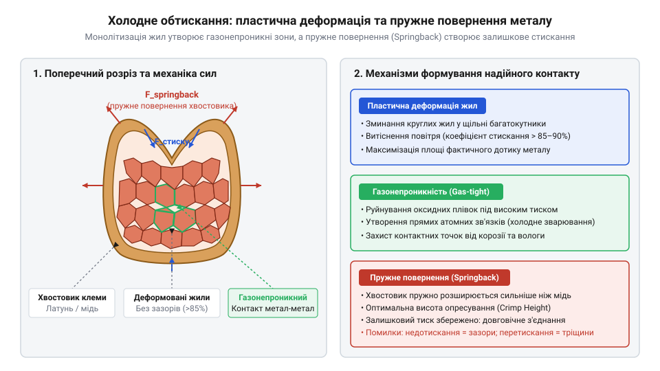
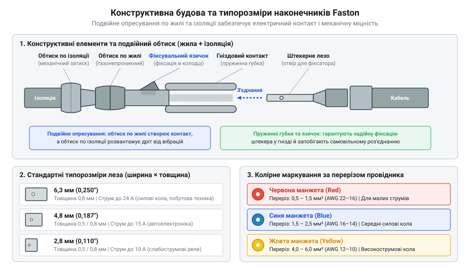

# Ізольовані наконечники Faston та технологія обтискання

<preknowlist>
- [Монтажний провід 18 і 20 AWG](root:cat-hw-parts/hookup-wire) — Розуміння будови багатожильного провідника, калібрів AWG та еластичності мідних жил під час опресування.
- [Родина силових роз'ємів XT (AMASS: XT30/60/90/120)](root:cat-hw-parts/xt-connectors) — Розуміння вимог до надійності силового контакту та мінімізації перехідного опору при високих струмах.
</preknowlist>

## Деградація контакту та холодне опресування

Під дією вібрацій і температурних коливань електричні з'єднання дегрудують. Паяння багатожильних проводів спричиняє втомний злам: олово затікає під ізоляцію, утворюючи жорстку межу з концентрованими напруженнями. У гвинтових клемниках через плинність металу й релаксацію напружень гвинт послаблюється, збільшуючи опір та іскріння. У силових лініях із [силові роз'єми XT](root:cat-hw-parts/xt-connectors) це загрожує перегрівом.

*Схема сумісної деформації провідника та обтискної гільзи з утворенням суцільного металевого блоку.*

Холодне опресування (англ. @@en|cold crimping@@, від *crimp* — зминати) усуває деградацію пластичною деформацією. Тиск інструмента стискає хвостовик і жили до зникнення зазорів. Руйнування оксидних плівок забезпечує холодне зварювання (англ. @@en|cold welding@@) на атомарному рівні. Контакт стає газонепроникним, що унеможливлює потрапляння кисню чи вологи й зупиняє корозію.

Стабільність контакту зберігає пружне повернення (англ. @@en|springback@@, від *spring* — пружина, *back* — назад) металу хвостовика. Після опресування хвостовик намагається відновити форму, але його пружне розширення менше за деформацію жил. Хвостовик залишається під натягом і діє як пружина, яка постійно стискає жили й компенсує вібраційні мікрозсуви та теплове розширення.

## Геометрія, типорозміри та матеріали клем

Ножеве клемне з'єднання @@en|Faston@@ складається з плоского ножа (штекер, англ. @@en|male tab@@) та пружинної розетки (гніздо, англ. @@en|female receptacle@@). Захист від самовільного роз'єднання під дією вібрацій забезпечує фіксувальна пукля (англ. @@en|detent dimple@@, від лат. *detentio* — утримання): під час з'єднання вона заходить в отвір ножа, утворюючи механічний замок.

*Конструктивні елементи штекера і гнізда Faston з позначенням пояса розвантаження натягу та трьох основних ширини ножа.*

Ширину ножа обирають за струмовим навантаженням:
- **6,3 мм** (0,250 дюйма) — силовий стандарт до 20 А (реле, блоки живлення);
- **4,8 мм** (0,187 дюйма) — проміжний розмір до 12 А (перемикачі);
- **2,8 мм** (0,110 дюйма) — сигнальний контакт до 6 А.

Опресовувальний хвостовик має дві секції: хвостовик жили створює електричний контакт, а пояс розвантаження натягу (англ. @@en|strain relief@@, від *strain* — натяг, *relief* — розвантаження) обтискає ізоляцію, захищаючи жилу від вигинання, коли опресовано [монтажний провід](root:cat-hw-parts/hookup-wire).

Клеми виготовляють із пружної латуні (окиснюється у волозі) або луджених мідних сплавів (стійкі до корозії, з низьким перехідним опором). Для ізоляції застосовують манжети:
- **Вінілові (@@en|PVC@@)** — бюджетні, обтискаються за один крок, але тріскаються на холоді (до +75 °C). - **Нейлонові (@@en|Polyamide@@)** — міцні, стійкі до мастил і нагріву (до +105 °C).

## Колірне маркування, обтискання та контроль

Колірне маркування манжети клеми @@en|Faston@@ відповідає перерізу провідника та калібру @@en|AWG@@ (англ., скор. від *American Wire Gauge*):
- **Червоний** — 0,5–1,5 мм² (22–16 @@en|AWG@@). - **Синій** — 1,5–2,5 мм² (16–14 @@en|AWG@@). - **Жовтий** — 4,0–6,0 мм² (12–10 @@en|AWG@@).

*Відповідність кольорів перерізу, довжина зачищення та ознаки якісного обтискання.*

Довжина зачищення жили дорівнює довжині хвостовика плюс 0,5–1,0 мм на передній вихід. Закоротке зачищення зменшує площу контакту, а задовге загрожує коротким замиканням при стягуванні джгута [пластиковими хомутами](root:cat-hw-parts/cable-ties).

Опресування виконують храповим кримпером (англ. @@en|ratchet crimper@@, від *ratchet* — зубчастий зупинник). Його механізм розблоковується лише після стискання клеми на повну глибину, що забезпечує однакову якість і газонепроникність контакту.

Якість крімпу перевіряють за трьома критеріями:
1. **Візуальний огляд**: манжета ціла, жили виступають спереду на 0,5–1,0 мм, пояс охоплює ізоляцію. 2. **Висота крімпу**: мікрометром вимірюють висоту стиснутого хвостовика на відповідність допуску. 3. **Тест на виривання** (англ. @@en|pull test@@, від *pull* — тягнути): перевіряють міцність з'єднання статичним зусиллям.