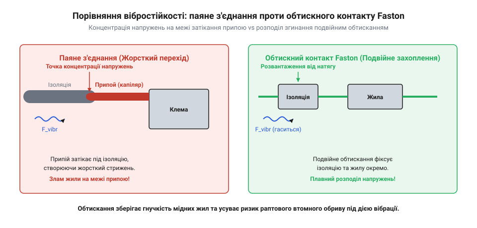
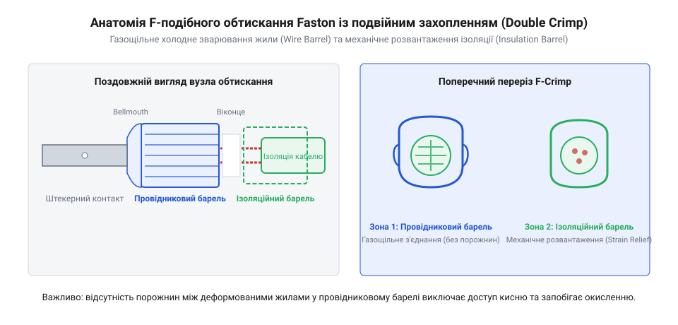

# Історія винайдення роз'ємів Faston та еволюція безпайкового з'єднання

<preknowlist>
- [Монтажний провід 18 і 20 AWG](root:cat-hw-parts/hookup-wire) — конструктивні особливості гнучких багатожильних провідників та значення калібрів AWG для підбору контакту
</preknowlist>

## Криза паяння та гвинтових клемників

У 1930–1940-х роках авіаційна та автомобільна промисловість зіштовхнулися з гострою технологічною кризою електричних з'єднань. Стрімкий розвиток бортової радіоелектроніки, систем запалювання та вимірювальних приладів вимагав прокладання сотень метрів кабельних трас усередині літаків і автомобілів. Проте тогочасна електротехніка спиралася лише на два основних методи з'єднання провідників: ручне паяння — @@en|soldered joint@@ (від англ. *solder* — паяти) та гвинтові клемники — @@en|screw terminal@@ (від англ. *screw* — гвинт). Обидва рішення виявилися непридатними для експлуатації в умовах динамічних механічних навантажень.

Основна проблема ручного паяння полягала в фізичній природі паяного шва. Коли рідкий припой затікає під джгут гнучкого багатожильного провідника, виникає так зване капілярне всмоктування. Після остигання розплаву межа між жорстким просоченим ділянкою та гнучкою голою жилою стає точкою екстремальної концентрації механічних напружень. Під час роботи авіаційного двигуна або руху автомобіля проводка зазнає постійної вібрації. У результаті на жорсткому краї @@en|soldered joint@@ виникає циклічний вигин, що швидко призводить до втомного мікротріщиноутворення та повного перелому мідних жилок.

Додатковим деструктивним чинником паяння була хімічна корозія та людський фактор. Ручне паяння вимагало застосування флюсів для видалення оксидних плівок. Залишки активних кислотних чи каніфольних флюсів з часом провокували міжкристалічну корозію міді, особливо у вологому морському чи високогірному середовищі. Крім того, якість з'єднання повністю залежала від майстерності монтажника, а сам процес вимагав використання відкритого вогню або розпечених паяльників, що створювало високу пожежну небезпеку під час збирання літаків поблизу паливних баків.

Гвинтові затискачі @@en|screw terminal@@ також не розв'язували проблему. Під дією постійної вібрації різьбові пари самочинно розкручувалися через релаксацію напружень у металі та циклічні температурні розширення. Багатожильний провід під плоским головкою гвинта з часом сплющувався та розходився в боки, що зменшувало силу притиску. Зменшення контакту викликало зростання електричного опору, локальний перегрів, окиснення та іскріння. Для захисту від розкручування інженери підбирали спеціальні [матеріали та класи міцності](root:cat-hw-parts/fastener-strength-classes-and-materials) кріплень та контргайки, однак це суттєво збільшувало вагу та трудомісткість монтажу.

Навіть якщо для ізоляції окремих блоків використовували [тросові та еластомірні віброізолятори](root:cat-hw-parts/wire-rope-isolators), сама кабельна проводка залишалася незахищеною перед втомними руйнуваннями. Промисловість опинилася перед неминучою потребою у принципово новому контакті, який поєднував би високу вібростійкість, відсутність нагріву при монтажі та можливість швидкого роз'єднання.

*Розподіл напружень демонструє, що в паяному з'єднанні максимум вигину припадає на жорстку межу затікання припою, тоді як обтискний контакт плавно розподіляє механічне навантаження.*

## Заснування AMP та концепція безпайкового обтискання

Відповіддю на кризу проводки в авіації стало винайдення технології холодної пластичної деформації. У 1941 році американський інженер Ункас А. Вітакер (Uncas A. Whitaker) заснував компанію @@en|AMP (Aircraft Marine Products)@@ (від англ. *aircraft* — літальний апарат та *marine* — морський). Вітакер запропонував повністю відмовитися від рідкого припою та затискних гвинтів на користь механічного опресування металевої гільзи навколо провідника — @@en|solderless connection@@ (від англ. *solderless* — без припою) або @@en|cold crimping@@ (від англ. *crimp* — обтискати, обтискання).

В основу концепції @@en|cold crimping@@ було покладено фізичний принцип незворотної пластичної деформації міді та латуні під дією високого тиску. Під час стискання обтискною матрицею тонкостінна металева гільза контакту зминається навколо багатожильного провідника. Коли прикладене зусилля перевищує межу плинності матеріалу, стінки гільзи та окремі мідні жилки починають пластично деформуватися, заповнюючи всі внутрішні порожнини. Внаслідок сильного зсувного тертя оксидні плівки на поверхні мідних жилок руйнуються, оголюючи чистий метал.

Під дією тиску чисті поверхні мідних жилок зближуються на міжатомні відстані, утворюючи так звані холодні зварні містки. У результаті формується монолітне @@en|gas-tight joint@@ (від англ. *gas-tight* — газощільний, непроникний для газів). Газощільність є критичною властивістю обтискного контакту: оскільки кисень, волога та агресивні хімічні пари з навколишнього середовища не можуть проникнути всередину опресованої зони, поверхневе окиснення міді повністю блокується. Це забезпечує стабільно низький електричний опір протягом десятиліть експлуатації без необхідності обслуговування.

Технологія @@en|solderless connection@@ ідеально підходила для гнучких [монтажних проводів різних калібрів](root:cat-hw-parts/hookup-wire). На відміну від паяння, обтискання не створює термічного навантаження на ізоляцію та не змінює кристалічну структуру міді поблизу контакту. Процес обтискання займає частки секунди і не вимагає високої кваліфікації робітника, оскільки якість з'єднання визначається геометрією обтискного інструменту.

Головним досягненням компанії @@en|AMP (Aircraft Marine Products)@@ стала стандартизація матриць та опресувальних кліщів. Інженерний розрахунок профілю матриці гарантував точний ступінь ущільнення жил: недостатнє стискання призводило б до збереження повітряних зазорів, а надмірне — до перетончення та механічного послаблення жили. Впровадження точних інструментів створило основу для масового конвеєрного виробництва кабельних джгутів у світовій індустрії.

## Поява Faston та анатомія F-подібного обтискання

Попри успіх перших кільцевих та вилкових обтискних клем, автопром та виробники побутової техніки потребували рознімального контакту, який дозволяв би миттєво підключати та від'єднувати вузли на складальному конвеєрі. У відповідь на цю потребу компанія @@en|AMP (Aircraft Marine Products)@@ розробила лінійку швидкорознімних клем @@en|Faston@@ (від англ. *fasten on* — швидко закріплювати). Конструкція @@en|Faston@@ складалася з плоского ножового штекера (штекерний контакт) та охоплювального плоского гнізда (гніздовий контакт) із фіксувальними лунками або язичками для надійного фіксування.

Ключовим інженерним проривом у клемах @@en|Faston@@ стало створення технології @@en|F-crimp@@ (від характерної форми обтискних вушок, що нагадують літеру F) та профілю подвійного захоплення — @@en|double crimp@@ (від англ. *double* — подвійний та *crimp* — обтиск). У такій клемі обтискна зона розділена на дві послідовні гільзи, кожна з яких виконує чітко розмежовану функцію.

Перша гільза — обтискна гільза жили — має два металевих вушка, які під дією матриці згинаються всередину, утворюючи відкриту F-подібну або B-подібну форму. Вушка глибоко врізаються у пучок мідних жилок, стискаючи їх у щільний газощільний блок та забезпечуючи високу електричну провідність. Друга гільза — обтискна гільза ізоляції — розташована позаду. Вона обтискає зовнішню пластикову оболонку провідника без її прорізання, створюючи механічне розвантаження від натягу — @@en|strain relief@@ (від англ. *strain* — деформація, натяг та *relief* — полегшення, розвантаження).

Завдяки @@en|strain relief@@ будь-які механічні зусилля, вібраційні коливання або вигини кабелю сприймаються зовнішньою ізоляційною оболонкою та другою гільзою. Внутрішній електричний контакт у першій гільзі залишається повністю розвантаженим від механічних напружень. Це остаточно усунуло проблему втомного ламання жил на межі контакту, яка роками руйнувала паяні шви.

*Двохзонна структура F-подібного обтискання розділяє функції: перша гільза створює газощільний електричний контакт із жилою, а друга фіксує ізоляцію для розвантаження від механічних натягів.*

Клеми @@en|Faston@@ швидко отримали стандартизовані розміри ширини ножового контакту, які стали загальносвітовим стандартом:
- 0.250" (6.35 мм) — основний типорозмір для силових кіл струмом до 20–25 А у побутовій техніці, автомобільній проводці та промисловому обладнанні. - 0.187" (4.75 мм) — середній типорозмір для кіл керування, реле та перемикачів. - 0.110" (2.8 мм) — малогабаритний типорозмір для слабострумних сигнальних кіл, мікроперемикачів та динаміків.

Стандартизація клем @@en|Faston@@ була зафіксована у міжнародних нормах, таких як @@en|UL 310@@ (стандарт Лабораторії з техніки безпеки США @@en|Underwriters Laboratories@@ для швидкорознімних клем) та @@en|DIN 46247@@ (німецький промисловий стандарт плоских ножових контактів). Завдяки цьому клеми @@en|Faston@@ почали повсюдно застосовувати, збираючи з них складні [кабельні шлейфи та заземлення](root:cat-hw-parts/industrial-pendant-cable-harnessing-and-shielding) у транспорті та промисловості.

З поширенням клем @@en|Faston@@ виникли міфи, які науково спростовуються інженерною практикою. По-перше, винайдення ножових клем часто помилково приписують автомобільним концернам Ford або General Motors, проте історично патенти належать компанії @@en|AMP (Aircraft Marine Products)@@, яка постачала ножові контакти автовиробникам як сторонній розробник. По-друге, серед деяких майстрів існує помилкова думка, що опресовану клему @@en|Faston@@ варто додатково пропаяти для "кращої надійності". Насправді додаткове паяння опресованої клеми повністю руйнує дію @@en|strain relief@@: припой під дією капілярного ефекту затікає під гільзу ізоляції, створюючи жорстку межу вигину прямо за обтиском. Під дією вібрації такий "покращений" контакт ламається набагато швидше, ніж якісно виконане опресування @@en|F-crimp@@.

## Галузева стандартизація UL 310 та DIN 46247

Швидке поширення клем @@en|Faston@@ у 1950-х роках виявило проблему сумісності між виробами різних виробників. Компанія @@en|AMP@@ (@@en|Aircraft Marine Products@@) створила вдалу конструкцію, але масове виробництво побутової техніки, автомобілів та промислового обладнання вимагало взаємозамінності контактних пар. Ножовий контакт одного постачальника міг мати незначне відхилення за товщиною або шириною, через що гніздо іншого виробника створювало або надто слабкий притиск, або вимагало надмірних зусиль під час монтажу. Занадто слабкий контакт спричиняв локальне зростання перехідного опору, нагрівання й окислення поверхонь, а надмірне зусилля призводило до деформації пружинних пелюсток гнізда або пошкодження корпусу роз'єму на складальному конвеєрі. Для усунення цих ризиків виникла потреба в єдиних галузевих стандартах, які б закріпили геометрію контакту, механічні зусилля та електричні характеристики.

Першим ключовим документом для північноамериканського ринку став стандарт @@en|UL 310@@, розроблений організацією @@en|Underwriters Laboratories@@. Стандарт жорстко уніфікував розміри ножових штирів і відповідних гнізд, розділивши їх на три основні серії за шириною ножа: 0.250 дюйма (6.35 мм), 0.187 дюйма (4.75 мм) та 0.110 дюйма (2.8 мм). Також було зафіксовано стандартні товщини ножа — 0.032 дюйма (0.81 мм) для силових кіл та 0.020 дюйма (0.51 мм) для малопотужних сигнальних ліній. Окрім геометричних розмірів, @@en|UL 310@@ увів нормативні критерії механічного сочленення: зусилля першого вставляння (@@en|insertion force@@) має бути помірним для зручності ручного збирання, а зусилля першого та шостого витягування (@@en|withdrawal force@@) не повинно падати нижче критичного порогу. Це гарантувало, що після кількох циклів обслуговування роз'єм зберігатиме належну пружність пелюсток і не роз'єднається від випадкового натягу проводу.

Європейський інженерний простір уніфікував ножові з'єднання через стандарт @@en|DIN 46247@@, розроблений Німецьким інститутом із стандартизації (@@de|Deutsches Institut für Normung@@). Німецький стандарт перевів дюймові розміри в метричну систему (6.3 мм, 4.8 мм та 2.8 мм) і встановив суворі допуски на виготовлення латунних і бронзових сплавів, товщину захисного лудження або нікелювання, а також розташування фіксувального отвору чи виступу. Вимоги стандартів дозволили інженерам точно розраховувати контактні групи під робочий струм: серія 6.3 мм витримує тривалу передачу струмів до 24 А, серія 4.8 мм розрахована на 10–15 А, а серія 2.8 мм застосовується в слабострумових колах керування до 7 А. Під час практичної розробки пристроїв та при [підборі монтажного проводу](root:cat-hw-parts/hookup-wire) відповідного калібру стандартизація дає змогу заздалегідь підбирати типорозмір клеми під механічні й електричні умови експлуатації.

## Спірна атрибуція та розвінчання історичних міфів

Широке впровадження ножових клем у масове виробництво породжує чимало історичних і технічних міфів. Найпоширеніша помилка стосується авторства винаходу: нерідко створення клем @@en|Faston@@ помилково приписують великим автомобільним концернам, таким як General Motors або Ford. Витоки цього міфу полягають у тому, що саме автомобільна промисловість 1950-х років стала найбільшим споживачем швидких з'єднань. Проте ранній автопром використовував нестандартні гвинтові затискачі або саморобні розрізні пружинні трубки, які часто розхитувалися від вібрації двигуна. Конструкцію стандартизованого ножового контакта з пружинним гніздом, фіксувальним пукльовуванням та холодним F-обтисканням розробила та запатентувала компанія @@en|AMP@@. Автомобільні гіганти лише ліцензували й масово впровадили готову технологію, через що у суспільній свідомості назва споживача затьмарила першоджерело.

Інший тривалий міф стверджує, ніби паяне з'єднання (@@en|soldered joint@@) є надійнішим за обтискний контакт у мобільних і вібронавантажених системах. На перший погляд злиття металів у паяному шві здається міцнішим за механічний обтиск. Проте фізика втоми металу демонструє зворотний ефект. Під час паяння рідкий припій за рахунок капілярного ефекту (@@en|solder wicking@@) піднімається вгору між жилами гнучкого проводу під ізоляцією. На межі, де просочена твердим припоєм жила переходить у гнучкий багатожильний провідник, виникає різка зміна жорсткості. У разі виникнення циклічних вібрацій уся механічна напруга концентрується саме в цій точці зламу. Припій має низьку втомну міцність, тому під дією змінних згинальних навантажень у ньому швидко утворюються мікротріщини, що призводить до відламування мідних жилок біля краю паяного шва.

Натомість правильне обтискання профілем @@en|F-crimp@@ позбавлене цього недоліку завдяки зоні розвантаження від натягу (@@en|strain relief@@). Окремий хвостовик клеми обтискає зовнішню ізоляцію проводу, сприймаючи на себе всі згинальні й вібраційні коливання та не допускаючи їх до місця електричного контакту. Сам провідник у зоні обтискання зазнає холодної пластичної деформації без термічного відпалу, зберігаючи деформаційне зміцнення (@@en|work hardening@@). Це запобігає релаксації напружень (@@en|stress relaxation@@) і фретинг-корозії (@@en|fretting corrosion@@) під дією мікрозміщень. Завдяки цьому в обладнанні, що працює в умовах постійної вібрації або змонтоване на блоках із [тросовими віброізоляторами](root:cat-hw-parts/wire-rope-isolators), стандартизований обтискний контакт @@en|Faston@@ виявляє значно вищу довговічність і механічну надійність, ніж паяне з'єднання.