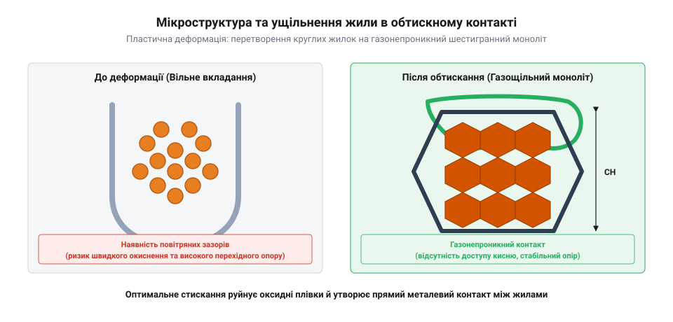
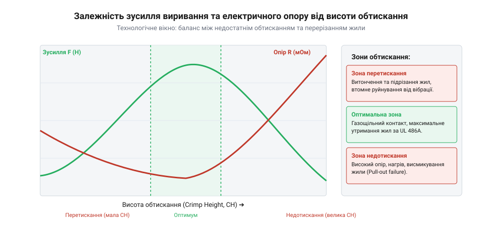

# Розрахунок ступеня деформації, механічної міцності та електричного опору обтисненого контакту

<preknowlist>
- [Монтажний провід 18 і 20 AWG](root:cat-hw-parts/hookup-wire) — геометрію багатожильних мідних провідників AWG та структуру окремих дротів у жилі
</preknowlist>

## Причини відмов неякісно опресованих контактів

Нерідко опресування провідника (від англ. @@en|crimp@@ — обтискання) сприймають як простий механічний затиск: металеву хвостову частину клемної гільзи зминають довкола жилок звичайними кліщами чи недорогим пресом. На перший погляд таке з'єднання здається цілком надійним, але у реальній експлуатації неякісно обтиснений контакт стає джерелом прихованих аварійних відмов. Якщо гільза лише стискає жилки без необхідної пластичної деформації, всередині з'єднання залишається безліч мікроскопічних порожнин між окремими дротами.

Навіть у сухому повітрі мідь миттєво покривається тонкою плівкою оксиду міді. Коли в нещільно обтиснену кримп-зону крізь мікрозазори проникають волога, кисень та агресивні гази, поверхнева оксидна плівка невпинно товщає. На відміну від чистої міді, оксид є діелектриком із високим питомим опором. Як наслідок, електричний перехідний опір (від англ. @@en|contact resistance@@) у місці контакту починає безперервно зростати.

За законом Джоуля-Ленца струм, що протікає крізь збільшений опір, виділяє теплову потужність `P = I² × R`. У силовому обладнанні на кшталт [роз'ємів серії XT](root:cat-hw-parts/xt-connectors) це спричиняє локальне перегрівання контакту. Циклічне нагрівання та охолодження призводить до термічного розширення матеріалів та прискореної релаксації напружень (від англ. @@en|stress relaxation@@). Метал гільзи з часом поступово розслабляється, притискне зусилля зменшується, опір зростає ще сильніше, що зрештою призводить до відплавлення ізоляції, виникнення електричної дуги чи повної пожежі.

Другий крайній випадок — механічне виривання провідника. Якщо пластична деформація жили була недостатньою, окремі жилки легко проковзують одна відносно одної та відносно внутрішньої стінки гільзи. В умовах вібрації, де допомагають [еластомірні віброізолятори](root:cat-hw-parts/wire-rope-isolators), або при випадкових механічних ривках кабелю провідник виривається з клеми під зусиллям, значно меншим за нормативні вимоги.

Щоб запобігти окисненню й вириванню, опресування має створити газонепроникний контакт (від англ. @@en|gas-tight joint@@). Під дією високого тиску опресувальних матриць круглі мідні жилки пластично деформуються, змінюючи свою форму й повністю видавлюючи повітря з міжжилкового простору. Висока питома сила деформації руйнує крихку оксидну плівку на поверхні міді, оголюючи чисті атоми металу. Відбувається їхній прямий молекулярний контакт — холодне зварювання (від англ. @@en|cold weld@@). На зрізі правильно опресованого контакту більше немає окремих круглих дротів: вони перетворюються на суцільний металевий моноліт без повітряних зазорів.

Випадковий вибір сил або геометричних розмірів інструмента не гарантує утворення такого моноліту. Занадто слабкий притиск залишає внутрішні зазори, а надмірний — перетискає жилки, тоншає стінку гільзи й провокує появу тріщин. Для досягнення стабільної якості потрібен точний математичний розрахунок параметрів деформації, коефіцієнта ущільнення та технологічних допусків.

## Геометрія деформації та коефіцієнт ущільнення

Перехід від набору окремих круглих дротів до суцільного газонепроникного моноліту підпорядковується законам пластичної деформації металів. До початку обтискання усередині гільзи знаходиться [багатожильний монтажний провід](root:cat-hw-parts/hookup-wire), жилки якого мають круглий поперечний переріз. Якщо розглядати ідеальне пакування кіл одинакового діаметра `d` на площині, гранична щільність пакування становить:

```
K_ideal = π / (2 × √3)
        ≈ 0.9069                [теоретична межа щільності пакування кіл, 90.69%]
```

Проте в реальному незтиснутому провідникові через нерегулярний уклад і кручення дротів площа міді займає лише 70–75% внутрішнього об'єму гільзи. Решта 25–30% припадає на порожнечі, заповнені повітрям.

Під час стискання опресувальною матрицею зовнішня металева гільза охоплює пучок жилок і зменшує свій внутрішній об'єм. На першій стадії жилки просто зсуваються й щільніше притискаються одна до одної. Коли внутрішній вільний об'єм вичерпується, напруження в міді перевищує межу плинності. Починається друга стадія — пластичне течіння металу. Круглі перерізи жилок деформуються, прибираючи повітряні зазори й перетворюючись на багатокутники (переважно шестикутники та п'ятикутники).

Для кількісної оцінки ступеня пластичної деформації використовують коефіцієнт ущільнення (від лат. @@en|compaction ratio@@), який позначають як `C_k`. Він визначається як відношення сумарної площі поперечного перерізу всіх мідних жилок до внутрішньої площі обтисненої гільзи в зоні деформації:

```
C_k = A_Cu / A_int
```

де `A_Cu` — сумарна геометрична площа перерізу мідних жилок до деформації (мм²), а `A_int` — площа внутрішнього контуру обтисненої гільзи (мм²).


*Поперечний переріз обтисненої зони: перехід від круглого перерізу дротів із зазорами до щільного полігонального моноліту з розміченими геометричними параметрами.*

Зміна значення `C_k` безпосередньо визначає якість та надійність електричного контакту:
- `C_k < 0.80` (недостатнє обтискання): у структурі залишаються повітряні канали. Оксидні плівки на міді не руйнуються, газонепроникність відсутня. Такий контакт має підвищений опір та низьку механічну міцність. - `C_k = 0.85 ... 0.90` (оптимальна зона): усі повітряні зазори повністю усунені. Жилки набули полігональної форми, досягнуто газонепроникності й холодного зварювання контактних поверхонь без перетоншення жилок чи стінок гільзи. - `C_k > 0.92` (надмірне обтискання): виникає надлишкова деформація. Відбувається інтенсивне наклепування (від англ. @@en|work hardening@@) міді, що робить її крихкою. Площа перерізу жилок критично зменшується, а метал гільзи видавлюється в зазори матриці з утворенням гострого облою або тріщин.

Розрахуємо необхідну внутрішню площу гільзи для забезпечення оптимального коефіцієнта ущільнення.

**Умова**: Провідник 18 AWG має 19 жилок діаметром `d = 0.235 мм` кожна. Необхідно забезпечити цільовий коефіцієнт ущільнення `C_k = 0.88`.

```
A_strand = π × d² / 4
         = 3.14159 × (0.235)² / 4       [площа одного дроту, мм²]
         = 0.04337                       [площа одного дроту, мм²]

A_Cu = n × A_strand
     = 19 × 0.04337                     [сумарна площа 19 жилок]
     = 0.824                             [загальна площа міді, мм²]

A_int = A_Cu / C_k
      = 0.824 / 0.88                    [визначення необхідної внутрішньої площі]
      = 0.936                            [цільова внутрішня площа гільзи, мм²]
```

Таким чином, для 18 AWG провідника внутрішня площа обтисненої гільзи має становити `0.936 мм²`.

## Розрахунок висоти обтискання та допусків

Оскільки прямо виміряти внутрішню площу `A_int` у виробничих умовах без руйнівного металографічного розрізу неможливо, її контролюють через зовнішній геометричний параметр — висоту обтискання (від англ. @@en|crimp height@@), позначувану як `h_c`. Висота обтискання вимірюється спеціальним мікрометром із точковим анівілем у найнижчій точці обтисненої зони.

Більшість силових та сигнальних клем (зокрема для [сигнальних роз'ємів JST](root:cat-hw-parts/jst-sm-connectors)) використовують двогорбу геометрію обтискання (B-crimp). Загальна площа зовнішнього профілю обтисненого контакту `A_total` складається з внутрішньої площі `A_int` та площі поперечного перерізу металевої стінки гільзи `A_wall`:

```
A_total = A_int + A_wall
```

Площа стінки гільзи визначається товщиною вихідного листа металу `t_m` та периметром розгортки гільзи `L_sleeve`: `A_wall ≈ t_m × L_sleeve`. Для стандартного профілю B-crimp геометрію зовнішнього перерізу зв'язують із шириною обтискання `w_c` (яка визначається шириною матриці інструмента) та висотою `h_c` через формовий коефіцієнт геометрії `k_g`:

```
A_total = k_g × w_c × h_c
```

Підставляючи вираз для `A_total`, отримуємо формулу розрахунку номінальної висоти обтискання `h_c`:

```
h_c = (A_Cu / C_k + A_wall) / (k_g × w_c)
```

На практиці кожна величина у формулі розрахунку має технологічне відхилення. Сукупність цих відхилень утворює накопичення допусків (від англ. @@en|tolerance stack-up@@):
- **Допуск перерізу провідника (`ΔA_Cu`)**: діаметр дротів згідно зі стандартом AWG має допуск ±3–5%. - **Допуск товщини стінки гільзи (`Δt_m`)**: штампування клем з листової латуні чи бронзи має відхилення товщини в межах ±0.02 мм. - **Знос та налаштування інструмента (`Δh_press`)**: зношування матриці та люфти механізму преса додають відхилення ±0.015 мм.


*Залежність механічної міцності та перехідного опору від висоти обтискання: вихід за межі технологічного вікна призводить або до виривання жилок, або до їхнього перетискання.*

Для забезпечення стабільної якості на конвеєрі визначають допустиме технологічне вікно висоти обтискання `[h_c,min; h_c,max]`. Верхня межа `h_c,max` обмежується мінімально припустимим коефіцієнтом ущільнення `C_k,min = 0.85` (щоб уникнути недотискання й зростання опору). Нижня межа `h_c,min` обмежується максимально припустимим коефіцієнтом `C_k,max = 0.90` (щоб не допустити надмірного наклепування й втрати міцності).

**Умова**: Для провідника 18 AWG (`A_Cu = 0.824 мм²`) використовується клема з товщиною стінки `t_m = 0.30 мм` та периметром гільзи `L_sleeve = 3.80 мм`. Ширина матриці обтискання `w_c = 1.45 мм`, формовий коефіцієнт `k_g = 0.84`. Розрахувати номінальну висоту `h_c` для `C_k = 0.88` та межі допуску для `C_k` від `0.85` до `0.90`.

```
A_wall = t_m × L_sleeve
       = 0.30 × 3.80                    [площа перерізу металу гільзи, мм²]
       = 1.140                          [площа стінки гільзи, мм²]

h_c,nom = (0.824 / 0.88 + 1.140) / (0.84 × 1.45)
        = (0.936 + 1.140) / 1.218        [підстановка параметрів для C_k = 0.88]
        = 2.076 / 1.218                 [ділення сумарної площі на ефективну ширину]
        = 1.704                          [номінальна висота обтискання, мм]

h_c,max = (0.824 / 0.85 + 1.140) / (0.84 × 1.45)
        = (0.969 + 1.140) / 1.218        [верхня межа висоти для C_k = 0.85]
        = 2.109 / 1.218
        = 1.732                          [максимальна припустима висота, мм]

h_c,min = (0.824 / 0.90 + 1.140) / (0.84 × 1.45)
        = (0.916 + 1.140) / 1.218        [нижня межа висоти для C_k = 0.90]
        = 2.056 / 1.218
        = 1.688                          [мінімальна припустима висота, мм]
```

Допустимий діапазон висоти обтискання становить `1.704 ± 0.020 мм` (від `1.688 мм` до `1.732 мм`). Дотримання цього вузького інтервалу гарантує одночасно низький електричний опір та високу механічну міцність контакту.

## Оцінка механічної міцності на виривання

Після визначення геометричного коефіцієнта ущільнення та висоти обтискання необхідно оцінити механічну надійність отриманого з'єднання. Ключовим показником механічної міцності є зусилля виривання (від англ. @@en|pull-out force@@ — зусилля виривання), яке визначає максимальне осьове розтягувальне навантаження, що його здатна витримати опресована клема до моменту висмикування або розриву провідника. У мобільній робототехніці, авіації та [кабельних шлейфах пультів](root:cat-hw-parts/industrial-pendant-cable-harnessing-and-shielding) оператора на з'єднання діють постійні вібрації та випадкові механічні ривки, що вимагає точного математичного розрахунку граничного утримання жили.

Утримувальне зусилля всередині обтисненої гільзи створюється поєднанням двох фізичних механізмів:
1. **Сила тертя та зачеплення (від англ. @@en|friction force@@)**: залишкове пружне напруження стиснутої стінки гільзи створює нормальний радіальний тиск `σ_n` на зовнішній шар мідних дротів. Опір ковзанню жили під дією поздовжньої сили визначається як `F_fric = μ × σ_n × A_surf`, де `μ` — коефіцієнт тертя між міддю та матеріалом гільзи, а `A_surf` — площа контакту. 2. **Гранична міцність на розрив (від англ. @@en|tensile strength@@)**: під дією прикладеного зусилля у мідних жилках виникає поздовжнє розтягувальне напруження, а на границі виходу жили з гільзи — зсувне напруження (від англ. @@en|shear stress@@).

Залежність зусилля виривання від ступеня деформації має чітко виражений нелінійний характер з вираженим максимумом. За недостатнього обтискання (`C_k < 0.85`) нормальний тиск `σ_n` замалий, а міжжилкове тертя недостатнє. Руйнування відбувається шляхом проковзування та висмикування дротів із гільзи при відносно малих навантаженнях.

У зоні оптимального опресування (`C_k = 0.85 ... 0.90`) сила фрикційного зачеплення та мікрозварені контактні плями холодного зварювання перевищують власну міцність міді. Руйнування з'єднання відбувається шляхом чистого розриву мідних жилок біля краю гільзи. На відміну від деталей зрізу чи різьбових з'єднань, де міцність оцінюють за класифікацією [матеріалів кріплення](root:cat-hw-parts/fastener-strength-classes-and-materials), міцність опресованого провідника обмежується перерізом чистої міді.

При надмірному перетисканні (`C_k > 0.92`) площа поперечного перерізу жилок критично зменшується через витончення дротів у місці обтискання, а сама мідь зазнає інтенсивного наклепування та стає крихкою. Як наслідок, механічна міцність стрімко падає, і провідник відривається під дією значно меншого зусилля.

Стандарти IEC 60352-2 та UL 486A/B регламентують мінімальне припустиме зусилля виривання `F_min` залежно від перерізу провідника `A_Cu`. У стандарті IEC 60352-2 емпірична залежність мінімальної нормованої міцності для багатожильних мідних провідників описується статевим співвідношенням:

```
F_min = k_s × (A_Cu)^0.75
```

де `k_s` — нормативний коефіцієнт міцності (`k_s ≈ 100 Н/мм⁰·⁷⁵`), а `A_Cu` — сумарна площа перерізу мідної жили (мм²).

Проведемо розрахунок теоретичної міцності жили та нормативного зусилля виривання.

**Умова**: Багатожильний провідник калібру 18 AWG має площу перерізу `A_Cu = 0.824 мм²`. Гранична міцність мідного дроту на розрив становить `σ_b = 240 Н/мм²`. Обчислити теоретичне зусилля розриву жили `F_break` та нормативне мінімальне зусилля виривання `F_min` згідно з IEC 60352-2.

```
F_break = σ_b × A_Cu
        = 240 × 0.824                   [граничне зусилля розриву мідної жили, Н]
        = 197.76                        [теоретична міцність суцільного провідника, Н]

F_min = k_s × (A_Cu)^0.75
      = 100 × (0.824)^0.75              [підстановка перерізу в формулу IEC 60352-2]
      = 100 × 0.8653                    [обчислення степеня перерізу]
      = 86.53                           [мінімально припустиме зусилля виривання, Н]
```

Таким чином, для 18 AWG нормативне мінімальне зусилля виривання становить `86.5 Н` (що відповідає близько 89 Н або 20 lbf за UL 486A/B). За якісного опресування в оптимальному вікні `C_k` реальне зусилля досягає 150–180 Н, забезпечуючи двократний запас міцності.

## Моделювання електричного опору та напруги

Після забезпечення механічної міцності контакту необхідно розрахувати його електричні характеристики. Головним критерієм якості є повний перехідний опір (від англ. @@en|contact resistance@@) опресованої зони `R_crimp`.

Повний електричний опір опресованого з'єднання складається з трьох послідовних компонентів:

```
R_crimp = R_bulk + R_constriction + R_film
```

Кожна складова має виражену фізичну природу:
1. **Об'ємний опір (від англ. @@en|bulk resistance@@)** `R_bulk`: опір суцільного металу мідної жили та металевої стінки гільзи на довжині обтискання `L_crimp`. Визначається за класичним законом Ома: `R_bulk = ρ_Cu × L_crimp / A_Cu + R_sleeve`. 2. **Опір стягування (від англ. @@en|constriction resistance@@)** `R_constriction`: виникає через те, що електричний струм не протікає крізь усю геометричну площу стикання, а стягується до дискретних точок мікроконтактів (асперитетів) і ділянок холодного зварювання. За теорією контакту Холма опір стягування обчислюється як:

```
R_constriction = (ρ_Cu + ρ_sleeve) / (4 × a_eff)
```

де `ρ_Cu` та `ρ_sleeve` — питомі опори міді та гільзи (Ом·мм²/м), а `a_eff` — ефективний радіус сумарної плями металевого контакту (мм). На відміну від [пружинних контактів Pogo Pins](root:cat-hw-parts/pogo-pins), де опір стягування обмежується точковим зусиллям пружини, при пластичній деформації жилок сотні мікроточок зливаються, забезпечуючи великий ефективний радіус `a_eff`. 3. **Плівковий опір (від англ. @@en|film resistance@@)** `R_film`: опір поверхневих оксидних та забруднювальних плівок. У належним чином сформованому газонепроникному контакті (від англ. @@en|gas-tight joint@@) під дією високого тиску оксиди повністю руйнуються, тому `R_film ≈ 0`. На відміну від з'єднань у [капсульних ковзних кільцях](root:cat-hw-parts/capsule-slip-ring), де оксидна плівка присутня постійно, опресований моноліт унеможливлює її повторне утворення.

Струм `I`, що протікає крізь контакт, викликає падіння напруги (від англ. @@en|voltage drop@@) `ΔV` та виділення теплової потужності (від англ. @@en|power dissipation@@) `P_loss`:

```
ΔV = I × R_crimp

P_loss = I² × R_crimp
```

Стандарт IEC 60352-2 вимагає, щоб опір обтисненого контакту `R_crimp` не перевищував опір еквівалентного відрізка неушкодженого провідника такої ж довжини більше ніж на 2.5 мОм, а падіння напруги `ΔV` за номінального струму не перевищувало 10–15 мВ.

Обчислимо електричні параметри опресованого контакту для робочого струму силового кола.

**Умова**: Провідник 18 AWG (`A_Cu = 0.824 мм²`, питомий опір міді `ρ_Cu = 0.0175 Ом·мм²/м`) опресовано в гільзу завдовжки `L_crimp = 6.0 мм`. Власний опір гільзи становить `R_sleeve = 0.15 мОм`. Сумарний ефективний радіус мікроконтактних плям холодного зварювання `a_eff = 0.35 мм`, а питомий опір матеріалу гільзи `ρ_sleeve = 0.028 Ом·мм²/м`. Робочий струм кола `I = 14 А`. Визначити `R_bulk`, `R_constriction`, `R_crimp`, падіння напруги `ΔV` та тепловиділення `P_loss`.

```
R_Cu = ρ_Cu × L_crimp / A_Cu
     = 0.0175 × 0.006 / 0.824           [опір мідної жили завдовжки 6 мм, Ом]
     = 0.0001274                        [значення опору жили, Ом = 0.127 мОм]

R_bulk = R_Cu + R_sleeve
       = 0.1274 + 0.150                 [додавання опору жили та гільзи, мОм]
       = 0.2774                         [сумарний об'ємний опір, мОм]

R_constriction = (ρ_Cu + ρ_sleeve) / (4 × a_eff)
               = (0.0175 + 0.028) / (4 × 0.35) [формула Холма для опору стягування, мОм]
               = 0.0455 / 1.4
               = 0.0325                 [опір стягування, мОм]

R_crimp = R_bulk + R_constriction
        = 0.2774 + 0.0325               [сума об'ємного опору та опору стягування, мОм]
        = 0.3099                        [повний перехідний опір контакту, мОм]

ΔV = I × R_crimp
   = 14 × 0.3099                        [падіння напруги за законом Ома, мВ]
   = 4.339                              [падіння напруги на контакті, мВ]

P_loss = I² × R_crimp
       = (14)² × 0.0003099              [потужність тепловиділення Джоуля-Ленца, Вт]
       = 196 × 0.0003099
       = 0.0607                         [розсіювана теплова потужність, Вт]
```

Отримане падіння напруги `4.34 мВ` значно нижче допустимої межі в 10 мВ, а тепловиділення `0.061 Вт` гарантує відсутність небезпечного локального перегрівання під час тривалої роботи під навантаженням.