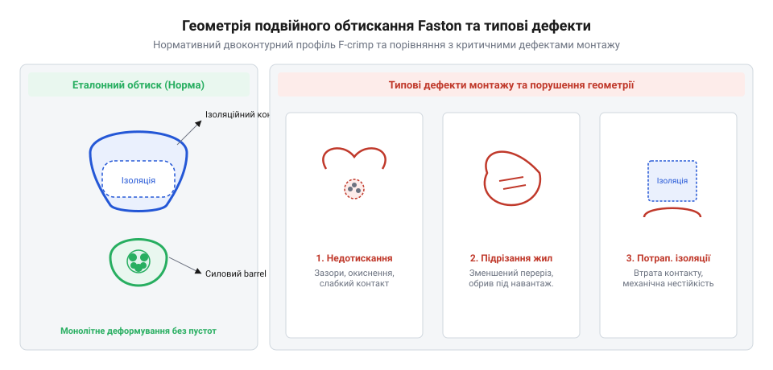
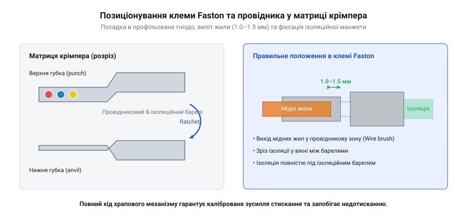

# Практикум з виготовлення силового кабельного джгута з обтисканням ізольованих Faston-клем

<preknowlist>
- [Монтажний провід 18 і 20 AWG](root:cat-hw-parts/hookup-wire) — конструктивні особливості багатожильних мідних дротів, перерізи жил та параметри зовнішньої ізоляції.
- [Родина силових роз'ємів XT (AMASS: XT30/60/90/120)](root:cat-hw-parts/xt-connectors) — принципи комутації силового живлення, припустимі струмові навантаження та падіння напруги.
- [Хомути пластикові](root:cat-hw-parts/cable-ties) — прийоми бандажування, укладки та фіксації силового джгута в робочому просторі.
</preknowlist>

## Втрата контакту та перегрів силових кіл

Під час розробки та складання вузлів живлення, силових комутаційних реле та блоків розподілу енергії розробники часто стикаються з раптовими перезавантаженнями контролерів, проплавленням пластикових корпусів або обривами кіл під навантаженням. Головна причина таких відмов — використання кустарних скруток або випадкових пайок у високострумових колах із робочим струмом від 5 до 20 А.

Просте скручування багатожильних мідних дротів має вкрай малу площу фактичного механічного контакту між окремими жилами. З часом під дією температурних коливань та пружної релаксації металу притискне зусилля зменшується, а поверхня міді окислюється. Це призводить до різкого зростання перехідного опору контакту `R_contact`. За законом Джоуля-Ленца, виділення теплової потужності в зоні контакту обчислюється наступним чином:

P = I² · R_contact
  = (15 A)² · 0.1 Ом          [підстановка робочого струму та перехідного опору]
  = 225 А² · 0.1 Ом
  = 22.5 Вт                   [теплова потужність на контакті]

Якщо крізь контакт із перехідним опором всього 0.1 Ом протікає струм 15 А, на ділянці завдовжки кілька міліметрів постійно виділяється 22.5 Вт теплової енергії. Такий локальний перегрів миттєво плавить первинну ізоляцію проводу, викликає обвуглювання та створює пряму загрозу пожежі.

Спроба зафіксувати силовий провід за допомогою пайки у високострумовому джгуті створює іншу критичну проблему — втомний злам мідних жил. Під час пайки рідкий припій за рахунок капілярного ефекту затікає під ізоляцію проводу на кілька міліметрів від місця з'єднання. Олов'яно-свинцевий або безсвинцевий припій перетворює гнучкий багатожильний провід на жорсткий монолітний стрижень. На межі, де затікання припою припиняється, виникає зона різкої концентрації механічних напружень. При дії вібрацій та вигинів кабельного джгута саме в цій точці виникає втомне мікротріщиноутворення, що швидко завершується повним зламом усіх мідних жил. Крім того, припій має властивість хладотекучості — під постійним механічним тиском гвинтового або клемного затискача він повільно деформується, викликаючи ослаблення контакту.

Падіння напруги на дефектному з'єднанні обчислюється так:

U_drop = I · R_contact
       = 15 А · 0.1 Ом        [підстановка робочого струму та опору]
       = 1.5 В                [падіння напруги на контакті]

При комутації потужних індуктивних навантажень, таких як силові реле чи електродвигуни, виникають пікові кидки струму, які здатні провалити напругу живлення нижче допустимого порогу роботи мікроконтролера, викликаючи систематичні збої програми.

Для побудови надійних високострумових кіл застосовують спеціалізовані рознімні з'єднання, подібні до [силових комутаційних роз'ємів](root:cat-hw-parts/xt-connectors). У вузлах живлення та комутації реле стандартом є швидкорознімні ізольовані клеми Faston (англ. @@en|Faston crimp terminal@@, від англ. *Fast On* — швидкознімний клемний контакт).

Надійність клем Faston забезпечується технологією двоконтурного обтискання (англ. @@en|crimp@@), яке розділяє електричну та механічну функції між двома окремими зонами клеми:
1. Силовий провідниковий хвостовик (англ. @@en|conductor crimp barrel@@) — виконує холодне зварювання мідних жил у газонепроникний моноліт під високим тиском, що усуває проміжки повітря та запобігає окисненню. 2. Ізоляційний хвостовик (англ. @@en|insulation crimp barrel@@) — обтискає зовнішню пластикову ізоляцію проводу, повністю поглинаючи механічні навантаження, вигини та вібрації, не передаючи їх на електричний контакт.

*Поперечний переріз правильно сформованого двоконтурного обтиску (силовий та ізоляційний barrel) у порівнянні з характерними дефектами монтажу.*

## Підбір дротів, клем та крімпера

Осягнувши переваги двоконтурного обтискання Faston-клем, необхідно правильно підібрати комплектуючі та інструмент. Помилка у виборі перерізу дротів, типорозміру клеми або геометричного профілю матриці унеможливлює створення якісного газонепроникного з'єднання.

Для складання силових джгутів використовують гнучкий [багатожильний монтажний провід](root:cat-hw-parts/hookup-wire) із мідними лудженими або відпаленими жилами. Переріз провідника обирають відповідно до розрахункового струмового навантаження кола:
* 20 AWG (площа перерізу близько 0.5 мм²) — розрахований на тривалий струм до 5–7 А; застосовується для малопотужних кіл живлення та сигналів управління. * 18 AWG (площа перерізу близько 0.75–0.82 мм²) — забезпечує впевнену роботу під струмами до 10–12 А; є основним вибором для обмоток і силових контактів автомобільних та промислових реле. * 16 AWG (площа перерізу близько 1.3 мм²) та 14 AWG (близько 2.1 мм²) — застосовуються для магістральних ліній живлення з навантаженням до 15 А та 20 А відповідно.

Ізольовані клеми Faston випускаються у трьох стандартних типорозмірах за шириною плоского ножа (англ. @@en|tab width@@):
* Серія 110 (ширина ножа 2.8 мм) — для слабострумових комутацій та компактних датчиків. * Серія 187 (ширина ножа 4.8 мм) — для реле середньої потужності та вимикачів. * Серія 250 (ширина ножа 6.3 мм) — загальноприйнятий промисловий стандарт для силових реле, блоків живлення та контакторів зі струмами до 20 А.

Для швидкої ідентифікації сумісного перерізу провідника ізоляційні манжети клем Faston мають міжнародне колірне маркування:
* Червоний манжет — розрахований на провідники перерізом від 0.5 мм² до 1.5 мм² (від 22 AWG до 16 AWG). * Синій манжет — розрахований на провідники перерізом від 1.5 мм² до 2.5 мм² (від 16 AWG до 14 AWG). * Жовтий манжет — призначений для потужних дротів перерізом від 4.0 мм² до 6.0 мм² (від 12 AWG до 10 AWG).

Обтискання ізольованих клем звичайними плоскогубцями або дешевими ручними кліщами без фіксації зусилля неприпустиме. Звичайний інструмент не дає контрольованого стискання, розриває зовнішній пластиковий манжет або створює недотиснуту область із високим опором.

Для якісного монтажу застосовують обтискний інструмент із храповим механізмом (англ. @@en|ratchet crimper@@, від англ. *ratchet* — храповик). Храповий механізм блокує розмикання рукояток доти, доки матриця не пройде повний цикл стискання та не досягне заданого геометричного профілю.

Крімпер повинен бути оснащений спеціалізованою матрицею для ізольованих контактів. На відміну від матриць для відкритих неізольованих клем, губки для ізольованих Faston мають овальну форму затискача з кольоровими маркувальними точками (червона, синя, жовта). Така геометрія стискає внутрішній металевий хвостовик, деформуючи його в щільний контур, але зберігає цілісність зовнішньої PVC або нейлонової ізоляційної манжети. Після формування джгута окремі провідники вкладають та фіксують за допомогою [пластикових кабельних хомутів](root:cat-hw-parts/cable-ties).

## Підготовка мідної жили та позиціонування

Маючи підібраний монтажний провід, ізольовані клеми потрібної серії та налаштований храповий крімпер, можна переходити до безпосереднього виконання технологічних операцій підготовки та обтискання.

Першим кроком є зачищення ізоляції проводу. Довжина зняття ізоляції L_strip повинна суворо відповідати довжині силового хвостовика клеми плюс технологічний зазор для виходу жили:

L_strip = L_barrel + ΔL
        = 4.5 мм + 1.0 мм     [підстановка довжини хвостовика та виходу жили]
        = 5.5 мм              [необхідна довжина зачищення провідника]

де L_barrel — довжина металевого силового хвостовика (англ. @@en|conductor crimp barrel@@), а ΔL — величина переднього виходу жили, що становить від 1.0 мм до 1.5 мм. Для стандартних клем Faston Серії 250 під провід 18 AWG довжина зачищення складає 5.0–6.0 мм.

Зачищення виконують прецизійним стрипером. Недопустимо використовувати ніж або невідкалібровані бокорізи, які викликають підрізання жил. Якщо під час зачищення зрізано навіть 2–3 тонкі мідні волокна з 19 жил проводу 18 AWG, ефективний переріз провідника в зоні обтиску зменшується до рівня 20 AWG. Це створює локальне звуження струмового каналу та осередкову зону перегріву.

Операція позиціонування клеми та провідника у крімпері виконується у такій послідовності:
1. Повністю розкрити губки храпового крімпера (англ. @@en|ratchet crimper@@). 2. Встановити ізольовану клему Faston у гніздо матриці, що відповідає кольору її манжета (наприклад, червону клему — у гніздо з червоною маркувальною точкою). При цьому контактна площина (ніж або гніздо) клеми повинна дивитися назовні від губок крімпера. 3. Злегка стиснути рукоятки інструмента до першого клацання храповика. Клема зафіксується в матриці, але не деформується. 4. Ввести зачищений провідник у задній отвір ізоляційної манжети клеми до моменту, коли край зовнішньої ізоляції проводу впреться у внутрішній уступ силового хвостовика.

Перед остаточним стисканням рукояток обов'язково здійснюють візуальний контроль позиціонування. Зріз мідних жил повинен чітко виходити у переднє оглядове вікно провідникового хвостовика (англ. @@en|conductor crimp barrel@@) на відстань 1.0–1.5 мм, але не заходити в зону рознімного контакту ножа. Одночасно з цим зовнішня ізоляція проводу повинна повністю перекриватися ізоляційним хвостовиком (англ. @@en|insulation crimp barrel@@), без оголених ділянок міді поза манжетом.

*Розташування ізольованої Faston-клеми у кольоровому гнізді матриці храпового крімпера та правильне позиціонування зачищеної жили перед обтисканням.*

## Обтискання подвійного контуру та перевірка

Процес формування якісного силового контакта вимагає не просто стискання металу, а створення нерознімного електромеханічного з'єднання за один робочий хід інструмента. Коли рукоятки крімпера з храповим механізмом (англ. @@en|ratchet crimper@@; від *ratchet* — храповик, *crimp* — обтискати) стискаються, дві осередкові зони матриці одночасно деформують дві незалежні ділянки Faston-клеми.

Перша зона деформації відповідає за електричну провідність. У ній силовий хвостовик (англ. @@en|conductor crimp barrel@@) обтискає зачищену мідну жилу [силового монтажного проводу](root:cat-hw-parts/hookup-wire). Під дією високого тиску овальної або дворадіусної матриці латунна стінка клеми та окремі тонкі мідні дротини зазнають спільної пластичної деформації. Повітряні зазори між волокнами повністю зникають, а поверхні металів стискаються настільки щільно, що утворюється газонепроникне з'єднання (англ. @@en|gas-tight joint@@). У такій зоні контакту відсутній кисень, що унеможливлює окислення міді протягом років експлуатації та забезпечує мінімальний перехідний електричний опір.

Друга зона деформації відповідає за механічну міцність і захист від вібрацій. Ізоляційний хвостовик (англ. @@en|insulation crimp barrel@@) охоплює зовнішню силіконову або полівінілхлоридну оболонку провідника. Ця зона не створює електричного контакту, але формує розвантажувач механічного натягу (англ. @@en|strain relief@@). Під час вигинів кабелю або вібраційних навантажень у робочому обладнанні згинальне зусилля припадає на пружну пластикову манжету, не передаючись на чутливе місце переходу від суцільно деформованого мідного пучка до вільного провідника.

Повний цикл обтискання гарантує інтегрований храповий механізм. Він затискає рукоятки інструмента і не дозволяє їм розійтися доти, доки матриця не досягне розрахованого технологічного зазору. Якщо оператор припинить тиснути посередині ходу, інструмент лишиться заблокованим. Це повністю виключає людський фактор і недотискання контакту через втому рук.

Після розмикання матриці якість з'єднання оцінюється візуально за трьома критичними геометричними параметрами:

1. **Вихід жил у контрольне вікно.** Мідні волокна повинні визирати з переднього торця силового хвостовика на 0.5–1.0 мм. Якщо дроти не досягають края хвостовика, площа електричного контакту зменшується. Якщо ж вони заходять занадто далеко, дріт перешкоджатиме фіксації плоского ножа у відповідній частині роз'єму. 2. **Наявність технологічного розтруба.** Задній край силового хвостовика повинен мати злегка відігнуту форму воронки (англ. @@en|bellmouth@@; від *bell* — дзвін, *mouth* — горловина). Цей розтруб запобігає зрізанню зовнішніх мідних волокон гострою кромкою металевого хвостовика при вигині проводу. 3. **Форма обтискання ізоляції.** Кольоровий пластиковий манжет має бути симетрично охоплений пелюстками хвостовика без проколів металом або розриву пластику.

Фінальним етапом перевірки є механічне випробування на виривання (англ. @@en|pull test@@; від *pull* — тягнути, *test* — випробування). Провід утримується однією рукою, а корпус клеми затискається фіксатором або пасатижами. Вздовж осі провідника прикладається плавне розтягувальне зусилля. Для монтажного проводу перерізом 18 AWG якісно обтиснутий контакт повинен легко витримувати поздовжній натяг до 80–100 N (приблизно 8–10 кгс). Зсув жили або її вислизання з силової гільзи вказує на дефект crimp-зони й вимагає переналаштування інструмента.

## Збирання джгута та усунення дефектів

Готові провідники з обтиснутими Faston-клемами об'єднуються в силовий кабельний джгут (англ. @@en|harness@@), призначений для комутації силових блоків живлення, релейних модулів та контакторів. Головна мета збирання — забезпечити трасування дротів без ризику їх перетирання про металеві елементи корпусу та запобігти плутанині під час обслуговування.

Основним інструментом бандлування пучка провідників є джгутування [пластиковими хомутами](root:cat-hw-parts/cable-ties). Провідники вирівнюються паралельно один до одного й стягуються хомутами з кроком 50–80 мм вздовж усієї довжини лінії. Затягування стрічки хомута має утримувати дроти в щільному пучку, але не деформувати їхню зовнішню силіконову або вінілову ізоляцію. Залишковий виступ стрічки обрізається під самий замок бокорізами або спеціальним пістолетом для хомутів, щоб запобігти утворенню гострих пластикових країв, здатних травмувати руки майстра.

Під час підключення Faston-клем до виводів комутаційних реле та блоків живлення дотримуються трьох правил безпечного монтажу:

* **Щільність посадки ножа.** Гніздова Faston-клема повинна насуватися на штирьовий ножевий контакт (англ. @@en|blade terminal@@) із виразним відчутним опором та клацанням. Пухке фіксування свідчить про розгинання пружинних губок клеми, що під струмовим навантаженням понад 10 A призведе до локального нагріву, окислення та розплавлення пластикового манжета. * **Компенсаційний вигин.** Провід біля ізоляційного манжета клеми обов'язково повинен мати пряму ділянку завдовжки щонайменше 20 мм перед першим поворотом траси. Натяг дроту під гострим кутом безпосередньо від клеми створює постійне заламувальне зусилля на мідні жили. * **Групування силових ліній.** У складному обладнанні Faston-клеми силового живлення реле часто поєднуються в єдину мережу разом із виходами [силових роз'ємів XT](root:cat-hw-parts/xt-connectors) акумуляторного блоку, тому силові та сигнальні провідники розділяють на окремі траси.

Під час виготовлення та контролю джгута можливе виявлення трьох типових монтажних дефектів, кожен з яких вимагає зрізання зіпсованого контакту та повторного виконання процедури:

1. **Недотискання храповика (англ. @@en|under-crimp@@).** Проявляється збільшеною висотою обтиснутого хвостовика, слабкою фіксацією провідника при механічному тесті та підвищеним перехідним опором. Причиною є знос матриці або неправильне налаштування ексцентрика крімпера. Для усунення дефекту регулювальне коліщатко притиску (англ. @@en|eccentric adjustment wheel@@) на корпусі інструмента повертають у бік збільшення стискання. 2. **Підрізання та перелом мідних жил.** Виникає внаслідок надмірного заглиблення лез стрипера під час зачищення або відсутності заднього розтруба силової гільзи. Втрата понад 5% загальної кількості мідних волокон зменшує ефективний струмопровідний переріз дроту, спричиняючи точкове перегрівання джгута під робочим навантаженням. 3. **Зсув ізоляції та її потрапляння в силову зону.** Якщо зовнішня ізоляція провідника заходить всередину силового хвостовика, пластик затискається безпосередньо між мідними жилами й металом клеми. З часом під впливом струмового нагріву пластик плинно деформується, контакт втрачає тиск, і з'єднання повністю вигорає. Ізоляція повинна закінчуватися чітко у технологічному проміжку між силовим та ізоляційним хвостовиками.