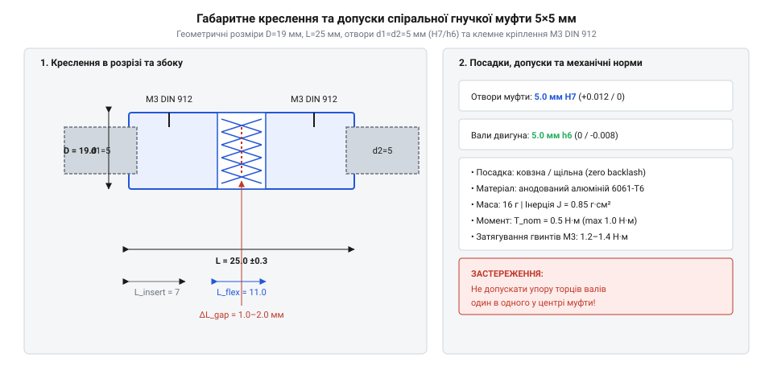
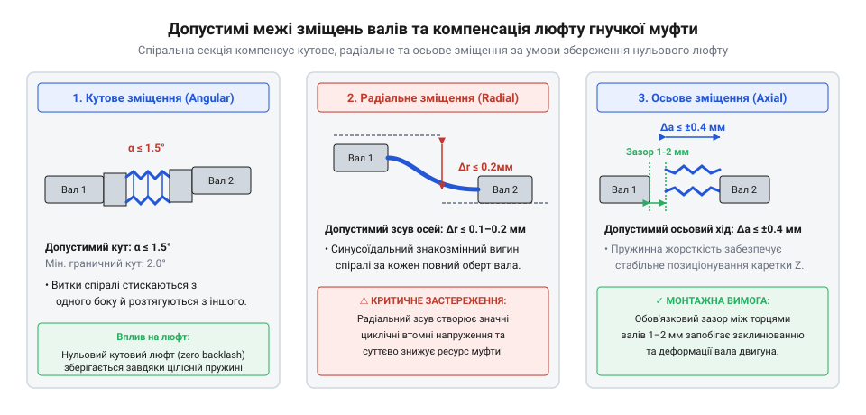

# Специфікація гнучкої муфти 5x5 мм та монтажні інтерфейси

## Геометричні габарити та посадочні допуски

Коли ми проєктуємо кінематичний ланцюг у компактних пристроях, таких як невеликі верстати з числовим програмним керуванням чи точні механізми подачі, надійність передачі обертального моменту починається з геометрії з'єднання. Якщо вал двигуна та вал робочого органу не мають ідеального просторового узгодження, виникають небезпечні перекоси, що швидко руйнують опори. Для розв'язання цієї проблеми використовують гнучку муфту (@@en|coupling@@), яка завдяки своїй спіральній структурі м'яко компенсує невеликі похибки монтажу. Проте сама можливість встановлення муфти на вал залежить від точності її посадочних отворів (@@en|bore@@) та відповідності зовнішніх розмірів просторовим обмеженням вузла.

Конструктивно наша мініатюрна муфта має зовнішній діаметр `D = 19` мм та загальну довжину `L = 25` мм. Такі габарити дозволяють розміщувати її в обмежених корпусах без ризику зачеплення сусідніх деталей. Обидва посадочні отвори розраховані на стандартні вали діаметром `d1 = d2 = 5` мм. Щоб посадка була стабільною, не допускала люфтів і водночас дозволяла легкий монтаж без заклинювання, виробники застосовують суворі поля допусків (@@en|tolerance@@). Для отворів муфти зазвичай витримується квалітет `H7`, тоді як вал виконується за полем `h6`. Таке поєднання забезпечує невеликий гарантований зазор або нульову посадку, що є критично важливим для точного центрування валів.

*Габаритне креслення муфти 5х5 мм із зазначенням зовнішніх розмірів та посадкових допусків отворів.*

Окрім номінальних розмірів, на якість з'єднання безпосередньо впливає мікрогеометрія поверхні вала. Якщо шорсткість вала перевищує допустимі норми, нерівності працюють як мікрорізці, що руйнують внутрішню поверхню отвору муфти під час осьового насування. Тому під посадочні шийки валів рекомендується чистове точіння або шліфування до параметрів шорсткості не гірше `Ra 0.8`. Дотримання цих вимог гарантує, що муфта сяде на вал рівно, без перекосів, створюючи надійну основу для подальшої фіксації кріпильними елементами.

## Специфікація кріплення: гвинти та затиски

Навіть ідеально підігнана за розмірами та допусками муфта не зможе передати жодного обертального моменту, якщо вона прослизатиме на валу. Спосіб фіксації визначає, як саме зусилля від кріпильних елементів перетворюється на силу тертя між внутрішньою поверхнею муфти та циліндричною шийкою вала. У мініатюрних муфтах найчастіше застосовують два принципово різні підходи: радіальні стопорні гвинти та інтегровані клемні затиски. Кожен із них має власну механіку взаємодії з валом і свої обмеження щодо надійності.

Перший традиційний варіант базується на використанні різьбових отворів у маточині муфти, куди вкручуються стопорні гвинти (@@en|set screw@@). Найчастіше використовують стандарти DIN 914 з конічним кінцем або DIN 916 із засвердленим чашковим кінцем. Конічний або гострий кінець гвинта під час затягування врізається в поверхню вала, забезпечуючи жорстке механічне стопорення. Проте такий точковий тиск неминуче залишає глибокі задирки та вибоїни на валу, через що зняти муфту або змінити її положення без попереднього зачищення вала стає майже неможливо.

Альтернативним і набагато досконалішим рішенням для відповідальних вузлів є клемний затиск (@@en|clamp hub@@). У цьому виконанні тіло маточини муфти має поздовжній розріз, а стягування здійснюється за допомогою гвинтів з циліндричною голівкою DIN 912, розташованих тангенціально. Коли ми затягуємо клемні гвинти, проріз звужується, і маточина рівномірно охоплює вал по всій окружності подібно до цанги. Це створює суцільну площу тертя, яка утримує крутний момент набагато ефективніше і не пошкоджує поверхню вала точковими задинами.

Для максимальної надійності передачі високих моментів без прослизання вали часто готують спеціальним чином, створюючи поздовжню лиску під стопорний гвинт або плоский гранчастий профіль, відомий як вал з лискою (@@en|D-cut shaft@@). Площина на валу забезпечує чітке геометричне замикання, виключаючи будь-яке кутове зсунення муфти навіть у разі різких реверсів або ударних навантажень.

## Нормування моменту затягування кріплення

Коли інженер обирає тип фіксації муфти, виникає питання контролю зусилля, з яким затягуються кріпильні елементи. Якщо затягнути гвинти занадто слабко, під час роботи виникне взаємне прослизання вала та муфти, що призведе до швидкого стирання поверхонь та втрати точності позиціювання. Якщо ж перевищити допустиме зусилля, пластичність матеріалу корпусу муфти не витримає напруження, що неминуче спричинить руйнування різьби.

Наша муфта виготовляється з легкого алюмінієвого сплаву серії `6061-T6`, який забезпечує ідеальний баланс малої ваги та пружності, необхідної для роботи спіральних прорізів. Проте стійкість алюмінієвої різьби до навантажень є нижчою, ніж у сталевих виробів. Для гвинтів різьби `M3`, які зазвичай використовуються в муфтах розміром 5х5 мм, нормативний діапазон затягування становить `0.4–0.5` Н·м. Такий момент гарантує створення необхідної сили тертя або затиску без пошкодження витків.

Якщо під час монтажу знехтувати цими межами та застосувати звичайний шестигранний ключ без контролю зусилля, зусилля руки легко перевищить `0.9–1.2` Н·м. У цьому діапазоні виникає критичне напруження зрізу на витках алюмінієвої різьби, що призводить до її повного зриву (@@en|thread stripping@@). Зірвана різьба повністю позбавляє маточину можливості триматися на валу, перетворюючи дорогу деталь на металобрухт. Тому для затягування кріплень слід завжди використовувати попередньо відкалібрований динамометричний інструмент або спеціальні викрутки з обмеженням крутного моменту (@@en|tightening torque@@).

## Кінематичні межі та компенсаційні допуски

На практиці досягти ідеальної співвісності двох валів — наприклад, вала крокового двигуна та вала ходового гвинта — практично неможливо через мікропохибки виготовлення рам, кронштейнів та корпусних деталей. Будь-яка невідповідність осей створює вимушене вигинальне навантаження, яке передається на підшипники та саму муфту. Якщо жорстко з'єднати такі вали жорсткою трубкою, вібрації та напруження швидко виведуть систему з ладу. Гнучка муфта розв'язує цю проблему завдяки своїй пружній спіральній геометрії, проте її компенсаційні можливості мають суворі паспортні межі.

*Граничні межі допустимих кутового, радіального та осьового зміщень валів та захист вузлів від зносу.*

Паспортні обмеження на допустиму неспіввісність (@@en|misalignment@@) для спіральної муфти 5х5 мм охоплюють три основні параметри. По-перше, допустимий кутовий перекіс осей становить до `2°`. По-друге, радіальний зсув валів не повинен перевищувати `0.2` мм. По-третє, осьовий пружний хід допускається в межах `±0.5` мм. Якщо реальні монтажні відхилення перевищують ці значення, спіральні витки муфти працюють у режимі постійних пластичних деформацій. Це спричиняє швидку втому металу, утворення тріщин та повне руйнування гнучкого елемента.

Правильна компенсація похибок безпосередньо впливає на довговічність усього механічного вузла. Коли муфта компенсує неспіввісність у межах норми, вона повністю знімає зайві радіальні та осьові навантаження з опорних валів, захищаючи мініатюрні кулькові підшипники (623, 625, 685, 686) — root:cat-hw-parts/miniature-ball-bearings від заклинювання та передчасного зносу доріжок кочення. Водночас конструкція спіралі забезпечує передачу обертання з нульовим кутовим люфтом (@@en|backlash@@), гарантуючи абсолютну кінематичну точність у системах позиціювання.
