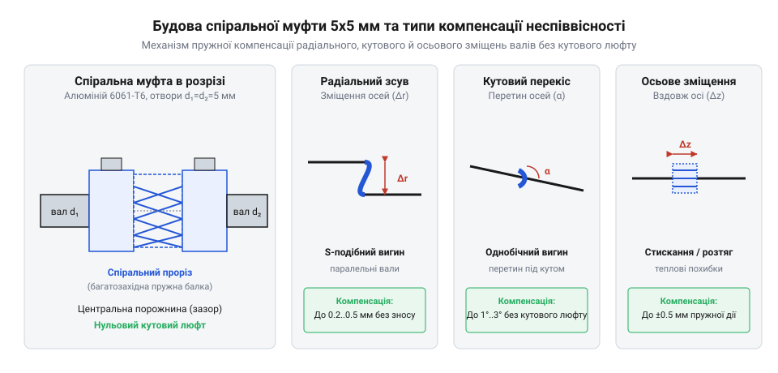
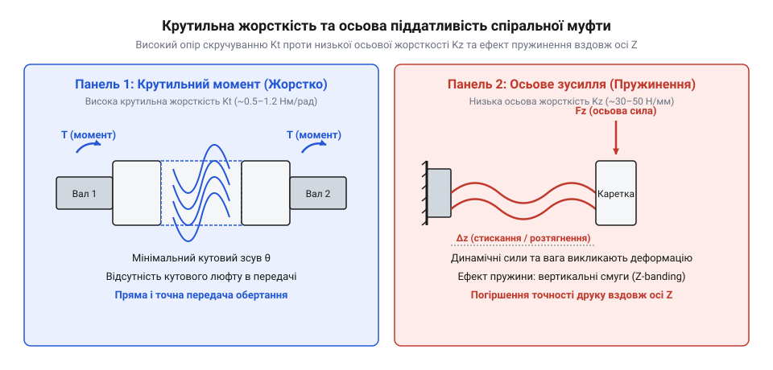
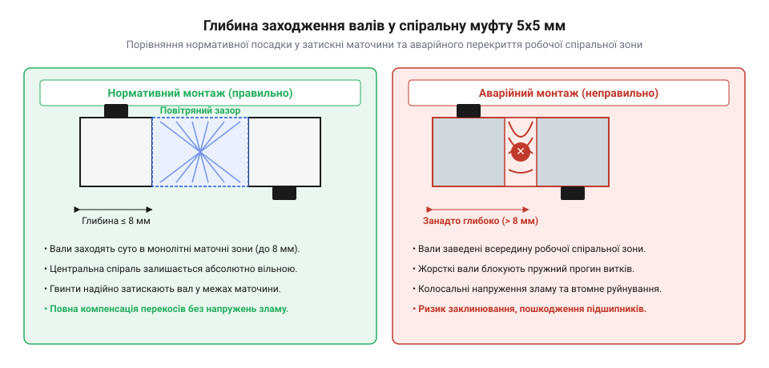

# Гнучка муфта 5×5 мм

<preknowlist>
- [Мініатюрні кулькові підшипники (623, 625, 685, 686)](root:cat-hw-parts/miniature-ball-bearings) — конструкція кулькових підшипників, їх чутливість до радіальних навантажень та механізми зносу кілець при виникаючому перекосі валів
</preknowlist>

## Неминучий перекіс валів точної механіки

Під час проєктування та складання точних механічних приводів — таких як осі переміщення 3D-принтерів, легкі верстати з числовим програмним керуванням (@@en|CNC@@) чи лабораторні позиціонери — неминуче постає завдання з'єднання вала крокового двигуна (наприклад, @@en|NEMA 17@@ із діаметром вала 5 мм) з ходовим гвинтом (наприклад, трапецеїдальним гвинтом @@en|Tr8x8@@ із хвостовиком 5 мм). Початківці у конструюванні часто припускають, що два вали можна виставити в просторі з ідеальною співвісністю (від лат. *co-* — разом та *axis* — вісь; @@en|coaxiality@@). Проте реальний фізичний світ унеможливлює математично точне збігання осей обертання через сукупність виробничих та монтажних похибок.

Геометрична неспіввісність (від англ. *misalignment* — неузгодженість положення; @@en|misalignment@@) виникає з кількох неминучих причин. По-перше, корпус мотора та опорні блоки підшипників виготовляються з допусками обробки, а деталі рами мають власну неперпендикулярність граней. По-друге, самі вали мають мікроскопічне радіальне биття (@@en|runout@@) та незначні первинні вигини, виниклі під час прокату чи нарізання різьби. По-третє, при нагріванні крокового двигуна під час тривалої роботи відбувається нерівномірне теплове розширення конструктивних елементів, що додатково зміщує осі у просторі.

У тривимірному просторі відхилення осей двох валів розкладається на три базові види геометричного зсуву:
- **Радіальна неспіввісність** (від лат. *radius* — промінь; @@en|radial misalignment@@) — паралельне зміщення осей обертання двох валів на певну відстань `Δr`, при якому геометричні осі залишаються паралельними, але не збігаються. - **Кутова неспіввісність** (@@en|angular misalignment@@) — перетин осей обертання під дещо відмінним від нуля кутом `Δα`, при якому вали утворюють злом у точці стику. - **Осьова неспіввісність** (@@en|axial misalignment@@) — зміщення валів уздовж спільної осі обертання Z на відстань `Δz`, що змінює зазор між їхніми торцями.

Спроба з'єднати такі вали суцільною жорсткою втулкою (@@en|rigid coupling@@) призводить до виникнення руйнівних механічних напружень. Оскільки жорстка муфта не має внутрішніх ступенів вільності для деформації, під час кожного оберту на 360 градусів зсув осей примусово вигинає вали. Це генерує циклічний згинальний момент (від нім. *Biegemoment* — момент вигину), який через вали передається безпосередньо на внутрішні підшипникові вузли.

Реактивні радіальні сили при жорсткому з'єднанні швидко руйнують [мініатюрні кулькові підшипники](root:cat-hw-parts/miniature-ball-bearings) двигуна та опорного блоку. Кулькові підшипники розраховані на сприйняття радіального навантаження за умови ідеально соосного розміщення кілець. Коли жорстко зафіксований вал здійснює кутовий чи радіальний зсув, внутрішнє кільце підшипника перекошується відносно зовнішнього. Навантаження перестає рівномірно розподілятися між усім комплектом кульок і концентрується на точкових ділянках доріжок кочення. Виникає локальний перенапружений контакт, що викликає втомне викришування металу (@@en|spalling@@), підвищений шум, втрату кроків двигуном та неминуче механічне заклинювання приводу.

Історично проблема захисту підшипникових вузлів від перекосів у точній механіці пройшла довгий шлях від масивних шарнірів до пружних суцільнометалевих елементів, про що детальніше розказано в матеріалі про [еволюцію спіральних муфт](root:cat-hw-parts/flexible-shaft-coupling/hist-flexible-beam-coupling-evolution.md). Усунути руйнівні циклічні навантаження можна лише шляхом введення між валами спеціального компенсаційного елемента, здатного безперервно вигинатися у просторі під час обертання, зберігаючи при цьому синхронність передачі кутового переміщення.

## Конструкція та компенсація неспіввісності спіраллю

Конструктивною відповіддю на потребу в безлюфтовій компенсації перекосів стала суцільнометалева спіральна муфта (від англ. *helical coupling* чи *beam coupling*; @@en|helical coupling@@). Зовні муфта являє собою суцільний циліндр, виточений із високоміцного алюмінієвого сплаву (найчастіше @@en|6061-T6@@ або @@en|7075-T6@@), який поєднує низьку масу, малий момент інерції та високу корозійну стійкість. У стандартному виконанні для точної механіки муфта має зовнішній діаметр 19 мм, довжину 25 мм та два співвісні посадкові отвори діаметром 5 мм (розмірність 5×5 мм), призначені для фіксації вала двигуна та ходового гвинта.

Ключовим елементом муфти є спіральний проріз (від грец. *helix* — завиток; @@en|helical cut@@), нарізаний у центральній частині циліндричного корпусу за допомогою електроерозійної обробки або високоточного фрезерування. Цей наскрізний проріз перетворює жорстку металеву стінку на безперервну тривимірну пружну стрічку. 

Механізм компенсації трьох видів неспіввісності базується на контрольованій пружній деформації витків спіралі при обертанні:
- При **кутовій неспіввісності** (@@en|angular misalignment@@): під час обертання муфти витки спіралі на боці звуження кута стискаються, а на протилежному боці розтягуються. Оскільки обертання відбувається безперервно, кожен конкретний виток послідовно проходить фази стиснення та розтягнення за один оберт, компенсуючи кут зламу `Δα` без створення згинального моменту на валах. - При **радіальній неспіввісності** (@@en|radial misalignment@@): спіральна зона вигинається у просторі за S-подібною кривою. Двовимірний вигин спіральної стрічки діє як два послідовні мікрошарніри, що дозволяє передавати обертальний момент між паралельними осі, зміщеними на відстань `Δr`. - При **осьовому зсуві** (@@en|axial misalignment@@): спіральна нарізка працює як класична пружина стиснення-розтягнення, поглинаючи поздовжні мікрозміщення `Δz` без виникнення заклинювання.

*Схема суцільнометалевої спіральної муфти в розрізі із зазначенням спірального прорізу та трьох типів зсувів валів — радіального, кутового й осьового.*

Головною перевагою суцільнометалевої спіральної муфти перед іншими компенсаційними з'єднаннями є абсолютна відсутність кутового люфту (від нім. *Luft* — повітря, зазор; @@en|backlash@@). Оскільки муфта виготовлена як монолітна деталь без збірних рухомих елементів, шпонок або гумових вкладишів, у ній фізично відсутні зазори між деталями, які могли б спричинити вільне прокручування вала при зміні напрямку обертання (реверсі).

Спіральна стрічка володіє високою крутильною жорсткістю (від лат. *torsio* — скручування; @@en|torsional stiffness@@) у напрямку обертання осі Z. Коли кроковий двигун повертає свій вал на певний кут `θ`, зсувне навантаження передається уздовж суцільного металевого профілю спіралі без запізнення. Це забезпечує точне синхронне повторення кутового переміщення ходовим гвинтом, що є критично важливим для позиціонування виконавчих механізмів. Повний кінематичний аналіз розподілу напружень наведено у [розрахунку крутильної жорсткості](root:cat-hw-parts/flexible-shaft-coupling/math-helical-coupling-kinematics-and-stiffness.md), а геометричні параметри посадкових зон розкрито у [специфікації муфти 5×5 мм](root:cat-hw-parts/flexible-shaft-coupling/api-flexible-coupling-5x5-spec-and-mounting-interface.md).

## Механічний компроміс та паразитна пружинистість

Попри вагомі переваги, суцільнометалева спіральна муфта є результатом інженерного компромісу між вигинальною гнучкістю та крутильно-осьовою жорсткістю. Щоб муфта легко вигиналася під дією радіального чи кутового зсуву валів і не перевантажувала підшипники, геометрія її спірального прорізу повинна мати достатню ширину та оптимальну товщину стінки. Проте зменшення товщини спіральної стрічки неминуче знижує її поздовжню жорсткість уздовж осі обертання.

У результаті нарізання спіралі суцільний алюмінієвий циліндр набуває властивостей пружини стиснення в поздовжньому напрямку. Ця паразитна осьова пружність стає джерелом серйозних похибок у механізмах, де муфта сприймає змінні поздовжні навантаження. 

*Графічна діаграма та схема деформації спіралі під дією крутного моменту та поздовжньої сили.*

Яскравим прикладом негативного прояву паразитної пружності є ефект воблінгу по осі Z (від англ. *wobble* — коливання, виляння; @@en|Z-wobble@@) у 3D-принтерах типу @@en|FFF/FDM@@. У цих пристроях ходовий гвинт осі Z піднімає та опускає важку друкувальну голівку або робочий стіл. Під час прискорення та гальмування каретки, а також при зміні маси виробу, що друкується, поздовжня сила `Fz`, яка діє на гвинт, постійно змінюється.

Якщо ходовий гвинт має навіть найменше геометричне викривлення (кривизну), при кожному оберті на 360 градусів він чинить на муфту циклічний тиск. Спіральна муфта починає циклічно стискатися та розтягуватися вздовж осі Z на мікрони. У результаті фактична висота наплавлюваного шару пластику змінюється від шару до шару: там, де муфта стиснулася, шар виходить товщим і витискається вбік, а де розтягнулася — тоншим. На вертикальних стінках роздрукованої деталі з'являється періодична горизонтальна смугастість із кроком, рівним кроку ходового гвинта. Експериментальні методи виявлення цієї похибки подано у матеріалі про [нейтралізацію ефекту Z-wobble](root:cat-hw-parts/flexible-shaft-coupling/proj-z-wobble-diagnostics-and-mitigation.md).

Другою суттєвою небезпекою для спіральних муфт є ризик незворотної пластичної деформації (від грец. *plastikos* — придатний для ліплення; @@en|plastic deformation@@). Алюмінієвий сплав @@en|6061-T6@@ володіє чіткою межею плинності (@@en|yield strength@@). У нормальних умовах роботи витки спіралі деформуються виключно в межах зони пружності. Проте у випадку заклинювання ходового гвинта (через потрапляння бруду, відсутність змащення, для якої призначена [силіконова змазка SI-180](root:cat-hw-parts/silicone-grease), або механічний упор) кроковий двигун продовжує розвивати максимальний утримуючий крутний момент.

При заклинюванні механізму напруження зсуву у тонкому перерізі спіралі перевищують межу плинності матеріалу. Витки спіралі випростовуються, зазнаючи незворотного розтягнення, або повністю руйнуються внаслідок втомного зламу. Муфта з розтягнутою спіраллю втрачає співвісність, починає сильно бити при обертанні й підлягає негайній заміні.

## Вибір типів муфт під кінематичні завдання

Потреба у з'єднанні двох валів виникає у найрізноманітніших кінематичних вузлах — від потужних промислових транспортерів до надточних оптичних позиціонерів та приводів 3D-принтерів. Утім, універсального механічного з'єднання не існує: кожен тип муфти розробляється під конкретний компроміс між крутильною жорсткістю, компенсаційною здатністю, допустимими обертами та вартістю виготовлення. Щоб свідомо вибрати муфту розміром 5×5 мм для конкретного приводу, інженер повинен чітко розуміти межі застосування чотирьох основних конструктивних родин.

Першою родиною є суцільні жорсткі муфти (від англ. *rigid coupling*; @@en|rigid coupling@@). Вони являють собою цілісні металеві втулки без жодних пружних елементів чи прорізів. Жорстка муфта забезпечує абсолютну крутильну й осьову жорсткість та здатна передавати значні крутні моменти без найменшого кутового запізнення. Однак її застосування вимагає практично ідеальної співвісності валів (з паралельним зміщенням менше ніж `0.01 мм`). Якщо зафіксувати такою втулкою реальні вали з монтажним перекосом, відсутність пружної компенсації призведе до появи циклічних згинальних моментів. Ці моменти швидко зруйнують [мініатюрні кулькові підшипники](root:cat-hw-parts/miniature-ball-bearings) двигуна та ходового гвинта. Тому жорсткі муфти застосовують лише в расточених на єдиній лінії корпусах або там, де вали мають власні плаваючі опори.

Другою родиною є кулачкові муфти з еластомерним вкладишем (від англ. *jaw coupling* або *spider coupling*; @@en|jaw coupling@@, @@en|spider coupling@@). Вони складаються з двох металевих півмуфт із торцевими кулачками, між якими встановлюється пружна зірочка (від англ. *elastomer insert* або *spider*; @@en|elastomer insert@@, @@en|spider@@) з поліуретану чи гуми. Еластомерний елемент чудово гасить механічні удари та вібрації (@@en|vibration damping@@), компенсуючи незначні кутові й радіальні зсуви. Проте для точної кінематики осі Z кулачкові муфти мають суттєвий недолік: під дією змінного крутного моменту поліуретан зазнає пружного гістерезису (від грец. *hysteresis* — запізнення; @@en|hysteresis@@), що створює кутовий люфт під час реверсу. Крім того, еластомер з часом старіє, втрачає пружність від контакту з оливами й вимагає регулярної заміни.

Третьою родиною є муфти Олдема (названі на честь винахідника Джона Олдема; @@en|Oldham coupling@@). Конструктивно така муфта містить дві крайні металеві втулки з пазами та проміжний рухомий диск (від англ. *center disc* або *slider*; @@en|center disc@@, @@en|slider@@) з ацеталю (@@en|POM@@) чи бронзи, який ковзає у перпендикулярних напрямках. Головна перевага муфти Олійдама — здатність компенсувати значні радіальні неспіввісності (@@en|radial misalignment@@) до `1–2 мм` без виникнення результуючих згинальних сил на підшипниках. При попередньому натягу вона забезпечує абсолютну відсутність кутового люфту (@@en|zero backlash@@). Проте ковзання центрального диска створює тертя та знос (@@en|sliding wear@@), що обмежує граничні оберти вала (@@en|RPM limit@@) та вимагає періодичного змащування, для якого застосовується [силіконова змазка SI-180](root:cat-hw-parts/silicone-grease).

Четвертою родиною є суцільнометалеві спіральні алюмінієві муфти (від англ. *helical coupling* або *beam coupling*; @@en|helical coupling@@) розміром 5×5 мм. Завдяки нарізаному спіральному прорізу (@@en|helical cut@@) ці муфти поєднують суцільнометалеву надійність, відсутність люфту (@@en|zero backlash@@) при реверсі, низький момент інерції та спроможність компенсувати три види зсуву осей одночасно. Вони є ідеальним вибором для малонавантажених приводів точного позиціонування — таких як вертикальна вісь Z у 3D-принтерах чи легкі гравіювальні верстати. Водночас їхніми обмеженнями є менший граничний крутний момент та паразитна осьова пружність.

Загальні критерії вибору муфти залежно від умов експлуатації кінематичного вузла подано у зведеній таблиці:

| Тип муфти | Кутовий люфт | Компенсація радіального зсуву | Осьова жорсткість | Гасіння вібрацій | Основна сфера застосування |
| :--- | :--- | :--- | :--- | :--- | :--- |
| **Суцільна жорстка** | Відсутній (0°) | Вкрай низька (< 0.01 мм) | Абсолютно висока | Відсутнє | Співвісні вали з суміщеними расточками |
| **Кулачкова (зірочка)** | Дрібний (гістерезис) | Поміркована (до 0.2 мм) | Середня | Відмінне | Приводи з ударним навантаженням та вібраціями |
| **Муфта Олійдама** | Відсутній (при натягу) | Висока (до 1–2 мм) | Висока | Помірне | Приводи з великим паралельним зсувом осей |
| **Спіральна 5×5 мм** | Абсолютно відсутній | Середня (до 0.2 мм) | Низька (пружинить) | Слабке | Точна механіка, осі Z 3D-принтерів, ЧПК |

Детальний математичний порівняльний аналіз передачі моменту та розподілу напружень наведено у матеріалі про [розрахунок крутильної жорсткості](root:cat-hw-parts/flexible-shaft-coupling/math-helical-coupling-kinematics-and-stiffness.md).

## Технологія правильного монтажу та фіксації

Надійність роботи та довговічність пружного з'єднання залежать від дотримання технологічної послідовності монтажу спіральної муфти 5×5 мм на вали крокового двигуна (наприклад, @@en|NEMA 17@@) та ходового гвинта (наприклад, @@en|Tr8x8@@). Найпоширенішою помилкою під час складання є недотримання глибини посадки валів (від англ. *insertion depth*; @@en|insertion depth@@), що перетворює гнучку муфту на джерело механічних аварій.

Конструктивно алюмінієва муфта ділиться на три ділянки: два крайні суцільні посадкові циліндри (клемні або стопорні маточини; @@en|clamping hub@@) завдовжки близько `8 мм` кожен та центральна робоча зона зі спіральним прорізом (від англ. *helical zone* чи *flexible beam zone*; @@en|helical zone@@) завдовжки близько `9 мм`. Головне технологічне правило монтажу полягає у тому, що кінці валів повинні заходити виключно у посадкові маточини й у жодному разі не перетинати межу робочої спіральної зони.

*Схема правильної та неправильної посадки валів усередину муфти 5×5 мм з позначенням робочої спіральної зони й фіксуючих гвинтів.*

Якщо кінці валів просунути занадто глибоко вгору чи вниз, вони впираються у внутрішні стінки спірального витка або стикаються торцями безпосередньо всередині спіралі. У результаті суцільний метал вала блокує пружний вигин стрічки. Муфта втрачає компенсаційні властивості, витки зазнають колосального локального перенапруження при найменшому перекосі осей, що призводить до швидкого втомного руйнування (@@en|fatigue failure@@) та розриву алюмінієвої спіралі.

Для фіксації муфти на валах діаметром 5 мм застосовують два основні типи механічного інтерфейсу:
1. **Фіксація стопорними гвинтами** (від англ. *set screws* або *grub screws*; @@en|set screws@@, @@en|grub screws@@): Муфта має два радіальні різьбові отвори M3 під шестигранний ключ. Цей метод ефективно працює виключно на валах із зрізаною плоскою фаскою — лискою (від англ. *D-cut shaft*; @@en|D-cut shaft@@). Загартований сталевий гвинт впирається пласким кінцем у площину лиски, створюючи надійне геометричне замикання проти прокручування (@@en|slippage@@). На гладких круглих валах стопорний гвинт врізається в метал точки контакту, утворюючи виступаючі задирки (від англ. *burrs*; @@en|burrs@@), які ускладнюють подальший демонтаж, та швидко послаблюється від вібрацій. 2. **Клемне затискання** (від англ. *clamping coupling* або *split hub*; @@en|clamping coupling@@): Маточина муфти має поздовжній розріз та дотичний гвинт M3. При затягуванні гвинта алюмінієва втулка рівномірно стискається навколо вала на 360 градусів. Це забезпечує передачу більшого крутного моменту за рахунок рівномірного тертя, не деформує поверхню вала та ідеально підходить для гладких валів без лиски.

Під час затягування різьбових елементів в алюмінієвому корпусі зі сплаву @@en|6061-T6@@ необхідно суворо дотримуватися моменту затягування (від англ. *tightening torque*; @@en|tightening torque@@). Спроба надмірної затяжки шестигранним ключем призводить до злизування внутрішньої різьби М3 (@@en|thread stripping@@) в м'якому алюмінію, після чого муфта стає непридатною до експлуатації. Рекомендований момент затягування для гвинтів М3 становить `0.4–0.5 Н·м`.

Покроковий алгоритм монтажу включає знежирення валів, перевірку відсутності заусенців, контрольне вимірювання глибини заходження вала штангенциркулем, фіксацію муфти з витриманим зазором між торцями валів та послідовне затягування гвинтів. Повні геометричні параметри посадків та розміри маточин детально описані у [специфікації муфти 5×5 мм](root:cat-hw-parts/flexible-shaft-coupling/api-flexible-coupling-5x5-spec-and-mounting-interface.md), а покрокову процедуру юстування можна відпрацювати на [стенді монтажу та регулювання](root:cat-hw-parts/flexible-shaft-coupling/proj-coupling-assembly-and-alignment-teststand.md).

## Діагностика несправностей та захист вузлів

У процесі довготривалої експлуатації точної механіки вузол з'єднання валів зазнає вібраційних, крутильних та циклічних вигинальних навантажень. Своєчасна діагностика первинних ознак несправностей дозволяє запобігти шлюбу при виготовленні деталей та захистити дороговартісні підшипники й крокові двигуни від руйнування.

Типовими несправностями спіральної алюмінієвої муфти є:
1. **Прокручування вала в посадковому отворі** (від англ. *slippage*; @@en|slippage@@). Ознаками цієї проблеми є періодичний втрачений крок по осі Z, зміщення висоти шарів у 3D-друці, характерний тихий металевий писк або поява сірого алюмінієвого пилу навколо маточини. Причиною стає послаблення стопорних гвинтів (@@en|set screws@@) через вібрацію, злизування різьби (@@en|thread stripping@@) або спроба зафіксувати гладкий вал без лиски стопорним гвинтом замість клемного затискача (@@en|clamping coupling@@). Тертя зсуву викликає фретинговий знос (від англ. *fretting corrosion*; @@en|fretting corrosion@@) посадкового отвору, що розширює зазор і вимагає заміни муфти. 2. **Незворотне розтягнення чи злам спіралі** (@@en|plastic deformation@@, @@en|fatigue failure@@). Ззовні ця несправність виглядає як збільшений зазор між витками спіралі з одного боку, видима осьова асиметрія або повний розрив алюмінієвої стрічки. Головна причина — заклинювання ходового гвинта через потрапляння бруду, викривлення направляючих або відсутність мастила, для усунення якого застосовується [силіконова змазка SI-180](root:cat-hw-parts/silicone-grease). Коли ходовий гвинт блокується, кроковий двигун створює максимальний момент, напруження в спіралі перевищують межу плинності (@@en|yield strength@@) сплаву @@en|6061-T6@@, утворюючи незворотну деформацію. 3. **Підвищене радіальне биття** (від англ. *radial runout*; @@en|radial runout@@). Проявляється у вигляді помітного радіального коливання ("виляння") корпусу муфти при обертанні, появі гулу підшипників та смугастості на роздрукованих виробах. Спричиняється перевищенням допустимого кутового (понад `2°`) чи радіального (понад `0.2 мм`) зсуву осей валів, або неправильним монтажем із заходженням вала у спіральну зону.

Для захисту підшипникових вузлів та подовження строку служби муфти слід дотримуватися алгоритму профілактичного обслуговування:
- **Щомісячний огляд**: перевірка затяжки затискних гвинтів динамометричним інструментом, візуальний контроль рівномірності кроку витків спіралі та відсутності металевої стружки. - **Кінематична розв'язка осі Z**: уникайте надмірної фіксації ("перевизначення") ходового гвинта. Верхній кінець ходового гвинта 3D-принтера повинен лишатися вільним або спиратися на плаваючу опору. Якщо жорстко зафіксувати ходовий гвинт з двох боків в опорних блоках із перекосом, пружна муфта буде змушена постійно працювати з граничним вигином, передаючи руйнівні реактивні сили на внутрішні [кулькові підшипники](root:cat-hw-parts/miniature-ball-bearings) крокового двигуна.

Вичерпна методологія експериментального виявлення та усунення кінематичних похибок позиціонування детально розкрита у проекті про [нейтралізацію ефекту Z-wobble](root:cat-hw-parts/flexible-shaft-coupling/proj-z-wobble-diagnostics-and-mitigation.md).