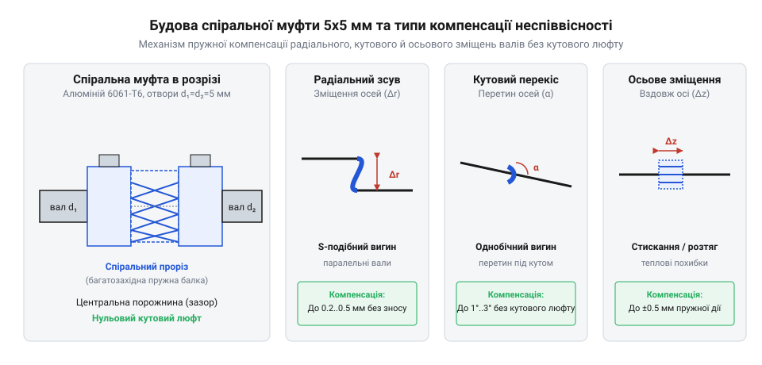
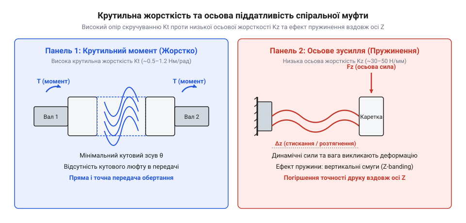
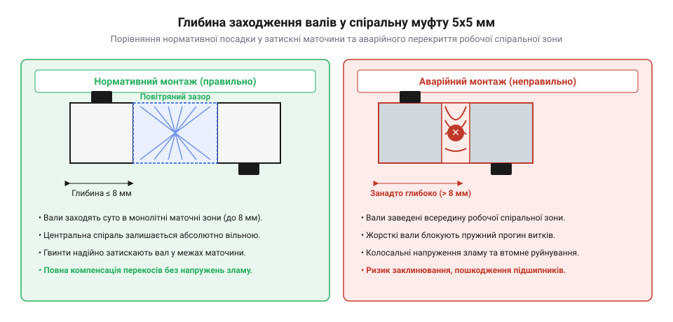

# Гнучка муфта 5×5 мм

<preknowlist>
- [Мініатюрні кулькові підшипники (623, 625, 685, 686)](root:cat-hw-parts/miniature-ball-bearings) — конструкція кулькових підшипників, їхня чутливість до радіальних реакцій та механізми передчасного зносу доріжок кочення при перекосі валів.
</preknowlist>

## Неминучий перекіс валів точної механіки

Коли шаговий двигун передає обертання на ходовий гвинт у точній механіці, осей двоє, і вони ніколи не збігаються ідеально через виробничі допуски рам, друкованих деталей та самих валів. Будь-яке жорстке з'єднання таких валів неминуче призводить до того, що під час обертання виникає просторовий перекіс: кожен півоберт змушує жорстку муфту нахиляти вали один відносно одного, породжуючи циклічні згинальні моменти та радіальне биття, коли вісь гвинта описує конус навколо осі двигуна. Ці змінні навантаження щоразу передаються на опори й б'ють по їхній жорсткості. Через це чутливі [мініатюрні кулькові підшипники](root:cat-hw-parts/miniature-ball-bearings) відчувають надмірне радіальне защемлення, їхні доріжки кочення швидко зношуються, а вал починає заїдати. Ця проблема змушує шукати спеціальні методи компенсації, де головним ворогом стає невідворотна неспіввісність (@@en|misalignment@@), що супроводжує будь-який рухомий вузол.

## Компенсація неспіввісності прорізною спіраллю

Щоб пом'якшити похибки з'єднання без втрати передачі крутного моменту, застосовують алюмінієву спіральну муфту 5×5 мм, виготовлену з пружного алюмінію 6061-T6. Її конструкція являє собою цільну металеву трубку, в якій вифрезеровано гвинтовий проріз у вигляді багатозахідної пружини. Завдяки симетричному розташуванню кількох заходів спіралі крутний момент передається рівномірно по всій площі перерізу, а міцність сплаву 6061-T6 забезпечує багаторазову пружну деформацію витків без появи залишкових деформацій. Цей проріз дає змогу виткам пружно деформуватися, приймаючи на себе зміщення без виникнення кутового люфту (від нім. Luft — зазор; @@en|backlash@@). Завдяки гнучкості витків @@en|helical coupling@@ легко згинається у будь-якому напрямку, компенсуючи кутові відхилення осей у межах до 2°, а також радіальні відхилення та поздовжні теплові подовження.

*Компенсація трьох типів просторової неспіввісності валів пружним вигином витків спіралі.*

## Паразитна осьова пружність та воблінг

Проте здатність гнутися у всіх напрямках має зворотний бік: витки спіралі працюють не лише на кручення, а й як пружина стиснення уздовж осі Z. Коли рухома каретка змінює напрямок або на неї діє додаткова вага, гнучка зона починає пружинити вздовж осі, спричиняючи невеликі коливання висоти шарів. Цей паразитів ефект, відомий як смугастість Z-wobble (від англ. wobble — коливання; @@en|Z-wobble@@), проявляється на надрукованих деталях у вигляді періодичних хвиль. Інженерний компроміс полягає в тому, що висока крутильна жорсткість @@en|helical coupling@@ поєднується з м'якістю вздовж осі, через що при заклинюванні вала виникає ризик перевищення межі плинності алюмінію.

*Порівняння крутильної жорсткості та паразитної поздовжньої пружності спіральної муфти.*

## Технологія монтажу та захист вузлів

Надійність роботи всього приводу залежить від правильного встановлення муфти на вали без защемлення робочої зони. Вали двигуна та гвинта не повинні входити в муфту надто глибоко і торкатися один одного всередині спірального прорізу, інакше пружина втратить рухливість. Для надійної фіксації використовують вали зі спеціальною лискою (@@en|D-cut shaft@@), яка запобігає прокручуванню під дією високого крутного моменту. Гвинти кріплення затягують із контрольованим зусиллям (від англ. torque — крутний момент; @@en|tightening torque@@), а для запобігання сухому тертю рухомих з'єднань використовують [силіконова змазка SI-180](root:cat-hw-parts/silicone-grease).

*Правильне обмеження глибини заходження валів у маточини для збереження рухливості спіралі.*