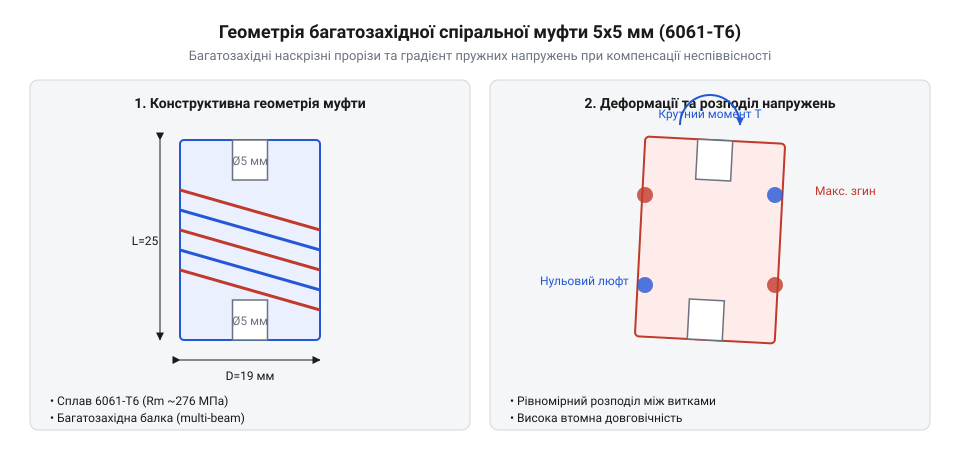

# Еволюція спіральних муфт точної механіки: від жорстких з'єднань до цільнометалевих пружних елементів

<preknowlist>
- [Мініатюрні кулькові підшипники (623, 625, 685, 686)](root:cat-hw-parts/miniature-ball-bearings) — як радіальні та осьові навантаження на вал руйнують підшипники при відсутності компенсації зміщень.
- [Силіконова змазка SI-180](root:cat-hw-parts/silicone-grease) — як доглядати за рухомими з'єднаннями та запобігати тертю у суміжних вузлах приводу.
</preknowlist>

## Жорсткі з'єднання та шарніри Гука

Коли ранні механізми вимагали передачі крутного моменту між двома валами, інженери з'єднували їх напряму за допомогою жорстких муфт (@@en|rigid coupling@@ від латинського *rigidus* — твердий, жорсткий). Таке з'єднання ідеально працювало на папері та в умовах абсолютного співвісного монтажу, проте на практиці найменший перекіс, похибка виготовлення або теплове розширення призводили до колосальних напружень. Вали намагалися обертатися навколо різних геометричних осей, через що на мініатюрні кулькові підшипники (623, 625, 685, 686) (`root:cat-hw-parts/miniature-ball-bearings`) діяли руйнівні змінні радіальні й осьові навантаження. Підшипники швидко заклинювали або руйнувалися, вимагаючи постійного обслуговування та мащення спеціальними сумішами, такими як силіконова змазка SI-180 (`root:cat-hw-parts/silicone-grease`), яка лише тимчасово пом'якшувала тертя, але не усувала першопричину — жорстке перевантаження від неспіввісності.

Для розв'язання цієї проблеми в утамування кутових відхилень звернулися до ідеї карданний шарнір (@@en|Cardan joint@@ від імені італійського математика Джероламо Кардано, який описав його конструкцію). Шарнір Гука дозволяв передавати обертання під кутом, проте він мав фундаментальний кінематичний недолік: при нерівних осях нерівномірність обертання веде до пульсацій кутової швидкості та появи люфту в шарнірних з'єднаннях. У точних приводах, де кожне мікронне зміщення чи зупинка критичні, люфт ставав неприпустимим джерелом похибок і вібрацій. Виникла гостра потреба у безлюфтовому елементі, здатному водночас гасити дрібні кутові та радіальні зміщення без кінематичних пульсацій.

## Поява прорізних суцільнометалевих муфт

Шукаючи вихід із глухого кута жорстких кінематичних ланцюгів, інженери звернулися до концепції суцільної деформації металу. Замість того, щоб з'єднувати вали окремими рухомими шарнірами з безліччю деталей, конструктори запропонували виготовляти муфту з єдиного цільного шматка матеріалу, виконавши в ньому спеціальні прорізи. Так з'явилася спіральна муфта (@@en|helical coupling@@ від грецького *helix* — спіраль, завиток), яку також називають балочна муфта (@@en|beam coupling@@ від англійського *beam* — балка, брус). Поздовжні спіральні прорізи перетворювали суцільний циліндр на гнучку пружинну балку, здатну згинатися і скручуватися під навантаженням.

Принцип роботи такої конструкції базується на пружній податливості витків. Коли вал двигуна зміщується відносно робочого гвинта, стінки прорізів плавно деформуються, приймаючи на себе кутове чи радіальне відхилення, але завдяки суцільній структурі метал не має люфту. Проте перші такі муфти виготовлялися зі сталі, що робило їх занадто жорсткими на кручення, важкими та інертними для високошвидкісних крокових приводів. Сталеві витки потребували занадто великого зусилля для згинання, що знову створювало навантаження на підшипники та викликало втомні руйнування при реверсивних навантаженнях.

## Алюміній 6061-T6 та багатозахідні спіралі

Пошук ідеального балансу між гнучкістю та жорсткістю на кручення привів інженерів до використання легких високоміцних сплавів, зокрема термічно обробленого алюмінію 6061-T6 (де 6061 позначає сплав на основі алюмінію, магнію та кремнію, а T6 — режим гартування і штучного старіння для максимальної міцності). Режим гартування та штучного старіння T6 забезпечує виділення дисперсних вторинних фаз (зокрема міцних інтерметалідів магнію і кремнію Mg2Si), які блокують рух дислокацій у кристалічній решітці, суттєво підвищуючи межу текучості та втомну міцність металу. Завдяки цьому алюміній 6061-T6 витримує мільйони циклів знакозмінного вигину спіральних балок під час реверсивних рухів без накопичення залишкових пластичних деформацій. Перехід на цей матеріал дозволив різко знизити масу муфти, зменшивши момент інерції ротора та підвищивши динаміку приводу. Однак однозахідні спіральні прорізи у м'якшому алюмінії все ще страждали від нерівномірності розподілу напружень та схильності до скручування під час різкого розгону.

Для розв'язання цієї проблеми розробили багатозахідні спіралі, які мають кілька переплетених симетричних прорізів, що йдуть гвинтовою лінією вздовж корпусу.

*Геометрія та розподіл деформацій у багатозахідній спіральній муфті.*

Як видно з геометрії багатозахідної спіральної муфти з алюмінію 6061-T6 для двигунів NEMA 17, симетричне розташування кількох гвинтових канавок рівномірно розподіляє зусилля по всьому периметру циліндра. Така структура повністю виключає бічне биття, забезпечує високу торсіонну жорсткість на передачу крутного моменту і водночас легко компенсує паралельне зміщення та кутові перекоси валів.

## Межі застосування та паразитна пружність

Попри високу ефективність у точних приводах, спіральні муфти мають свої принципові експлуатаційні обмеження, пов'язані з фізикою пружних деформацій. Головною проблемою стає паразитна пружність, яка виявляється у вигляді осьової податливості та пружинного ефекту під час реверсивних рухів. Коли кроковий двигун змінює напрямок обертання, багатозахідна спіраль спочатку злегка розтягується або стискається вздовж осі, створюючи мікроскопічну затримку перед тим, як вал почне переміщуватися. Для високоточних верстатів із різьбовими валами типу Tr8x8 це може призводити до похибок позиціювання, якщо навантаження перевищують розрахункові межі.

Особливо яскраво ця особливість проявляється у зв'язці з ходовими гвинтами високого кроку, наприклад, стандарту Tr8x8, де за один повний оберт вала гайка та прикріплена до неї каретка переміщуються рівно на 8 міліметрів. Через такий великий крок навіть мікроскопічне осьове стискання чи розтягнення багатозахідної спіралі муфти під час реверсу або під вагою вузла — у межах якихось 0.05–0.1 мм — перетворюється на помітне вертикальне зміщення робочого шару друку чи інструмента. Оскільки пружний елемент діє як м'яка пружина, маса рухомих компонентів і зусилля різання або екструзії змушують його постійно «дихати» вздовж осі, що створює характерні хвилі на вертикальних поверхнях і знижує загальну точність позиціювання.

Саме тому спіральні муфти категорично не підходять для важких промислових верстатів, де передаються великі крутні моменти і виникають ударні навантаження. У таких випадках використовують жорсткі муфти або спеціальні сильфонні та мембранні конструкції. Проте для легких систем на базі двигунів NEMA 17 правильно підібрана алюмінієва спіральна муфта залишається найкращим вибором, оскільки вона надійно захищає чутливі підшипники від неминучих похибок монтажу і забезпечує плавну, безшумну передачу руху без люфту.