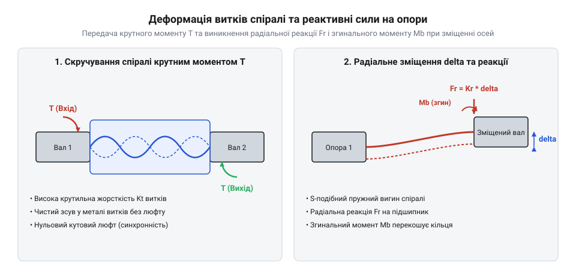

# Математичний розрахунок крутильної жорсткості, деформацій та компенсації неспіввісності спіральної муфти

<preknowlist>
- [Мініатюрні кулькові підшипники](root:cat-hw-parts/miniature-ball-bearings) — Необхідно розуміти конструкцію та допустимі радіальні та осьові навантаження на підшипникові опори, на які муфта передає реактивні зусилля від неспіввісності.
</preknowlist>

## Кінематика та ступені вільності муфти

Будь-який механічний привід на практиці стикається з неминучою неточностю виготовлення деталей, тепловими деформаціями корпусу та просіданням монтажних плит. Коли два вали, з'єднані жорсткою муфтою, мають хоча б мікроскопічну похибку положення, у системі виникають руйнівні перевантаження. Жорстке з'єднання перетворює будь-яке відхилення на заклинювання, швидке зношування та руйнування опорних вузлів, таких як [мініатюрні кулькові підшипники](root:cat-hw-parts/miniature-ball-bearings). Щоб уникнути цього, застосовують кінематичну гнучкість, яка забезпечується геометрією спіральних прорізів у цільному металевому циліндрі.

Процес передачі обертального руху у спіральній муфті базується на перетворенні жорсткого тіла на пружну систему з кількома ступенями вільності (@@en|degrees of freedom@@). Кінематика (@@en|kinematics@@ від грец. kinēma — рух) муфти описує рух її витків у тривимірному просторі без урахування мас і сил, що їх викликають. Сама конструкція є сукупністю гвинтових прорізів, які утворюють неперервну пружну балку з величною довжиною розгортки. Така балка здатна компенсувати три типи неспіввісності (@@en|misalignment@@): паралельне радіальне зміщення (@@en|radial displacement@@), кутове перекошування осей (@@en|angular misalignment@@) та осьове зміщення. Математично взаємне положення осей сполучуваних валів у просторі задається через комбінацію просторового зсуву та повороту: радіальне паралельне зміщення описується вектором просторового зсуву `δ = [δ_x, δ_y, 0]^T`, а кутовий перекіс осей формалізується через матрицю повороту `R(α)`, що визначає орієнтацію вихідного вала відносно вхідного у тривимірній системі координат. Накладання цих геометричних трансформацій змушує витки гвинтового прорізу зазнавати складних локальних деформацій зміщення та поворотів у кожному перерізі балки.

Коли вали зміщуються один відносно одного, витки спіралі не ковзають і не утворюють зазорів, на відміну від шарнірних механізмів. Натомість кожен елемент спірального прорізу зазнає локального пружного згину та скручування. Це гарантує кінематичну безперервність: кутова швидкість провідного вала передається на ведений без миттєвих коливань чи мтвого ходу. Ступені вільності спірального елемента дозволяють йому працювати як універсальний пружний шарнір, що розвантажує привід від додаткових силових факторів.

## Крутильна жорсткість та кутовий зсув

Передача крутного моменту від двигуна до виконавчого механізму неминуче супроводжується пружним закручуванням з'єднання. Фізична сутність цього процесу полягає в тому, що циліндрична спіраль під дією прикладеного зусилля чинить опір зовнішньому навантаженню завдяки пружним властивостям матеріалу. Крутильна жорсткість (@@en|torsional stiffness@@ від лат. torsio — скручування) характеризує здатність муфти протистояти кутовому зміщенню при роботі під навантаженням.

Коли на вхідний вал діє крутний момент (@@en|torque@@) `T`, виникає кут скручування (@@en|torsional twist@@) `theta`, який визначає похибку кутового позиціонування між кінцями муфти. Деформація (@@en|deformation@@) витків підпорядковується закону Гука для кручення, де кожен спіральний проріз працює як криволінійний пружний стрижень. У багатозахідних конструкціях прорізи утворюють паралельні пружні контури: якщо муфта має `n` однакових симетрично розташованих витків із жорсткістю кожного `K_single`, їхні реакції додаються, утворюючи еквівалентну крутильну жорсткість `K_t = n · K_single`. Таке паралельне з'єднання дозволяє пропорційно збільшити крутильну жорсткість у `n` разів за збереження високої податливості окремих тонких променів при просторовому вигині. Значення кутового зсуву розраховується через сумарну довжину спірального прорізу та геометричні характеристики перерізу витка:

         T
    θ = ───      [закон пружного кручення спірального елемента]
         K_t

    θ = (32 · T · R² · L_eff) / (G · d_wire⁴)    [інтегральна формула жорсткості для гвинтової спіралі]

де `T` — переданий крутний момент, `K_t` — розрахункова крутильна жорсткість муфти, `R` — середній радіус спіралі, `L_eff` — ефективна довжина розгорнутого витка, `G` — модуль зсуву матеріалу (для алюмінієвого сплаву `G ≈ 26 ГПа`), `d_wire` — еквівалентна товщина перерізу витка. 

Знання параметра `θ` є критичним для сервоприводів із високими вимогами до точності позиціонування. Занадто м'яка спіраль призведе до резонансних коливань і відставання кута повороту робочого органу, тоді як надто жорстка втратить здатність компенсувати похибки монтажу.

## Реактивні зусилля від неспіввісності осей

Компенсація неспіввісності осей не відбувається безслідно для системи: кожне зміщення валів змушує пружні витки муфти деформуватися, що породжує додаткові сили реакції на валах і опорах. Природа цих зусиль полягає у виникненні пружних сил опору матеріалу під час вимушеного згину та зміщення витків.

*Геометрія деформації витків спіральної муфти під навантаженням та схема реакцій.*

Коли вали мають радіальне зміщення `δ`, спіраль працює як здвоєна консольна балка, що зазнає поперечного згину. Реактивні зусилля (@@en|reaction forces@@) `F_r` та згинальний момент (@@en|bending moment@@) `M_b` передаються безпосередньо на підшипникові опори вала. Розрахунок радіальної реакції базується на радіальній жорсткості (@@en|radial stiffness@@) `K_r`:

         δ
    F_r = ───    [закон опору пружної спіралі при поперечному зміщенні]
         K_r

    F_r = (12 · E · I_z · δ) / L_s³    [формула згину балки для осьових витків]

де `E` — модуль Юнга матеріалу, `I_z` — осьовий момент інерції перерізу витка, `δ` — величина радіального зміщення, `L_s` — довжина робочої зони спіралі. Аналогічно, кутове перекошування осей викликає згинальний момент `M_b = K_m · θ_mis`, де `K_m` — моментна жорсткість. Ці додаткові навантаження обов'язково враховуються при виборі та перевірці довговічності підшипників, щоб запобігти їх передчасному руйнуванню.

## Осьова піддатливість та граничні напруження

Окрім кручення та радіального згину, муфта часто зазнає осьових переміщень, викликаних тепловим подовженням валів або неточностями осьової фіксації двигуна. Осьова піддатливість (@@en|axial compliance@@ від лат. complere — гнутися, подаватися) визначає здатність спіралі стискатися або розтягуватися вздовж поздовжньої осі без критичного зростання зусиль.

Деформація витків під дією осьового зусилля `F_ax` призводит до появи максимальних напружень вигину в небезпечних перерізах прорізів. Для запобігання незворотній пластичній деформації (@@en|plastic deformation@@) алюмінієвий сплав (@@en|aluminum alloy@@) 6061-T6, з якого виготовляють муфту, повинен перевірятися на міцність. Розрахунок базується на порівнянні максимальних напружень вигину `σ_max` із межею плинності матеріалу `σ_yield`: Для оцінки ресурсу конструкції за тривалих знакозмінних навантажень розглядається [циклічна втома спіральних муфт](root:cat-hw-parts/helical-coupling-fatigue).

          F_ax
    δ_ax = ──────    [осьове переміщення під дією осьової сили]
          K_ax

          M_b
    σ_max = ─── ≤ σ_yield    [умова міцності витків спіралі]
          W_z

де `K_ax` — осьова жорсткість муфти, `W_z` — момент опору витка при згині, а `σ_yield ≈ 276 МПа` для сплаву 6061-T6. Якщо сумарні напруження від крутного моменту, радіального зміщення та осьового розтягу перевищують допустиме значення, виникає ризик утворення тріщин у корені спіральних прорізів, що веде до аварійного руйнування приводу.