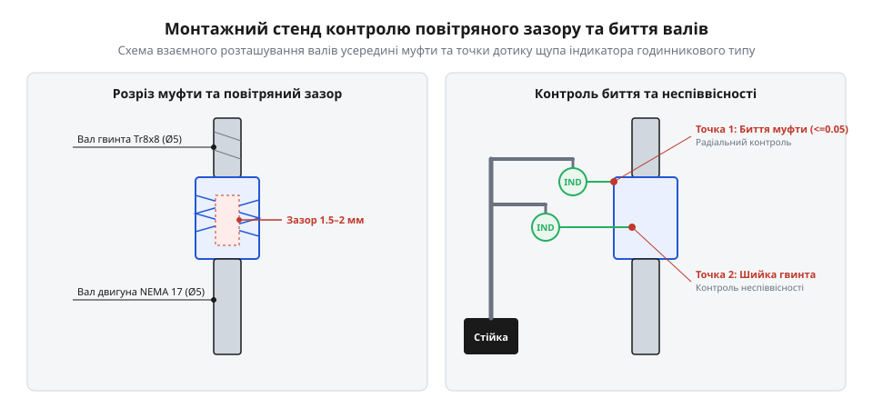

# Складання та діагностичний стенд юстування гнучкої муфти

<preknowlist>
- [Мініатюрні кулькові підшипники](root:cat-hw-parts/miniature-ball-bearings) — Принципи радіальної фіксації валів та запобігання осьовим перекосам за допомогою підшипникових опор.
</preknowlist>

## Підготовка валів та вибір посадки

Монтаж кулачкових та спіральних гнучких муфт починається з ретельної механічної підготовки циліндричних посадкових поверхонь валів. У типовому кінематичному вузлі приводу 3D-принтера або малогабаритного фрезерного верстата ЧПК з'єднуються вихідний вал крокового двигуна NEMA 17 (номінальний діаметр 5.0 мм із допуском за квалітетом h6 або h7) та шпилька ходового гвинта TR8 (діаметр обточеного хвостовика 5.0 мм або 8.0 мм).

Перед складанням необхідно усунути типові дефекти виготовлення та транспортування:

1. **Зняття задирок та зачищення забоїн.** Навіть незначний металевий задир на кромці вала висотою 0.02–0.05 мм при спробі силового насаджування муфти пошкоджує калібрований внутрішній отвір алюмінієвої маточини, викликаючи перекіс посадки та непереборний ексцентриситет. Торці валів обов'язково обробляють дрібнозернистим надфілем зі зняттям плавної фаски під кутом 45° на глибину 0.5 мм.
2. **Знежирення поверхонь.** Залишкові консерваційні оливи та бруд змивають ізопропіловим спиртом або розчинником. Наявність мастила в зоні фрикційного затиску знижує коефіцієнт тертя в 2–3 рази, провокуючи прослизання вала під дією робочого крутного моменту.
3. **Орієнтація лиски D-cut.** Якщо вал крокового двигуна має плоску лиску (D-вал), затискний гвинт муфти слід спрямовувати строго по нормалі до площини лиски або використовувати розрізні клемні муфти, які обтискають циліндричну частину вала без утворення кутового перекосу.

## Монтаж муфти та осьовий зазор

Найкритичнішою помилкою при монтажі спіральної алюмінієвої муфти (@@en|helical beam coupling@@) є дотикання торців з'єднуваних валів усередині центральної порожнини. Якщо кінці вала двигуна та ходового гвинта загнати в муфту впритул один до одного, гнучкий спіральний виріз повністю втрачає можливість деформуватися в осьовому та кутовому напрямках. Спіраль виявляється затиснутою зсередини, і будь-яка неточність співвісності викликає колосальні радіальні навантаження на підшипники та передчасний втомний злам пружних витків муфти.


*Конструктивне дотримання технологічного повітряного зазору між валами всередині гнучкої муфти та точки вимірювання радіального й торцевого биття.*

Правильне просторове розміщення вузла вимагає дотримання суворих геометричних правил:

- **Повітряний зазор.** Між торцем вала крокового двигуна та торцем ходового гвинта всередині центральної частини муфти обов'язково витримують регламентований зазор величиною від 1.0 до 2.0 мм. Цей вільний простір забезпечує безперешкодний згин тонких перемичок спіралі при кутових перекосах до 1.5–2.0° та пружну осьову компенсацію без виникнення паразитних внутрішніх напружень.
- **Глибина посадки.** Довжина стандартної муфти становить 25.0 мм. Глибина захоплення кожного вала в затискних циліндричних поясках має бути симетричною і складати орієнтовно 9.0–11.0 мм з кожного боку. Недостатнє заглиблення вала (менше 7 мм) призводить до нерівномірного навантаження на затискні пелюстки та зриву з'єднання при пускових струмах.

## Контроль моменту затягування кріплення

Корпуси гнучких муфт серійного виробництва виготовляються з дюралюмінієвих сплавів (найчастіше 6061-T6 або 7075-T6). Фіксація валів здійснюється або радіальними стопорними гвинтами без головки (установчі гвинти за стандартом DIN 916 з конічним кінцем), або стяжними гвинтами розрізних клемних хомутів (гвинти з внутрішнім шестигранником за стандартом DIN 912 класу міцності 8.8 чи 12.9 із різьбою M3).

Алюмінієва внутрішня різьба є вкрай чутливою до перетягування. Спроба затягнути гвинт M3 звичайним Г-подібним шестигранним ключем без контролю зусилля часто призводить до зрізання витків алюмінієвої різьби або розтріскування тонкої стінки муфти.

Регламентований діапазон крутного моменту затягування гвинтів M3 для алюмінієвих муфт становить:

```
T_tightening = 0.8 ... 1.2 Н·м
```

Для клемних муфт із двома паралельними гвинтами на одному пояску застосовують покроковий черговий метод затягування: спочатку перший гвинт підтягують до моменту 0.4 Н·м, потім другий гвинт — до 0.4 Н·м, після чого обидва гвинти послідовно довозять до фінального номіналу 1.0 Н·м. Це унеможливлює кутовий перекіс клемної щілини та гарантує рівномірне циліндричне охоплення вала.

## Вимірювання биття індикатором годинникового типу

Після остаточного монтажу вузол перевіряють на спеціалізованому юстувальному стенді або безпосередньо на рамі верстата. Контроль точності виконують стрілочним індикатором годинникового типу з магнітним штативом.

Вимірювання проводять у двох обов'язкових площинах:

1. **Радіальне биття.** Щуп індикатора встановлюють строго перпендикулярно до осі вала на виході з муфти. Повільно прокручуючи ротор двигуна рукою, фіксують максимальне розгойдування стрілки за повний оберт. Радіальне биття справного та правильно зібраного вузла не повинно перевищувати 0.03–0.05 мм.
2. **Торцеве биття та кутовий перекіс.** Щуп індикатора спирають у плоский торець маточини або контрольний буртик на відстані радіуса від осі. Різниця показань дозволяє розрахувати кутовий перекіс осей `α_misalign` у градусах. Допустимий кут перекосу для стандартної спіральної муфти не перевищує 1.0–1.5°.

Скрипт на мові Python розраховує радіальне биття, перевіряє кутовий перекіс за показами двох точок і виносить вердикт щодо придатності вузла до експлуатації:

```python
import math

def evaluate_coupling_alignment(radial_min_mm, radial_max_mm, axial_delta_mm, flange_diameter_mm):
    """
    Оцінка якості юстування валів гнучкої муфти.
    radial_min_mm, radial_max_mm: мінімальне і максимальне значення радіального показу (мм)
    axial_delta_mm: різниця осьових показів індикатора на протилежних краях фланця (мм)
    flange_diameter_mm: діаметр кола, по якому проводився вимір торцевого биття (мм)
    """
    radial_tir = radial_max_mm - radial_min_mm
    angular_misalignment_deg = math.degrees(math.atan2(axial_delta_mm, flange_diameter_mm))
    
    print(f"=== Протокол перевірки складання муфти ===")
    print(f"Повне радіальне биття (TIR): {radial_tir:.3f} мм (допуск: <= 0.050 мм)")
    print(f"Розрахунковий кутовий перекіс: {angular_misalignment_deg:.2f}° (допуск: <= 1.50°)")
    
    status_radial = radial_tir <= 0.050
    status_angular = angular_misalignment_deg <= 1.50
    
    if status_radial and status_angular:
        print("ВЕРДИКТ: Вузол зібрано бездоганно. Співвісність у межах норми.")
    else:
        reasons = []
        if not status_radial:
            reasons.append("радіальне биття перевищує 0.05 мм (перевірте задирки або нерівномірну затяжку)")
        if not status_angular:
            reasons.append("кутовий перекіс перевищує 1.5° (відрегулюйте паралельність площин монтажу двигуна)")
        print(f"ВЕРДИКТ: Вузол потребує юстування: {', '.join(reasons)}.")
        
    return radial_tir, angular_misalignment_deg

# Приклад вимірювань для муфти діаметром 19 мм:
evaluate_coupling_alignment(radial_min_mm=0.01, radial_max_mm=0.04, axial_delta_mm=0.15, flange_diameter_mm=19.0)
```
