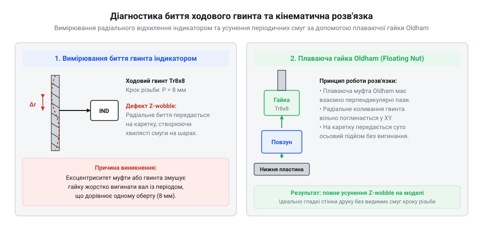

# Діагностика та усунення артефактів Z-wobble у 3D-друці

<preknowlist>
- [Мініатюрні кулькові підшипники](root:cat-hw-parts/miniature-ball-bearings) — Номенклатура та посадкові розміри підшипників (623, 625, 685, 686) для правильної фіксації осей та зниження тертя.
- [Силіконова змазка SI-180](root:cat-hw-parts/silicone-grease) — Особливості застосування силіконового мастила для зменшення зносу рухомих з'єднань і плавного ходу гайки.
</preknowlist>

## Виявлення дефектів Z-wobble на моделі

Характерним дефектом тривимірного друку на принтерах із приводом вертикальної осі ходовими гвинтами є періодична хвилястість вертикальних стінок деталі, відома в інженерній практиці як @@en|Z-wobble@@ (або горизонтальне биття осі Z). Візуально дефект виглядає як регулярна черга горизонтальних опуклих та увігнутих смуг, що повторюються з абсолютно однаковою циклічністю по всій висоті надрукованого виробу.

Головною діагностичною ознакою Z-wobble є суворий зв'язок між просторовим періодом смуг на деталі та робочим кроком ходового гвинта:

```
λ_wobble = P_lead
```

де `λ_wobble` — період смугастості на стінці деталі вздовж вертикалі, а `P_lead` — хід ходового гвинта за один повний оберт 360°. Для найпоширеніших трапецієподібних чотиризахідних гвинтів TR8x8 крок різьби становить 2 мм, а хід за оберт дорівнює точно 8 мм. Якщо вимірювання штангенциркулем показують, що хвилі повторюються рівно через кожні 8.0 мм висоти деталі, джерелом проблеми є механічний ексцентриситет ходового гвинта або дефект його з'єднання з валом крокового двигуна. Для двозахідного гвинта TR8x4 цей період становитиме 4.0 мм, а для однозахідного TR8x2 — 2.0 мм.

Фізична причина виникнення горизонтальних смуг полягає у вимушеному зміщенні каретки в площині XY. Коли вісь неідеально прямого ходового гвинта обертається, його вершина та середня частина описують у просторі конічну або еліптичну траєкторію. Якщо латунна або поліацеталева (POM) гайка жорстко прикручена до консолі каретки столу чи порталу екструдера, радіальна складова викривлення гвинта передає циклічне силове зусилля безпосередньо на рухомий вузол. Каретка під дією цього зусилля пружно зміщується на 0.05–0.2 мм вбік від заданої траєкторії лінійних напрямних. У результаті кожен новий шар пластику вкладається з мікроскопічним зміщенням у площині XY, утворюючи регулярний рельєфний малюнок на гладких стінках.

## Вимірювання радіального та осьового биття

Для локалізації дефекту та оцінки величини перекосу використовують вимірювальну схему на базі стрілочного індикатора годинникового типу (@@en|dial indicator@@) із магнітною стійкою та ціною поділки 0.01 мм.


*Схема контролю радіального відхилення ходового гвинта за допомогою стрілочного індикатора та кінематична розв'язка за допомогою плаваючої гайки.*

Процедура діагностики складається з послідовних кроків:

1. **Контроль співвісності вала двигуна.** Вимірювальний щуп індикатора встановлюють радіально на вихідний кінець 5-міліметрового вала крокового двигуна NEMA 17 безпосередньо біля верхнього підшипника. Повільно обертаючи ротор вручну, фіксують повне радіальне биття TIR (Total Indicator Reading). Для справного двигуна биття власного вала не повинно перевищувати 0.01–0.02 мм.
2. **Контроль биття корпусу гнучкої муфти.** Щуп переносять на зовнішній діаметр нижньої та верхньої циліндричних ділянок спіральної алюмінієвої муфти. Биття понад 0.04 мм свідчить про перекіс затискних гвинтів або нерівномірну деформацію пелюсток затиску.
3. **Вимірювання відхилення ходового гвинта.** Щуп індикатора позиціонують у западину різьби ходового гвинта на відстані 20 мм вище муфти, а потім — біля верхнього зрізу гвинта. Під час повного оберту ротора на 360° стрілка індикатора показує сумарний ексцентриситет системи. Якщо амплітуда відхилення перевищує 0.15–0.30 мм, це неминуче спричиняє видимі дефекти друку на вертикальних гранях.
4. **Оцінка осьового пружинення муфти.** Алюмінієві розрізні муфти зі спіральним прорізом (helical beam) мають істотний конструктивний недолік: під дією ваги важкого столу або вертикальної реакції різання спіраль стискається подібно до пружини. Під час зміни напрямку руху (реверсу Z) муфта спочатку пружно деформується на 0.03–0.08 мм вздовж вертикалі, і лише після вибору цієї деформації гвинт починає переміщувати каретку, що спотворює висоту першого шару та провокує різнотовщинність шарів.

Нижче наведено діагностичний сценарій на мові Python, який обчислює амплітуду радіального биття за точками вимірювання індикатора та перевіряє відповідність кроку артефактів на деталі:

```python
import math

def analyze_z_wobble(measured_points_mm, lead_screw_pitch_mm, layer_height_mm):
    """
    Аналіз радіального биття гвинта та розрахунок періодичності дефекту Z-wobble.
    measured_points_mm: список замірів індикатора за один повний оберт (360 градусів)
    lead_screw_pitch_mm: робочий хід гвинта за 1 оберт (наприклад, 8.0 мм для TR8x8)
    layer_height_mm: товщина шару друку (наприклад, 0.2 мм)
    """
    max_val = max(measured_points_mm)
    min_val = min(measured_points_mm)
    tir_runout = max_val - min_val
    eccentricity = tir_runout / 2.0
    
    layers_per_cycle = lead_screw_pitch_mm / layer_height_mm
    
    print(f"=== Результати діагностики осі Z ===")
    print(f"Повне радіальне биття (TIR): {tir_runout:.3f} мм")
    print(f"Розрахунковий ексцентриситет: {eccentricity:.3f} мм")
    print(f"Період дефекту на деталі: {lead_screw_pitch_mm:.1f} мм")
    print(f"Кількість шарів у періоді хвилі: {layers_per_cycle:.1f} шарів")
    
    if tir_runout > 0.10:
        print("УВАГА: Биття перевищує критичну межу 0.10 мм. Необхідне юстування або встановлення плаваючої гайки.")
    else:
        print("НОРМА: Биття в межах допустимого допуску для якісного друку.")
        
    return tir_runout, layers_per_cycle

# Приклад практичних замірів через кожні 45 градусів оберту гвинта:
readings = [0.00, 0.04, 0.09, 0.13, 0.12, 0.08, 0.03, 0.01]
analyze_z_wobble(readings, lead_screw_pitch_mm=8.0, layer_height_mm=0.20)
```

## Встановлення та регулювання плаваючої розв'язки

Радикальним і найнадійнішим інженерним вирішенням проблеми Z-wobble є механічне розв'язання ступенів вільності між ходовою гайкою та рухомою кареткою. Замість жорсткого прикручування гайки до металевого кронштейна застосовують плаваючу гайку (@@en|floating nut@@) або трикомпонентну муфту Олдхема (@@en|Oldham coupling@@).

Конструкція плаваючої розв'язки базується на принципі розділення координатних осей:

- **По осі Z (вертикаль):** Вузол зберігає абсолютну жорсткість. Сила ваги каретки або опорні кульки передають вертикальний рух гвинта на кронштейн без найменшого люфту чи пружинення.
- **У площині XY (горизонталь):** Ходова гайка має дві взаємно перпендикулярні рухомі призматичні або пазові напрямні. Коли викривлений гвинт коливається в горизонтальній площині з амплітудою до 0.5–1.0 мм, гайка вільно ковзає всередині пазів плаваючого адаптера, повністю компенсуючи радіальний ексцентриситет і не передаючи жодного горизонтального зусилля на каретку.

Монтаж та юстування плаваючої розв'язки виконують у такому порядку:

1. Демонтують жорсткі кріпильні гвинти латунної гайки з посадочного фланця каретки.
2. Встановлюють адаптер плаваючої гайки. Рухомі контактні поверхні та ковзні пластини ретельно змащують тонким шаром стійкого мастила, наприклад [силіконовою змазкою SI-180](root:cat-hw-parts/silicone-grease), яка запобігає заїданню та сухому тертю при знакозмінних мікрозсувах.
3. Фіксувальні гвинти адаптера затягують не повністю: між головками гвинтів та рухомим фланцем гайки встановлюють пружинні тарілчасті шайби або забезпечують регламентований зазор 0.3–0.5 мм, що гарантує вільне переміщення елементів у межах горизонтального люфту без заклинювання.

## Захист підшипників двигуна та перевірка

Поширеною помилкою при складанні осі Z є перекладання повної ваги консолі осі X та важкого складання екструдера безпосередньо на внутрішні підшипники крокового двигуна NEMA 17. Стандартні роторні підшипники двигуна серії 625 або 688 є радіальними; вони не розраховані на постійні високі осьові навантаження. Коли гвинт опирається торцем у вал двигуна всередині муфти, осьова сила витискає внутрішнє кільце підшипника, викликаючи прискорений знос доріжок кочення, збільшення люфту та появу характерного клацання під час роботи.

Для довговічної та бездоганної роботи системи впроваджують схему з розвантажувальним упорним підшипником:

1. У нижній частині профільної рами над муфтою встановлюють незалежний підшипниковий блок із радіально-упорним підшипником або одинарним кульковим упорним підшипником.
2. Ходовий гвинт спирається на цей підшипник спеціальним упорним буртиком або фіксувальним кільцем зі стопорним гвинтом. Уся гравітаційна вага каретки сприймається жорсткою рамою верстата.
3. Вал крокового двигуна через гнучку муфту передає виключно обертальний крутний момент, працюючи в абсолютно розвантаженому режимі без осьового стискання.

Фінальна перевірка полягає у тестовому друку високого тонкостінного циліндра або призми заввишки 100 мм в один периметр (режим вази). Огляд поверхні під косим освітленням та контрольні вимірювання мікрометром підтверджують повну відсутність періодичних горизонтальних смуг, що свідчить про успішне усунення дефектів Z-wobble та правильне юстування кінематичного вузла.
