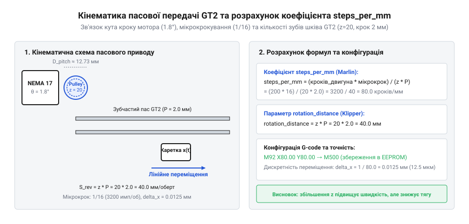
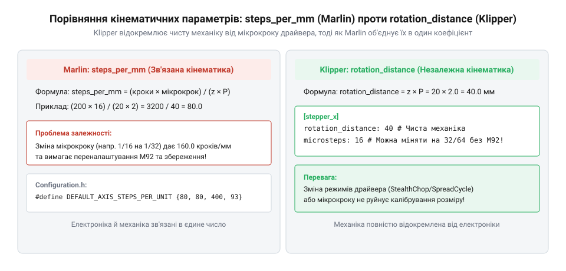

# Конфігурація параметрів пасового приводу GT2 у прошивках 3D-принтерів

## Математика кроку та мікрокрокування приводів

Будь-який сучасний 3D-принтер чи CNC-верстат керує лінійним переміщенням осей за допомогою перетворення кутового обертання ротора крокового двигуна (@@en|stepper motor@@) у поступальний рух за допомогою ремінного приводу. Точність позиціювання та якість друку безпосередньо залежать від того, наскільки правильно обчислено взаємозв'язок між електричними імпульсами керування та фізичним переміщенням паса.

Стандартний кроковий двигун у базовому повнокроковому режимі робить один повний оберт за 200 кроків, що відповідає куту кроку 1.8 градуса на один імпульс. Для двигунів з кутом 0.9 градуса цей показник становить 400 кроків на оберт. Проте роздільна здатність у 1.8° є надто грубою для досягнення високої деталізації виробів, оскільки крок зубів стандартного армованого паса GT2 дорівнює рівно 2.0 мм. Якщо просто переміщувати вісь повними кроками з 20-зубовим шківом, лінійне переміщення за один крок становитиме 0.2 мм, що спричинить помітні вібрації, шум та резонансні явища.

Для розв'язання цієї проблеми використовують апаратне мікрокрокування (@@en|microstepping@@) за допомогою сучасних драйверів крокового мотора (@@en|stepper driver@@), таких як TMC2209 чи A4988. Драйвер плавно змінює співвідношення струмів у двох обмотках двигуна, розділяючи один фізичний крок на дрібніші електричні підкроки — мікрокроки. Наприклад, поділ 1/16 або 1/32 перетворює 200 базових кроків на 3200 або 6400 імпульсів на один повний оберт ротора.


*Кінематичний зв'язок кутового руху мотора з лінійним переміщенням паса GT2.*

Щоб визначити, скільки імпульсів повинен згенерувати контролер для переміщення осі на один міліметр, послідовно розраховують кінематичні параметри приводу. Спочатку знаходять повну кількість мікрокроків на один оберт вала двигуна шляхом множення базових кроків на оберт на коефіцієнт мікрокрокування. Далі обчислюють довжину окружності шківа як добуток кількості зубів на крок зуба паса GT2 (2.0 мм).

```
steps_per_revolution = base_steps × microstepping
= 200 × 16
= 3200 [повна кількість мікрокроків на оберт вала двигуна]

belt_pitch_circumference = teeth_count × 2.0
= 20 × 2.0
= 40.0 [периметр шківа у міліметрах]
```

Звідси виводиться кінцева кількість імпульсів на міліметр лінійного переміщення, яка забезпечує повну відповідність між наказом контролера та реальним переміщенням каретки.

## Конфігурація steps_per_mm у Marlin

У прошивці Marlin та аналогічнихembedded-системах, наприклад RepRapFirmware, кінематика осей описується через дискретні коефіцієнти кількості імпульсів на міліметр (@@en|steps per mm@@). Цей параметр безпосередньо визначає, скільки імпульсів «step» мікроконтролер має надіслати на драйвер, щоб вісь змістилася рівно на один міліметр. Неправильне значення цього параметра неминуче призводить до геометричних спотворень друку, коли деталь виходить витягнутою або стиснутою по осях X та Y.

Основне налаштування здійснюється у головному заголовочному файлі конфігурації прошивки Marlin, де задається масив `DEFAULT_AXIS_STEPS_PER_UNIT`. Порядок значень у масиві суворо відповідає осям: `[X, Y, Z, E]`. Для розрахунку значення для осі X або Y з ремінним приводом GT2 використовують раніше знайдену кількість імпульсів на оберт та периметр шківа.

Нижче наведено фрагмент стандартної конфігурації у файлі `Configuration.h` для кінематики Cartesian або CoreXY з 20-зубовим шківом та мікрокроком 1/16:

```cpp|arduino
// Configuration.h - Налаштування кроків на міліметр для осей
#define DEFAULT_AXIS_STEPS_PER_UNIT { 80.0, 80.0, 4000.0, 500.0 }
```

Якщо в конструкції апаратного забезпечення замість стандартного шківа на 20 зубів (20T) використовується менший шків на 16 зубів (16T), обчислення суттєво змінюється. Оскільки довжина окружності 16-зубового шківа менша (16 × 2.0 мм = 32.0 мм), на один міліметр лінійного шляху припадає більша кількість кроків.

```
steps_per_mm = steps_per_revolution ÷ (teeth_count × 2.0)
= 3200 ÷ (16 × 2.0)
= 3200 ÷ 32.0
= 100.0 [розрахунок steps_per_mm для шківа 16T при мікрокроку 1/16]
```

Відповідно, для 16T шківа значення в масиві `DEFAULT_AXIS_STEPS_PER_UNIT` замінюється на `100.0`. Важливо пам'ятати, що зміни в `Configuration.h` вимагають повторного компілювання та прошивки плати керування, якщо в прошивці не активовано підтримку збереження параметрів в EEPROM.

## Параметр rotation_distance у прошивці Klipper

Прошивка Klipper пропонує іншу, більш інтуїтивну концепцію опису кінематики, яка повністю позбавляє користувача необхідності вручну перемножувати кроки, мікрокроки та кількість зубів для отримання проміжних коефіцієнтів. Замість цього використовується параметр відстань повороту (@@en|rotation_distance@@), який вказує, скільки міліметрів лінійного переміщення робить вісь за один повний оберт вала двигуна (360 градусів).

У файлі конфігурації `printer.cfg` для кожного крокового двигуна в секції `[stepper_x]` чи `[stepper_y]` задається фізична відстань, яку проходить вісь за 360 градусів обертання ротора. Для ремінної передачі GT2 цей параметр обчислюється як прямий добуток кількості зубів приводного шківа на крок зуба ременя (2.0 мм).


*Зіставлення параметрів конфігурації кінематики в прошивках Marlin та Klipper.*

Нижче наведено приклад конфігурації секції `[stepper_x]` у файлі `printer.cfg` для стандартного двигуна з 200 кроками на оберт, мікрокроком 16 та 20-зубовим шківом:

```ini
[stepper_x]
step_pin: PB13
dir_pin: !PB12
enable_pin: !PB14
microsteps: 16
full_steps_per_rotation: 200
rotation_distance: 40.0
# rotation_distance = teeth_count × 2.0 мм = 20 × 2.0 = 40.0 мм на оберт
endstop_pin: ^PC6
position_endstop: 0
position_max: 235
homing_speed: 50
```

Якщо конструкція принтера передбачає використання 16-зубового шківа (16T), параметр `rotation_distance` просто змінюється на математичний результат множення 16 на 2.0, тобто на `32.0`. 

Архітектура Klipper самостійно виконує внутрішнє перетворення заданого `rotation_distance`, кількості `microsteps` та `full_steps_per_rotation` у необхідну частоту генерації імпульсів планувальника. Це виключає накопичення арифметичних похибок округлення, характерних для класичних целочислених або неточних дробових розрахунків `steps_per_mm`, роблячи процес налаштування гнучким та захищеним від людської помилки.

## Оперативне калібрування та G-команди

Навіть після ретельних теоретичних розрахунків параметрів переміщення реальний 3D-принтер може мати невеликі похибки розмірів через мікропрослизання ременя, еластичність армованого корду або неточний діаметр зубих шківів. Для усунення цих відхилень без постійного перепрошивання контролера використовують оперативне калібрування за допомогою стандартних G-команд через термінал принтера (наприклад, через консоль OctoPrint, Mainsail або Fluidd).

Для динамічної зміни кількості імпульсів на міліметр у реальному часі використовується команда `M92`. Наприклад, якщо під час друку тестового кубика розміром 100 мм вимірювання штангенциркулем показали фактичний розмір 99.2 мм, необхідно виконати математичну корекцію поточного значення.

```
corrected_steps = current_steps × (expected_size ÷ measured_size)
= 80.0 × (100.0 ÷ 99.2)
= 80.645 [розрахунок скоригованого значення steps_per_mm через M92]
```

Після обчислення нового значення кінематичного коефіцієнта в консоль термінала вводять відповідні G-команди:

```gcode
; Встановлення нового значення кроків для осей X та Y
M92 X80.645 Y80.645

; Збереження поточних налаштувань в енергонезалежну пам'ять EEPROM
M500

; Перевірка та виведення поточних активних параметрів конфігурації
M503
```

Команда `M92` змінює параметри лише в оперативній пам'яті мікроконтролера. Якщо вимкнути живлення принтера без виконання команди збереження `M500`, усі внесені калібрувальні зміни будуть втрачені, і після перезавантаження відновляться старі значення з пам'яті. Команда `M503` слугує для діагностики, змушуючи прошивку вивести в термінал повний звіт про всі активні налаштування, включаючи поточні коефіцієнти осей, максимальні швидкості, прискорення та параметри PID-регулювання температурних датчиків.
