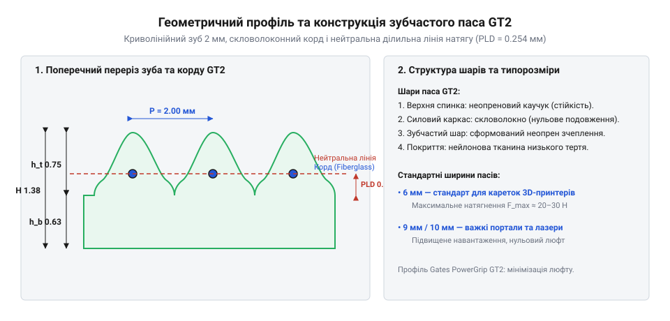
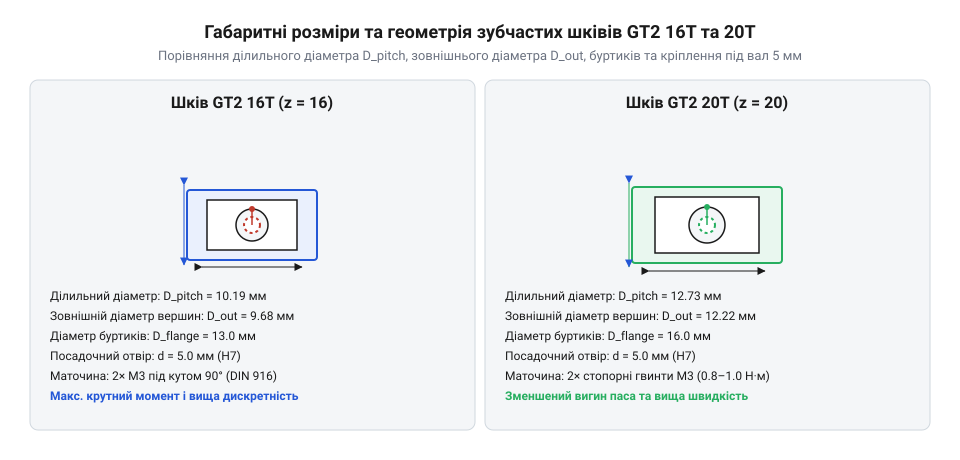

# Механічна специфікація та геометрія профілю GT2 і шківів

## Геометричний профіль зуба та корду GT2

Під час проектування високоточних лінійних привідних систем — таких як 3D-принтери, лазерні гравери чи мініатюрні верстати з числовим програмним керуванням — виникає гостра потреба у передачі обертового руху в поступальний із мінімальним люфтом і абсолютною стабільністю кроку. Традиційні клинові та класичні зубчасті паси з прямокутним чи трапецієподібним профілем під час кожного зачеплення створюють ударні коливання через різкий удар зуба об западину шківа та мають значний кінематичний люфт при реверсі. Для розв'язання цієї проблеми було розроблено криволінійний профіль зуба, який забезпечує плавний перекат зуба по ввігнутій поверхні шківів без утворення зазорів. Цей фірмовий стандарт зачіснення отримав назву зубчастий пас (@@en|timing belt@@) з геометричним криволінійним профілем (@@en|curvilinear profile@@), де кожен зуб має ретельно прораховану дугоподібну форму, що ідеально узгоджується із западинами шківа. Задля гарантування беззазорного кочення без заклинювання профіль GT2 виготовляється із суворими допусками: допуск на крок становить ±0.05 мм, а висоту зуба витримують у межах ±0.03 мм. Водночас радіус скруглення западини шківа приймається рівним близько r ≈ 0.55 мм із відповідним спряженням вершин, що усуває зайві напруження та гарантує вільний плавний перекат зубів під час реверсивних рухів.

Геометрія паса базується на номінальному кроці 2 мм, що означає сталу відстань між сусідніми центрами зубів уздовж лінії натягу. Висота зуба становить рівно 0.75 мм, а загальна товщина паса разом із гумовою або поліуретановою основою дорівнює 1.38–1.52 мм. Поверхня зуба має плавне скруглення вершин та пологий радіус бічних стінок, завдяки чому навантаження розподіляється не в одній точці, а по всій площині дотику. Це виключає ефект заклинювання та значно зменшує знос робочих поверхонь. По всій довжині паса на рівні нейтральної лінії натягу проходить армувальний корд (@@en|tensile cord@@), виконаний із високоміцних скловолоконних або арамідних ниток.


*Геометричний переріз криволінійного зуба та структура армованого корду паса GT2 2 мм.*

Нейтральна лінія натягу розташована всередині армувального шару, який практично не розтягується під впливом робочих зусиль. Це критично важливо, оскільки будь-яке подовження гілки паса призводить до втрати позиційної точності рухомого вузла. Поліуретанова або неопренова основа захищає корд від вологи, мастил та абразивного пилу, а також забезпечує необхідну гнучкість для роботи на шківах малого діаметра. На відміну від застарілих стандартів, профіль GT2 мінімізує радіальні вібрації на високих швидкостях переміщення.

## Специфікація відкритих і замкнених пасів

Коли конструктор проектує лінійний привід із рухомою кареткою або обертовий механізм із замкненим контуром, він стикається з різними умовами передачі тягового зусилля. Для відкритих лінійних відрізків, де кінці паса жорстко кріпляться до каретки за допомогою спеціальних затискачів, використовується відкритий пас у вигляді рулону. Для нескінченних контурів, де пас з'єднаний у кільце й працює на постійне обертання між двома чи більше шківами, застосовуються замкнені безкінечні паси фіксованої довжини. Стандартизація охоплює три основні монтажні ширини: 6 мм, 9 мм та 10 мм, кожна з яких розрахована на певні силові навантаження. При цьому вибір матеріалу визначає температурні режими експлуатації: неопренові паси зі скловолоконним кордом стабільно працюють у діапазоні від -30°C до +80°C (короткочасно до +100°C), зберігаючи еластичність гуми, тоді як білі термопластичні поліуретанові паси (PU) мають обмеження від -10°C до +60°C, оскільки за вищих температур поліуретан розм'якшується, а за від'ємних втрачає гнучкість і тріскається на вигинах малих шківів.

Для визначення допустимого навантаження та вибору ширини паса необхідно враховувати максимальне розривне зусилля та рекомендований попередній натяг. Наприклад, для паса шириною 6 мм розривне зусилля становить близько 110 Н, тоді як для ширини 9 мм та 10 мм цей показник зростає до 170 Н і 190 Н відповідно. Робочий попередній натяг обирається в межах однієї третини від максимального тягового зусилля, щоб забезпечити зачеплення без проскакування, але без надмірного тиску на ваги двигунів і підшипники.

Для розрахунку оптимального попереднього натягу вітки відкритому або замкненому пасу використовують співвідношення натягу, що базується на масі рухомих частин та пікових прискореннях:

```
T_pre = (F_load / 2) + (m_carriage · a_max) / k_factor
= (40 / 2) + (1.2 · 3000) / 4
= 20 + 900 = 920 Н (у піку динамічного розгону)
```

де `T_pre` — попередній натяг паса, `F_load` — корисне тягове зусилля, `m_carriage` — маса каретки, `a_max` — максимальне прискорення, `k_factor` — емпіричний коефіцієнт розподілу навантаження. Надійність передачі залежить від дотримання мінімального радіуса вигину, який для пасів GT2 із скловолоконним кордом не повинен опускатися нижче 15 мм, інакше внутрішні нитки корду зазнають втомного руйнування.

## Зубчасті шківи та монтажні інтерфейси

Передача крутного моменту з вала крокового двигуна на тяговий пас здійснюється за допомогою зубчастих шківів, які повинні гарантувати бездоганну співвісність і відсутність бічних зміщень. Під час обертання на високих швидкостях пас прагне зійти з колеса через осьові похибки монтажу, тому геометрія шківа включає не лише зубчасті вінці, а й бічні обмежувальні буртики. Найпоширенішими в сучасних компактних механізмах є зубчастий шків (@@en|timing pulley@@) із кількістю зубів 16T, 20T та 36T, де літера T позначає кількість зубів на колі.

Розмір і кількість зубів безпосередньо визначають лінійне переміщення каретки за один повний оберт вала двигуна. Для обчислення ділильного діаметра шківа та його зовнішнього діаметра за виступами зубів застосовують геометричні співвідношення:

```
D_pitch = (N · P) / π
= (20 · 2) / 3.14159
= 12.73 мм (ділильний діаметр шківів 20T)
```

де `N` — кількість зубів (`N = 20`), `P` — крок паса (`2 мм`). Зовнішній діаметр `D_outer` з урахуванням зменшення на висоту робочого профілю становить близько 12.22 мм для шківа 20T та 9.75 мм для шківа 16T. Посадочні отвори шківів стандартизовані під найпопулярніші вали крокових двигунів діаметром 5 мм (для двигунів NEMA 17) та 8 мм (для двигунів NEMA 23). Фіксація шківа на валу виконується за допомогою двох стопорних гвинтів M3 або M4, які вкручуються перпендикулярно до осі вала.


*Габаритні креслення та монтажні інтерфейси зубчастих шківів 16T та 20T під вал 5 мм.*

Для запобігання прокручуванню шківа на гладкому валу під час реверсивних ударних навантажень кінець вала повинен мати поздовжню лиску D-cut, на яку спирається кінцик стопорного гвинта. Затягування гвинтів має здійснюватися з контрольованим зусиллям, щоб деформація алюмінієвого тіла шківа не призвела до пошкодження посадочного отвору та появи радіального биття.

## Обвідні ролики та опорні підшипники

У будь-якій протяжній пасовій передачі неминуче виникають вільні гілки паса, які під час швидких реверсів починають резонувати, створюючи вібрації, шум і втрати позиційної точності. Для утримання геометрії контуру та створення необхідного натягу застосовуються обвідні ролики або ідлери, які поділяються на гладкі та зубчасті. Конструкція обвідного ролика (@@en|idrler pulley@@) базується на прецизійному кульковому підшипнику серій 623, 688 або MR105, запресованому всередину металевої оболонки.

Гладкі ролики контактують із тильною (навпаки зубів) стороною паса. Оскільки пас має дискретну зубчасту структуру, під час його проходження через гладкий ролик малого діаметра виникає так званий полігональний ефект — швидкісні мікроколивання натягу через те, що пас перекочується по багатокутній траєкторії. Для усунення цього ефекту діаметр гладкого ролика повинен становити не менше 15–20 мм, а поверхня повинна бути ідеально відшліфованою. Зубчасті ідлери, що мають відповідні зуби кроку 2 мм, контактують із внутрішньою зубчастою стороною паса, повністю зберігаючи крок і не створюючи додаткових вигинів корду.

Під час монтажу опорних підшипників на осі необхідно забезпечити абсолютну паралельність віток паса відносно напрямних рами. Перекіс осі ролика навіть на один градус викликає поступове сповзання паса до одного з буртиків, його боковий знос і значне зростання тертя. Тому осі ідлерів кріпляться через регульовані ексцентрикові шайби або довгасті пази, що дозволяє точно виставити положення обвідного вузла при остаточному натягу системи.