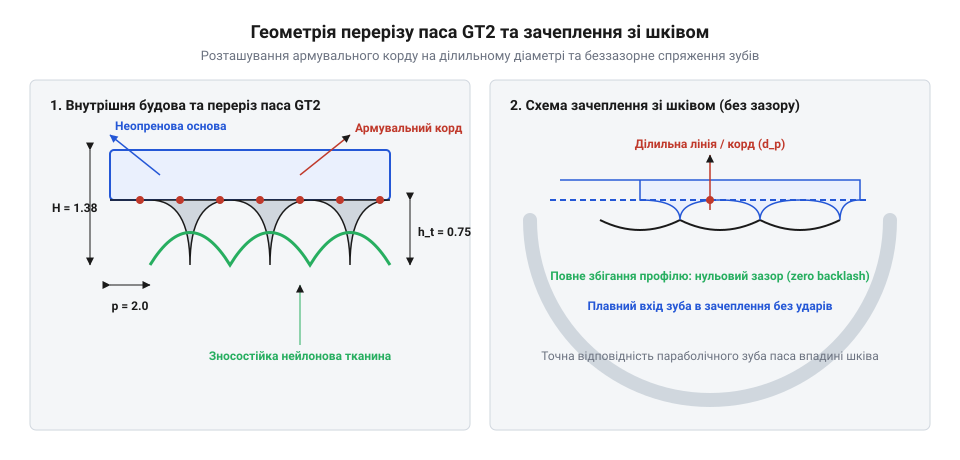
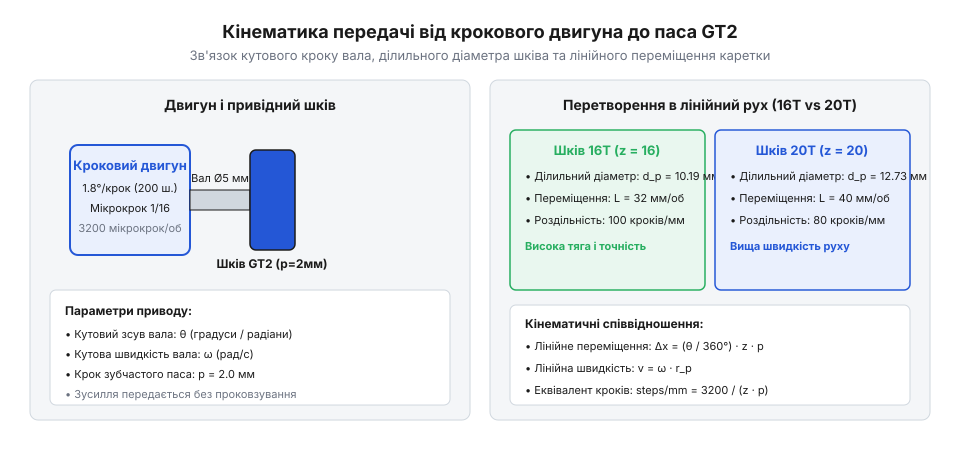
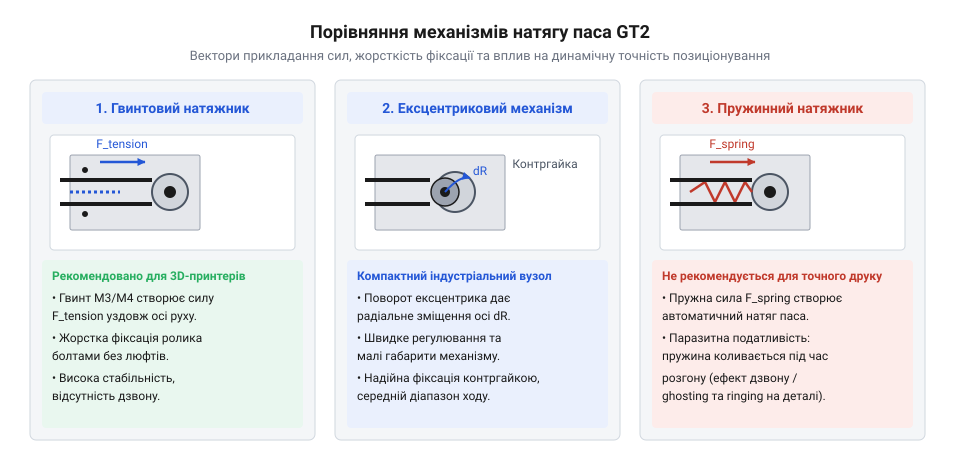
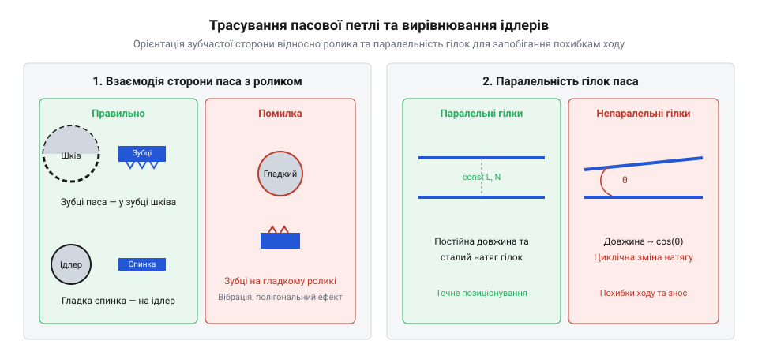
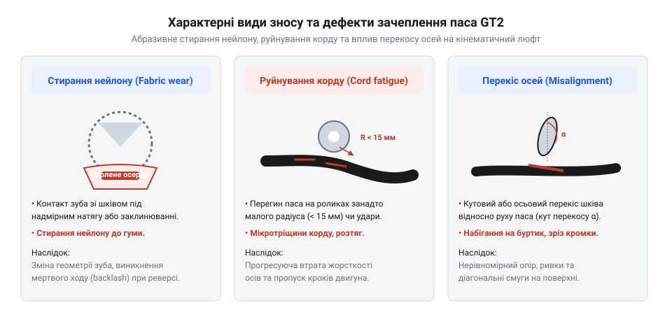

# Ремінь GT2, шківи й натяжник

## Проблема накопичення похибки та люфтів

Уявіть роботу прецизійного 3D-принтера або верстата з числовим програмним керуванням (ЧПУ), від якого вимагається відтворення деталей із точністю до десятої частки міліметра. Загальна програма задає переміщення друкувальної голівки: 100 мм праворуч, а потім рівно 100 мм назад. Проте на готовій деталі ви помічаєте неприємний дефект — вертикальні стінки зміщені, круглі отвори перетворилися на овали, а кути виявилися закругленими з помітним відставанням. Спроба реалізувати точне лінійне позиціонування за допомогою простих приводних механізмів наражається на фундаментальні фізичні обмеження, які руйнують кінематичну точність системи.

Найпростішою ідеєю для перетворення обертального руху вала двигуна на лінійне переміщення каретки є використання гладкого паса, натягнутого між двома циліндричними роликами. Проте така передача є фрикційною (від лат. *frictio* — тертя): передача зусилля відбувається виключно за рахунок сили тертя спокою між внутрішньою поверхнею паса та гладким шківом. Під час швидкого розгону каретки сила інерції `F = m · a` перевищує максимальну силу тертя спокою, внаслідок чого виникає мікроковзання (англ. @@en|microslip@@). Ба більше, для утримання приводу від постійного проковзування доводиться створювати величезний початковий натяг. Це призводить до пружного поздовжнього розтягування матеріалу паса, швидкого зносу та радіального перевантаження підшипників крокового двигуна. Оскільки ковзання має невизначений, випадковий характер, похибка позиціонування накопичується з кожним проходом осі, утворюючи незворотне зміщення шарів (англ. @@en|layer shift@@).

Щоб виключити ковзання, у промисловості розробили зубчасті паси (англ. @@en|timing belt@@, від *timing* — синхронізація), де передача зусилля здійснюється за рахунок геометричного зачеплення зубів паса із впадинами шківа. Перші масові стандарти зубчастих пасів — такі як @@en|MXL@@ (англ. *Mini Extra Light*, крок 2.032 мм) та @@en|XL@@ (англ. *Extra Light*, крок 5.08 мм) — створювалися для промислових приладів, офісної техніки та малопотужних силових передач, де головною метою була синхронізація обертів валів без проковзування. Вони мали трапецієподібну геометрію (англ. @@en|trapezoidal profile@@) з прямими похилими бічними гранями та пласкою вершиною.

Проте під час використання трапецієподібних пасів у системах точного позиціонування виявився критичний недолік — люфт при зміні напрямку руху (англ. @@en|backlash@@, від *back* — назад та *lash* — удар). Трапецієподібний зуб має входити у впадину шківа й виходити з неї під час обертання без заклинювання бічних граней. Для цього конструктивні допуски вимагають наявності гарантованого геометричного зазору між зубом паса та впадиною шківа. Коли кроковий двигун обертається в один бік, бічна грань зуба паса притиснута до робочої стінки впадини шківа. Проте в момент реверсу (зміни напрямку обертання на протилежний) вал двигуна та шків повертаються на певний кут `Δθ` "вхолосту", поки зазор не буде обрано і грань шківа не торкнеться протилежної сторони зуба паса. У цей момент шків вже рухається, а каретка залишається нерухомою. Зсув фази між обертанням вала та лінійним переміщенням створює зону гістерезису позиціонування, що виражається у появі розривів контуру й спотворенні геометрії деталей.

Крім зазору у зачепленні, трапецієподібні паси страждають від так званого полігонального ефекту (англ. @@en|polygonal effect@@). Коли пас огинає шків із малою кількістю зубів, ділильна лінія паса лягає не на ідеальне коло, а утворює багатокутник. Під час обертання шківа ефективний радіус передачі постійно пульсує між радіусом вписаного та описаного кіл багатокутника. Це викликає періодичні коливання лінійної швидкості паса, вібраційні напливи (англ. @@en|ringing@@) на поверхнях деталей та високий рівень акустичного шуму.

Усвідомлення цих обмежень змусило інженерів компанії @@en|Gates Corporation@@ переглянути геометрію зачеплення. Першим кроком стала розробка профілю @@en|HTD@@ (англ. *High Torque Drive*), який замінив трапецію на напівкруглу форму зуба для рівномірного розподілу напружень. Проте справжнім проривом для прецизійного приводу стало створення модифікованого криволінійного профілю @@en|GT2@@ (англ. *Gates Tooth Profile 2*) з кроком 2.00 мм. Детальний шлях розвитку геометрії передач висвітлено у [матеріалі про еволюцію зубчастих профілів](root:cat-hw-parts/gt2-belt-and-pulleys/hist-gt2-profile-evolution.md), де розкрито перехід від силових трапецієподібних систем до безлюфтових позиціонуючих структур.

Не менш важливою ланкою у виникненні позиційної похибки є поздовжня деформація матеріалу паса під динамічним навантаженням. Еластомерна основа паса (ґума чи полімер) має низький модуль пружності. Під час різкого розгону масивної каретки з прискоренням `a` ведена гілка паса зазнає розтягувального зусилля, що призводить до пружного видовження. Якщо армувальний корд всередині паса не володіє високим модулем жорсткості, каретка відставатиме від розрахункового положення під час прискорення та пролітатиме далі під час гальмування (англ. @@en|overshoot@@).

Таким чином, побудова високоточного лінійного приводу вимагає одночасного розв'язання двох фізичних задач: створення нелінійної параболічної геометрії зуба, яка повністю ліквідує зазор у зачепленні зі шківом, та інтеграції всередину паса армувального корду з гранично високою жорсткістю на розтяг. Розуміння цієї двоєдиної потреби дозволяє перейти до детального розбору внутрішньої будови та механіки зачеплення паса стандарту @@en|GT2@@.

## Конструкція ременя GT2 та геометрія зачеплення

Стандарт зубчасто-пасової передачі @@en|GT2@@ з кроком 2 мм розроблявся як безлюфтова кінематична пара, здатна передавати лінійний рух із мікронною повторюваністю. На відміну від звичайного монолітного ґумового ременя, пас @@en|GT2@@ є складеним композитним виробом, кожен шар якого виконує чітко визначену механічну функцію. Конструкція складається з трьох основних елементів: еластомерної основи (корпусу), захисного нейлонового покриття зубів та внутрішнього силового армувального корду.

Основа паса виготовляється із синтетичного неопренового каучуку (англ. @@en|Neoprene@@ / @@en|HNBR@@) або високоміцного поліуретану (англ. @@en|polyurethane@@, @@en|PU@@). Цей матеріал забезпечує гнучкість, необхідну для постійного циклічного згинання навколо шківів малого діаметра, стійкість до зносу та хімічний захист. Поверхня зубів, яка зазнає безпосереднього тертя під час входження у впадини шківа, вкрита зносостійкою нейлоновою тканиною (англ. @@en|nylon fabric facing@@, на основі поліаміду). Нейлоновий шар має низький коефіцієнт тертя проти алюмінію та сталі, запобігає передчасному стиранню еластомерних зубів і зменшує шум під час високошвидкісної роботи.

Найважливішим елементом, що відповідає за кінематичну точність та поздовжню жорсткість паса, є силовий армувальний корд (англ. @@en|tensile cord@@). Корд складається з множини паралельно покладених ниток зі скловолокна (англ. @@en|fiberglass@@) або араміду (англ. @@en|aramid@@, відомого під торговельною маркою кевлар). Скловолокно володіє надзвичайно високим модулем пружності та практично нульовим залишковим розтягом під робочим навантаженням.

Ключовим конструктивним рішенням є розташування армувального корду строго на лінії ділильного діаметра паса (англ. @@en|pitch line@@). Коли пас огинає круговий шків, зовнішній шар еластомеру зазнає розтягування, а внутрішній шар із зубами — стискається. Проте поздовжня вісь корду проходить через нейтральну шар-лінію (англ. @@en|neutral axis@@), довжина якої залишається строго незмінною незалежно від радіуса згину. Завдяки цьому геометричний крок між центрами зубів `p = 2.00 мм` зберігається сталим як на прямих ділянках петлі, так і під час огинання шківа будь-якого діаметра.

Будову паса та геометрію його зачеплення зі шківом показано на схемі.


*Конструктивна будова паса GT2 у перерізі: армувальний скловолоконний корд на лінії ділильного діаметра та щільне безлюфтове входження параболічного зуба у впадину шківа.*

Геометрія зуба @@en|GT2@@ має модифікований параболічний профіль. Крок паса `p` становить 2.00 мм, висота зуба `h_t` дорівнює приблизно 0.75 мм, а відстань від вершини зуба до ділильної лінії (англ. @@en|pitch line distance@@, @@en|PLD@@) становить 0.254 мм. Конструктивні параметри профілю, геометричні допуски та стандарти виготовлення шківів детально описано у [довіднику механічної специфікації GT2](root:cat-hw-parts/gt2-belt-and-pulleys/api-gt2-mechanical-spec.md).

Механізм взаємодії параболічного зуба із впадиною шківа принципово відрізняється від трапеції. Завдяки плавному параболічному контуру зуб паса не вклинюється і не вдаряється об стінку впадини, а плавно перекочується по ній під час обертання шківа. Геометрія впадини шківа виготовляється із мікронною точністю методом фрезерування або зубодовбання, що забезпечує повне сполучення поверхонь без радіального чи тангенціального зазору. Оскільки бічні поверхні зуба щільно прилягають до впадини по всій висоті, у момент реверсу напрямку руху відсутній мертвий хід (англ. @@en|backlash@@). Навантаження розподіляється одночасно між кількома зубами, що перебувають у зачепленні (англ. @@en|teeth in mesh@@), мінімізуючи локальну деформацію еластомеру.

Під час проєктування пасової траси петля огинає не лише приводний зубчастий шків двигуна, а й обвідні ролики (англ. @@en|idler@@, від *idle* — холостий). Огинання ролика може здійснюватися як гладкою спинкою паса, так і зубчастою стороною. - Коли пас торкається ролика гладкою спинкою, використовується **гладкий обвідний ролик**. Рівна зовнішня поверхня спинки паса забезпечує рівномірне перекочування без вібрацій. - Коли ж траса петлі вимагає огинання ролика зубчастою стороною, застосування гладкого ролика є грубою помилкою. На гладкому циліндрі вершини зубів паса зазнають точкового стискання, а проміжки між зубами залишаються без опори. Це спричиняє деформацію профілю зубів та виникнення систематичних пульсацій радіуса огинання, що проявляється як паразитна хвилястість на поверхні надрукованих деталей. Для огинання зубчастою стороною обов'язково застосовуються **зубчасті ідлери** (англ. @@en|toothed idler@@), профіль зубів яких повністю відповідає геометричному кроку 2.00 мм.

Ширина паса є основним параметром, що визначає його нагрузочну здатність та поздовжню жорсткість. У робототехніці та 3D-друку стандартно застосовуються паси @@en|GT2@@ шириною 6 мм, 9 мм та 12 мм. Оскільки силовий корд складається з паралельних ниток скловолокна, кількість ниток прямо пропорційна ширині паса. Збільшення ширини паса з 6 мм до 9 мм підвищує кількість силових ниток корду на 50%, що пропорційно збільшує модуль поздовжньої жорсткості `k_b`. Пружне розтягування паса `ΔL` під дією сили інерції `F = m · a` під час прискорення каретки визначається співвідношенням:

```
ΔL = (F · L) ÷ (E · A)
   = (m · a · L) ÷ (E · W · t_eff)     [підстановка сили інерції та ефективної площі]
```

де `m` — маса рухомої каретки, `a` — лінійне прискорення осі, `L` — вільна довжина гілки паса, `E` — модуль пружності скловолоконного корду, `W` — ширина паса, а `t_eff` — ефективна товщина силового шару.

Зі збільшенням ширини `W` абсолютне видовження `ΔL` зменшується. Це дозволяє уникнути резонансного тремтіння та вібраційних напливів (англ. @@en|ghosting@@) при високих динамічних прискореннях (прискорення понад 5000 мм/с²). Детальний розрахунок пружної деформації під навантаженням та фізичних моделей натягу викладено в [математичній моделі жорсткості паса](root:cat-hw-parts/gt2-belt-and-pulleys/math-gt2-tension-and-stiffness.md). Практичні рекомендації щодо збирання та вибору параметрів вузла наведено у [методиці проєктування пасового вузла](root:cat-hw-parts/gt2-belt-and-pulleys/proj-gt2-axis-assembly-and-tensioning.md).

Завдяки поєднанню параболічної геометрії зубів, нерозтяжного скловолоконного корду на ділильній лінії та правильно підібраних зубчастих ідлерів, пасова пара @@en|GT2@@ забезпечує жорстке безлюфтове зчеплення. Це створює надійну фізичну основу для подальшого розрахунку кінематики лінійного переміщення осі та дискретності позиціонування.

## Кінематика переміщення та розрахунок дискретності

З'ясувавши композитну будову ременя та безлюфтовий характер параболічного зачеплення @@en|GT2@@, ми постаємо перед наступною інженерною задачею: як точно перетворити обертання вала двигуна на вимірюваний лінійний зсув каретки. Електричний блок керування не оперує міліметрами — він надсилає у драйвер двигуна послідовність цифрових імпульсів. Якщо система отримує 1000 дискретних імпульсів, на яку саме відстань переміститься друкувальна голівка чи фреза? Відповідь визначається кінематичним розрахунком передачі, що пов'язує кутове дискретне переміщення вала з лінійним кроком паса.

Основою синхронного приводу є кроковий двигун, вал якого повертається не безперервно, а дискретними кутовими кроками (англ. @@en|full step@@). Стандартний двофазний кроковий двигун робить один повний оберт за 200 повних кроків, що відповідає куту кроку `α = 1.8°` (або 400 кроків з кутом `α = 0.9°` для підвищеної точності). Щоб зменшити вібрації та підвищити плавність руху, сучасні драйвери застосовують мікрокрокування (англ. @@en|microstepping@@) — дробіння основного електричного кроку на `M` мікрокроків (наприклад, 1/16, 1/32, 1/64 або 1/256). У результаті кількість дискретних станів на один оберт вала `N_rev` обчислюється як добуток базових кроків `N_full` на дільник мікрокроку `M`.

Обертальний рух вала передається пасу через зубчастий шків, затиснутий на валу двигуна. Ключовим параметром шківа є число його зубів `z`. Оскільки крок паса @@en|GT2@@ строго фіксований і дорівнює `p = 2.00 мм`, ділильний периметр шківа (англ. @@en|pitch circumference@@) — тобто довжина паса, що проходиться за один повний оберт вала, — становить `C = z · p`. Наприклад, для поширеного шківа на 20 зубів (`z = 20`) один оберт вала переміщує пас строго на 40.0 мм.

Кінематичну взаємодію між кроковим двигуном, шківом та пасом показано на схемі.


*Схема перетворення кутового зміщення вала двигуна на лінійне переміщення каретки: зв'язок між мікрокроком, числом зубів шківа та кроком паса 2 мм.*

Основною величиною для конфігурування осі є розрахункова дискретність (від лат. @@en|discretus@@ — розділений) або кількість кроків на міліметр переміщення (англ. @@en|steps per mm@@, @@en|steps per unit@@). Вона показує, скільки мікрокроків має подати керуюча плата для зсуву каретки на 1 мм. Якщо привід є прямим (без додаткового редуктора, передавальне відношення `i = 1`), розрахунок виконується за базовим формульним співвідношенням.

```
S = (N_full · M · i) ÷ (z · p)
  = (200 · 16 · 1) ÷ (20 · 2.00)     [підстановка параметрів: 1.8°, 1/16, z=20, p=2 мм]
  = 3200 ÷ 40
  = 80 кроків/мм                    [розрахункова дискретність осі]
```

Знаючи величину `S = 80 кроків/мм`, ми можемо розрахувати теоретичну лінійну роздільну здатність осі (англ. @@en|resolution@@) `Δx` — найменший лінійний зсув, що відповідає одному мікрокроку:

```
Δx = 1 ÷ S
   = 1 ÷ 80
   = 0.0125 мм                       [теоретична роздільна здатність 12.5 мкм]
```

Шляхом вибору шківа з різним числом зубів `z` інженер шукає компроміс між лінійною роздільною здатністю, крутним моментом та максимальною швидкістю переміщення:
- **Малий шків (`z = 16`)**: ділильний периметр `C = 32 мм`. При мікрокроці 1/16 дискретність становить `S = 3200 / 32 = 100 кроків/мм`, що забезпечує підвищену роздільну здатність `Δx = 0.010 мм` (10 мкм). Зменшений ділильний радіус `r = C / 2π ≈ 5.09 мм` збільшує плече лінійного зусилля `F = T_motor / r` при тому самому моменті двигуна `T_motor`. Проте малий радіус підвищує циклічний згин паса й вимагає більшої частоти імпульсів від контролера для досягнення тієї самої швидкості. - **Стандартний шків (`z = 20`)**: ділильний периметр `C = 40 мм`, `S = 80 кроків/мм`, роздільна здатність 12.5 мкм. Забезпечує оптимальний баланс між радіусом згину, навантаженням на підшипники та швидкістю осі. - **Великий шків або редукційні ступені (`z = 36...80`)**: застосовуються у вузлах підвищеного навантаження або редукторах екструдерів. Якщо шків `z = 80` ведеться від малого шківа `z = 20`, виникає механічне редукційне відношення (англ. @@en|reduction ratio@@) `i = 80 / 20 = 4:1`, що помножує підсумкову дискретність осі в чотири рази.

Детальний формалізований вивід кінематичних рівнянь та аналіз розрахунку похибок наведено в [математичному описі кінематики](root:cat-hw-parts/gt2-belt-and-pulleys/math-gt2-positioning-kinematics.md).

Знайдене значення дискретності `S` заноситься до конфігураційних файлів прошивок керування. Проте різні архітектури прошивок використовують власні синтаксичні інтерфейси:
- У прошивці @@en|Marlin@@ значення дискретності задається прямо в кроках на міліметр через масив `DEFAULT_AXIS_STEPS_PER_UNIT {80, 80, 400, 93}` або команду `M92`. - У прошивці @@en|Klipper@@ замість кроків на міліметр задається фізична довжина переміщення за один оберт вала (англ. @@en|rotation distance@@). Для шківа `z = 20` параметр `rotation_distance` становить строго `z · p = 40`, а кількість кроків розраховується математичним ядром прошивки автоматично на основі вказаних параметрів `microsteps: 16` та `full_steps_per_rotation: 200`. - У системі @@en|RepRapFirmware@@ конфігурування здійснюється через параметр `M92 X80 Y80`.

Повний перелік параметрів та синтаксичні приклади для всіх трьох систем наведено у [довіднику параметрів прошивки](root:cat-hw-parts/gt2-belt-and-pulleys/api-firmware-stepper-config.md).

Точний кінематичний розрахунок гарантує геометрію переміщення лише в ідеальних статичних умовах. Проте під час реального руху на систему діють динамічні сили прискорення, які прагнуть розтягнути пас і порушити точність позиціонування.

## Динаміка зусиль та механіка натяжників

Ідеальна кінематична модель припускає абсолютну жорсткість усіх ланок приводу. Проте під час реальної роботи каретка масою 0.5 кг, що розганяється з прискоренням `a = 10 000 мм/с²` (10 м/с²), генерує динамічну силу інерції `F_dyn = m · a = 5.0 Н`. У стані спокою обидві гілки замкненої або відкритої пасової петлі перебувають під однаковим початковим робочим натягом `T_0` (англ. @@en|static tension@@). Коли кроковий двигун починає розгін, натяг у ведучій гілці зростає до `T_1 = T_0 + F_dyn / 2`, тоді як натяг у веденій гілці зменшується до `T_2 = T_0 - F_dyn / 2`.

Якщо початковий робочий натяг `T_0` виявиться недостатнім (`T_0 < F_dyn / 2`), ведена гілка повністю втратить натяг (`T_2 ≤ 0`) і провисне. Це спричинить небезпечний динамічний ефект — пропуск кроків або перескок зубів (англ. @@en|tooth skip@@) через впадини шківа. З іншого боку, під дією зростаючого зусилля `T_1` силовий корд ведучої гілки зазнає пружного видовження `ΔL`. Наслідком цього розтягування є динамічна похибка позиціонування: каретка відстає від розрахункової траєкторії при розгоні та проскочує її при гальмуванні (англ. @@en|overshoot@@), спричиняючи резонансні коливання (англ. @@en|ringing@@) на кутах деталі.

Виникає спокуса затягнути пас якнайсильніше, щоб максимально підвищити жорсткість приводу. Проте верхня межа натягу `T_0,max` суворо обмежена механічною міцністю вузлів. По-перше, сумарне натяжне зусилля обох гілок `2 · T_0` створює постійне радіальне навантаження (англ. @@en|radial load@@) на вал крокового двигуна та підшипники обвідних роликів. Стандартні підшипники двигунів NEMA 17 розраховані на максимальне радіальне зусилля не більше 20–30 Н. Перевищення цієї межі призводить до швидкого руйнування шарикопідшипників, вигину вала двигуна та зростання внутрішнього тертя. По-друге, надмірний натяг викликає прискорений знос нейлонового покриття зубів та мікророзриви скловолоконних ниток корду.

Для підтримання оптимального натягу без перевантаження підшипників застосовуються спеціальні механізми натягу (натяжники). Їхні основні конструктивні варіанти показано на схемі.


*Порівняння трьох конструкцій натяжників: жорстке гвинтове регулювання, компактне ексцентрикове повертання та деформаційно-нестабільне пружинне кріплення.*

Аналіз физики роботи цих механізмів виявляє суттєві відмінності в їхній динамічній жорсткості:
- **Гвинтові натяжники (англ. @@en|screw tensioner@@)**: переміщення блоку обвідного ролика здійснюється за допомогою метричних гвинтів (M3 або M4). Це забезпечує абсолютно жорстке фіксування положення ролика. Гвинтовий механізм дозволяє з мікронною точністю виставити початковий натяг `T_0` і не зазнає жодних пружних деформацій під дією динамічної сили `F_dyn`. Вимога до інженера — періодична перевірка натягу під час технічного обслуговування. Це єдине рекомендоване рішення для прецизійних 3D-принтерів та ЧПУ-верстатів. - **Ексцентрикові натяжники (від грец. @@en|ekkentros@@ — виведений з центру; англ. @@en|eccentric tensioner@@)**: регулювання здійснюється поворотом ексцентрикової втулки або осі ролика. Перевагами є крайня компактність та швидкість налаштування. Проте обмежений робочий хід ексцентрика, а при слабкому затисканні фіксуючого гвинта існує ризик самовільного прокручування під дією вібрацій. - **Пружинні натяжники (англ. @@en|spring tensioner@@)**: сталева пружина-прищіпка, що встановлюється безпосередньо на вільну гілку паса. Пружина автоматично вибирає слабину, проте створює катастрофічний дефект — вона радикально знижує поздовжню жорсткість осі. Власна жорсткість пружини в десятки разів менша за жорсткість скловолоконного корду. Під час прискорення каретки пружина стискається і розтискається, утворюючи низькочастотний осцилятор. Застосування пружинок на пасі @@en|GT2@@ у точних верстатах суворо заборонено, оскільки це руйнує точність позиціонування.

Не менш важливу роль у збереженні кінематичної точності відіграє правильне геометричне трасування пасової петлі та вирівнювання ідлерів (англ. @@en|idler@@).


*Правила трасування пасової петлі: забезпечення паралельності робочих гілок лінійним напрямним та використання зубчастих ідлерів для зачеплення зубчастою стороною паса.*

Під час трасування необхідно дотримуватися двох фундаментальних правил:
1. **Строга паралельність робочих гілок**: гілка паса, приєднана до рухомої каретки, має бути строго паралельною до лінійних напрямних осі. Якщо гілка розташована під кутом `θ`, фактичний лінійний зсув каретки `Δx` ставатиме меншим за розрахункове видовження паса `ΔL` відповідно до співвідношення `Δx = ΔL · cos(θ)`. Цей дефект має назву косинусної похибки (від лат. @@en|cosinus@@ — синус доповнення; англ. @@en|cosine error@@). Ба більше, перекос гілки створює бокову силу, що притискає каретку до напрямної, викликаючи підклинювання підшипників та нерівномірний знос. 2. **Вибір типу обвідного ролика**: якщо петля огинає ролик гладкою спинкою паса, застосовується гладкий ролик. Якщо ж огинання відбувається зубчастою стороною, обов'язково встановлюються зубчасті ідлери (англ. @@en|toothed idler@@). Використання гладких роликів на зубчастій стороні викликає точкову деформацію зубів та пульсацію ділильного радіуса.

Детальний аналіз пружних моделей жорсткості викладено у [математичній моделі жорсткості паса](root:cat-hw-parts/gt2-belt-and-pulleys/math-gt2-tension-and-stiffness.md), а гайд зі збирання вузлів натягу наведено у [методиці проєктування пасового вузла](root:cat-hw-parts/gt2-belt-and-pulleys/proj-gt2-axis-assembly-and-tensioning.md).

Для контролю стану приводу та діагностики неполадок застосовується регулярний огляд елементів передачі. Характерні види зносу та дефекти позиціонування наведено на схемі.


*Діагностика зносу пасового приводу: стирання нейлонового покриття, розволокнення корду, зрізання зубів та виникнення похибки реверсу.*

На практиці натяг регулюють за допомогою акустичного методу: коротка вільна гілка паса змушується до коливань легким щипком, після чого вимірюється власна частота поперечних коливань (англ. @@en|natural frequency@@) `f`. Розрахунок статичного натягу `T_0` за відомою довжиною гілки `L` та лінійною масою `m_linear` виконується за формулою:

```
f = 1 ÷ (2 · L) · √(T_0 ÷ m_linear)
  = 1 ÷ (2 · 0.15) · √(18 ÷ 0.0078)  [підстановка: L=0.15 м, T_0=18 Н, m_linear=0.0078 кг/м]
  = 3.333 · √2307.7
  = 3.333 · 48.04
  ≈ 120.1 Гц                        [розрахункова частота акустичних коливань]
```

Для паса @@en|GT2@@ шириною 6 мм при вільній довжині гілки 150 мм оптимальна частота коливань становить від 110 до 130 Гц, що відповідає статичному натягу `T_0 ≈ 15...20 Н`. Детальну покрокову процедуру налаштування описано в [акустичному вимірюванні натягу](root:cat-hw-parts/gt2-belt-and-pulleys/proj-gt2-tension-measurement-and-tuning.md).

Типові види зносу та їхні фізичні причини:
- **Чорний ґумовий пил і стирання нейлонового покриття**: свідчать про перекос шківів або ідлерів, через що пас трується об бокові фланці (англ. @@en|flange@@), або про надмірний натяг. - **Зрізання зубів або їхній прискорений знос**: виникають при роботі з недостатнім натягом `T_0`, що призводить до набігання зубів на вершини шківа під час інтенсивного гальмування. - **Розшарування та розрив ниток корду**: виникає через перевищення граничного радіуса згину (використання шківів з `z < 12`), надмірне статичне затягування або застосування шкідливих пружинних натяжників. - **Поява похибки реверсу (люфту)**: найчастіше викликана не зносом паса, а послабленням затискних штифтів (англ. @@en|set screw@@) шківа на зрізі D-подібного вала крокового двигуна.

Систематичний контроль натягу, забезпечення паралельності траси та використання гвинтових натяжників дозволяють повністю реалізувати високий потенціал точності та довговічності пасової передачі @@en|GT2@@.

## Трасування пасової петлі та співвісність

Навіть ідеально розрахована кінематика та оптимально налаштований механічний натяг не гарантують високої точності позиціонування, якщо геометрія трасування пасової петлі містить просторові відхилення. У реальному приводі пас є не абстрактною силовою лінією, а фізичним стрічковим тілом певної ширини, яке взаємодіє з циліндричними поверхнями шківів та напрямних роликів. Будь-яка непаралельність робочих гілок відносно осі руху або перекос осей обертання породжує додаткові паразитичні сили, що викликають прискорений знос корду, виникнення геометричних похибок та появу візуальних дефектів на оброблюваних поверхнях.

Головною геометричною вимогою під час проєктування пасового приводу є сувора паралельність робочої гілки паса до лінійних напрямних осі переміщення. Робочою називається гілка, що з'єднує ведучий шків або обвідний ролик безпосередньо з рухомою кареткою. Якщо вісь переміщення каретки розташована під кутом `θ` до напрямку паса, то при лінійному зсуві каретки на відстань `Δx` фактична довжина протягнутого паса `ΔL` визначається через геометричне співвідношення `ΔL = Δx / cos(θ)`. Відповідно, зворотне перетворення дає лінійний зсув `Δx = ΔL · cos(θ)`. Цей феномен носить назву косинусної похибки (від лат. @@en|cosinus@@ — синус доповнення; англ. @@en|cosine error@@).

Оскільки косинус кута `cos(θ)` завжди менший за одиницю при `θ > 0`, каретка проходить меншу відстань, ніж розраховано прошивкою контролера. Зміна кута `θ` уздовж ходу осі робить похибку нелінійною. Ба більше, кутове відхилення гілки генерує поперечну бокову силу `F_side = T_0 · sin(θ)`, яка притискає каретку до лінійної напрямної. Це призводить до зростання фрикційного опору, нерівномірного зносу підшипників кочення або втулок ковзання та ризику механічного підклинювання осі.

Другим критичним фактором є забезпечення співвісності (просторової паралельності) осей обертання всіх шківів та обвідних роликів (від англ. @@en|idler@@ — обвідний ролик). Якщо вісь ролика відхилена від перпендикуляра до площини руху, пас під час перекочування прагне зсунутися вздовж осі обертання. У результаті край паса починає безперервно тертися об направляючий боковий фланець (від фр. @@en|flanc@@ — боковина, край; англ. @@en|flange@@) шківа.

Осьовий перекос викликає нерівномірний розподіл натягу між нитками скловолоконного корду: край, що притискається до фланця, зазнає підвищеного розтягувального напруження, тоді як протилежний край послаблюється. Це спричиняє швидке стирання захисного покриття, розволокнення корду та виникнення паразитного ефекту виляння (від англ. @@en|wobbling@@ — хитання, виляння; англ. @@en|belt wobbling@@, @@en|Z-wobbling@@). Ексцентриситет або некруглість обвідних роликів передає циклічні пульсації натягу безпосередньо на каретку, залишаючи на виробах періодичну хвилясту текстуру (англ. @@en|ghosting@@).

Геометричні наслідки непаралельності гілок паса та перекосу осей наведено на схемі.


*Геометричний аналіз трасування: виникнення косинусної похибки при кутовому відхиленні гілки, тертя об фланці при осьовому перекосі та утворення періодичного воблінгу.*

Окрему увагу слід приділити вибору конструкції обвідних роликів залежно від того, якою стороною пас торкається ролика. Якщо траса контуру передбачає вигин навколо ролика гладкою спинкою, застосовується гладкий ролик (англ. @@en|smooth idler@@). Якщо ж ролик огинається внутрішньою зубчастою стороною паса, використання гладкого ролика категорично недопустиме.

При контакті зубів паса @@en|GT2@@ із циліндричною поверхнею гладкого ролика вершини зубів зазнають локального продавлювання, а ефективний ділильний радіус контактної лінії постійно пульсує з частотою проходження зубів `f_pass`. Це створює високочастотну вібрацію та мікроскопічні стрибки швидкості каретки. Для зубчастого боку паса обов'язково застосовуються зубчасті ролики (англ. @@en|toothed idler@@), профіль впадин яких точно відповідає геометричній специфікації кроку 2 мм.

Конструкція вузла фіксації кінців паса на рухомій каретці визначає надійність передачі зусилля без втрати поздовжньої жорсткості. У системах з відкритим пасовим контуром (від англ. @@en|open-loop belt@@ — відкритий пасовий контур) обидва кінці ременя мають бути суворо жорстко закріплені на корпусі каретки.

Застосовуються три основні методи фіксації відкритих пасів:
- **Зубчасті притискні планки (англ. @@en|toothed clamp@@, @@en|belt lock plate@@)**: фрезеровані або 3D-друковані деталі з внутрішнім профілем зубів @@en|GT2@@. Зчеплення відбувається за рахунок зачеплення кількох зубів поспіль (англ. @@en|teeth in mesh@@), що рівномірно розподіляє навантаження вздовж силового корду без його здавлювання чи деформації. Це найнадійніший інженерний спосіб фіксації. - **Гвинтові притискні пластини**: притискання гладкого або зубчастого паса між двома плоскими металевими пластинами за допомогою гвинтів. При надмірному затягуванні існує ризик перерізання та розчавлювання крихких скловолоконних ниток корду, а при недостатньому — вислизання паса під дією динамічного прискорення. - **Фіксація пластиковими стяжками (англ. @@en|zip-tie fixing@@)**: загинання кінця паса в петлю навколо штифта й стягування капроновими хомутами. Цей спосіб є недопустимим для точних приводів, оскільки капронові стяжки зазнають в'язкопружної повзучості (від англ. @@en|creep@@ — повзучість) під постійним натягом, що призводить до самовільного послаблення паса та втрати точності.

Для замкнених пасових контурів (від англ. @@en|closed-loop belt@@ — замкнений пасовий контур), що застосовуються у схемах з неперервною петлею, фіксація здійснюється за допомогою притискного блоку або рухомого кареточного кронштейна з можливістю тонкого регулювання положення.

Вичерпні практичні рекомендації з проєктування вузлів кріплення та вирівнювання траси наведено в [проєктуванні та збиранні пасового вузла](root:cat-hw-parts/gt2-belt-and-pulleys/proj-gt2-axis-assembly-and-tensioning.md), а довідкові розміри роликів викладено у [механічній специфікації стандарту GT2](root:cat-hw-parts/gt2-belt-and-pulleys/api-gt2-mechanical-spec.md).

## Діагностика зносу та усунення дефектів

Довготривала прецизійна експлуатація пасового приводу @@en|GT2@@ вимагає систематичного технічного обслуговування, періодичного вимірювання натягу та вміння візуально діагностувати несправності на ранніх стадіях. Навіть при правильному початковому збиранні в процесі експлуатації відбувається природна релаксація напружень у матеріалі корпусу, припрацювання нейлонового покриття та знос механічних вузлів. Вчасне виявлення відхилень дозволяє запобігти раптовим відмовам, пропуску кроків та погіршенню якості обробки.

Найбільш точним та об'єктивним методом контролю робочого стану є акустичне вимірювання власної частоти поперечних коливань вільної гілки паса. Натягнута гілка паса поводиться подібно до защемленої струни з лінійною масою `m_linear` (кг/м) та вільною довжиною між роликами `L` (м). При легкому щипку гілка здійснює згасаючі поперечні коливання з основною резонансною частотою `f` (Гц).

Залежність власної частоти коливань від статичного натягу `T_0` описується базовим формульним співвідношенням:

```
f = 1 ÷ (2 · L) · √(T_0 ÷ m_linear)
```

Для практичного визначення необхідного натягу `T_0` за виміряною частотою `f` формула виражається у зворотному вигляді:

```
T_0 = 4 · m_linear · L² · f²
    = 4 · 0.0078 · (0.15)² · (120)²     [підстановка: m_linear=0.0078 кг/м, L=0.15 м, f=120 Гц]
    = 0.0312 · 0.0225 · 14400
    = 18.144 Н                          [розраховане значення статичного натягу]
```

Для стандартного паса @@en|GT2@@ шириною 6 мм зі скловолоконним кордом (лінійна маса `m_linear ≈ 0.0078 кг/м`) при вільній довжині гілки `L = 150 мм` (0.15 м) оптимальний робочий натяг `T_0 ≈ 15...20 Н` відповідає діапазону частот від 110 до 130 Гц. Вимірювання здійснюється за допомогою мобільного додатку — акустичного спектроаналізатора або оптичного тензометричного частотоміра.

У двопасових кінематичних схемах (наприклад, паралельні паси осі Y 3D-принтера) фундаментальним правилом є абсолютна симетрія налаштування: обидві гілки повинні бути налаштовані на однакову частоту з точністю до ±1...2 Гц. Неоднаковий натяг паралельних пасів викликає перекос порталу, виникнення діагональних похибок геометрії та підвищений знос підшипників.

Окрім акустичного контролю, обов'язковим є регулярний візуальний огляд елементів приводу для виявлення характерних дефектів.

Методи візуальної діагностики та спектрального налаштування показано на схемі.


*Методика технічного обслуговування GT2: характерні зони візуального зносу зубів й корду та спектральний аналіз власної частоти для налаштування натягу.*

Основні види несправностей та їхні фізичні причини:
- **Утворення чорного гумового пилу та знос кромок паса**: свідчить про осьовий перекос шківів або непаралельність валів. Пас зсувається вбік і безперервно трується об бокові фланці роликів. Для усунення слід відрегулювати положення шківів на валах і перевірити перпендикулярність осей. - **Зношування й зрізання зубів (від англ. @@en|tooth shearing@@ — зрізання зубів)**: виникає при роботі з заниженим статичним натягом `T_0`. Під час інтенсивного гальмування ведена гілка провисає, і зуби паса набігають на вершини зубів шківа, зрізаючи нейлонове покриття. Інша причина — використання шківів з невідповідним профілем (наприклад, T2.5 замість @@en|GT2@@). - **Розволокнення та розрив силового корду (англ. @@en|cord delamination@@, @@en|tensile fracture@@)**: прояв надмірного статичного натягу (`T_0 > 35 Н` для ширини 6 мм) або використання шківів з недопустимо малим числом зубів (`z < 12`). Малий радіус згину викликає значні напруження вигину в скловолоконних нитках, що призводить до їхнього мікротріскання й розшарування. - **Пропуск кроків під час динамічного руху (англ. @@en|tooth skip@@)**: виникає, коли динамічна сила прискорення каретки `F_dyn = m · a` перевищує подвійний статичний натяг (`F_dyn / 2 > T_0`). Ведена гілка повністю втрачає натяг і провисає, що призводить до стрибкоподібного зсуву шарів (від англ. @@en|layer shift@@ — зсув шарів) на оброблюваній деталі. - **Резонансне тріпотіння паса (від англ. @@en|belt flap@@ — тріпотіння паса; англ. @@en|standing wave@@)**: виникає на довгих вільних ділянках пасового контуру при збігу частоти слідування кроків двигуна `f_step = v / p` з власною частотою гілки `f`. На пасі утворюється стояча хвиля великої амплітуди, яка спричиняє раптові сплески люфту (від англ. @@en|backlash@@ — мертвий хід, люфт) та високу шорсткість (англ. @@en|ringing@@) поверхні.

Для пригнічення резонансного тріпотіння застосовують зміну статичного натягу (зсув власної частоти `f` за межі робочих швидкостей двигуна) або встановлюють проміжні обвідні ролики, які зменшують вільну довжину `L` і підвищують власну частоту гілки.

Регулярне виконання технічного обслуговування — перевірка акустичної частоти через кожні 100 годин роботи, огляд надійності затискання затискних гвинтів (англ. @@en|set screw@@) шківів на валах двигунів та очищення зубчастого профілю від пилу — забезпечує стабільно високу точність та довговічність механічної передачі.

Детальний опис процедури калібрування натягу наведено у [акустичному вимірюванні натягу та калібруванні](root:cat-hw-parts/gt2-belt-and-pulleys/proj-gt2-tension-measurement-and-tuning.md), а виведення рівнянь пружної деформації корду викладено у [математичній моделі жорсткості та натягу](root:cat-hw-parts/gt2-belt-and-pulleys/math-gt2-tension-and-stiffness.md).