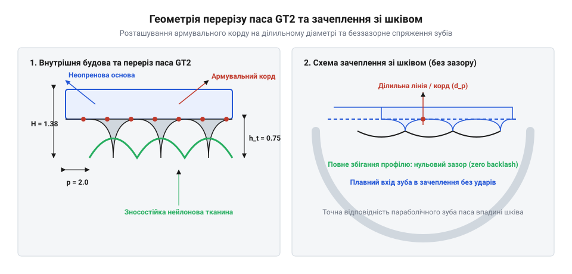

# Ремінь GT2, шківи й натяжник

## Проблема люфтів і неточність переміщення

Під час проєктування точних механізмів лінійного переміщення головним завданням стає передавання обертового руху вала на каретку без втрат координати. У простих фрикційних системах гладкий пас прослизає при розгоні, роблячи неможливим точне позиціонування. Застосування зачеплення розв'язує цю проблему, проте класичні трапецієподібні зуби мають суттєвий конструктивний недолік. Через необхідність технологічних зазорів для вільного входження і виходу зуба зі впадину шківа під час реверсу виникає мертвий хід. Зуб паса спочатку проходить холостий проміжок, вдаряючись об стінку зуба шківа, що призводить до спотворення координат та вібрацій. Для усунення цього ефекту використовується зубчастий пас (`@@en|timing belt@@`), геометрія якого забезпечує безперервне щільне зачеплення без виникнення явища, яким є люфт при зміні напрямку руху (`@@en|backlash@@`).

## Будова та геометрія ременя GT2

Щоб забезпечити високу точність позиціонування та пласність ходу, сучасні приводи переходять на спеціальну геометрію зачеплення. На відміну від трапецієподібних аналогів, вирішальне значення має параболічний криволінійний профіль (`@@en|curvilinear profile@@`), який забезпечує плавне безцентрове входження зуба у впадину шківа. Основою конструкції є еластомерне тіло з поліхлоропрену або поліуретану, всередині якого проходить силовий армувальний корд (`@@en|tensile cord@@`) зі скрученого скловолокна. Цей корд розташований строго вздовж нейтральна ділильна лінія (`@@en|pitch line@@`), що повністю запобігає розтягуванню паса під час навантажень. Зовнішня поверхня зубів вкрита зносостійкою нейлоновою тканиною, що знижує тертя. Під час трасування петлі неминуче використання напрямних елементів: обвідний ролик (від англ. `@@en|idler@@` — холостий) може бути як гладким, так і зубчастим. Зубчастий `@@en|idler@@` встановлюють на внутрішньому тильному боці паса, щоб уникнути деформації зубів і вібрацій, тоді як гладкий застосовується лише на тильному боці за умови достатнього діаметра.


*Геометрія перерізу паса GT2 та зачеплення параболічного зуба зі шківом.*

## Кінематичний розрахунок і дискретність позиціонування

Перетворення дискретних кутових кроків вала в лінійне переміщення каретки базується на параметрах кінематичної схеми приводу. Джерелом руху є кроковий двигун (`@@en|stepper motor@@`), зазвичай із базовою роздільною здатністю 200 кроків на оберт (кутом кроку 1.8 градуса). Для підвищення плавності та зменшення резонансу драйвери використовують мікрокрокування (`@@en|microstepping@@`), ділячи кожен повний крок на електричні підоснови (наприклад, 1/16 або 1/32). Лінійне переміщення за один повний оберт шківа визначається як добуток кількості зубів шківа на крок паса. Для налаштування мікропрограми управління важливо обчислити кількість кроків на міліметр (від лат. `@@en|discretus@@` — розділений; англ. `@@en|steps per mm@@`), яка визначає точність позиціонування осі.

```
S = (N_full · M) ÷ (z · p)
  = (200 · 16) ÷ (20 · 2.00)     [параметри: 1.8°, мікрокрок 1/16, шків 20T, крок 2 мм]
  = 3200 ÷ 40
  = 80 кроків/мм                 [дискретність переміщення осі]
```

Значення `@@en|steps per mm@@` безпосередньо залежить від кількості зубів шківа: заміна шківа на менший (наприклад, з 20T на 16T) збільшує роздільну здатність переміщення, зменшуючи лінійне переміщення за один імпульс двигуна.

## Натяг паса та усунення перекосів

Під час швидкого розгону та гальмування каретки на пас діють змінні сили інерції, які можуть викликати провисання непритягнутої гілки або зумовлювати пружні коливання. Недостатній натяг призводить до втрати синхронності, а надмірний перевантажує підшипники валів та спричиняє швидке стирання бічних кромок зубів. Для стабільного зусилля використовується механізм натягу (`@@en|belt tensioner@@`), який найчастіше реалізується за допомогою гвинтових або ексцентрикових пружинних вузлів. Контроль зусилля часто здійснюють за частотою вільних коливань паса, вимірюючи її акустичним методом. Окрім правильного натягу, критично важливим є паралельне трасування гілок відносно напрямних рейок. Будь-яке відхилення кута прокладання створює косинусна похибка (від лат. `@@en|cosinus@@` — синус доповнення; англ. `@@en|cosine error@@`), яка спотворює масштаб переміщення і викликає бічне тертя. Забезпечення ідеальної паралельності та стабільного `@@en|belt tensioner@@` гарантує довговічність та відсутність резонансного дзвону.