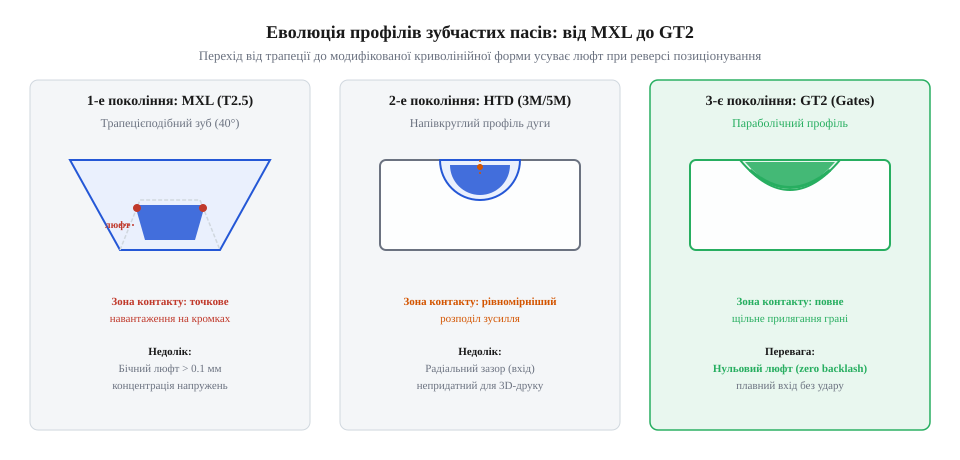

# Еволюція зубчастих профілів від MXL та HTD до GT2

## Проблема люфту в трапецієподібних пасах

Коли інженерам на початку ери точного машинобудування та верстатобудування знадобилося передавати обертовий рух без прослизання, традиційні паси виявилися безсилими. Звичайний плоскатий пас чи клиновий пас тримається виключно за рахунок сили тертя, яка неминуче прослизає під навантаженням або при різкому розгоні, роблячи неможливим точне позиціонування вузлів. Для розв'язання цієї проблеми було створено зубчастий пас (@@en|timing belt@@), який об'єднав переваги гнучкого приводу та жорсткого зачеплення зубів. Першими масовими представниками цього сімейства стали паси з трапецієподібний профіль (@@en|trapezoidal profile@@), зокрема класичні дрібні стандарти MXL та XL. Їхня геометрія базувалася на трапецієподібних зубах, які входять у відповідні канавки на шківі, гарантуючи жорстке кінематичне співвідношення без втрати жодного оберту.

Проте на практиці цей ідеальний геометричний розрахунок наштовхнувся на сувору фізику взаємодії металевих шківів і гумових або поліуретанових зубів. Щоб зуб міг вільно увійти в западину шківа і так само вільно вийти з неї під час огинання шківів різного діаметра, конструктори були змушені закладати невеликі геометричні зазори. Зуб трапецієподібної форми просто не може щільно заповнити трапецієподібну канавку без заклинювання, адже під час перегину паса на дузі кола крок зубів по зовнішній та внутрішній поверхнях відрізняється. У результаті між бічною поверхнею зуба паса та зубом шківа залишався неминучий мікроскопічний простір.

Цей конструктивний зазор призводив до критичного наслідку у приводах точних механізмів — виникнення кутового люфту (від нім. Luft — зазор; @@en|backlash@@). Коли двигун змінював напрямок обертання на протилежний, вал верстата чи каретка залишалися нерухомими протягом кількох мілісекунд, доки зуб паса не пройде вільний простір і не впишеться в протилежну стінку канавки шківа. У задачах лінійного позиціонування, де рахунок йде на соті долі міліметра, цей мертвий хід руйнував усю точність обробки, викликаючи вібрації, ривки та мікроудари, які швидко руйнували краї зубів паса.

## Поява силових напівкруглих профілів HTD

Зростаючі потреби важкого промислового устаткування, робототехніки та потужних приводів вимагали передачі значно більших крутних моментів, ніж могли витримати крихкі трапецієподібні зуби. Під час роботи на високих потужностях трапецієподібні зуби зосереджували все напруження на гострих кутах своєї основи, що неминуче призводило до зрізання зубів або їхнього передчасного викришування під ударними навантаженнями. Для подолання цієї межі у 1970-х роках компанія Gates Rubber Company розробила принципово нову геометрію зачеплення — напівкруглий профіль HTD (від англ. High Torque Drive — високий крутний момент; @@en|curvilinear profile@@).

Головна інновація напівкруглого профілю полягала у відмові від гострих кутів на користь плавної радіусної форми зуба як на пасі, так і на шківі. Така форма дозволила радикально змінити характер розподілу напружень: замість точкових концентраторів навантаження на кутах, сила тиску тепер розподілялася по всій плавній кривій поверхні зуба. Завдяки цьому крок паса (@@en|pitch@@), який визначається як відстань між аналогічними точками сусідніх зубів уздовж лінії армуючого корду, залишався стабільним під навантаженням, а сама здатність передавати потужність зросла у кілька разів.

*Порівняння геометрії профілів та зон контакту зуба зі шківом для трьох поколінь зубчастих пасів.*

Попри колосальний успіх у передачі високих моментів, профіль HTD мав власний конструктивний спадок, який заважав йому стати ідеальним інструментом для високоточного реверсивного позиціонування. Напівкруглий зуб паса заходив у напівкруглу западину шківа за принципом вкладання циліндра в ложе, що створювало певні труднощі із радіальним зазором. Для запобігання заклинюванню при вході зуба в зачеплення конструктори знову змушені були залишати простір між вершиною зуба та дном канавки, через що повністю усунути мертвий хід так і не вдалося.

## Прорив криволінійної геометрії Gates GT2

Хоча висока потужність HTD задовольняла потреби багатьох галузей, інженери з точного позиціонування продовжували боротися з мікролюфтами під час реверсу. Подальші дослідження показали, що чисте коло у напівкруглому профілі не є оптимальним для плавної взаємодії під час перегину паса навколо шківа малого діаметра. У результаті глибоких математичних симуляцій і випробувань було створено модифікований криволінійний параболічний профіль, відомий як Gates GT2 (PowerGrip GT2), який здійснив справжній прорив у кінематичній точності.

Головна відмінність GT2 полягала у вдосконаленій формі зуба, яка математично спряжена з профілем западини шківа таким чином, щоб забезпечити беззазорне зачеплення без явища заклинювання. У цьому профілі зуби паса і шківа під час входження плавно стискають одне одного у вертикальній та горизонтальній площинах, повністю ліквідуючи будь-які передумови для появи люфту. Завдяки такій геометрії привод стає абсолютно позбавленим мертвого ходу, або, як кажуть інженери, @@en|backlash-free@@, що критично важливо для верстатів із числовим програмним керуванням та координатних механізмів.

Окрім відсутності люфту, модифікована форма зуба GT2 вирішила ще одну вічну проблему ремінних передач — шум і вібрації на високих швидкостях. Завдяки параболічній кривій входження зубів у западини шківа відбувається м'яко, без різких ударів об краї, які були неминучими для трапецієподібних форм. Сила натягу корду розподіляється рівномірно по всій площі контакту, завдяки чому пас працює надзвичайно тихо, плавно і зберігає стабільність кроку навіть при різких реверсах на максимальних швидкостях.

## Тріумф стандарту GT2 2 мм

Справжній тріумф геометрії GT2 стався тоді, коли відкрите апаратне забезпечення та індустрія персонального виготовлення потребували дешевого, але неймовірно точного приводу для лінійного переміщення. Коли на початку 2010-х років зародився рух @@en|RepRap@@, розробники перших доступних настільних 3D-принтерів та лазерних гравіювальників зіткнулися з проблемою: наявні промислові ремені були занадто великими, а дрібні трапецієподібні давали жахливий люфт на друкувальних голівках. Саме тоді стандарт GT2 із кроком 2 мм був обраний як ідеальне рішення для компактних крокових двигунів NEMA 17.

Малий крок 2 мм у поєднанні з безлюфтовою геометрією дозволив досягти високої роздільної здатності лінійного переміщення без складних редукторів, напряму з'єднавши шківи з валами двигунів. Проте популярність породила й плутанину на ринку: дешеві китайські копії часто випускали під маркою T2.5 або намагалися поєднати шківи T2.5 із ременями GT2. Попри зовнішню схожість із трапецієподібним стандартом T2.5, який має крок 2.5 мм та зовсім інший кут нахилу граней, спроба встановити такий пас на шків GT2 призводить до катастрофічного зносу, проскакування зубів та повернення нестерпного люфту через невідповідність профілів зачеплення.

Сьогодні стандартизований профіль GT2 2 мм панує не лише у 3D-друку, а й у мініатюрних ЧПК-верстатах, медичному обладнанні та оптичних сканерах. Його перемога довела, що правильна математична оптимізація криволінійної форми зуба здатна перетворити звичайний передавальний елемент на високоточний компонент мікронного рівня. Завдяки простоті монтажу, відсутності потреби в змащуванні та довговічності армованих скловолокном або сталевим кордом поліуретанових ременів, GT2 назавжди закріпився як еталон надійності в сучасній мега- і мікромеханіці.