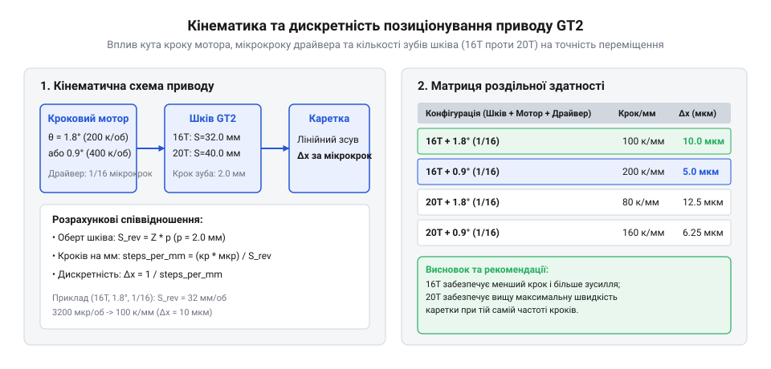

# Розрахунок кінематики та дискретності позиціонування пасової передачі GT2

## Кінематична схема пасового приводу

Точне позиціонування робочого органу в сучасних верстатах з числовим програмним керуванням (@@en|numerical control@@) та тривимірних принтерах вимагає перетворення обертального руху двигуна на прямолінійний рух каретки. Найпоширенішим рішенням для цього є зубчастий пас (@@en|timing belt@@) стандарту GT2, який завдяки своїй геометрії профілю зуба забезпечує надійне зачеплення без прослизання. Під час обертання приводного шківа зубці паса послідовно входять у впадини між зубами шківа, формуючи жорсткий кінематичний зв'язок між кутовим положенням ротора та лінійним переміщенням стрічки.

Для аналізу цього процесу розглядають геометрію ділильного діаметра (@@en|pitch diameter@@) шківа. Оскільки корд паса розташований на певній відстані від внутрішньої поверхні зубців, розрахунки спираються на умовне коло, на якому довжина кроку паса залишається незмінною незалежно від вигину. Ділильний діаметр шківа `d_p` залежить виключно від кількості зубів `z` та номінального кроку зуба паса `p`, який для стандарту GT2 дорівнює 2 міліметри.

    d_p = (z · p) / π
    = (z · 2) / 3.14159     [підстановка номінального кроку GT2 та числа пі]

Ця залежність показує, що з збільшенням кількості зубів шківа пропорційно зростає його ділильний діаметр. Лінійне переміщення каретки за один повний оберт шківа дорівнює довжині кола по ділильній лінії, тобто добутку кількості зубів на крок паса. Такий підхід дозволяє чітко зв'язати кількість обертів двигуна з міліметрами переміщення робочого стола чи екструдера.

## Розрахунок дискретності та кроків на міліметр

Перетворення неперервного обертання двигуна на дискретні кроки позиціонування здійснюється кроковим двигуном (@@en|stepper motor@@) та електронним драйвером. Стандартний кроковий двигун за один повний оберт робить певну кількість кроків, зазвичай 200, що відповідає основному куту кроку 1.8 градуса. Проте для досягнення високої точності сучасні системи використовують мікрокрокування (@@en|microstepping@@), де кожен базовий крок електрично ділиться на менші частини, наприклад 1/16 або 1/32.

Для налаштування прошивки контролера необхідно визначити кількість кроків на міліметр (@@en|steps per mm@@), тобто скільки мікрокроків має зробити двигун, щоб перемістити каретку рівно на один міліметр. Цей параметр обчислюється як відношення загальної кількості мікрокроків на один оберт ротора до лінійного переміщення каретки за цей же оберт.

*Кінематичний розрахунок дискретності та дискретних переміщень для пасової передачі GT2.*

Розглянемо детальний розрахунок для двох найпоширеніших типів шківів з кількістю зубів 16 та 20 при різних режимах мікрокрокування. Нехай базовий кут кроку двигуна становить 1.8 градуса, що відповідає 200 крокам на оберт.

**Розрахунок для шківа 16T при мікрокрокуванні 1/16**
    steps_per_mm = (steps_per_rev · microstep_factor) / (z · p)
    = (200 · 16) / (16 · 2)     [підстановка параметрів двигуна, драйвера та шківа 16T]
    = 3200 / 32                 [обчислення загальної кількості мікрокроків та лінійного шляху]
    = 100                       [результуюча дискретність: рівно 100 кроків на міліметр]

**Розрахунок для шківа 20T при мікрокрокуванні 1/32**
    steps_per_mm = (steps_per_rev · microstep_factor) / (z · p)
    = (200 · 32) / (20 · 2)     [підстановка параметрів двигуна, драйвера та шківа 20T]
    = 6400 / 40                 [обчислення загальної кількості мікрокроків та лінійного шляху]
    = 160                       [результуюча дискретність: рівно 160 кроків на міліметр]

Отримані значення показують, що шків на 20 зубів забезпечує більшу роздільну здатність за рахунок тоншого кроку дискретизації при вищому мікрокрокуванні, тоді як 16-зубовий шків дає більший крутний момент на валу при меншій кількості мікрокроків на міліметр.

## Геометрія контуру та міжосьова відстань

Під час проєктування кінематичної схеми механізму виникає потреба точного розрахунку довжини паса, яка залежить від розташування приводного та натяжного шківів. Міжосьова відстань (@@en|center distance@@) між валами визначає загальну довжину замкненого контуру або необхідний запас відкритої стрічки для рухомої каретки. Неправильно підібрана довжина паса призведе або до провисання, що викликає люфти, або до надмірного натягу, який перевантажує підшипники валів.

Для замкненої пасової передачі загальна довжина паса складається з двох паралельних прямолінійних ділянок між шківами та дуг охоплення на кожному шківі. Якщо обидва шківи мають однакову кількість зубів, розрахунок спрощується до подвійної міжосьової відстані та довжини одного повного кола.

    L = 2 · C + π · d_p
    = 2 · C + (π · z · p) / π   [підстановка виразу ділильного діаметра шківа]
    = 2 · C + z · p             [спрощення формули для однакових шківів]

Якщо шківи мають різну кількість зубів, у формулу додається похибка через різницю їхніх радіусів та кути охоплення. Для розрахунку довжини відкритого паса у рухомих системах з фіксованими кінцями стрічки враховують максимальний хід каретки та довжину кріпильних елементів, додаючи технологічний запас для надійної фіксації в затискачах.

## Динамічні параметри: швидкість і прискорення

Кінематичні розрахунки переміщення не будуть повними без оцінки динамічних характеристик приводу — лінійної швидкості та прискорення каретки. Частота імпульсів, яку генерує мікроконтролер для керування драйвером крокового двигуна, безпосередньо визначає кутову швидкість ротора, а через неї — швидкість переміщення робочого органу.

Лінійна швидкість каретки обчислюється через частоту імпульсів кроків та розраховану дискретність системи. Знаючи кількість кроків на міліметр, можна легко перевести частоту в герцах у міліметри за секунду.

    v = f / steps_per_mm
    = f / 100                   [підстановка частоти імпульсів та дискретності для шківа 16T]
    = 0.01 · f                  [отримання лінійної швидкості в міліметрах за секунду]

Прискорення каретки визначається швидкістю зміни частоти імпульсів у часі під час розгону чи гальмування. Щоб уникнути зриву кроків та втрати синхронізації ротора з магнітним полем статора, прискорення обмежують допустимим крутним моментом двигуна та інертністю рухомих мас. Максимальне лінійне прискорення розраховується через тангенціальне зусилля на шківі та загальну масу каретки з урахуванням маси самого паса.
