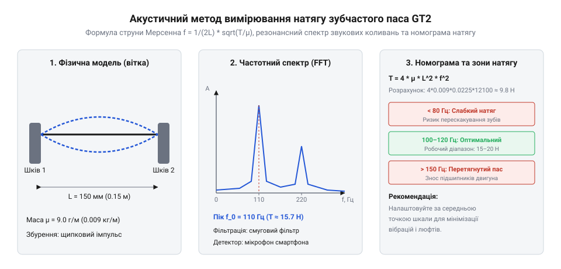

# Фізика натягу, жорсткості та акустичного вимірювання зусилля

## Пружність корду та закон Гука

Під час проєктування прецизійних механізмів із ремінними передачами, наприклад 3D-принтерів або фрезерних верстатів з ЧПК, інженер стикається з проблемою втрати позиційної точності через податливість зубчастого паса (@@en|timing belt@@). Якщо уявити ремінь як абсолютне жорстке тіло, то будь-яке зусилля на шківі мало б миттєво й безпомилково переміщувати каретку. Проте в реальності під дією тягового зусилля вітка паса розтягується, накопичуючи пружну деформацію, що призводить до мікролюфтів і запізнення реакції руху. Щоб зрозуміти, як саме ремінь протидіє цьому розтягненню, потрібно дослідити фізичну природу його внутрішньої структури — несучого армувального корду (@@en|tensile cord@@), який приймає на себе всю поздовжню напругу.

Основним елементом, що визначає жорсткість паса, є не гумова чи поліуретанова основа, а паралельні нитки корду, замуровані всередині тіла паса. Ці нитки найчастіше виготовляють зі скловолокна або арамідного волокна (кевлару). Під час розтягнення вітки паса в межах пружної деформації напруження підкоряється закону Гука (@@en|Hooke's law@@), який встановлює лінійну пропорційність між прикладеним зусиллям та подовженням матеріалу. З цього закону виводиться коефіцієнт поздовжньої жорсткості вітки паса, що залежить від площі поперечного перерізу корду, його модуля пружності та вільної довжини вітки.

Розглянемо виведення формули жорсткості вітки паса. Нехай вільна довжина вітки дорівнює `L`, сумарна площа поперечного перерізу всіх несучих ниток корду дорівнює `A`, а модуль поздовжньої пружності матеріалу корду (модуль Юнга) дорівнює `E`. Під дією поздовжнього зусилля `T` абсолютне подовження вітки становить `ΔL`. Напруження в корді розраховується як відношення зусилля до площі перерізу, а відносне подовження — як відношення зміни довжини до початкової довжини.

        σ = T / A
        = E · (ΔL / L)          [закон Гука для одновимірного розтягнення]

Виразимо звідси абсолютне подовження `ΔL`, переставивши члени рівняння:

        ΔL = (T · L) / (E · A)  [вираз подовження через тягове зусилля]

Коефіцієнт жорсткості `k` вітки паса визначається як відношення зусилля `T` до викликаного ним подовження `ΔL`:

        k = T / ΔL
        = T / ((T · L) / (E · A)) [підстановка виразу подовження]
        = (E · A) / L             [скорочення на зусилля T]

Отримана формула показує, що жорсткість вітки прямо пропорційна модулю пружності матеріалу корду та площі його поперечного перерізу, і обернено пропорційна вільній довжині вітки `L`. Для стандартного паса GT2 завширшки 6 мм зі скловолоконним кордом площа `A` становить приблизно 0.8 мм², а модуль `E` досягає 70000 МПа, тоді як арамідний корд має модуль близько 110000 МПа, забезпечуючи вищу жорсткість і менше подовження під навантаженням.

## Динамічне подовження при розгоні каретки

Коли рушійний двигун різко змінює швидкість руху каретки, виникають потужні сили інерції, які намагаються затримати масу рухомлюваних деталей. Якщо маса каретки становить `m`, а задане прискорення під час розгону або гальмування дорівнює `a`, то інерційне зусилля, що діє на ремінь, визначається за другим законом Ньютона. Оскільки вітка паса має кінцеву поздовжню жорсткість, виведену в попередньому розділі, це інерційне зусилля не передається миттєво: воно викликає миттєве пружне подовження робочої вітки та стискання неробочої, змушуючи каретку відставати від теоретичної траєкторії.

Цей процес супроводжується коливними перехідними процесами, оскільки пружний ремінь разом із масою каретки утворює пружинно-масову систему. Під час різкого старту або зупинки крокового чи серводвигуна енергія удару переходить у вільні коливання системи, що призводить до появи високочастотного «дзвону» (@@en|ringing@@) або тінєвих дефектів на поверхні виробу під час тривимірного друку. Щоб уникнути цього, необхідно вміти точно розраховувати динамічне подовження та розуміти його зв'язок із кінематичними параметрами руху.

Розглянемо математичне виведення динамічного подовження робочої вітки паса `ΔL_dyn` під час розгону. Сила інерції каретки масою `m`, що рухається з прискоренням `a`, дорівнює:

        F_i = m · a             [другий закон Ньютона для сили інерції]

Підставимо це інерційне зусилля в рівняння пружного подовження вітки довжиною `L` з урахуванням її жорсткості `k`:

        ΔL_dyn = F_i / k
        = (m · a) / k           [підстановка сили інерції у формулу закону Гука]

Розгорнемо коефіцієнт жорсткості `k` через параметри корду `E` та `A`, щоб отримати повну залежність від фізичних характеристик паса:

        ΔL_dyn = (m · a · L) / (E · A) [розгорнутий вираз динамічного подовження]

Наприклад, якщо маса каретки становить `m` = 0.5 кг, прискорення при швидкому переміщенні дорівнює `a` = 3000 м/с², вільна довжина вітки `L` = 0.3 м, а жорсткість вітки `k` = 3.5 × 10⁵ Н/м, обчислимо динамічне подовження:

        ΔL_dyn = (0.5 · 3000 · 0.3) / (3.5 · 10⁵)
        = 450 / 3.5 · 10⁵       [обчислення чисельника]
        = 0.001285 м            [результат у метрах]
        = 1.285 мм              [переведення в міліметри]

Таке подовження на 1.285 мм під час різкого розгону означає, що каретка в перші мілісекунди відстає від команди контролера на суттєву відстань, після чого починає коливатися навколо сталого положення. Зменшити цей ефект можна або зниженням маси рухомих частин, або підвищенням натягу та використанням жорсткішого арамідного корду.

## Акустичне вимірювання за формулою Мерсенна

Точне налаштування зусилля попереднього натягу паса є критичною умовою для забезпечення як позиційної точності, так і довговічності механіки. Оскільки пряме вимірювання зусилля за допомогою пружинних динамометрів у закритих корпусах верстатів часто неможливе, на практиці використовують безконтактний акустичний метод. Цей метод ґрунтується на аналізі частоти власних поперечних коливань (@@en|transverse vibration@@) вільної вітки паса, яка звучить як натягнута струна при щиpганні. Математичний зв'язок між частотою основної гармоніки, натягом та масою паса описується класичними законами французького вченого Марена Мерсенна (@@en|Mersenne's laws@@).

*Акустичний спектральний аналіз частоти поперечних коливань вільної вітки паса GT2.*

Розглянемо виведення струнного рівняння Мерсенна для вільної вітки паса. Нехай вільна довжина вітки між шківами дорівнює `L`, сила натягу вітки становить `T`, а погонна маса паса (маса одиниці довжини) дорівнює `μ`. Швидкість поширення поперечної хвилі `c` у гнучкій натягнутій нитці визначається квадратним коренем із відношення натягу до погонної маси:

        c = √(T / μ)            [швидкість поперечної хвилі в гнучкій нитці]

Основна частота власних поперечних коливань `f` струни довжиною `L` пов'язана зі швидкістю хвилі через довжину хвилі основної гармоніки, яка дорівнює двозміній довжині вітки `λ = 2 · L`:

        f = c / (2 · L)         [зв'язок частоти, швидкості та довжини вітки]

Підставимо вираз швидкості хвилі `c` у формулу частоти, щоб отримати повну формулу Мерсенна:

        f = (1 / (2 · L)) · √(T / μ) [струнне рівняння частоти власних коливань]

Для зручності налаштування на практиці цю формулу часто перетворюють так, щоб знаходити зусилля натягу `T` за виміряною частотою `f`:

        f² = T / (4 · L² · μ)   [піднесення обох частин рівняння до квадрата]
        T = 4 · L² · μ · f²     [розрахункова формула зусилля натягу за частотою]

Наприклад, якщо вільна довжина вітки паса GT2 становить `L` = 0.25 м, погонна маса стандартного паса GT2 заввишки та завширшки 6 мм зі скловолоконним кордом дорівнює `μ` = 0.016 кг/м, а за допомогою мікрофона та спектроаналізатора виміряно резонансну частоту `f` = 75 Гц, обчислимо зусилля натягу `T`:

        T = 4 · (0.25)² · 0.016 · (75)² [підстановка числових значень]
        = 4 · 0.0625 · 0.016 · 5625     [обчислення квадратів]
        = 0.25 · 0.016 · 5625           [перемноження перших множників]
        = 0.004 · 5625                  [проміжний результат]
        = 22.5 Н                        [шукане зусилля натягу в ньютонах]

Цей метод дозволяє швидко та з високою точністю контролювати натяг віток без розбирання вузла, забезпечуючи рівномірність налаштування осей.

## Розрахунок мінімального попереднього натягу

Визначення оптимального попереднього натягу (@@en|pretension@@) є компромісом між двома суперечливими вимогами: з одного боку, натяг повинен бути достатньо високим, щоб запобігти пропуску зубів на шківі під час різкого реверсу крутного моменту; з іншого боку, надмірний натяг створює величезне радіальне навантаження на вал двигуна, що швидко руйнує кулькові підшипники та призводить до заклинювання або перегріву двигуна. Тому інженер зобов'язаний розрахувати точний мінімально необхідний попередній натяг, який гарантує надійне зачеплення зубів за максимальних динамічних навантажень.

Під час роботи приводу робоча вітка паса натягується силами інерції та тяги, тоді як неробоча вітка відповідно розслаблюється. Якщо зусилля в неробочій вітці внаслідок навантаження падає до нуля, ремінь втрачає натяг, зуби виходять із зачеплення зі шківцем, і відбувається пропуск кроків. Щоб цього не сталося, попередній натяг `F_0` має щонайменше перевищувати половину максимального робочого тягового зусилля з урахуванням запасу надійності. Водночас сумарне навантаження на вали не повинно перевищувати допустиму радіальну вантажопідйомність підшипників крокового двигуна типорозміру NEMA 17, яка зазвичай становить до 25–30 Н у динамічному режимі.

Розглянемо математичний розрахунок мінімального попереднього натягу `F_0`. Нехай максимальне тягове зусилля, необхідне для розгону та переміщення каретки з урахуванням сил різання чи опору, дорівнює `F_max`. Згідно з теорією пасових передач, зусилля у робочій вітці `T_1` та неробочій вітці `T_2` під навантаженням визначаються через попередній натяг `F_0` та половину робочого зусилля:

        T_1 = F_0 + (F_max / 2) [зусилля у натягнутій робочій вітці]
        T_2 = F_0 - (F_max / 2) [зусилля у вільній неробочій вітці]

Щоб уникнути пропуску зубів і втрати натягу в неробочій вітці (`T_2 > 0`), мінімальний попередній натяг повинен задовольняти умову:

        F_0 > F_max / 2         [умова запобігання провисанню неробочої вітки]

Введемо коефіцієнт запас надійності за натягом `K_s` (зазвичай приймається в межах 1.25...1.5 для компенсації коливань і динамічних піків):

        F_0 = (F_max / 2) · K_s [розрахункова формула мінімального попереднього натягу]

Наприклад, якщо максимальне тягове зусилля під час інтенсивного розгону становить `F_max` = 24 Н, а обраний коефіцієнт запасу дорівнює `K_s` = 1.3, обчислимо необхідний попередній натяг `F_0`:

        F_0 = (24 / 2) · 1.3    [підстановка значень у формулу]
        = 12 · 1.3              [обчислення половини зусилля]
        = 15.6 Н                [результат попереднього натягу]

Перевіримо сумарне навантаження на підшипники вала двигуна. Сумарна сила, що діє на вал, дорівнює сумі натягу উভয় віток: `T_sum = T_1 + T_2 = 2 · F_0` = 2 · 15.6 = 31.2 Н (у стані спокою або при мінімальному навантаженні). Це значення знаходиться на межі допустимого для стандартних підшипників NEMA 17, тому налаштування натягу за допомогою акустичного методу (75 Гц, що відповідає ~22.5 Н на вітку) забезпечує оптимальний баланс між відсутністю пропуску зубів і безпечним ресурсом вузла.