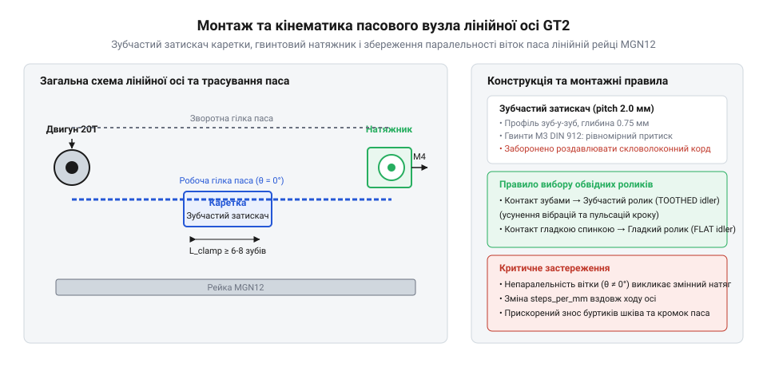

# Проєктування та збирання пасового вузла лінійної осі з натяжником

## Конструювання та кріплення затискачів паса

Коли рух від крокового двигуна (@@en|stepper motor@@) передається до рухомої каретки за допомогою гнучкого зубчастого паса (@@en|timing belt@@), виникає критичне завдання надійного закріплення кінців відкритого паса. Неправильна конструкція вузла кріплення призводить або до прослизання ременя під час різких прискорень і реверсів, або до роздавлювання та перерізання внутрішніх силових елементів. Щоб уникнути цього у відповідальних конструкціях ЧПК-верстатів та 3D-принтерів, використовують спеціальну зубчасту притискну планку (@@en|belt clamp@@), профіль якої точно повторює крок і геометрію зубів паса.

Усередині кожної стрічки високоякісного ременя прокладено силовий армувальний корд (@@en|tensile cord@@), який зазвичай складається зі скручених ниток скловолокна, араміду або сталевого дрібту. Цей корд сприймає всю поздовжню напругу від натягу та робочого зусилля, оскільки еластична поліуретанова або неопренова основа служить виключно для передачі зусилля на зуби шківа та захисту волокон. Якщо спробувати затиснути кінці паса гладкими металевими пластинами або притискати їх краями гвинтів безпосередньо по гладкій спинці, зусилля стискання неминуче деформує внутрішні жили, викликаючи їхнє локальне розшарування та розрив під навантаженням. 

Зубчастий затискач вирішує цю проблему завдяки розподілу зусилля зачеплення по кількох зубах. Планка має прецизійну рифлену поверхню з профілем, що входить у западини паса на довжині щонайменше трьох-чотирьох зубів, і виготовляється з фрезерованого анодованого алюмінію 6061 чи конструкційного вуглеволоконного поліаміду, оскільки м'які пластики зазнають пластичної повзучості під тиском гвинтів. Сила тертя та опір зсуву розподіляються рівномірно, повністю розвантажуючи кінцевий зріз паса. Якщо конструкція використовує петльове охоплення зі зворотним перегином ременя зуб-у-зуб, радіус зворотного перегину має становити щонайменше 12–15 мм, аби не допустити руйнування ниток крихкого скловолоконного корду. Для інженерного розрахунку мінімальної довжини зачеплення притискної планки, що гарантує утримання номінального тягового зусилля без зрізання зубів, застосовують таке співвідношення:

    F_max = z · p_pitch · b · τ_shear
    = 4 · 2.0 · 6.0 · 1.5
    = 72.0 N      [розрахунок максимального тягового зусилля для 4 зубців кроком 2 мм і шириною 6 мм]

де F_max — максимальне зусилля утримання, z — кількість задіяних зубів, p_pitch — крок зуба (для стандартного профілю GT2 дорівнює 2 мм), b — ширина паса (6 мм), τ_shear — допустиме на зсув напруження матеріалу зубів ременя. Як видно з формули, чотири зуби забезпечують достатній запас міцності для стандартних лінійних осей. Монтаж виконується шляхом рівномірного затягування кріпильних гвинтів із фіксацією різьби, не допускаючи перекосу планки, який міг би перерізати крайки паса.

## Монтаж шківів та вирівнювання співвісності

Після надійної фіксації кінців паса на каретці необхідно забезпечити передачу крутного моменту від двигуна на робочу гілку за допомогою зубчастого шківа. Шків жорстко кріпиться на валу за допомогою установчого гвинта (@@en|set screw@@), який закручується у спеціальну лиску (D-shaft) вала. Неповноцінна фіксація призводить до прокручування шківа під час різких розгонів, що миттєво знижує точність позиціювання та призводить до зриву кроку.

Особливу увагу слід приділити співвісності привідного шківа та всіх допоміжних обвідних роликів (від англ. @@en|idler@@ — холостий, ледачий), які формують замкнутий або натягнутий контур траси. Якщо привідний шків і ідлер розташовані в різних площинах, ремінь зазнає постійного бічного згинального моменту. Це викликає прискорене зношування бічних торців паса, появу характерного свисту, вібрацій та самовільне сповзання ременя з реборд шківів. 

Вирівнювання виконується за допомогою юстувальної металевої лінійки або лазерного маркера, встановленого паралельно базовій алюмінієвій рамі. Осьове биття шківа на валу не повинно перевищувати десятих часток міліметра. Установчий гвинт обов'язково контриться анаеробним фіксатором різьби середньої міцності, щоб вібрації від кроків двигуна не послабили з'єднання під час тривалої роботи.

## Трасування контуру та усунення косинусної похибки

Правильне прокладання гілок паса вздовж лінійних напрямних визначає геометрію переміщення каретки. Робочі вітки паса мають бути суворо паралельні не лише між собою, але й до осі руху каретки (рейкового профілю чи циліндричного вала). Якщо гілки встановлені під невеликим кутом, виникає неминуча косинусна похибка (від лат. @@en|cosinus@@ — синус доповнення; англ. @@en|cosine error@@), яка спотворює дійсне переміщення каретки відносно команди контролера.

*Монтажна схема пасового вузла лінійної осі з гвинтовим натяжником та зубчастим затискачем.*

Фізику цього явища можна описати через геометричну проєкцію зміщення. Якщо гілка натягнута під кутом θ до напрямку руху, реальне переміщення вздовж осі x відрізняється від лінійного переміщення паса L:

    x = L · cos(θ)
    = L · (1 - (θ²) / 2)      [розклад у ряд Тейлора для малого кута перекосу θ]
    ≈ L · (1 - 0.005)        [для кута θ = 0.1 радіана]

Як видно з виразу, навіть невеликий кут перекосу створює систематичну похибку масштабування координат, що призводить до геометричних спотворень деталей при друкуванні чи обробці. Для усунення косинусної похибки монтажники використовують спеціальні калібрувальні шаблони, що фіксують положення ідлерів і кронштейнів з мікронною точністю до остаточного затягування кріпильних гвинтів.

## Встановлення натяжника та регулювання натягу

Завершальним етапом механічного збирання пасового вузла є монтаж регулювального пристрою, який забезпечує оптимальний попередній натяг гілок без надмірного навантаження на підшипники двигуна та ідлерів. Найбільш надійним рішенням для точних осей є гвинтовий натяжник (@@en|screw tensioner@@), який дозволяє плавно зміщувати рухомий кронштейн за допомогою ходового гвинта з дрібним кроком.

На відміну від пружинних фіксаторів, які піддаються резонансним коливанням і з часом втрачають пружність, гвинтовий натяжник забезпечує жорстку фіксацію положення після юстування. Контроль натягу здійснюється перевіркою зусилля прогину вітки під час дозованого натискання або за допомогою акустичного резонансу вільної ділянки паса.

Для попереднього розрахунку переміщення натяжного кронштейна Δs, необхідного для досягнення заданого приросту зусилля натягу ΔF при відомій жорсткості системи k, використовують рівняння:

    Δs = ΔF / k
    = 20.0 / 5.0     [підстановка зусилля 20 Н та жорсткості пасової системи 5 Н/мм]
    = 4.0 mm         [результат необхідного зміщення регулювального гвинта]

Після досягнення розрахункового натягу положення натяжної каретки фіксується контргайками або стопорними гвинтами. Це гарантує стабільність динамічних характеристик приводу протягом усього терміну експлуатації обладнання.