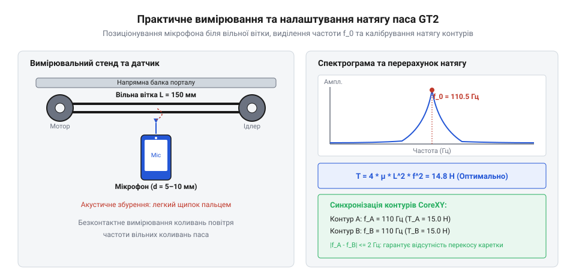

# Акустичне вимірювання натягу та калібрування точності осі

## Акустичний метод вимірювання частоти коливань

Коли зубчастий пас (@@en|timing belt@@) у механізмі 3D-принтера чи CNC-верстата натягнутий «на око», неминуче виникають серйозні проблеми: недостатній натяг призводить до пропуску кроків через прослизання зубців на шківах, а надмірний — руйнує підшипники крокових двигунів і швидко зношує армований корд паса. Традиційні спроби перевірити натяг натисканням пальця дають надто велику похибку через суб'єктивність людського сприйняття. Надійним і безконтактним розв'язком цієї проблеми є акустичний метод вимірювання частоти коливань вільної гілки паса.

Фізична суть методу полягає в тому, що вільна ділянка паса між шківами поводиться як натягнута струна. Якщо щипнути або легко вдарити по цій гілці посередині, вона здійснює вільні коливання на своїй основній власній частоті (@@en|natural frequency@@). Ці коливання є переважно поперечними коливаннями (@@en|transverse vibration@@), які збуджують звукову хвилю в повітрі. За допомогою мікрофона смартфона чи спеціального акустичного датчика цю звукову хвилю можна записати, оцифрувати та передати на спектральний аналізатор.

*Акустичне вимірювання натягу вільної гілки паса GT2 спектроаналізатором та визначення резонансного піка.*

На спектрограмі звукового сигналу чітко видно гострий резонансний пік, який відповідає основній частоті коливань вільної ділянки @@en|timing belt@@. Для фіксації сигналу використовують мобільні акустичні застосунки або спектроаналізатори на базі швидкого перетворення Фур'є (БПФ/FFT), зокрема спеціалізовані утиліти для натягу ременів чи точні хроматичні тюнери для налаштування музичних інструментів. Критичним фактором достовірності вимірювання є виключення паразитних акустичних завад: шум від обдування радіаторів хотенду або вентиляторів блоку живлення створює численні низькочастотні гармоніки, які алгоритм може помилково прийняти за резонанс ременя. Тому перед вимірюванням усі вентилятори тимчасово зупиняють, а мікрофон розміщують на відстані 10–20 міліметрів від середини вільної гілки, уникаючи торкання під час збудження. Збуджувати коливання варто легким торканням пластиковим медіатором або кінчиком пальця, після чого одразу прибирати руку. Отримане значення частоти в герцах стає надійною основою для подальшого математичного обчислення сили натягу.

## Розрахунок статичного натягу за частотою

Знаючи частоту власних поперечних коливань вільної ділянки @@en|transverse vibration@@, інженер стикається із завданням переведення герців у конкретну силу натягу в ньютонах, адже виробники обладнання нормують натяг саме в ньютонах. Для цього використовують класичну формулу струни Мерсенна (@@en|Mersenne's laws@@), яка зв'язує частоту основного тону, довжину ділянки, масу та силу натягу.

Для розрахунку статичного натягу (@@en|static tension@@) паса GT2 завширшки 6 міліметрів із погонною масою `m` (у кілограмах на метр) та вільним прольотом завдовжки `L` (у метрах) використовують такий математичний вираз:

    f = (1 / (2 × L)) × √(T / m)
    = (2 × L × f)² × m
    = T

Де `f` — виміряна власна частота (@@en|natural frequency@@) в герцах, `L` — вільна довжина гілки в метрах, `m` — погонна маса паса (для стандартного гумового паса GT2 шириною 6 мм зі скловолоконним кордом `m` зазвичай становить приблизно 0.022 кг/м або 0.000022 кг/мм), а `T` — шуканий статичний натяг у ньютонах; при цьому варто враховувати, що ідеальна струнна модель припускає відсутність власної жорсткості на згин, що на практиці дає помітну похибку для дуже коротких прольотів (`L < 100` мм), коли пружність самого тіла зубчастого паса додає додаткове відновлювальне зусилля до сили натягу, штучно завищуючи виміряну частоту `f` відносно чистого розрахунку за формулою Мерсенна.

Розглянемо практичний приклад розрахунку для вільної гілки довжиною 150 міліметрів (0.15 м) із виміряною частотою 75 герц:

    f = 75
    L = 0.15
    m = 0.022
    T = (2 × 0.15 × 75)² × 0.022
    = (0.3 × 75)² × 0.022
    = 22.5² × 0.022
    = 506.25 × 0.022
    = 11.14 Н

Отримане значення 11.14 ньютона перебуває в межах рекомендованого робочого діапазону 10–15 ньютонів для стандартних 3D-принтерів із зубчастими пасами @@en|timing belt@@. Якщо розрахована сила нижча за 8 ньютонів, пас потребує підтягування; якщо вища за 20 ньютонів — натяг надмірний, що призведе до нагріву двигунів.

## Синхронізація та вирівнювання паралельних контурів

У складних кінематичних схемах, таких як CoreXY або H-Bot, а також у портальних системах з двома незалежними двигунами на одній осі, рух забезпечують паралельні гілки пасів. Якщо натяг однієї гілки відрізняється від іншої, виникає механічний перекіс порталу під час швидких прискорень. Для усунення цього явища застосовують точне вирівнювання натягу паралельних контурів у рамках загальної кінематики (від грец. @@en|kinema@@ — рух; англ. @@en|kinematics@@).

Суть методики полягає в тому, що обидві вільні гілки, які відповідають за рух каретки, збуджують по черзі, досягаючи рівності їхніх власних частот (@@en|natural frequency@@) з точністю до 1–2 герців. Оскільки довжина вільних прольотів у симетричних контурах однакова, рівність частот гарантує ідентичність статичного натягу (@@en|static tension@@) в обох гілках. Налаштування виконують за допомогою регулювальних гвинтів натягувачів, контролюючи зміну спектрального піка в реальному часі.

Якщо натяг лівого та правого контурів відрізняється на 10 герців і більше, під час руху каретки виникає динамічний перекіс, який призводить до заклинювання лінійних підшипників на валах або рейках. Послідовне вирівнювання частоти поперечних коливань (@@en|transverse vibration@@) обох гілок @@en|timing belt@@ дозволяє симетрично розподілити навантаження на підшипники та забезпечити плавність ходу без вібрацій і резонансних призвуків.

## Інструментальне калібрування кроків у прошивці

Навіть ідеально натягнутий зубчастий пас (@@en|timing belt@@) не забезпечить мікрометричної точності позиціювання, якщо в прошивку мікроконтролера закладено номінальне, а не фактичне значення переміщення на один оберт вала. Для фінішного налаштування точності виконують інструментальне калібрування за допомогою мікрометричного індикатора або якісного штангенциркуля.

Суть методики полягає у вимірюванні реального лінійного переміщення каретки при відданні команди на переміщення на велику фіксовану відстань (наприклад, 100 міліметрів). Користувач вимірює фактично пройдену відстань і на основі отриманих даних коригує кількість кроків на міліметр (від лат. @@en|discretus@@ — розділений; англ. @@en|steps per mm@@) або крок обертання (`rotation distance`).

Для прошивок старого покоління (наприклад, Marlin) розрахунок нового значення виконують через перерахунок параметрів `steps_per_mm`:

    New_Steps = Old_Steps × (Target_Distance / Measured_Distance)
    = 80 × (100 / 99.2)
    = 80 × 1.00806
    = 80.645 steps/mm

Для сучасних прошивок (Klipper, RepRapFirmware), де використовується кінематика @@en|kinematics@@ із параметром `rotation_distance`, розрахунок здійснюється через лінійну пропорцію довжини кроку обертання:

    New_Rotation_Distance = Old_Rotation_Distance × (Measured_Distance / Target_Distance)
    = 40.0 × (99.2 / 100)
    = 40.0 × 0.992
    = 39.68 мм

Після обчислення нові параметри вводяться через консоль за допомогою команд на кшталт `M92` для Marlin або редагуванням файлу `printer.cfg` для Klipper, після чого значення зберігають в енергонезалежній пам'яті за допомогою команди `M500` або перезапуском конфігурації. Це завершує повний цикл точного механічного та програмного налаштування пасової передачі.