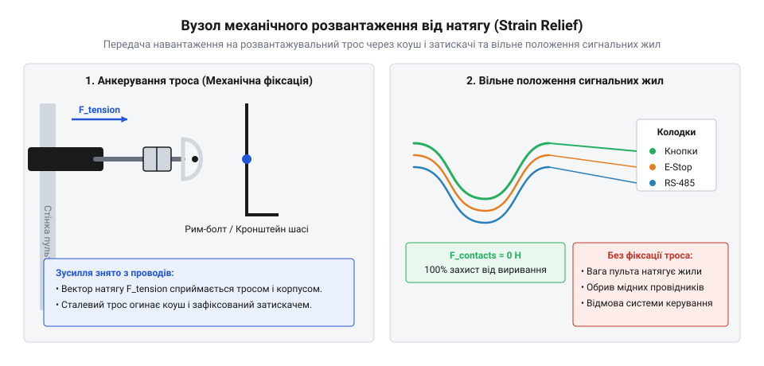
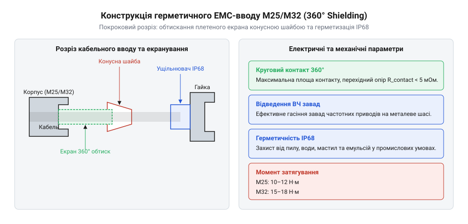

# Залізний API: схема розводки жил, кріплення троса та герметичного ЕМС-вводу

<preknowlist>
- [Монтажний провід 18 і 20 AWG](root:cat-hw-parts/hookup-wire) — Вибір перерізу мідних жил, струмові навантаження та типи ізоляції підвісних джгутів.
- [Ізольовані наконечники Faston та технологія обтискання](root:cat-hw-parts/faston-crimp-terminals) — Технологія обтискання наконечників для комутації жил кабелю до кнопок і перемикачів.
- [Класи міцності та матеріали кріплення: сталі 8.8–12.9, нержавійка A2/A4, титан Gr5 та задирання різьби](root:cat-hw-parts/fastener-strength-classes-and-materials) — Властивості металевого кріплення для затиску силового троса та корпусного герметичного вводу.
</preknowlist>

## Руйнування підвісного джгута та завади

Під час щоденної експлуатації мостового крана чи підйомного талю оператор постійно тягне, повертає та переміщує підвісний пульт керування за кабель. Багатожильний кабель довжиною 10–25 метрів разом із масивним пластиковим або металевим корпусом пульта важить від 5 до 15 кілограмів. У разі неправильного монтажу вся ця статична вага, а також динамічні ривки під час руху оператора припадають безпосередньо на мідні жили електричних провідників у місці їх входу в корпус. Мідь володіє високою електричною провідністю, проте має низьку границю втоми при циклічних вигинах і розтягах. Без механічного розвантаження дрібні мідні нитки тонкожильного провідника швидко зазнають пластичної деформації, шийкування та остаточного механічного зламу біля клемних колодок або паяних з'єднань.

Другим критичним чинником є важке електромагнітне середовище цеху. Сучасний підйомний механізм живиться від частотного перетворювача, який формує широтно-імпульсну модуляцію з крутими фронтами наростання напруги. Високі швидкості зміни напруги та струму створюють потужні імпульсні електричні й магнітні поля. Якщо силові кола живлення контакторів на 230 В і низьковольтні сигнальні лінії інтерфейсів зв'язку прокладені в одному підвісному джгуті без просторового розділення жил та суцільного екранування, виникає ємнісна й індуктивна наводка. Вона призводить до хибних спрацьовувань командних реле, викривлення цифрових пакетів або довільного вимкнення кола аварійної зупинки.

Для забезпечення безперебійної та безпечної роботи апаратний інтерфейс підвісного джгута вимагає розділення трьох системних функцій. Механічне навантаження має повністю сприйматися окремим сталевим тросом. Електромагнітне екранування забезпечується суцільною мідною опліткою із затиском в обох кінцях джгута через герметичний кабельний ввід. Електричні кола розділяються всередині кабелю за суворою схемою розпінування `@@en|pinout@@` (від англ. pin — штир, вивід, та out — назовні).

## Схема розводки жил підвісного кабелю

Розподіл жил у багатожильному підвісному кабелі визначається робочими напругами кіл, струмовим навантаженням та чутливістю сигналів до електромагнітних завад. Силові кола кнопок керування контакторами, котушки яких споживають значний пусковий струм, потребують провідників із перерізом 0.75–1.0 мм² (18 AWG або 20 AWG). Вибір правильного калібру жил детально розглядається під час [вибору монтажного проводу](root:cat-hw-parts/hookup-wire). Надійне приєднання жил до силових кнопок та поворотних перемикачів всередині пульта виконують при [використанні наконечників Faston](root:cat-hw-parts/faston-crimp-terminals), що запобігає послабленню контакту від постійної вібрації.

Для передачі цифрових даних від датчиків або джойстиків (наприклад, через інтерфейс RS-485 або CAN) застосовують виті пари `@@en|twisted pair@@`. Крок скрутки жил становить 15–25 мм. Принцип захисту витої пари полягає у тому, що зовнішня електромагнітна завада наводить у двох близько розташованих провідниках однакову за амплітудою та фазою синфазну напругу. Диференціальний приймач на боці шафи керування підраховує лише різницю потенціалів між жилами, завдяки чому синфазна завада взаємно компенсується із коефіцієнтом приглушення понад 40–60 дБ.

У разі довгих підвісних кабелів важливо розраховувати падіння напруги на жилах живлення, щоб уникнути ненадійного спрацьовування котушок реле. Падіння напруги `ΔU` обчислюють на основі повного опору петлі `R`, питомого опору міді `ρ` (0.0175 Ом·мм²/м), довжини кабелю `L` та перерізу жили `S`:

```
R = ρ · (2 · L) / S              [опір провідника у дві сторони]
ΔU = I · R                        [падіння напруги на довжині джгута]
```

Для кабелю довжиною `L = 20` м із жилами перерізом `S = 0.75` мм² при пусковому струмі котушки контактора `I = 2` А розрахунок має такий вигляд:

```
R = 0.0175 · (2 · 20) / 0.75
  = 0.0175 · 40 / 0.75
  ≈ 0.933 Ом                     [значення опору петлі живлення]
ΔU = 2 · 0.933
   = 1.866 В                     [величина спаду напруги]
```

Падіння напруги на 1.87 В є допустимим для мережі 24 В DC (менше 8%), що гарантує чітке спрацьовування контактора. Для запобігання перехресним наводкам `@@en|crosstalk@@` (від англ. cross — перехресний, та talk — розмова) між кола 230 В AC та диференціальні лінії зв'язку прокладають заземлені екранні розділювачі або виділяють їх у різні суміжні шари джгута.

Стандартна схема розводки жил підвісного кабелю (таблиця розпінування `@@en|pinout@@`):

| Номер жили / Колір | Переріз (AWG / мм²) | Призначення кола | Тип сигналу / Напруга | Особливості укладання |
| :--- | :--- | :--- | :--- | :--- |
| 1 (Коричневий) | 18 AWG / 0.75 мм² | Аварійний зупин (E-Stop Канал 1) | Силове коло NC / 24V DC або 230V AC | Пряма жила, ізольований канал |
| 2 (Білий) | 18 AWG / 0.75 мм² | Аварійний зупин (E-Stop Канал 2) | Силове коло NC / 24V DC або 230V AC | Двоканальний захист від короткого замикання |
| 3 (Чорний) | 18 AWG / 0.75 мм² | Спільний фазний/плюсовий дріт кнопок | Живлення кнопок / 24V DC або 230V AC | Захист від струмового перевантаження |
| 4 (Синій) | 18 AWG / 0.75 мм² | Кнопка «Підйом» (Up) | Команда контактора / 24V DC | З'єднання через наконечник Faston |
| 5 (Зелений) | 18 AWG / 0.75 мм² | Кнопка «Опускання» (Down) | Команда контактора / 24V DC | З'єднання через наконечник Faston |
| 6 (Жовтий) | 18 AWG / 0.75 мм² | Кнопка «Переміщення Вліво» | Команда контактора / 24V DC | З'єднання через наконечник Faston |
| 7 (Сірий) | 18 AWG / 0.75 мм² | Кнопка «Переміщення Вправо» | Команда контактора / 24V DC | З'єднання через наконечник Faston |
| 8 (Червоний) / 9 (Рожевий) | 20 AWG / 0.50 мм² | Лінія RS-485 (A / B) | Цифровий диференціальний сигнал | Окрема вита пара в індивідуальному екрані |
| 10 (Фіолетовий) / 11 (Помаранчевий) | 20 AWG / 0.50 мм² | Живлення електроніки пульта (+24V / GND) | Постійний струм / 24V DC | Вита пара для зменшення площі петлі |
| Екран (Оплітка) | Суцільна мідь | Заземлення та захист від ЕМС | Низький імпеданс PE | 360-градусний контакт з вводом |

## Кріплення силового троса та розвантаження

Механічне розвантаження кабелю здійснюється за допомогою вузла `@@en|strain relief@@` (від англ. strain — натяг, деформація, та relief — ослаблення), основними елементами якого є високоміцний сталевий трос, коуш та дугові затискачі. Використовують оцинкований або нержавіючий трос діаметром 2–4 мм із руйнівним зусиллям понад 500–1000 кг. Трос проходить усередині кабелю вздовж поздовжньої осі або прокладається поруч із ним у спеціальних петлях.

Головне правило монтажу полягає у створенні слабини електричних жил. Довжина мідних провідників усередині корпусу пульта робиться на 15–20 мм більшою за довжину зафіксованого сталевого троса. Завдяки цьому при будь-якому розтягуванні кабелю або різкому падінні пульта сталевий трос натягується першим і сприймає 100% осьового механічного зусилля. Електричні жили залишаються абсолютно вільними від натягу.


*Монтаж розвантажувального троса з утворенням петлі навколо коуша та фіксацією дуговими затискачами на металевому кронштейні пульта.*

Для виготовлення петлі на кінці троса застосовують каплеподібну металеву оправку — коуш. Він запобігає залому троса та стиранню його окремих сталевих дротів у місці контакту з кріпильним пальцем. Вкрай важливо правильно монтувати дугові затискачі (типу U-bolt): U-подібна дужка повинна тиснути на глухий (неробочий) кінець троса, а масивна затискна колодка — на робочу гілку, яка перебуває під навантаженням. Відстань між затискачами має дорівнювати 6 діаметрам троса, а кількість затискачів для троса 3 мм становить не менше трьох штук.

Анкерний кронштейн жорстко прикручують до силового каркасу пульта. Під час вибору гвинтів та гайок дотримуються вимог щодо [класів міцності сталі](root:cat-hw-parts/fastener-strength-classes-and-materials) (використовують болти класу 8.8 або з нержавіючої сталі A2-70/A4-80), оскільки зріз чи виривання різьби при динамічному ударі призведе до миттєвого руйнування електричних з'єднань.

## Монтаж герметичного EMC-вводу M25 та M32

Після закріплення механічного троса необхідно забезпечити герметичний та електромагнітно захищений вхід кабелю в корпус пульта. Для цього застосовують герметичний ввід `@@en|EMC cable gland@@` (від англ. EMC — Electromagnetic Compatibility, cable — кабель, gland — ущільнювач) розміром M25 (для кабелів зовнішнім діаметром 11–18 мм) або M32 (для кабелів діаметром 15–25 мм).

Традиційне розплетення екрана та його скручування у дріт («свинячий хвостик» або `@@en|pig-tail@@`, від англ. pig — свиня, tail — хвіст) є неприпустимим у промислових умовах з високим рівнем завад. Послідовна паразитна індуктивність скрученого провідника `L_pigtail` становить приблизно 1 нГн/мм. На високих частотах перемикання частотного перетворювача індуктивний опір `X_L` зростає пропорційно частоті `f`:

```
X_L = 2 · π · f · L_pigtail      [індуктивний опір скрученого екрана]
```

При частоті завади `f = 30` МГц скручений екран довжиною 50 мм має опір:

```
X_L = 2 · 3.1416 · 30·10⁶ · 50·10⁻⁹
    ≈ 9.42 Ом                    [високочастотний імпеданс контакту]
```

Опір 9.42 Ом унеможливлює відведення високочастотних струмів на корпус, перетворюючи сам «хвостик» на випромінювальну антену всередині пульта. 

Натомість герметичний `@@en|EMC cable gland@@` забезпечує низькоімпедансний 360-градусний контакт оплітки із корпусом завдяки внутрішній латунній конусній затискній шайбі.


*Будова та порядок збирання 360-градусного ЕМС-вводу M25/M32 з конусним затиском екранувальної плетеної оболонки та ущільнювальною манжетою.*

Монтаж 360-градусного вводу виконують за такими кроками:
1. Знімають зовнішню захисну оболонку кабелю з поліуретану або ПВХ на довжину 15–20 мм у місці розміщення затискного вузла. 2. Розправляють відкриту мідну плетену оплітку та рівномірно насувають її на внутрішній латунний конус вводу по всьому колу (на 360°). 3. Насувають конусну затискну шайбу, яка щільно притискає оплітку до конуса під час загвинчування нажимної гайки. 4. Затягують корпус вводу в різьбовому отворі корпусу або фіксують контргайкою з нормованим моментом затягування `@@en|torque@@`: для M25 — 8–10 Н·м, для M32 — 12–15 Н·м. 5. Затягують зовнішню нажимну гайку з моментом 6–8 Н·м, що забезпечує рівномірний обтиск еластомірного ущільнювача навколо кабелю для досягнення ступеня захисту IP68 (витримує тривале занурення у воду).

## Заземлення екрана на шині шафи

На протилежному кінці підвісного джгута — всередині шафи керування — екранувальна оплітка кабелю мусить бути належним чином підключена до заземлювальної шини захисного заземлення (PE). Прикрою помилкою є залишення екрана незаземленим або його підключення тонким монтажним провідником до звичайного клемника.

Для створення низькоімпедансного контакту на вході в шафу керування з кабелю знімають зовнішню ізоляцію на довжині 30–40 мм, оголюючи мідне плетіння. Оголений екран притискають безпосередньо до мідної або оцинкованої шини заземлення за допомогою пружинних ЕМС-скоб `@@en|shield clamp@@`. Пружинна скоба забезпечує постійне радіальне зусилля притиску навіть у разі температурних розширень та вібрацій шафи, гарантуючи площу контакту понад 180°–360°.

Під час проектування заземлення необхідно враховувати ризик виникнення контуру заземлення `@@en|ground loop@@` (від англ. ground — земля, та loop — петля). Якщо потенціал металевого корпусу пульта та заземлювальної шини шафи відрізняється, двостороннє пряме заземлення екрана може спричинити протікання вирівнювального струму промислової частоти (50 Гц) по оплітці. Для запобігання цьому паралельно підвісному джгуту прокладають окремий мідний провідник вирівнювання потенціалів перерізом не менше 4–6 мм², який бере на себе основний струм вирівнювання, зберігаючи оплітку від перегріву та випромінювання завад.

Після заземлення екрана поодинокі сигнальні та силові жили джгута акуратно маркують та розводять до відповідних клемних блоків. Для відсутності механічного зламу жил при відкриванні дверцят або обслуговуванні шафи застосовують фіксацію провідників у перфорованих кабель-каналах при [фіксації пластиковими хомутами](root:cat-hw-parts/cable-ties).