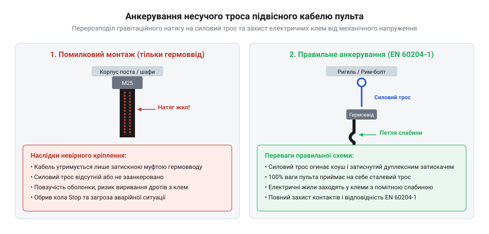

# Еволюція підвісних кабельних шлейфів та методів їхнього розвантаження

<preknowlist>
- [Тросові та еластомірні віброізолятори: Wire Rope, силіконові демпфери та поглинання ударів](root:cat-hw-parts/wire-rope-isolators) — механіка розподілу динамічних навантажень у гнучких металевих тросах.
- [Класи міцності та матеріали кріплення: сталі 8.8–12.9, нержавівка A2/A4, титан Gr5 та задирання різьби](root:cat-hw-parts/fastener-strength-classes-and-materials) — принципи вибору матеріалів для забезпечення механічної міцності силових елементів.
</preknowlist>

## Ранні відмови підвісних джгутів керування

У 1930–1950-х роках масова електрифікація промислових підприємств і металургійних цехів вимагала від операторів мобільності під час керування мостовими та козловими кранами. Щоб робітник міг переміщатися уздовж прольоту цеху поряд із підвішеним вантажем, кнопочні пульти керування зробили підвісними. Електричні сигнали від пересувної підвісної станції до нерухомої шафи автоматики передавалися через вертикально опущений багатожильний кабель.

На той час спеціалізованих кабель-шлейфів ще не існувало. Інженери застосовували звичайні круглі або кручені кабелі з мідними жилами в ґумовій чи полівінілхлоридній ізоляції, створюючи первісний (від англійського *pendant* — підвішений): @@uk|підвісний кабель-шлейф@@. Ці кабелі розроблялися для статичного прокладання у кабельних лотках і не мали жодних внутрішніх силових елементів. Коли такий кабель завдовжки від 5 до 15 метрів утримував на вазі масивний чавунний або сталевий кнопочний пост масою 5–10 кг, виникало постійне (від латинського *tensio* — натяг): @@uk|тензометричне перевантаження@@, при якому все механічне навантаження припадало виключно на струмопровідні мідні провідники.

Механічне напруження в мідних жилах під дією власної ваги та пульта визначається через співвідношення сили тяжіння до сумарної площі перерізу жил. У прозі вирази позначено через ім'я величини, а покроковий розрахунок механічного напруження `σ` у мідних жилах при статичному й динамічному навантаженні виглядає так:

```
σ = F / A
  = (m_cable + m_station) · g / A
  = (4.0 kg + 6.0 kg) · 9.81 m/s² / 1.5 mm²
  = 98.1 N / 1.5 mm²
  = 65.4 MPa                     [статичне механічне напруження]

σ_dyn = σ · k_d
      = 65.4 MPa × 3.0
      = 196.2 MPa                [динамічне напруження при ривку]
```

Отримане значення динамічного напруження `σ_dyn = 196.2 MPa` суттєво перевищує межу плинності відпаленої міді, яка становить лише 60–70 MPa. Внаслідок цього в кристалічній ґратці провідників виникає (від латинського *deformatio* — спотворення): @@uk|пластична деформація міді@@. Мідні дротини незворотно витягуються, а їхній поперечний переріз тоншає.

Під час щоденної експлуатації крана підвісна станція зазнає постійних коливань та знакоперемінних згинів. Найбільша концентрація механічних напружень виникала у точці жорсткої фіксації — біля вводу кабелю в корпус кнопочного поста. Циклічне розтягування спричиняло наклеп міді та накопичення дислокацій, що швидко викликало (від англійського *fatigue failure* — втомне руйнування): @@uk|втомне руйнування жил@@. Характерною рисою цієї проблеми була прихована відмова: мідні провідники повністю ламалися всередині неушкодженої зовні ґумової чи пластикової оболонки. Кран раптово втрачав керування, що призводило до аварійних зупинок. Стало очевидно, що передача електричних сигналів і сприйняття ваги мають бути розділені між різними конструкційними елементами, подібно до того як [монтажний провід](root:cat-hw-parts/hookup-wire) відокремлюють від несучих деталей, підбираючи належні [класи міцності кріплення](root:cat-hw-parts/fastener-strength-classes-and-materials).

## Зовнішні компенсатори натягу та їхні вади

У 1960-х роках, прагнучи розвантажити мідні жили від механічного тягаря, розробники промислового обладнання почали застосовувати зовнішні компенсаційні елементи. Поряд із кабелем керування паралельно протягували окремий сталевий трос або металевий ланцюг. Несучий трос жорстко прикріплювали до металоконструкції кранового візка вгорі та до корпусу кнопочного поста внизу.

Щоб електричний кабель не висів вільною петлею, його скріплювали із зовнішнім сталевим тросом через кожні 30–50 см за допомогою металевих скоб або впроваджених тоді [пластикових хомутів](root:cat-hw-parts/cable-ties). Інколи для об'єднання джгута застосовували спіральний [органайзер кабелів](root:cat-hw-parts/cable-organizer). У статичному стані така схема працювала: сталевий трос повністю сприймав вагу пульта і самого кабелю, позбавляючи мідні жили від небезпеки розтягування. Проте під час руху кранового візка та маніпуляцій оператора виявився серйозний геометричний дефект.

Під час згинання джгута кабель і сталевий трос опинялися на різних радіусах кривини. Якщо визначити (від латинського *neutralis* — той, що не належить жодному): @@uk|нейтральна вісь згину@@ як поздовжній шар перерізу, який під час деформації згину не зазнає ані розтягування, ані стискання, то у зовнішнього сталевого троса та товстого електричного кабелю ці осі не збігалися і проходили на відстані кількох міліметрів одна від одної.

Коли оператор відхиляв підвісний пульт убік, кабель на зовнішній дузі згину намагався пройти довший шлях, ніж жорсткий сталевий трос, розташований ближче до центра кривини. Оскільки зовнішні хомути жорстко утримували кабель біля троса у фіксованих точках, кабель не міг вільно проковзувати поздовжньо. Виникало різницеве стискання: жорсткі точки кріплення змушували гнучкий кабель вигинатися вбік між хомутами. Це викликало викривлення електричного провідника, що отримало назву (від німецького *Korkenzieher* — гвинт для пляшок): @@uk|штопороподібна деформація@@.

Крім втрати форми, постійні знакоперемінні зсуви спричиняли інтенсивне тертя зовнішньої ізоляції об металеві затискачі та сталеві струни троса. Внаслідок цього виникав (від латинського *abrasio* — зіскрібання): @@uk|абразивний знос оболонки@@. Полівінілхлоридна оболонка швидко стиралася до дірок, оголюючи ізоляцію внутрішніх жил. Волога й пил проникали всередину, викликаючи короткі замикання на корпусні металоконструкції. Незважаючи на те що [тросові віброізолятори](root:cat-hw-parts/wire-rope-isolators) успішно гасили вібрації в інших вузлах, паралельне зовнішнє підвішування кабелю виявилося непридатним для тривалої експлуатації. Інженери усвідомили: силовий розвантажувальний елемент не можна залишати зовні — його необхідно конструктивно інтегрувати всередину самого кабелю.

## Інтеграція силового троса в оболочку

Наприкінці 1970-х та у 1980-х роках кабельна індустрія здійснила технологічний прорив, створивши спеціалізовані підвісні кабель-шлейфи зі співвісною внутрішньою структурою. Замість зовнішнього підвішування несучий елемент розмістили безпосередньо по центральній осі кабелю. Як силове осердя почали використовувати високогнучкий багатожильний сталевий трос або плетену нитку, для якої застосовується (від англійського *aromatic polyamide* — ароматичний поліамід): @@uk|арамідний несучий трос@@ (кевлар).

Електричні провідники в ізоляції рівномірно скручують навколо центрального силового елемента з оптимально розрахованим кроком скрутки. Завдяки цьому всі мідні жили симетрично віддалені від центру, де проходить @@lat|нейтральна вісь згину@@. При згинанні кабелю в будь-якому напрямку жили зазнають однакових мінімальних деформацій без поздовжнього витягування чи стискання. Звичайний PVC для зовнішньої ізоляції замінила (від грецького *polys* та німецького *Urethan*): @@uk|поліуретанова оболонка@@ (PUR), яка володіє винятковою стійкістю до стирання, надрізів, впливу олив та зберігає гнучкість при мінусових температурах.


*Поперечний розріз підвісного кабелю з внутрішнім несучим тросом, сигнальними жилами та поліуретановою оболонкою.*

Прийняття міжнародних стандартів безпеки, зокрема EN 60204-1 (Безпечність машин. Електрообладнання машин), закріпило суворі вимоги до підвісних органів керування: будь-який кнопочний пост повинен мати обов'язковий (від англійського *strain relief* — розвантаження від натягу): @@uk|компенсатор натягу кабелю@@. Стандарт заборонив передавати механічне навантаження від ваги пульта на електричні контакти або зовнішню пластикову ізоляцію.

Попри розробку досконалих кабелів, на практиці поширилася помилкова думка, ніби для розвантаження натягу достатньо затиснути кабель за зовнішню оболонку звичайним цанговим гермовводом. Це небезпечна помилка. Під дією постійної ваги пульта та температурних коливань поліуретан зазнає повільної пластичної хладотекучості. Оболонка поступово витягується й прослизає крізь затискач, унаслідок чого внутрішні мідні жили вириваються з клемних блоків або рвуть [наконечники Faston](root:cat-hw-parts/faston-crimp-terminals).

Правильна технологія монтажу вимагає розранжирування кінців кабелю. При вводі в шафу автоматики та в кнопочний пост зовнішню оболонку знімають, а внутрішній сталевий або арамідний трос звільняють і фіксують через клиновий затискач чи коуш. Це утворює надійне (від німецького *Anker* — якір): @@uk|анкерне кріплення троса@@, яке передає 100% механічного зусилля безпосередньо на силовий металевий каркас пульта. Електричні жили, підключені через [сигнальні роз'єми JST-SM](root:cat-hw-parts/jst-sm-connectors) чи гвинтові клеми, залишаються повністю розвантаженими, що гарантує безаварійну роботу обладнання протягом років.


*Схема анкерування внутрішнього несучого троса підвісного кабелю до металевого корпусу кнопочного поста.*

## Частотні приводи та еволюція екранування

Масове впровадження частотно-регульованих приводів у кранових системах наприкінці 1970-х років кардинально змінило вимоги до внутрішньої структури підвісних кабелів. До цього релейно-контакторні схеми керування працювали на чистій синусоїдальній частоті 50 Гц або постійному струмі, де електромагнітні завади виникали лише як короткі іскрові сплески під час розмикання контакторів. У таких умовах незахищений [сигнальний монтажний провід](root:cat-hw-parts/hookup-wire) всередині джгута працював без системних збоїв. Однак поява частотних перетворювачів із широтно-імпульсною модуляцією @@en|PWM@@ (від @@en|Pulse Width Modulation@@) та швидкими @@en|IGBT@@-транзисторами створила потужне джерело високочастотного випромінювання.

Вихідні каскади частотних приводів генерують прямокутні імпульси напруги зі швидкістю наростання фронту @@en|dv/dt@@ понад 5–10 кВ/мкс при частоті комутації від 4 до 16 кГц. У тісному просторі підвісного кабелю @@en|pendant cable@@, де силові жили двигунів прокладені паралельно з чутливими колами енкодерів чи цифрових кнопок, стрімка зміна напруги викликає паразитивне ємнісне та індуктивне наведення. Першою спробою захисту стало застосування алюмінієвої фольги @@en|aluminum foil shield@@ із тонким лудженим дренажним проводом @@en|drain wire@@.

Така конструкція швидко виявила катастрофічну непридатність до циклічних механічних навантажень. Під час постійного згинання й скручування кабелю оператором крана тонка алюмінієва фольга зазнає втомного руйнування @@en|flex fatigue@@ вже після кількох тисяч циклів, внаслідок чого суцільний екран розривається на ізольовані фрагменти. Водночас дренажний провід через високий індуктивний опір на високих частотах виявляється неефективним:

X_L = 2 · π · f · L

Оскільки індуктивність L тонкого одиночного провідника створює значний опір для високочастотних гармонік f, дренажний провід замість скидання завад на землю сам перетворюється на випромінювальну антену. Через поверхневий ефект @@en|skin effect@@ високочастотний струм витісняється на поверхню провідника, що ще більше збільшує його ефективний опір. На відміну від стаціонарних ліній, де працює [стандартний ethernet-кабель](root:cat-hw-parts/ethernet-cable), підвісні шлейфи вимагають принципово іншого підходу до захисту.

Еволюційним проривом у забезпеченні електромагнітної сумісності @@en|EMC@@ (від @@en|ElectroMagnetic Compatibility@@) стало створення гнучкого плетеного екрана @@en|braided shield@@ із мідних луджених дротів із щільністю покриття @@en|coverage ratio@@ понад 85%. Переплетені мідні пасма вільно зміщуються одне відносно одного під час вигину, не втрачаючи електричного контакту й не руйнуючись від зсувних напружень. Щоб плетений екран під дією постійного вигину не перетирав ізоляцію внутрішніх жил, у сучасних підвісних кабелях між жилами та екраном екструдують проміжну синтетичну оболонку @@en|inner sheath@@. Суцільна 360-градусна сітка формує низькоімпедансну клітку Фарадея, яка замикає високочастотні струми спільної моди @@en|common-mode current@@ та надійно захищає сигнальні кола.

## Стандартизація EN 60204-1 та спростування міфів

Численні аварії з обривом кнопочних постів та ураженням операторів струмом змусили міжнародні інженерні комітети жорстко регламентувати вимоги до підвісних органів керування. Стандарт @@en|EN 60204-1@@ («Безпечність машин. Електрообладнання машин») зафіксував обов'язкове правило: будь-який підвісний пульт має утримуватися виключно спеціалізованим силовим елементом, а струмопровідні мідні жили повинні бути повністю розвантажені від механічного натягу @@en|strain relief@@. Попри чіткість нормативу, у промисловій практиці десятиліттями зберігаються небезпечні інженерні міфи.

Найпоширенішим міфом є твердження, що для розвантаження натягу достатньо затиснути зовнішню оболонку кабелю стандартним гермовводом або зовнішнім хомутом. Полімерні матеріали оболонки, як-от полівінілхлорид чи поліуретан, під впливом постійної ваги пульта та динамічних ривків зазнають хладотечії @@en|cold flow@@ — повільної пластичної деформації матеріалу під постійним тиском. Оболонка витягується й вислизає із затискача, після чого 100% механічного навантаження переходить на внутрішні мідні жили. Мідь має низьку межу плинності, тому жили швидко зазнають шийкоутворення, пластично деформуються й вириваються з клемних колодок.

Другий хибний підхід полягає в затисканні внутрішнього сталевого або арамідного несучого троса безпосередньо в загальний клемний блок разом із провідниками живлення, або зв'язуванні його в джгут через [звичні пластикові хомути](root:cat-hw-parts/cable-ties). Модуль пружності несучого троса в рази перевищує показники міді. Під дією вібрації жорсткий трос перетирає сусідню ізоляцію кіл керування, викликаючи коротке замикання. Відповідно до вимог стандарту, несучий трос має відокремлюватися на виході з кабелю та фіксуватися за корпус кнопочного поста чи металоконструкцію крана через окремий механічний анкер @@en|anchor clamp@@. Для сталевих тросів застосовують коуш @@en|thimble@@ та обтискну гільзу @@en|crimp sleeve@@, використовуючи надійні [класи міцності матеріалів](root:cat-hw-parts/fastener-strength-classes-and-materials), тоді як для арамідних жил використовують спеціальні клинові затискачі, що запобігають перерозподілу точкового тиску.

Третій міф стосується екранування: припущення, що скручування плетеного екрана в один тонкий джгут («хвостик» або @@en|pigtail@@) і підключення його до заземлювальної клеми забезпечує належний захист. Довгий тонкий «хвостик» володіє високою паразитною індуктивністю, яка створює значний вихідний опір для високочастотних завад частотного привода. Напруга завади на клемі обчислюється як:

V = L · (di / dt)

При високих значеннях di/dt імпульсний кидок напруги створює між екраном і корпусом потенціал у кілька десятків вольт, спричиняючи збої сигнальних кіл. Для виконання вимог @@en|EN 60204-1@@ та норм електромагнітної сумісності екран підвісного кабелю мусить заземлюватися на 360 градусів по всьому периметру оболонки через спеціалізований @@en|EMC cable gland@@.

Під час проектування та монтажу підвісного кабелю діє суворе правило: фізична довжина несучого троса між анкерними точками повинна бути коротшою за довжину електричних жил. Це гарантує утворення технологічної петлі слабини на провідниках, унеможливлюючи передачу механічних зусиль на електричні контакти навіть при граничних динамічних ривках.