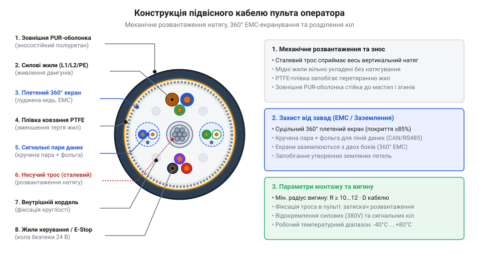
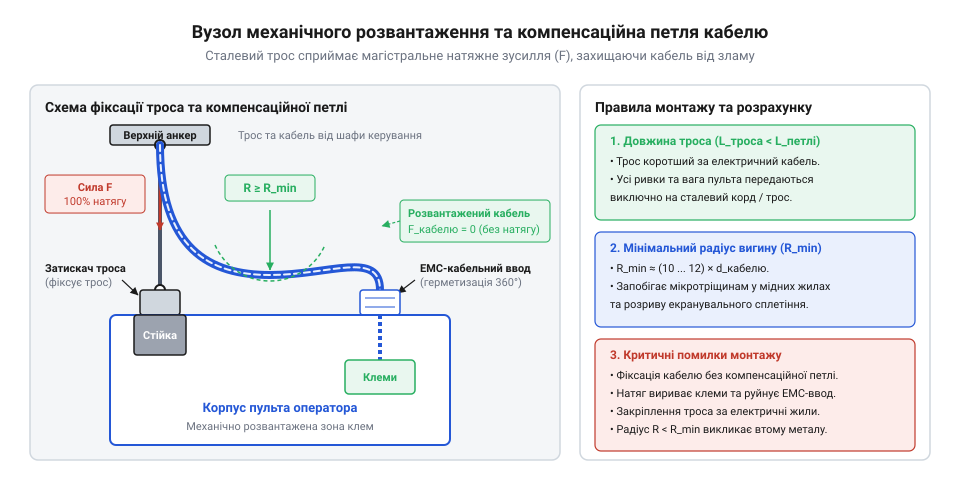
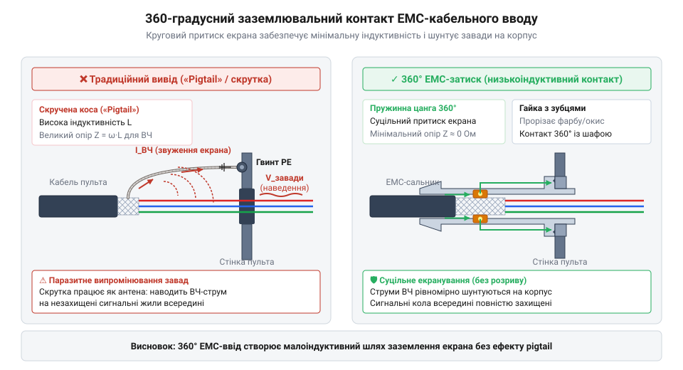
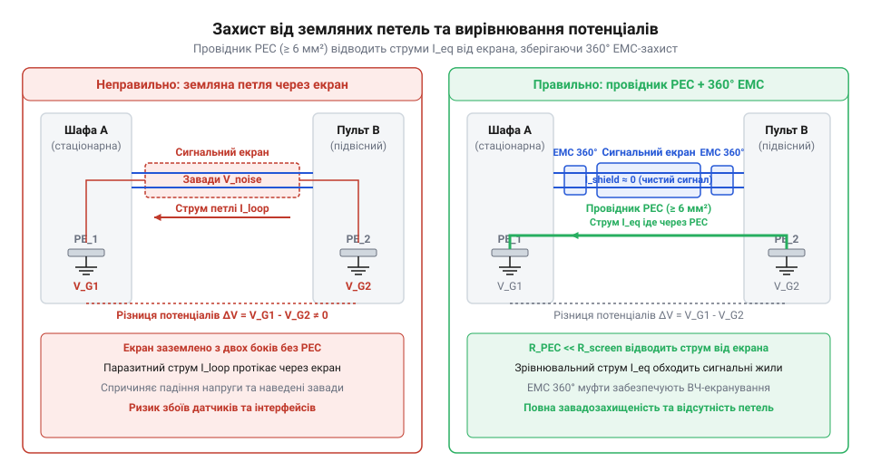
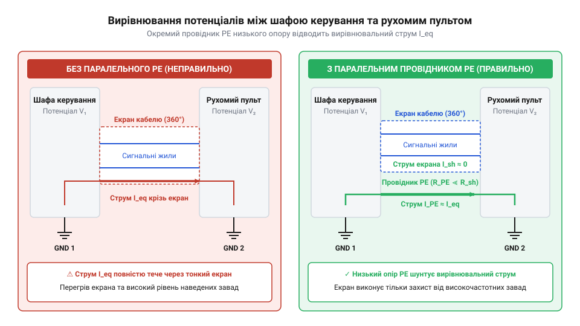

# Кабельні шлейфи та заземлення пультів оператора

<preknowlist>
- [Монтажний провід 18 і 20 AWG](root:cat-hw-parts/hookup-wire) — Класифікація провідників за AWG, структура гнучких баготочкових жил та обмеження по струму.
- [Класи міцності та матеріали кріплення: сталі 8.8–12.9, нержавійка A2/A4, титан Gr5 та задирання різьби](root:cat-hw-parts/fastener-strength-classes-and-materials) — Механічна міцність матеріалів, стійкість кріплення до розтягування та зносу під час затискання тросів.
- [Ізольовані наконечники Faston та технологія обтискання](root:cat-hw-parts/faston-crimp-terminals) — Принципи обтискання клем для створення низькоомного контактного з'єднання в колах заземлення.
</preknowlist>

## Руйнування жил підвісного пульта

У промисловому середовищі підвісні пульти керування мостовими кранами, кран-балками, консольними маніпуляторами та верстатами з ЧПК постійно зазнають жорсткого механічного впливу. Оператор переміщує @@en|підвісний пульт@@ (англ. *pendant*, від лат. *pendere* — звисати) уздовж виробничої дільниці, тягне його за оболонку, прискорює, розгойдує та повертає навколо власної осі. Кабельний шлейф при цьому працює в умовах складеного навантаження: власна вага довгого висячого прольоту створює постійне осьове розтягування, а маневри оператора додають динамічні ривки, багаторазові вигини біля кабельного вводу та кручення. Якщо для підвісу застосувати звичайний контрольний кабель, непристосований до таких умов, деструктивні фізичні процеси всередині джгута розпочнуться вже через кілька тижнів експлуатації.

Головною причиною прихованої відмови провідників є @@en|механічна втома@@ (лат. *fatigatio* — виснаження, англ. *flex fatigue*) мідних жил. Мідь володіє високою пластичністю, проте під дією циклічних мікродеформацій вигину у її кристалічній ґратці накопичуються дислокації. Виникає явище, відоме як @@en|наклеп@@ (англ. *work hardening*) — метал локально втрачає гнучкість, стає крихким і покривається мікротріщинами. Оскільки багатожильний провідник складається з десятків тонких дротин, процес руйнування розгортається поступово. Спочатку лопаються окремі поверхневі елементарні нитки. Переріз жилы зменшується, її електричний опір зростає, а в місці мікрообривів починається локальний нагрів струмом навантаження. Зрештою відбуваються хвилеподібні втрати контакту, що проявляються як спорадичні збої сигналів аварійної зупинки або перезавантаження контролера, а далі — повний фізичний розрив жилы.

Окрім плоских вигинів, серйозну загрозу становить торсійне кручення кабелю. Коли оператор повертає пульт навколо вертикальної осі на 180° або 360°, обертальний момент рівномірно розподіляється вздовж довжини шлейфу. У кабелях із неналежною будовою жил кручення викликає зміщення зовнішніх провідників відносно внутрішніх, що призводить до ефекту «пташиного гнізда» — жили випинаються крізь ізоляцію, утворюючи локальні потовщення та злами.

Ще небезпечнішим наслідком механічного перенапруження кабелю є втрата цілісності кола заземлення та екранування. Захисний провідник PE зазнає таких самих вигинальних навантажень, як і сигнальні лінії. Обрив жилы PE всередині шлейфу не призводить до негайної зупинки обладнання, через що аварійна ситуація тривалий час залишається непоміченою. При пробої фазного провідника на металевий корпус пульта або накопиченні статичного заряду корпус опиняється під високою напругою, створюючи пряму загрозу ураження оператора струмом. Для надійного з'єднання клем заземлення в умовах постійної вібрації використовують [ізольовані наконечники Faston](root:cat-hw-parts/faston-crimp-terminals), які створюють газонепроникний контакт. Водночас руйнування жил екрана призводить до утворення мікроскопічних щілин у плетиві. Через ці прогалини у сигнальні лінії проникають високочастотні завади від імпульсних перетворювачів частоти, що зумовлює хибні спрацьовування датчиків та збої промислових шин даних.

Окрім прямого розтягування жил, у підвісному кабелі діє внутрішнє тертя. Коли джгут згинається, зовнішні жили вимушені долати довший шлях, ніж внутрішні. Якщо жили щільно затиснуті всередині оболонки і не мають можливості вільно зсуватися одна відносно одної, між їхньою ізоляцією виникає колосальне напруження зсуву. Відбувається @@en|перетирання ізоляції@@ (англ. *chafing*) — полімерний шар зношується до оголення міді, викликаючи міжжильні короткі замикання. Крізь виниклі мікротріщини в оболонці всередину джгута проникають мастила та охолоджувальні емульсії, прискорюючи хімічну деградацію первинної ізоляції. Ситуація ускладнюється, якщо корпус кабельного вводу закріплено гвинтами неналежного класу міцності, що описано в матеріалі про [матеріали промислового кріплення](root:cat-hw-parts/fastener-strength-classes-and-materials): ослаблення затискача призводить до того, що вся маса пульта починає висіти безпосередньо на клемній колодці.

Спроби вирішити проблему механічного розвантаження шляхом прив'язування зовнішнього сталевого троса паралельно до звичайного кабелю виявилися неефективними. Про це детально розказано у короткій історичній довідці:

Історично підвісні кнопочні пости підв'язували за допомогою зовнішніх прядив'яних канатів або сталевих тросів, прикріплених хомутами вздовж кабелю. Проте різна жорсткість кабелю та несучого троса призводила до того, що під час маневрів пульта кабель утворював петлі, закручувався навколо троса та інтенсивно перетирався у місцях кріплення хомутів. Це спонукало розробників створити спеціалізовані підвісні шлейфи із самонесучою внутрішньою структурою, де розвантажувальні елементи інтегровані безпосередньо всередину кабельного сердечника, що описано у матеріалі про [еволюцію підвісних кабелів](root:cat-hw-parts/industrial-pendant-cable-harnessing-and-shielding/hist-pendant-cables-evolution.md).

Зрозумівши физичні механізми механічної втоми міді, торсійного деформування, тертя ізоляції та ризики втрати захисного заземлення, інженер має перейти до вивчення внутрішньої архітектури кабелів, спеціально спроектованих для сприйняття цих навантажень.

## Анатомія гнучкого підвісного кабелю

Щоб кабель здатний був витримувати сотні тисяч циклів вигину та сприймати значні осьові зусилля без пошкодження струмопровідних жил, його внутрішня конструкція будується за принципом поділу функцій: механічне навантаження сприймає центральний силовий каркас, а сигнальні та силові жили розміщуються у зоні мінімальних деформацій.


*Поперечний переріз підвісного кабелю з внутрішнім несучим тросом, роздільними силовими і сигнальними крученими парами та зовнішнім плетеним екраном.*

Основою спеціалізованого підвісного кабелю є @@en|центральний несучий елемент@@ (англ. *strain relief core*). Він виконується у вигляді високоміцного сталевого троса в еластичній ізоляції або плетеного арамідного корду (англ. *Kevlar*). Його розташовують чітко по осі симетрії кабелю. Таке розміщення гарантує, що несучий елемент знаходиться на лінії, яка називається @@en|нейтральна вісь@@ (лат. *neutralis* — той, що не належить ні тому, ні іншому) вигину. Під час вигинання кабелю в будь-якому напрямку довжина центральної осі залишається незмінною, тому трос не зазнає розтягування чи стискання від згину, зберігаючи свою повну міцність для сприйняття ваги пульта та динамічних ривків. Арамідний корд володіє колосальною міцністю на розрив при мінімальній вазі та не проводить електричний струм, тоді як сталевий трос забезпечує максимальну стійкість до жорстких ривків, але вимагає обов'язкового надійного заземлення на обох кінцях.

Навколо центрального елемента концентричними шарами укладаються струмопровідні жили. Щоб кабель не закручувався під час вигинів, суміжні шари жил скручують у протилежних напрямках. На відміну від стаціонарних кабелів, де застосовують монолітні або невеликожильні провідники, у підвісних кабелях використовують дрібнодротові гнучкі жили 5-го або 6-го класу гнучкості за стандартом IEC 60228. Детальні характеристики перерізів та допустимих струмів для таких провідників викладені у розділі про [монтажні провідники AWG](root:cat-hw-parts/hookup-wire). Елементарні дротини жили мають вкрай малий діаметр (від 0.05 до 0.10 мм) і скручуються з дуже коротким кроком. Поняття @@en|крок скрутки@@ (англ. *lay length*) визначає осьову довжину, на якій жила робить один повний оберт навколо центральної осі. Короткий крок скрутки дозволяє дротинам легко ковзати та компенсувати внутрішні напруження при вигині. Сигнальні провідники обов'язково об'єднують у @@en|скручені пари@@ (англ. *twisted pairs*), що зменшує взаємні наведення та підвищує @@en|електромагнітна сумісність@@ (від грецьк. *ēlektron* — бурштин, та *Magnētis* — магніт). *elektron*, *magnes* та лат. *compatibilis* — сумісний, англ. *electromagnetic compatibility*, EMC).

Для запобігання внутрішньому тертю між провідниками та оболонкою застосовують роздільні мікропористі плівки з фторопласту або поліестеру, а також заповнення синтетичним тальком. Завдяки цьому жили не злипаються з зовнішньою оболонкою під час вулканізації або екструзії і можуть вільно зміщуватися при вигині кабелю. На відміну від підвісних шлейфів, [гнучкі кабелі для кабель-каналів](root:cat-hw-parts/industrial-drag-chain-cables) оптимізовані лише для лінійного руху в одній площині, тоді як підвісний кабель розрахований на тривимірне просторове згинання та торсійне кручення.

Сигнальний блок джгута захищають за допомогою металевого екрана. У підвісних кабелях суворо заборонено застосовувати суцільну алюмінієву фольгу без плетеного каркаса: при циклічному вигині суцільна фольга швидко покривається зламами і втрачає суцільність. Замість неї застосовують @@en|плетений екран@@ (англ. *braid shield*) з луджених мідних дротин із щільністю оптичного покриття не менше 85%. Плетена структура працює як сітка, яка розтягується та стискається разом із кабелем без руйнування окремих провідників.

Зовнішній захист джгута забезпечує @@en|поліуретан@@ (від грецьк. *polys* — численний, багато). *polys* — багатий, нім. *Urethan*, англ. *polyurethane*, PUR) або термопластичний еластомер (TPE). На відміну від стандартного полівінілхлориду (ПВХ), поліуретанова оболонка володіє винятковою зносостійкістю, стійкістю до мастил, охолоджувальних емульсій та ультрафіолету, а також зберігає еластичність при температурах до -40 °C.


*Вузол фіксації розвантажувального троса в корпусі пульта та вільна компенсаційна петля кабелю.*

Правильний монтаж підвісного кабелю вимагає дотримання технології закріплення несучого елемента. Центральний трос виводять із кабелю всередині пульта та фіксують у спеціальному гвинтовому затискачі на металевому каркасі корпусу. При цьому самі струмопровідні жили повинні мати вільну компенсаційну петлю, щоб будь-яке зовнішнє зусилля натягу припадало виключно на трос, а не на клемні з'єднання.

Критичним параметром при проектуванні траси підвісного кабелю є його мінімальний радіус вигину `R_min`. Обчислення цього значення та перевірка міцності троса виконуються за інженерною методикою:

Значення мінімального радіуса вигину залежить від зовнішнього діаметра кабелю `d_cable` та коефіцієнта динамічної гнучкості `k_flex`:

```
R_min = k_flex × d_cable
      = 12 × 18.0 мм        [для динамічного підвісу приймаємо k_flex = 12]
      = 216 мм              [мінімально припустимий радіус вигину]
```

При цьому допустиме статичне навантаження на внутрішній несучий трос `F_allow` розраховується з урахуванням трикратного запасу міцності `k_safety`:

```
F_allow = F_break / k_safety
        = 4500 Н / 3.0       [де F_break — розривне зусилля троса]
        = 1500 Н             [максимально допустимий робочий натяг]
```

Повний математичний апарат для розрахунку механічних параметрів підвісного кабельного шлейфу подано у матеріалі про [розрахунок радіуса вигину](root:cat-hw-parts/industrial-pendant-cable-harnessing-and-shielding/math-pendant-cable-strain-and-bending-radius.md).

Дотримання розрахованого радіуса вигину та належна фіксація силового троса запобігають передчасному втомному руйнуванню провідників і забезпечують тривалий ресурс роботи підвісного пульта.

## Механічне розвантаження та радіус вигину

Підвісний пульт оператора мостового крана чи кран-балки постійно перебуває в стані статичного розтягу під дією власної ваги та динамічних ривків під час переміщення. Якщо висячий кабель зафіксувати в корпусі пульта лише за зовнішню оболонку або мідні жили, гравітаційне навантаження невпинно розтягуватиме струмопровідні провідники. Мідь має відносно низьку граничну межу плинності (@@en|yield point@@) (від англ. *yield* — плинність, та *point* — точка), тому під дією постійного розтягування жили зазнають пластичної деформації, тоншають, розриваються або вислизають із гвинтових клем. Щоб запобігти механічній руйнації електричних кіл, застосовують вузли механічного розвантаження (@@en|strain relief@@) (від англ. *strain* — натяг, та *relief* — послаблення), які повністю переносять механічну вагу пульта та зусилля натягу з крихких мідних провідників на внутрішній або зовнішній силовий трос.

Історично розвантаження підвісних кабелів пройшло шлях від примітивних зовнішніх сталевих ланцюгів до високотехнологічних кабелів із центральним арамідним або сталевим кордом. Детальний огляд того, як змінювалася конструкція підвісних систем, розкрито в огляді про [еволюцію підвісних шлейфів](root:cat-hw-parts/industrial-pendant-cable-harnessing-and-shielding/hist-pendant-cables-evolution.md). Головний фізичний принцип сучасного розвантажувального вузла полягає в тому, що несучий трос має бути коротшим за електричні жили всередині корпусу пульта. Завдяки цьому під час підвішування пульта силовий трос натягується першим, а мідні жили залишаються у вільній, злегка вигнутій S-подібній формі без жодного механічного натягу.

Розподіл розтягувального зусилля між сталевим несучим елементом та мідними провідниками визначається їхнім модулем пружності Юнга та площею поперечного перерізу. Модуль Юнга для сталі становить близько `210` ГПа, тоді як для міді — лише `110` ГПа. Завдяки значно вищій жорсткості сталевого троса та правильному механічному затисканню понад `95`% усього вагового навантаження сприймає трос:

F_total = F_pendant + F_cable         [сумарна сила ваги пульта та кабелю]
F_steel = F_total * (E_s * A_s / (E_s * A_s + E_c * A_c))  [частка навантаження на сталевий трос]

де `E_s` та `E_c` — модулі Юнга сталі та міді, а `A_s` та `A_c` — відповідні сумарні площі перерізу несучого троса та мідних жил.

Закріплення несучого троса всередині пульта здійснюється за допомогою спеціальних механічних затискачів, коушів та клинових фіксаторів (@@de|Keilklemme@@) (від нім. *Keil* — клин, та *Klemme* — затискач). Сталевий трос виводять із центральної осі кабелю, огинають довкола сталевого коуша й фіксують різьбовими затискачами або обтискною алюмінієвою гільзою. Отриману петлю або кінцевий затискач кріплять безпосередньо до металевого силового шасі пульта, а не до його пластикової декоративної кришки. Для надійного монтажу механічних кронштейнів розвантаження використовують кріплення з відповідними [класами міцності метизів](root:cat-hw-parts/fastener-strength-classes-and-materials), зокрема сталеві болти класу 8.8 або A4, що запобігає зрізу різьби під дією постійних вібрацій. У пластикових або композитних корпусах пультів для фіксації кронштейна троса попередньо вмонтовують міцні [різьбові футорки](root:cat-hw-parts/threaded-inserts-and-heat-set). Якщо пульт працює в умовах сильних ударних навантажень чи розгойдування, силовий трос кріплять до шасі через демпфуючі елементи з [тросовими віброізоляторами](root:cat-hw-parts/wire-rope-isolators).

Другим вирішальним чинником довговічності підвісного кабелю є дотримання мінімально припустимого радіуса вигину `R_min`. Коли кабель згинається, провідники на зовнішньому радіусі вигину зазнають розтягування, а провідники на внутрішньому радіусі — стискання. Якщо радіус вигину занадто малий, зовнішні жили виходять за межі пружної деформації, а внутрішні — вигинаються хвилями та руйнують мікроструктуру фторопластової ізоляції. На відміну від статичних кабелів або джгутів у [гнучких кабель-каналах](root:cat-hw-parts/industrial-drag-chain-cables), де кабель рухається в одній площині, підвісний шлейф зазнає тривимірного вигину та торсійного кручення.

Для розрахунку мінімального радіуса вигину підвісного кабелю використовують співвідношення між його зовнішнім діаметром `D_k` та безрозмірним коефіцієнтом гнучкості `k`:

k = 12                         [коефіцієнт для динамічних підвісних кабелів]
R_min = k * D_k                [формула розрахунку радіуса вигину]

Розглянемо практичний розрахунок для промислового підвісного кабелю із зовнішнім діаметром `D_k = 18.5` мм.

**Розрахунок мінімального радіуса вигину для кабелю D_k = 18.5 мм:**

D_k = 18.5                     [мм, зовнішній діаметр кабелю]
k = 12                         [коефіцієнт динамічного вигину]
R_min = 12 * 18.5
      = 222.0                  [мм, мінімально припустимий радіус вигину]

Отримане значення `R_min = 222` мм означає, що при облаштуванні петлі провисання кабелю біля шафи керування або на вході в пульт діаметр вигину має становити не менше `444` мм. Зменшення цього радіуса призводить до стрімкого накопичення механічної втоми мідних жил. Детальний математичний апарат для розрахунку граничних напружень у провідниках подано в матеріалі про [розрахунок механічних навантажень](root:cat-hw-parts/industrial-pendant-cable-harnessing-and-shielding/math-pendant-cable-strain-and-bending-radius.md).

При укладанні та фіксації кабелю всередині пульта категорично заборонено перетискати його зовнішню поліуретанову оболонку. Звичайні [пластикові хомути](root:cat-hw-parts/cable-ties) під час надмірного затягування створюють точкові концентратори напружень, локально деформують шар екрана та зміщують провідники з нейтральної осі вигину. Кабель повинен затискатися в корпусі через еластичні гумові втулки або розвантажувальні сальники із широкою поверхнею притиску.

## 360-градусне екранування та захист EMC

Промислові підвісні кабелі функціонують у жорстких електромагнітних умовах поруч із силовими кабелями частотно-регульованих приводів (@@en|VFD@@) (від англ. *variable frequency drive* — частотно-регульований привод) та потужними контакторами. Високочастотні імпульсні завади, що виникають під час широтно-імпульсної модуляції приводу, через паразитичні ємності легко наводяться на сигнальні провідники підвісного шлейфу. Для захисту ліній зв'язку та аналогових сигналів застосовують спільне та попарне екранування. Однак ефективність екрана залежить не лише від щільності мідного плетіння, а й від способу його заземлення на кінцях кабелю.

Класичною помилкою під час монтажу екранованого кабелю є згортання плетіння екрана в тонкий джгут — так званий «хвіст» (@@en|pigtail@@) (від англ. *pig* — свиня, та *tail* — хвіст), який підключають до гвинтового клемника заземлення. На низьких частотах таке з'єднання працює задовільно, але на високочастотних завадах (понад `1` МГц) витий @@en|pigtail@@ довжиною лише `5`–`10` см володіє значною власною індуктивністю (близько `1` нГн на кожен міліметр довжини). Через скін-ефект (@@en|skin effect@@) (від англ. *skin* — шкіра, та *effect* — ефект) високочастотний струм витісняється на поверхню провідника, що додатково збільшує опір. Така індуктивність створює високий коефіцієнт передавального імпедансу (@@en|transfer impedance@@) (від лат. *transferre* — переносити, та *impedire* — перешкоджати), через що екран втрачає захисні властивості та починає сам випромінювати високочастотні завади всередині пульта.

Щоб забезпечити мінімальний імпеданс заземлення на високих частотах, плетіння екрана має з'єднуватися з металевим корпусом пульта або шафи керування по всьому периметру на `360` градусів. Для цього застосовують суцільне 360-градусне екранування (@@en|360-degree shield termination@@) за допомогою спеціалізованих металевих сальників.


*Конструкція металевого EMC-кабельного вводу із забезпеченням суцільного 360-градусного контакту екрана з корпусом пульта.*

Як видно з наведеної конструкції, під час затягування нажимної гайки EMC-вводу плетіння екрана рівномірно розщеплюється та притискається конусними металевими кільцями до латунного або нержавіючого корпусу ввода (@@en|EMC cable gland@@) (від англ. *EMC* — електромагнітна сумісність, та *gland* — сальник). Це забезпечує еквіпотенціальний контакт із низьким опором та відсутність індуктивних «хвостів». Правильно дібраний сальник одночасно забезпечує механічне затискання оболонки, герметичність ступеня `IP67` та EMC-захист. Вибір та монтаж [спеціалізованих EMC-вводів](root:cat-hw-parts/emc-glands-and-shield-clamps) здійснюють відповідно до геометричних параметрів плетіння кабелю. З повними технічними параметрами вводів та розводкою жил можна ознайомитися у [специфікації кабельних вводів](root:cat-hw-parts/industrial-pendant-cable-harnessing-and-shielding/api-pendant-harness-pinout-and-emc-gland-specs.md).

Другою критичною проблемою підвісних систем є виникнення паразитних земляних петель (@@en|ground loop@@) (від англ. *ground* — земля, та *loop* — петля). Якщо підвісний пульт має власне заземлення через металеву конструкцію крана, а шафа керування заземлена на загальний контур цеху, між ними виникає різниця потенціалів `ΔU_g`. При двосторонньому заземленні екрана через цей шар починає протікати коефіцієнт зрівнювального струму низької частоти (`50` Гц або гармоніки частотного перетворювача). Зрівнювальний струм розігріває тонке плетіння екрана та наводить диференційні завади на сигнальні жили.

Щоб ліквідувати паразитні струми в екрані й водночас зберегти високу ефективність 360-градусного екранування за завадами EMC, застосовують вирівнювання потенціалів (@@en|equipotential bonding@@) (від лат. *aequus* — рівний, *potentia* — сила, та англ. *bonding* — з'єднання).


*Схема заземлення екрана та паралельного провідника вирівнювання потенціалів для запобігання земляним петлям.*

Для реалізації цієї схеми паралельно з підвісним кабелем (або всередині нього як окрема жила великого перерізу `4`–`6` мм²) прокладають окремий провідник вирівнювання потенціалів `PE`. Цей провідник володіє значно меншим активним опором, ніж плетіння екрана, тому весь зрівнювальний струм низької частоти тече через нього, не перевантажуючи сигнальний екран. Монтаж провідника `PE` на корпус пульта виконують міцними [ізольованими наконечниками](root:cat-hw-parts/faston-crimp-terminals), обтиснутими за технологією холодного опресування. Розрахувати струми в петлях та перевірити здатність екрана поглинати завади можна за допомогою інструментів із [моделюванням передавального імпедансу](root:cat-hw-parts/industrial-pendant-cable-harnessing-and-shielding/math-pendant-shield-transfer-impedance.md). Загальні принципи побудови таких систем розкрито в матеріалі про [системою вирівнювання потенціалів](root:cat-hw-power/equipotential-bonding-in-industrial-cabinets).

Всередині самого пульта керування провідники підвісного шлейфу розводять із дотриманням суворого просторового відокремлення. Силові кола живильних напруг та ліній керування контакторами кріплять окремими джгутами від чутливих цифрових шин. Для комунікаційних інтерфейсів використовують лише [скручені пари](root:cat-hw-parts/jst-gh-cable) з коротким кроком скрутки, а для високошвидкісних ліній даних застосовують екрановані [кабелів Ethernet](root:cat-hw-parts/ethernet-cable). Залишок довжини сигнальних жил під час підключення до плати повинен бути мінімальним. Покрокова процедура оброблення кабелю та фінального випробування джгута описана у керівництві з [практичним монтажем джгута](root:cat-hw-parts/industrial-pendant-cable-harnessing-and-shielding/proj-industrial-pendant-harnessing-assembly.md).

## Вирівнювання потенціалів і земляні петлі

Коли підвісний пульт керування переміщується вздовж мостового крана або автоматизованої лінії на довжину 10–20 метрів, його металевий корпус або несучі елементи опиняються в зоні іншого місцевого заземлення, ніж стаціонарна шафа керування. Навіть незначна різниця потенціалів у кілька десятків або сотень мілівольт між заземлювальною шиною шафи та конструкційним заземленням цеху створює серйозну проблему. Якщо сигнальний кабель має плетений екран, підключений до корпусу шафи та корпусу пульта з обох боків, ця різниця потенціалів замикається в суцільне електричне коло.

Утворюється @@en|ground loop@@ (від англійського *ground* — земля, та *loop* — петля) — закрита гальванічна петля заземлення. У цій петлі безперервно протікає паразитний струм вирівнювання потенціалів з частотою мережі 50 Гц або високочастотними гармоніками від частотно-регульованого приводу (VFD). Протікаючи вздовж плетення екрана, цей струм створює внутрішнє змінне магнітне поле, яке через @@en|transfer impedance@@ (від англійського *transfer* — передача, та *impedance* — імпеданс) наводить напругу завади безпосередньо у внутрішні сигнальні жили (аналогові сигнали 0–10 В, лінії кнопок, інтерфейси RS-485 чи CAN).

Просте рішення — від'єднати екран від заземлення з одного боку — в сучасних промислових умовах виявляється згубним. Одностороннє заземлення екрана ефективне лише проти низькочастотних електричних полів. Проте в умовах інтенсивних високочастотних завад від частотних перетворювачів незаземлений кінець екрана працює як приймальна антена. Для блокування високочастотних випромінювань необхідне повне 360-градусне екранування з двостороннім заземленням екрана через [EMC-кабельні вводи](root:cat-hw-parts/emc-glands-and-shield-clamps).

Щоб вирішити цю суперечність і придушити паразитний струм у земляній петлі без порушення 360-градусного екранування, застосовують @@en|equipotential bonding@@ (від латинського *aequus* — рівний, *potentia* — сила, та англійського *bonding* — з'єднання) — вирівнювання потенціалів за допомогою паралельного захисного провідника.

Поруч із підвісним кабелем або всередині його загальної оболонки прокладають спеціальний додатковий @@en|PE conductor@@ (від англійського *Protective Earth* — захисне заземлення) великого перерізу (щонайменше 4–10 мм²), або з'єднують корпус пульта з конструкцією крана гнучкою мідною шиною. Оскільки омічний та індуктивний опір товстого захисного провідника в десятки разів менший за опір тонкого сітчастого екрана, абсолютна більшість вирівнювального струму спрямовується через захисну шину, оминаючи чутливий екран.

Розподіл паразитного струму вирівнювання потенціалів між екраном та паралельним провідником заземлення описується робастною системою рівнянь імпедансу паралельних віток. Струм ділиться обернено пропорційно повним імпедансам віток:

```
Z_sh = R_sh + j · ω · L_sh                         [повний імпеданс екрана кабелю]
Z_pe = R_pe + j · ω · L_pe                         [повний імпеданс провідника вирівнювання PE]
I_total = U_diff / (Z_sh · Z_pe / (Z_sh + Z_pe))    [загальний струм вирівнювання від різниці потенціалів U_diff]
I_sh = I_total · (Z_pe / (Z_sh + Z_pe))           [струм, що протікає безпосередньо через екран]
I_sh ≈ U_diff · R_pe / (R_sh · R_pe + j · ω · (R_sh · L_pe + R_pe · L_sh))    [підстановка параметрів для високочастотної складової]
```

Де:
- `U_diff` — різниця потенціалів заземлення між шафою та пультним вузлом (В);
- `R_sh` та `L_sh` — активний опір (Ом) та індуктивність (Гн) плетеного екрана;
- `R_pe` та `L_pe` — активний опір (Ом) та індуктивність (Гн) паралельного провідника вирівнювання потенціалів;
- `ω` — кругова частота складової струму завади (рад/с).

З отриманого виразу видно: зменшення активного опору `R_pe` та індуктивності `L_pe` (шляхом збільшення перерізу провідника PE та зменшення його довжини) пропорційно знижує струм `I_sh`, що проходить крізь плетений екран. Детальний математичний аналіз залежностей наведено у матеріалі [передавального імпедансу екрана](root:cat-hw-parts/industrial-pendant-cable-harnessing-and-shielding/math-pendant-shield-transfer-impedance.md).

Для підключення вирівнювального провідника до заземлювальної шини пульта та шафи застосовують надійні [обтискні наконечники Faston](root:cat-hw-parts/faston-crimp-terminals) або кільцеві клеми під болтове з'єднання M6/M8 з зубчастими шайбами, які прорізають анодований чи фарбований шар металу корпуса, забезпечуючи контактний опір менше 0.001 Ом.


*Схема вирівнювання потенціалів між шафою керування та рухомим пультом: паралельний провідник PE перебирає на себе основний струм equalization, захищаючи екран від перегріву та наведення завад.*

При монтажі системи заземлення рухомих пультів необхідно дотримуватись правил [вирівнюванні потенціалів у шафах](root:cat-hw-power/equipotential-bonding-in-industrial-cabinets). Екран кабелю затискається 360-градусним контактом у ввідному сальнику, а провідник вирівнювання потенціалів приєднується до найближчої заземлювальної планки безпосередньо біля вводу. Це повністю усуває @@en|common-mode noise@@ (від англійського *common-mode* — синфазний, та *noise* — шум), запобігаючи збоям мікроконтролерних блоків пульта та спотворенню аналогових сигналів. Точна геометрична розводка систем заземлення описана у [специфікації залізного API](root:cat-hw-parts/industrial-pendant-cable-harnessing-and-shielding/api-pendant-harness-pinout-and-emc-gland-specs.md).

## Розподіл кіл у спільному джгуті

У підвісних кабелях обмежений зовнішній діаметр та жорсткі вимоги до маси змушують компонувати в одному кабельному шлейфі лінії з різними електричними характеристиками. По поруч розташованих жилах можуть проходити силові кола 230/400 В змінного струму для живлення допоміжних приводів або гальм, дискретні кола 24 В постійного струму для кнопок аварійної зупинки (E-Stop), а також надчутливі аналогові сигнали джойстиків (0–10 В, 4–20 мА) чи цифрові шини RS-485 і CAN.

Коли силові провідники комутують індуктивне навантаження (наприклад, розмикання котушки гальма чи пуск двигуна), у них виникає стрімкий стрибок струму з високою швидкістю зміни `di/dt`. Через наявність паразитної ємності та взаємної індуктивності між паралельними жилами кабелю виникає @@en|crosstalk@@ (від англійського *cross* — перехресний, та *talk* — розмова) — перехресна завада. Силовий імпульс наводить у сусідніх сигнальних провідниках короткі сплески напруги амплітудою в кілька вольт. Для цифрової шини це означає втрату кадрів даних, а для аналогового джойстика — хибне спрацьовування або ривок виконаного механізму.

Захист від перехресних завад починається з внутрішньої геометричної структури самого кабелю. У промислових підвісних шлейфах застосовують комбіноване (гібридне) скручування. Сигнальні лінії об'єднуються у @@en|twisted pair@@ (від англійського *twisted* — скручений, та *pair* — пара). Скручування двох провідників із коротким кроком (10–15 мм) забезпечує одинакове наведення зовнішньої завади на обидва дроти. Оскільки приймач сигналу вимірює різницю потенціалів між жилами (диференційний сигнал), наведена синфазна завада взаємно компенсується, усуваючи @@en|common-mode noise@@.

Для особливо чутливих ліній (наприклад, виходи енкодерів чи аналогові важелі) кожна скручена пара оснащується індивідуальним екраном з алюмінізованої фольги — це @@en|individual shield@@ (від англійського *individual* — індивідуальний, та *shield* — екран). Зверху весь джгут покривається загальним плетеним екраном — @@en|overall shield@@ (від англійського *overall* — загальний, та *shield* — екран). Силові жили розміщуються симетрично в зовнішньому або центральному шарі скрутки, щоб їхні магнітні поля взаємно гасили одне одне.

Розрахунок амплітуди наведеної напруги завади від паралельного силового провідника на сигнальне коло здійснюється на основі закону електромагнітної індукції Фарадея та геометрії розташування жил:

```
m_12 = (μ₀ / (2 · π)) · ln(d_2 / d_1)              [питома взаємна індуктивність між паралельними провідниками]
M = m_12 · L                                       [повна взаємна індуктивність на довжині сумісного прокладання L]
U_induced = M · (di_p / dt)                        [наведена напруга завади в сигнальній петлі]
U_induced = (μ₀ · L / (2 · π)) · ln(d_2 / d_1) · (di_p / dt)    [підставивши значення питомої взаємної індуктивності]
```

Де:
- `μ₀` — магнітна стала (4π × 10⁻⁷ Гн/м);
- `L` — довжина паралельного ділянки прокладання силового та сигнального провідників (м);
- `d_1` — відстань від силового провідника до ближчої жили сигнальної пари (м);
- `d_2` — відстань від силового провідника до дальшої жили сигнальної пари (м);
- `di_p / dt` — швидкість зміни струму в силовому колі (А/с).

Отриманий вираз пояснює два критичних правила:
1. Збільшення відстані між силовими та сигнальними провідниками (збільшення `d_1` та зменшення відношення `d_2 / d_1`) логарифмічно зменшує взаємну індуктивність `M`. 2. Використання @@en|twisted pair@@ зближує значення `d_1` та `d_2` до майже однакової величини (`d_2 / d_1 ≈ 1`), через що `ln(1) = 0`, і наведена напруга прямує до нуля.

Всередині корпусу підвісного пульта, де кабель розгалужується на окремі провідники, просторове відокремлення реалізують механічними методами. Силові кола живлення та комутації прокладають вздовж однієї стінки пульта, а сигнальні кола — вздовж протилежної. Мінімальна припустима відстань між паралельними силовими та сигнальними джгутами становить 50–100 мм. Якщо перетин силових і сигнальних ліній неминучий, їх прокладають суворо під кутом 90 градусів: при перпендикулярному розташуванні вектор магнітного поля силового провідника паралельний площині сигнальної петлі, що робить взаємну індуктивність рівною нулю (`M = 0`).

Для внутрішнього розведення застосовують якісний [монтажний провід 18 AWG](root:cat-hw-parts/hookup-wire) із термостійкою PVC або фторопластовою ізоляцією. Фіксацію джгутів виконують за допомогою [пластикових хомутів](root:cat-hw-parts/cable-ties), а для захисту від перетирання на гострих ребрах корпусу застосовують [органайзер кабелів](root:cat-hw-parts/cable-organizer).


*Конструкція комбінованого підвісного джгута: симетричне розміщення силових фаз знижує зовнішнє магнітне поле, а індивідуальні екрани сигнальних пар запобігають перехресним наведенням.*

На клемниках та платах пульта розділення кіл підтримується фізичними бар'єрами. Для сильних струмів використовують надійні [силові роз'єми XT](root:cat-hw-parts/xt-connectors), тоді як для сигнальних ліній кнопок та джойстиків застосовують [сигнальні роз'єми JST-SM](root:cat-hw-parts/jst-sm-connectors) або планарні з'єднувачі зі знімними фіксаторами.

При виборі кабелю для екстремальних умов експлуатації орієнтуються на стандарти, описані у статті про [гнучких кабелях для треків](root:cat-hw-parts/industrial-drag-chain-cables). Покрокову процедуру розробки, розділення жил та розпаювання підвісного джгута описано у матеріалі [практичний монтаж джгута](root:cat-hw-parts/industrial-pendant-cable-harnessing-and-shielding/proj-industrial-pendant-harnessing-assembly.md).