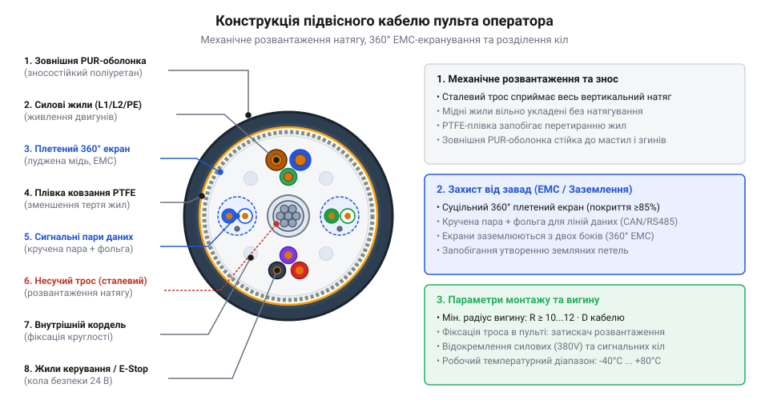
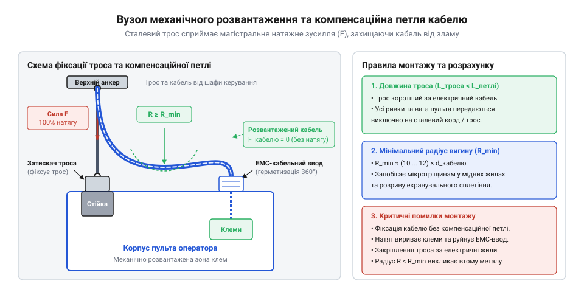
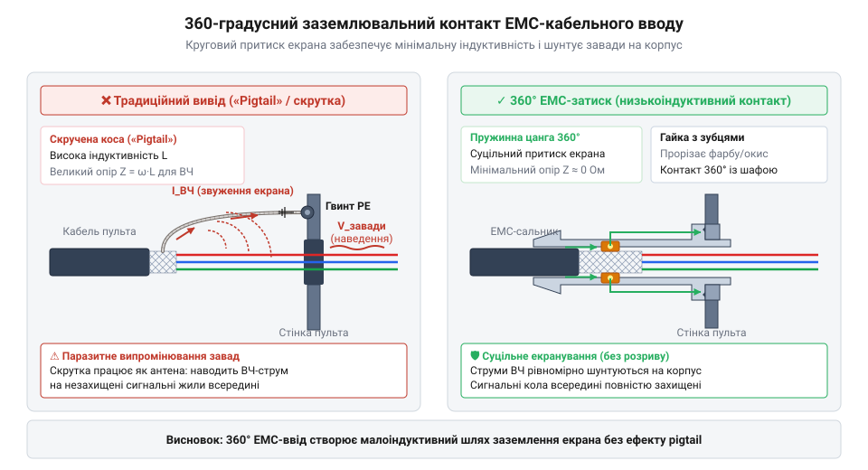
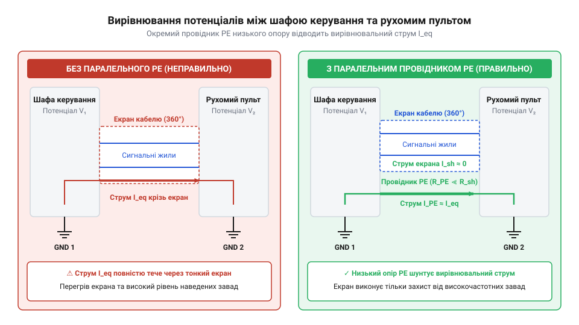

# Кабельні шлейфи та заземлення пультів оператора

<preknowlist>
- [Монтажний провід 18 і 20 AWG](root:cat-hw-parts/hookup-wire) — класифікація провідників за AWG, структура гнучких багатодротових жил та обмеження по струму
- [Класи міцності та матеріали кріплення: сталі 8.8–12.9, нержавійка A2/A4, титан Gr5 та задирання різьби](root:cat-hw-parts/fastener-strength-classes-and-materials) — механічна міцність кріпильних матеріалів, стійкість до розтягування та зносу під час затискання тросів
- [Ізольовані наконечники Faston та технологія обтискання](root:cat-hw-parts/faston-crimp-terminals) — принципи обтискання клем для створення низькоомного контактного з'єднання в колах заземлення
</preknowlist>

## Руйнування жил підвісного пульта

Підвісний пульт (англ. @@en|pendant@@, від *pendant* — підвісний) керування краном чи маніпулятором під'єднано гнучким кабелем, який під час роботи зазнає комбінованого навантаження: циклічного згинання, кручення та осьового розтягування під власною вагою й масою пристрою.

Звичайний контрольний кабель швидко виходить з ладу в таких умовах. При кожному вигині мідні дротини жил зазнають знакозмінних напружень стискання та розтягування. У кристалічній ґратці накопичуються дислокації, спричиняючи втомне руйнування (англ. @@en|flex fatigue@@) та локальний наклеп (англ. @@en|work hardening@@). Мідь втрачає пластичність, у дротинах з'являються мікротріщини, що призводить до спорадочних втрат контакту та плаваючих помилок приводу.

Через взаємний зсув провідників відбувається перетирання (англ. @@en|chafing@@) первинної ізоляції. Найбільших деформацій зазнають віддалені від центра кабелю шари — плетений екран та провідник заземлення PE. Пошкодження лінії PE створює загрозу ураження струмом, а руйнування екрана відкриває шлях високочастотним завадам. Захист підвісних кіл вимагає спеціалізованого підвісного джгута з внутрішнім силовим каркасом.

## Анатомія гнучкого підвісного кабелю

Будова підвісного кабелю повністю відокремлює механічні навантаження від провідників.


*Анатомія підвісного кабелю: силовий сердечник вздовж нейтральної осі сприймає навантаження, а жили захищені від тертя.*

Центральний силовий сердечник (англ. @@en|strain relief core@@) із кевлару чи сталі розташовано вздовж нейтральної осі (англ. @@en|neutral axis@@) вигину. Оскільки деформація матеріалу тут дорівнює нулю, сердечник сприймає вагу пульта, повністю розвантажуючи провідники.

Гнучкі мідні жили 5-го класу ([монтажні провідники AWG](root:cat-hw-parts/hookup-wire)) укладають з коротким кроком скрутки (англ. @@en|lay length@@) та зміною напрямку шарів. Синтетичні плівки запобігають @@en|chafing@@ ізоляції, плетений екран (англ. @@en|braid shield@@) щільністю від 85% пригнічує завади, а оболонка з поліуретану PUR захищає кабель від зношування.

## Механічне розвантаження та радіус вигину

Перевищення межі плинності (англ. @@en|yield point@@, від англ. *yield* — плинність та *point* — межа) незворотно деформує мідь. Щоб захистити жили, натяг від маси пульта передають на шасі через вузли механічного розвантаження (англ. @@en|strain relief@@, від англ. *strain* — навантаження та *relief* — розвантаження).


*Схема механічного розвантаження: несучий трос зафіксований коротше за жили на силовому шасі пульта, утворюючи компенсаційну петлю всередині корпусу.*

Несучий трос фіксують коротшим за провідники, застосовуючи надійні [класи міцності кріплення](root:cat-hw-parts/fastener-strength-classes-and-materials) із 5-кратним запасом міцності. Жили утворюють вільну компенсаційну петлю без осьового натягу. Затискати їх [пластиковими кабельними хомутами](root:cat-hw-parts/cable-ties) заборонено через небезпеку концентрації напружень.

Мінімальний допустимий радіус вигину `R_min` розраховують через діаметр кабелю `d_cable` та коефіцієнт гнучкості `k_flex` (`k_flex ≈ 10..12` у русі):

```
R_min = k_flex · d_cable
```

## 360-градусне екранування та захист EMC

Перемикання силових ключів частотно-регульованого приводу (англ. @@en|VFD@@) створює високочастотні завади. Традиційне заземлення екрана витим хвостом (англ. @@en|pigtail@@, від *pig* — порося та *tail* — хвіст) зводить нанівець захист сигнальних ліній.


*Електромагнітна ефективність: pigtail випромінює завади через високу індуктивність, тоді як EMC-сальник забезпечує низькоомний круговий контакт із корпусом.*

Витий хвіст має власну індуктивність (`L_pig ≈ 10..20 nH/cm`). На високих частотах скін-ефект (англ. @@en|skin effect@@) та індуктивний опір збільшують передавальний імпеданс (англ. @@en|transfer impedance@@) `Z_t = V_noise / I_shield` у сотні разів, і pigtail починає випромінювати завади на сигнальні жили.

Суцільне 360-градусне заземлення (англ. @@en|360-degree shield termination@@) через ЕМС-сальник (англ. @@en|EMC cable gland@@) усуває завади. Латунне кільце охоплює екран по всьому периметру, забезпечуючи низькоомний контакт з корпусом, герметичність IP67 та механічне розвантаження.

## Вирівнювання потенціалів і земляні петлі

Рознесення точок заземлення шафи керування та крана викликає різницю потенціалів `ΔV_PE` через блукаючі струми. Заземлення екрана з обох боків замикає земляну петлю (англ. @@en|ground loop@@, від англ. *ground* — земля та *loop* — петля).


*Придушення земляних петель: паралельний провідник вирівнювання потенціалів PE великого перерізу шунтує плетений екран, відводячи зрівнювальні струми від сигнальних жил.*

Зрівнювальний струм `I_loop = ΔV_PE / Z_shield` (50 Hz) протікає через петлю та індукує синфазну заваду (англ. @@en|common-mode noise@@, від англ. *common-mode* — синфазний та *noise* — завада) на сигнальних жилах. Для її придушення застосовують вирівнювання потенціалів (англ. @@en|equipotential bonding@@, від англ. *equipotential* — рівнопотенціальний та *bonding* — з'єднання).

Паралельно кабелю прокладають окремий провідник PE перерізом 4–6 мм². Оскільки його опір значно нижчий (`Z_PE << Z_shield`), струм відгалужується у PE, шунтуючи екран. Для підключення PE застосовують клемні з'єднання з використанням [ізольованих наконечників Faston](root:cat-hw-parts/faston-crimp-terminals).

## Просторовий розподіл кіл у джгуті

Паралельне прокладання силових ланцюгів та чутливих сигнальних ліній викликає перехресні наводки (англ. @@en|crosstalk@@, від англ. *cross* — перехресний та *talk* — розмова) через взаємну індуктивність `M`. Зміна струму `dI/dt` у силових жилах індукує заваду `V_noise = M · (dI/dt)`.


*Конструкція гібридного підвісного джгута: силові жили прокладені окремо, а сигнальні лінії об'єднані у скручені пари з індивідуальними екранами.*

Для захисту кіл дотримуються трьох правил:

1. **Скручені пари з індивідуальними екранами:** Сигнальні лінії об'єднують у скручені пари (англ. @@en|twisted pair@@, від *twisted* — вита та *pair* — пара). Скручування компенсує синфазну заваду, а індивідуальний екран (англ. @@en|individual shield@@) блокує ємнісний зв'язок. 2. **Просторове відокремлення:** Силові та сигнальні джгути всередині пульта розносять по окремих каналах, а в точках перетину орієнтують під кутом 90° для мінімізації `M`. 3. **Захист розведення:** Силові кола підключають через [силові роз'єми XT](root:cat-hw-parts/xt-connectors), а провідники захищають обгортками від перетирання об кромки корпусу.